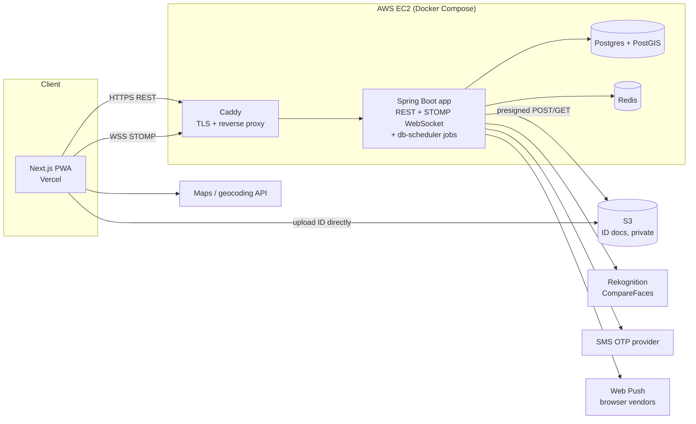
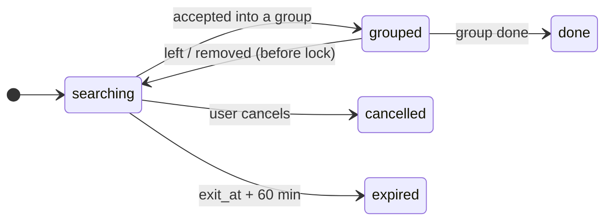
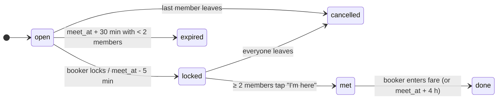

# Ubery — Design Doc v0.0.2

> Connect passengers landing at Delhi IGI around the same time, heading the same way, so they can share one cab.
> We **only connect**. Booking happens in Uber/Ola by one group member. Money moves between users (UPI), never through us.

Status: draft · Owner: Keshav (dev) · Team: 1 PM, 2 devs · Scope: web (PWA), Delhi IGI only

**Changes from v0.0.1:** backend moved from NestJS (TypeScript) to **Spring Boot (Java 21)**. Background jobs move from BullMQ to **db-scheduler** (Postgres-backed), realtime from Socket.IO to **Spring WebSocket + STOMP**, and the separate worker process is gone. Product scope, data model, API and safety rules are unchanged.

---

## 1. Product scope

### 1.1 Core loop (the only thing v1 must do well)

1. Sign up with phone OTP.
2. Create a **trip request**: terminal, flight no., when I'll be outside, where I'm going, seats, bags, women-only?
3. See **ranked matches**: open groups / other travellers going my way within ±30 min.
4. Request to join → members accept → **group chat** opens.
5. Group locks at meet time, meets at the terminal pickup point, one person (the **booker**) books Uber/Ola with multiple stops.
6. After the ride: booker enters the actual fare → app shows each person's share + UPI pay link → rate each other.

### 1.2 In v1 / not in v1

| In v1 | Later | Never (by decision) |
|---|---|---|
| Phone OTP login | Live flight status API | Booking rides |
| Trip requests + ranked matches | Auto-matching (no manual join) | Handling payments |
| Groups, join requests, group chat | Masked calling | Driver side |
| ID verification (manual review + face match) | Other airports | |
| Women-only groups | Native mobile apps | |
| Web push notifications | Ratings-based ranking | |
| Fare split + UPI deep links | | |
| Report / block, SOS (112) | | |
| Admin panel for ID review | | |

### 1.3 Delhi-specific notes

- IGI has **T1, T2, T3**. Pickup zones differ per terminal. PM to physically confirm the app-cab pickup spots and record them (`terminals.pickup_note`). Don't guess these.
- **Competitor that matters: Airport Express metro line.** It's cheap and fast to central Delhi / Dwarka. Our sweet spot is where the metro is painful: **Gurugram, Noida, Faridabad, South/East Delhi** — far, expensive solo cabs, big savings when split.
- Store all times as UTC (`timestamptz`), display in IST.

### 1.4 Success metrics (PM owns)

- **Match rate**: % of trip requests that end in a locked group of ≥ 2. This is the only number that matters early.
- Time to first match, no-show rate, % verified users, report rate.

---

## 2. High-Level Design

### 2.1 Architecture: modular monolith



**Why a modular monolith, not microservices:** 2 devs. Microservices would add network calls, deploys and distributed debugging with zero benefit at this scale. Modules have hard boundaries (each owns its tables, talks to others via services/events), so any one can be split out later. This is the answer to give in interviews.

**The statement, explained:**
- **"2 devs"**: microservices mainly solve *team* problems, like 50 engineers getting in each other's way. With 2 developers, that problem doesn't exist.
- **"Network calls, deploys, distributed debugging"**: these are the costs you'd pay. Every call between parts could fail, you'd run many pipelines, and finding a bug means following it across services.
- **"Zero benefit at this scale"**: one EC2 instance handles Ubery's load easily. There's nothing to scale separately yet.
- **"Hard boundaries, can be split out later"**: because each module owns its tables and only talks through a defined interface, you could later pull out, say, `chat` into its own service without rewriting everything else.
- **Interview version:** "I chose a modular monolith because microservices solve team-scale and independent-scaling problems we don't have. Their operational cost is real from day one. Clean module boundaries keep the option to split later."

**One process.** REST, WebSocket and background jobs all run in one Spring Boot app. Jobs are stored in Postgres by db-scheduler, which is cluster-safe, so running a second instance later won't run a job twice.

**Module boundaries are enforced, not just promised:** Spring Modulith runs a test (`ApplicationModules.of(UberyApp.class).verify()`) that fails the build if one module reaches into another's internals. Modules talk through public service interfaces or Spring application events (e.g. `GroupLocked` → `notifications` sends a push). This turns "modular monolith" from a claim into something you can show in the code.

### 2.2 Modules

| Module | Owns | Does |
|---|---|---|
| `auth` | `sessions`, OTP keys in Redis | OTP request/verify, JWT access + refresh rotation |
| `users` | `users`, `blocks` | Profile, UPI ID, public profile view |
| `verification` | `verifications` | Presigned upload, face match job, admin approve/reject, doc deletion |
| `trips` | `trip_requests`, `terminals` | Create/update/cancel trip request |
| `matching` | — (pure logic + queries) | Candidate search + ranking |
| `groups` | `groups`, `group_members` | Join requests, accept, lock, leave, no-show, state machine |
| `chat` | `messages` | Group messages, system messages, live location (Redis, TTL) |
| `notifications` | `push_subscriptions` | Web Push + in-app WebSocket events |
| `feedback` | `ratings`, `reports` | Post-ride rating, report, block |
| `admin` | — | Verification queue, reports queue, ban |

### 2.3 Tech stack (and why each piece earns its place)

| Layer | Choice | Why |
|---|---|---|
| Repo | Monorepo: `apps/web` (pnpm), `apps/api` (Maven) | One repo, two toolchains, one CI |
| Frontend | Next.js (App Router) + TypeScript + Tailwind, PWA (manifest + service worker) | Installable, push notifications, one codebase for mobile web |
| Map UI | Leaflet + OpenStreetMap tiles | Free; we only show pins and a meet point |
| Geocoding / autocomplete | Ola Maps or Google Places (pick by free tier — **verify pricing**) | India address quality matters for destination entry |
| Backend | **Java 21 + Spring Boot**, built with Maven | Industry-standard backend; DI, Security, Data, WebSocket all built in |
| Module boundaries | Spring Modulith | Verifies module boundaries in a test; in-process events between modules |
| Virtual threads | `spring.threads.virtual.enabled=true` | Java 21 feature: blocking code (JDBC, S3 calls) without tying up OS threads |
| API contract | springdoc-openapi → `openapi-typescript` generates frontend types | Replaces the shared Zod package: Java is the source of truth, TS types are generated |
| Validation | Jakarta Bean Validation (`@Valid`, `@NotNull`, `@Size`) on the API; Zod in frontend forms | Server always validates; client validation is only for UX |
| Auth | Spring Security + OAuth2 Resource Server (JWT decode) | No hand-written JWT parsing |
| DB | PostgreSQL 16 + **PostGIS** | Geo queries (`ST_DWithin`, distance), transactions for seat-taking races |
| Data access | Spring Data JPA + Hibernate Spatial (JTS `Point`), native SQL for geo queries | Entities for CRUD, plain SQL where it's clearer |
| Migrations | Flyway (`V1__init.sql` = the DDL in §3.1) | Plain SQL migrations, versioned with the code |
| Cache | Redis (Spring Data Redis) | OTPs, rate limits, ephemeral live location |
| Realtime | Spring WebSocket + STOMP; frontend uses `@stomp/stompjs` | Topics per group, user queues, auth via channel interceptor |
| Jobs | db-scheduler (one-time tasks stored in Postgres) | Delayed jobs (expire trip at T+60 min), retries, cluster-safe; no extra infra |
| Object storage | S3 (private bucket), AWS SDK for Java v2 + `S3Presigner` | ID documents, auto-deleted |
| Face match | AWS Rekognition `CompareFaces` | ID photo vs selfie; costs fractions of a cent per call |
| Push | Web Push (VAPID) via the `web-push` Java library | Free. iOS needs PWA installed to home screen (iOS 16.4+) |
| Tests | JUnit 5 + AssertJ (unit), Spring Boot Test + Testcontainers `postgis/postgis` (integration), Playwright (e2e) | Matching logic and concurrency get real tests |
| Code style | Spotless (google-java-format) in Maven; ESLint + Prettier for web | Enforced in CI |
| CI/CD | GitHub Actions → build image → GHCR → SSH deploy to EC2 | Free for this scale |
| Infra as code | Terraform (EC2, SG, S3, IAM, budget alarm) — phase 3 | Small, real, resume-worthy |
| Observability | Spring Boot Actuator + Micrometer, JSON logs (logstash-logback-encoder), Sentry free tier; OpenTelemetry later | |
| Load test | k6 — phase 3 | Gives real numbers for the resume ("X concurrent sockets on a t4g.small") |

**Why Java + Spring Boot (v0.0.2 decision):** shows core Java (OOP, interfaces, collections, concurrency, Java 21 features) in the most important layer of the system, and Spring Boot is the most common backend stack in Indian hiring. Cost: the frontend stays TypeScript, so the team works in two languages; the OpenAPI-generated types keep the two sides in sync.

### 2.4 AWS budget (~$100 credits)

Use AWS only where it adds value: **EC2, S3, Rekognition**. Approximate monthly (check the AWS pricing calculator):

| Item | ~USD/month |
|---|---|
| EC2 t4g.small (2 GB, ARM) running everything in Docker | ~12 |
| EBS 20 GB gp3 | ~2 |
| Public IPv4 | ~3.6 |
| S3 + Rekognition at demo volume | < 1 |
| **Total** | **~18 → ~5 months of credits** |

Rules:
- **Develop locally with Docker Compose.** Only run EC2 when demoing/testing; stop it otherwise.
- **Do not create:** NAT Gateway, ALB, RDS, ElastiCache, EKS. Each one alone eats the credits in months.
- **Set AWS Budgets alerts at $10 / $25 / $50 on day one.**
- Frontend on Vercel Hobby (free). Hobby is non-commercial — move off it when this becomes a business.
- Nightly `pg_dump` → S3 (host cron on the EC2 instance). The DB lives on the instance; this is the backup.
- **JVM memory:** the JVM, Postgres and Redis share 2 GB. Cap the heap (`-Xmx512m`) and check real usage. If it's tight, move to t4g.medium (4 GB, roughly double the EC2 cost → ~3 months of credits).

---

## 3. Low-Level Design

### 3.1 Data model (Postgres)

```sql
create extension if not exists postgis;
create extension if not exists pgcrypto;

create type verification_status as enum ('unverified','pending','verified','rejected');
create type gender              as enum ('female','male','other');
create type trip_status         as enum ('searching','grouped','cancelled','expired','done');
create type group_status        as enum ('open','locked','met','done','cancelled','expired');
create type member_status       as enum ('requested','accepted','declined','left','removed','no_show');

create table users (
  id            uuid primary key default gen_random_uuid(),
  phone         text not null unique,              -- E.164, +91XXXXXXXXXX
  name          text not null,
  gender        gender,                            -- set ONLY by admin from the verified ID
  verification  verification_status not null default 'unverified',
  verified_at   timestamptz,
  upi_id        text,                              -- optional, shown only to group members
  role          text not null default 'user' check (role in ('user','admin')),
  rating_sum    int not null default 0,
  rating_count  int not null default 0,
  no_show_count int not null default 0,
  banned_at     timestamptz,
  created_at    timestamptz not null default now()
);

create table sessions (                            -- refresh tokens, rotated on every use
  id           uuid primary key default gen_random_uuid(),
  user_id      uuid not null references users on delete cascade,
  token_hash   text not null unique,               -- sha256 of refresh token, never the token
  expires_at   timestamptz not null,
  revoked_at   timestamptz,
  created_at   timestamptz not null default now()
);

create table verifications (
  id              uuid primary key default gen_random_uuid(),
  user_id         uuid not null references users on delete cascade,
  doc_type        text not null check (doc_type in ('passport','driving_licence','voter_id','masked_aadhaar')),
  doc_key         text,                            -- S3 key; NULLed once the file is deleted
  selfie_key      text,
  face_similarity real,                            -- from Rekognition, 0..100
  doc_last4       text,                            -- the only document number we keep
  status          verification_status not null default 'pending',
  reviewed_by     uuid references users,
  reviewed_at     timestamptz,
  reject_reason   text,
  created_at      timestamptz not null default now()
);

create table terminals (
  id           text primary key,                   -- 'DEL-T1', 'DEL-T2', 'DEL-T3'
  airport      text not null,                      -- 'DEL'
  name         text not null,
  pickup       geography(point, 4326) not null,
  pickup_note  text                                -- filled by PM after visiting
);

create table trip_requests (
  id          uuid primary key default gen_random_uuid(),
  user_id     uuid not null references users,
  terminal_id text not null references terminals,
  flight_no   text,                                -- informational in v1
  exit_at     timestamptz not null,                -- when they expect to be outside
  dest        geography(point, 4326) not null,     -- exact; never sent to other users
  dest_area   text not null,                       -- 'DLF Phase 3, Gurugram' — what others see
  solo_km     real not null,                       -- pickup → dest, computed on create
  seats       smallint not null default 1 check (seats between 1 and 3),
  bags        smallint not null default 1 check (bags between 0 and 6),
  women_only  boolean not null default false,
  status      trip_status not null default 'searching',
  created_at  timestamptz not null default now()
);
create unique index trip_one_active   on trip_requests (user_id) where status in ('searching','grouped');
create index        trip_search       on trip_requests (terminal_id, exit_at) where status = 'searching';
create index        trip_dest_gist    on trip_requests using gist (dest);

create table groups (
  id           uuid primary key default gen_random_uuid(),
  terminal_id  text not null references terminals,
  meet_at      timestamptz not null,               -- max(exit_at) of accepted members
  women_only   boolean not null,
  status       group_status not null default 'open',
  capacity     smallint not null default 4,
  seats_taken  smallint not null default 0,
  bags_taken   smallint not null default 0,
  booker_id    uuid references users,
  fare_total   numeric(10,2),                      -- entered by booker after the ride
  created_at   timestamptz not null default now(),
  check (seats_taken <= capacity)
);
create index groups_open on groups (terminal_id, meet_at) where status = 'open';

create table group_members (
  group_id    uuid not null references groups on delete cascade,
  user_id     uuid not null references users,
  trip_id     uuid not null references trip_requests,
  status      member_status not null default 'requested',
  share       numeric(10,2),                       -- computed fare share
  created_at  timestamptz not null default now(),
  primary key (group_id, user_id)
);

create table messages (
  id          bigint generated always as identity primary key,
  group_id    uuid not null references groups on delete cascade,
  user_id     uuid references users,               -- NULL for system messages
  kind        text not null default 'text' check (kind in ('text','system')),
  body        text not null check (length(body) <= 1000),
  created_at  timestamptz not null default now()
);
create index messages_by_group on messages (group_id, id);

create table ratings (
  group_id  uuid not null references groups,
  rater_id  uuid not null references users,
  ratee_id  uuid not null references users,
  score     smallint not null check (score between 1 and 5),
  primary key (group_id, rater_id, ratee_id)
);

create table reports (
  id          uuid primary key default gen_random_uuid(),
  reporter_id uuid not null references users,
  reported_id uuid not null references users,
  group_id    uuid references groups,
  reason      text not null,
  status      text not null default 'open' check (status in ('open','actioned','dismissed')),
  created_at  timestamptz not null default now()
);

create table blocks (
  blocker_id uuid not null references users,
  blocked_id uuid not null references users,
  primary key (blocker_id, blocked_id)
);

create table push_subscriptions (
  id         uuid primary key default gen_random_uuid(),
  user_id    uuid not null references users on delete cascade,
  endpoint   text not null unique,
  keys       jsonb not null,
  created_at timestamptz not null default now()
);
```

### 3.2 State machines





Every transition is a single SQL `update ... where status = '<from>'` so invalid transitions affect 0 rows and fail loudly. Each transition posts a `system` message to the chat and publishes a WebSocket event.

### 3.3 Matching

**Inputs:** new or updated trip `T`. **Output:** top 5 open groups + top 5 searching travellers to start a group with.

**Step 1 — candidate SQL (cheap, uses indexes):**

```sql
-- open groups T could join
select g.*
from groups g
where g.terminal_id = $terminal
  and g.status = 'open'
  and g.meet_at between $exit_at - interval '30 min' and $exit_at + interval '30 min'
  and g.capacity - g.seats_taken >= $seats
  and (g.women_only = false or $t_is_verified_female)
  and (not $t_women_only or g.women_only)
  and exists (                                      -- at least one member heading near T
    select 1 from group_members m join trip_requests tr on tr.id = m.trip_id
    where m.group_id = g.id and m.status = 'accepted'
      and st_dwithin(tr.dest, $dest, 15000))        -- 15 km
  and not exists (                                  -- nobody in the group blocked/was blocked by T
    select 1 from group_members m join blocks b
      on (b.blocker_id = m.user_id and b.blocked_id = $user)
      or (b.blocked_id = m.user_id and b.blocker_id = $user)
    where m.group_id = g.id);
```

**Step 2 — rank in code (pure function, fully unit-tested):**

```java
// apps/api/src/main/java/com/ubery/matching/MatchRanker.java
// No Spring, no DB: plain Java so it is trivial to unit test.
final class MatchRanker {
  // shortcut: straight-line km × ROAD_FACTOR instead of real routing; see Proposed Stash idea 1 for real road distances.
  static final double ROAD_FACTOR = 1.4;

  record Point(double lat, double lng) {}
  record Trip(Point dest, int seats, int bags, Instant exitAt, double soloKm) {}
  record Candidate(UUID groupId, List<Trip> members, Instant meetAt) {}
  record Ranked(UUID groupId, double extraKm, double score) {}

  static double routeKm(Point pickup, List<Point> drops) {
    // greedy: always go to the nearest remaining drop. Fine for ≤ 4 drops.
  }

  static double extraKmFor(Point pickup, Candidate g, Trip t) {
    // routeKm(pickup, g drops + t.dest) - routeKm(pickup, g drops)
  }

  static boolean acceptable(Point pickup, Candidate g, Trip t) {
    // nobody (including T) rides more than max(3 km, 25%) beyond their solo trip
    // bags: sum ≤ 4 for a sedan
  }

  static List<Ranked> rank(Point pickup, Trip t, List<Candidate> candidates) {
    return candidates.stream()
        .filter(g -> acceptable(pickup, g, t))
        .map(g -> {
          double extra = extraKmFor(pickup, g, t);
          long minutes = Math.abs(Duration.between(g.meetAt(), t.exitAt()).toMinutes());
          return new Ranked(g.groupId(), extra, extra + 0.2 * minutes); // lower is better
        })
        .sorted(Comparator.comparingDouble(Ranked::score))
        .limit(5)
        .toList();
  }
}
```

**Step 3 — notify the other side.** When `T` is created, a `match.notify` job runs the reverse query: which *searching* users would have `T` in their top 5? Send them a push: "Someone heading to Gurugram lands 10 min after you."

**Why suggestions + consent instead of auto-assign:** safety. Users see verified badge, rating, first name and area before choosing. Auto-assign is phase 3, once there's trust data.

**Why PostGIS and not H3/geohash:** with one airport and a few hundred concurrent trips, `ST_DWithin` on a GiST index is instant. H3 is worth it only if we precompute pools across many airports — note it as a future option, don't build it.

### 3.4 Concurrency: two people taking the last seat

Join acceptance is one atomic statement, no locks held across requests:

```sql
update groups
set seats_taken = seats_taken + $seats, bags_taken = bags_taken + $bags
where id = $group and status = 'open'
  and seats_taken + $seats <= capacity
returning *;
```

0 rows → "group just filled up". Run it in the same `@Transactional` method that sets `group_members.status = 'accepted'` and `trip_requests.status = 'grouped'` (a `@Modifying` native query in the repository). The `check (seats_taken <= capacity)` constraint is the last line of defence.

**Write an integration test that fires 10 concurrent accepts at a 1-seat group and asserts exactly 1 succeeds.** In Java: an `ExecutorService` with 10 threads, a `CountDownLatch` so they all start at once, and an `AtomicInteger` counting successes, against a real Postgres from Testcontainers.

Interview follow-up worth knowing: the alternatives are JPA optimistic locking (`@Version` column, retry on `OptimisticLockException`) or pessimistic locking (`SELECT ... FOR UPDATE`). The conditional `UPDATE` is simpler than both here because the whole check-and-change fits in one statement.

### 3.5 REST API (v1)

All under `/api/v1`, JSON, auth via `Authorization: Bearer <access JWT>`.

| Method & path | Purpose |
|---|---|
| `POST /auth/otp` `{phone}` | Send OTP |
| `POST /auth/verify` `{phone, code}` | → access token (15 min) + refresh token in `httpOnly; Secure; SameSite=Lax` cookie (30 days) |
| `POST /auth/refresh` | Rotate refresh token; reuse of an old one revokes all sessions |
| `POST /auth/logout` | Revoke session |
| `GET/PATCH /me` | Own profile (name, UPI ID) |
| `GET /users/:id` | Public profile: first name, verified badge, rating, ride count |
| `POST /verification/upload-urls` | Presigned POSTs for doc + selfie |
| `POST /verification` `{docType, docKey, selfieKey}` | Submit for review |
| `GET /terminals` | T1/T2/T3 + pickup info |
| `POST /trips` | Create trip request |
| `PATCH /trips/:id` | Update `exit_at` (flight delayed) |
| `DELETE /trips/:id` | Cancel |
| `GET /trips/:id/matches` | Ranked groups + travellers |
| `POST /groups` `{tripId, inviteTripId?}` | Start a group (optionally inviting a traveller) |
| `POST /groups/:id/join` `{tripId}` | Request to join |
| `POST /groups/:id/members/:userId/accept` / `decline` | Any accepted member can decide (v1) |
| `POST /groups/:id/leave` | Leave |
| `POST /groups/:id/lock` | Booker locks |
| `POST /groups/:id/here` | "I'm at the pickup point" |
| `POST /groups/:id/fare` `{total}` | Booker enters fare → shares computed |
| `GET /groups/:id/messages?before=<id>` | Paginated history (cursor = message id) |
| `POST /ratings`, `POST /reports`, `POST /blocks` | Feedback |
| `POST /push/subscribe` | Save Web Push subscription |
| `GET /admin/verifications?status=pending` | Admin queue |
| `POST /admin/verifications/:id/approve` `{gender, docLast4}` / `reject` `{reason}` | Admin decision |
| `POST /admin/users/:id/ban` | Admin |

Errors: `{ "error": { "code": "GROUP_FULL", "message": "..." } }` with proper HTTP status. Codes are a Java `enum ErrorCode`, published in the OpenAPI spec, so the generated TS types let the UI switch on them. One `@RestControllerAdvice` maps exceptions to this shape.

### 3.6 WebSocket (Spring WebSocket + STOMP)

Endpoint `/ws`. Auth: access JWT in the STOMP `CONNECT` frame header; a `ChannelInterceptor` validates it and sets the user. The same interceptor checks membership on every `SUBSCRIBE` to a group topic; never trust a client-chosen destination.

| Direction | Destination | Payload |
|---|---|---|
| C→S | `/app/groups/{groupId}/chat` | `{body, clientId}` (clientId for dedupe/optimistic UI) |
| S→C | `/topic/groups.{groupId}.chat` | message row |
| C→S | `/app/groups/{groupId}/location` | `{lat, lng}` — only between `locked` and `met`, stored in Redis with 60 s TTL, never in Postgres |
| S→C | `/topic/groups.{groupId}.location` | `{userId, lat, lng, at}` |
| S→C | `/topic/groups.{groupId}.updated` | group + members snapshot |
| S→C | `/user/queue/join-requests` | `{groupId, user}` |
| S→C | `/user/queue/matches` | `{tripId}` → client refetches matches |

shortcut: Spring's in-memory simple broker only works with one app instance; when we run two, switch to a broker relay (RabbitMQ STOMP plugin) or Redis pub/sub fan-out.

### 3.7 Background jobs (db-scheduler)

| Job | Trigger | Does |
|---|---|---|
| `trip.expire` | delayed to `exit_at + 60 min` on create/update | `searching → expired` |
| `group.autolock` | delayed to `meet_at - 5 min` | `open → locked` if ≥ 2 members |
| `group.expire` | delayed to `meet_at + 30 min` | expire groups that never formed |
| `match.notify` | on trip create | reverse-match + push |
| `verify.facematch` | on verification submit | Rekognition CompareFaces → store similarity |
| `verify.purge` | after admin decision | delete S3 objects, null the keys |

Each job is a db-scheduler `OneTimeTask`. Use the entity ID as the task instance ID (`trip.expire` + `tripId`) so rescheduling replaces the old job instead of duplicating it. Jobs live in the `scheduled_tasks` table, so they survive restarts. db-scheduler doesn't create that table itself; add its schema as a Flyway migration. The nightly DB backup is a host cron, not an app job.

### 3.8 Fare split

Booker enters the real fare after the ride. Default split is **proportional to each person's solo distance** (the person going furthest pays most):

```
share_i = fare × solo_km_i / Σ solo_km
```

Round to whole rupees; the booker absorbs the rounding remainder. Each member sees a UPI link:

```
upi://pay?pa=<booker_upi>&pn=<booker_name>&am=<share>&cu=INR&tn=Ubery%20ride
```

Works from Android mobile browsers; iOS support for `upi://` is patchy, so also show the UPI ID with a copy button. The app never confirms payment — it's between users.

Uber deep link to prefill the booker's ride (verify the current format in Uber's docs): `https://m.uber.com/ul/?action=setPickup&pickup[latitude]=..&pickup[longitude]=..&dropoff[latitude]=..&dropoff[longitude]=..`. Ola: check whether a public deep link exists; otherwise just show the drop list.

---

## 4. Safety, privacy, legal

### 4.1 OTP auth
- 6 digits, stored in Redis as a **hash**, TTL 5 min, max 5 attempts, 30 s resend cooldown.
- Rate limit: 3 OTPs / 15 min per phone, 10 / hour per IP.
- **India SMS needs DLT registration** (TRAI) to send from your own sender ID. Options: (a) a provider that handles DLT for you (e.g. MSG91), or (b) Firebase Phone Auth, then exchange the Firebase ID token for our JWT. **Decision for PM + devs.** In dev, OTP is printed to the API log.

### 4.2 ID verification (one-time)
- Accepted: Passport, Driving Licence, Voter ID, **masked** Aadhaar only. Never collect a full Aadhaar number (Aadhaar Act restricts this for private entities).
- Flow: client gets presigned **POST** (enforces `content-length-range` ≤ 5 MB and image content type) → uploads doc + live selfie straight to S3 → a background job runs Rekognition `CompareFaces` → admin sees doc, selfie, similarity score → approves (sets `gender`, `doc_last4`) or rejects.
- **Delete both images right after the decision.** Keep only: doc type, last 4 digits, reviewer, timestamp, verified flag. S3 lifecycle rule deletes anything left after 7 days as a safety net.
- Bucket: Block Public Access on, SSE-S3 encryption, admin views via 5-minute presigned GET only.
- Profile shows **"ID verified"** badge + date.

### 4.3 Women-only groups
- Only users with `verification = 'verified' AND gender = 'female'` can create or join women-only groups. Gender comes from the ID review, **not** self-declaration — otherwise the feature is trivially abused.
- Enforced in the matching SQL **and** in the join endpoint (never only in the UI).
- **Open question for PM:** policy for IDs showing transgender / third gender (legally recognised in India).

### 4.4 Other safety
- Phone numbers are never shown to other users. Chat in-app only.
- Before joining a group, others see only: first name, verified badge, rating, ride count, `dest_area`, exit time, bags. Exact destination is never sent to other clients.
- SOS button in the group screen → `tel:112` + share group details with an emergency contact (phase 2).
- Report + block from any profile. Blocked users never appear in each other's matches.
- No-show (didn't tap "I'm here", flagged by others) increments `no_show_count`; shown on profile after 2.
- 18+ only (checked from ID).

### 4.5 Legal / privacy
- Terms: we're a **communication platform**, not a transport provider or aggregator. Get this reviewed before going commercial.
- **DPDP Act 2023**: explicit consent at signup, purpose-limited data, account deletion endpoint (`DELETE /me` → anonymise messages, delete profile). Check the current status of the DPDP Rules before launch.
- Privacy policy must list: phone, name, ID (deleted after review), trip locations, chat.

### 4.6 App security checklist
- Spring Security default security headers, strict CORS (web origin only), CSRF safe via `SameSite` cookie + refresh endpoint accepting only POST.
- Every group endpoint checks membership server-side; admin endpoints behind `@PreAuthorize("hasRole('ADMIN')")`.
- Every request body validated with Bean Validation (`@Valid`); parameterised SQL only (JPA / named parameters, never string concatenation).
- Secrets in `.env` locally, SSM Parameter Store (free tier) on EC2. Never commit `.env`.

---

## 5. Repo layout

```
ubery/
  apps/
    web/                 Next.js PWA
      app/               routes: /, /login, /trip/new, /trip/[id], /group/[id], /profile, /verify, /admin
      components/
      lib/api.ts         fetch wrapper + token refresh
      lib/api-types.ts   generated from the API's OpenAPI spec (never edit by hand)
      public/sw.js       service worker (push)
    api/                 Spring Boot, Maven
      pom.xml
      src/main/java/com/ubery/
        UberyApp.java
        auth/ users/ verification/ trips/ matching/ groups/ chat/ notifications/ feedback/ admin/
                         one package per module; only the top-level package is public to other modules
      src/main/resources/
        application.yml
        db/migration/    Flyway: V1__init.sql, V2__...
      src/test/java/com/ubery/
                         unit tests, Testcontainers integration tests, ModularityTest
  infra/
    docker-compose.yml   postgres+postgis, redis, api, caddy
    terraform/           phase 3
  Docs Text/             design docs (Markdown)
  Docs HTML/             same docs as HTML pages
  .github/workflows/ci.yml
```

---

## 6. Conventions (decide once, don't debate again)

### 6.1 Branching (GitHub Flow)

One protected `main` plus short-lived branches. No `develop` / `release/*` / `hotfix/*` (GitFlow is overhead for 2 devs).

Branch name: `type/<issue#>-short-description`, using the same prefixes as commits.

| Prefix | Use for | Example |
|---|---|---|
| `feat/` | New feature | `feat/14-trip-request` |
| `fix/` | Bug fix | `fix/31-group-full-race` |
| `docs/` | Design docs, README | `docs/design-v0.0.3` |
| `chore/` | Setup, dependencies, config | `chore/scaffold-monorepo` |
| `ci/` | GitHub Actions, deploy | `ci/arm64-image-build` |
| `refactor/` | Restructure, no behaviour change | `refactor/matching-ranker` |
| `test/` | Tests only | `test/concurrency-join` |
| `spike/` | Throwaway experiments (e.g. Proposed Stash ideas) | `spike/roadgraph-cpp` |

Rules for `main`:
- No direct pushes; every change goes through a PR.
- CI (build, tests, formatting) must pass before merging.
- 1 approval: the two devs review each other. PM approves `docs/` PRs that change product decisions.
- Squash merge (one PR = one commit on `main`); delete the branch after merging.
- Branches live 2–3 days at most. Split big features into slices (e.g. OTP login: API → UI → rate limits).

Releases (from Phase 2): tag `main` as `v0.1.0`, `v0.2.0`…; a tag triggers the deploy to EC2. Urgent fixes use the same flow (`fix/` branch → PR → new tag).

Docs and ideas: new design versions are new files on a `docs/` branch. Stash ideas start on a `spike/` branch; if accepted, the clean version arrives through a normal `feat/` PR and the spike is deleted.

Note: GitHub enforces branch protection for free only on **public** repos. On a private repo without a paid plan, these rules are followed by agreement.

### 6.2 Code conventions

- Java: Java 21, google-java-format via Spotless, enforced in CI. Constructor injection only (no field `@Autowired`). Use `record`s for DTOs.
- Web: TypeScript `strict`, ESLint + Prettier, enforced in CI.
- Conventional commits (`feat:`, `fix:`…); PR titles use the same format, since squash merge turns the PR title into the commit message.
- Migrations via Flyway, committed, forward-only. Hibernate `ddl-auto=validate`, never `update`.
- IDs: UUID v4 everywhere except `messages` (bigint, for cursor pagination).
- Phone numbers stored E.164. Money as `numeric(10,2)` in INR, `BigDecimal` in Java, never `double`.
- API versioned under `/api/v1`.
- Feature work = schema + API + UI + test in one PR.

---

## 7. Roadmap

**Phase 0 — validate (PM, parallel to Phase 1, ~2 weeks)**
Talk to ~30 people at IGI arrivals / in flyer WhatsApp groups. Confirm the pickup spots per terminal. Optional: run a WhatsApp group for one route (IGI → Gurugram) and count real matches.

**Phase 1 — core loop**
Monorepo + Docker Compose + CI · Spring Boot skeleton + Flyway + Spring Modulith test · OpenAPI → TS types · OTP auth (console provider) · profile · terminals seed · trip request with address autocomplete · matching (SQL + ranker + JUnit tests) · groups + join/accept + concurrency test · chat over STOMP · expiry jobs.
*Done when:* two browsers can sign up, match, group, chat, lock.

**Phase 2 — trust & safety**
ID upload + Rekognition + admin queue + doc purge · women-only · Web Push · live location at pickup · fare split + UPI links · ratings, reports, blocks · real SMS provider · deploy to EC2 with Caddy TLS.
*Done when:* a verified woman can create a women-only group that an unverified user cannot see.

**Phase 3 — make it impressive**
Flight status API to auto-shift `exit_at` on delays · auto-matching · Terraform · OpenTelemetry tracing · k6 load test with published numbers · account deletion (DPDP).

**Team split (suggested)**
- PM: Phase 0, pickup spots, women-only/ID policy, T&C + privacy policy, metrics.
- Dev 1 (you): Java API, matching, groups/concurrency, jobs, infra.
- Dev 2: PWA, chat UI, map/autocomplete, admin panel, push.
- Claude: scaffolding, tests, reviews, any module on request.

---

## 8. Open questions

1. SMS: MSG91 (DLT) vs Firebase Phone Auth?
2. Geocoding provider: Ola Maps vs Google Places — compare free tiers.
3. Who accepts join requests: any member, or only the group creator?
4. Women-only policy for third-gender IDs.
5. Max detour default: 3 km / 25% — PM to sanity-check against real Gurugram/Noida routes.
6. Domain name + brand (is "Ubery" too close to "Uber" for a trademark issue? Probably yes — consider renaming before going public).
7. Does Dev 2 also need to read Java, or stay frontend-only? Affects code review on backend PRs.

See `Proposed Stash.md` for ideas under consideration that are not part of this design yet.
