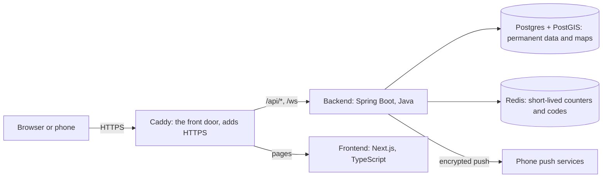

# Building Namastute: a book about making a real web app

How a cab-sharing app for Delhi airport was designed, built, tested and made ready for real users, one step at a time, with every idea explained from the ground up.

Last updated: 2026-10-24.

---

## About this book

### Who it's for
- **Someone new to computer science** who wants to see how a real app is built, from the first file to a server that could serve hundreds of people.
- **A student preparing for interviews**, who needs to explain *why* things are built the way they are, not just *what* was typed.
- **A future teammate** who wants to understand this codebase quickly.

You don't need to know how to program to follow the ideas. Code appears often, but every code block is explained line by line, and every new word is defined before it's used.

### How each chapter works
- Most chapters start with **"Words first"**: a short list of the words that chapter uses, each explained in a sentence or two. Read it even if you think you know the words; the chapter relies on exactly those meanings.
- **Concept chapters** teach one idea in the same order every time: **the problem** → **the naive way** (the first thing most people would try) → **why it hurts** → **the better tool** → **how it works** → **how Namastute uses it**.
- **Code walkthrough chapters** follow a concept chapter. They open the real files and explain them piece by piece. Keep the file open next to the book.
- **Decisions** tables record what the team chose and when, so you can see the reasoning, not just the result.
- Lines marked **`shortcut:`** describe a limit we accepted on purpose, and when we'd remove it (chapter 64 explains the habit).

### Numbers in this book
- Chapters and sections have **fixed numbers** (for example 40.3). Comments in the code point to them ("see Learning Notes 40.3"), so they never change, even when a chapter is improved.
- That's why some chapters have a section **.0** ("Words first"): it was added at the start without renumbering anything.
- When a later chapter changed something an earlier chapter describes, the earlier one has a **Later change** note pointing forward.

### How to read it
- **Start here** and **The project in one page** (next) give you the basics and the map.
- Then read the parts in order. Each part opens with a short page saying what it covers.
- The **Glossary** (chapter 90) defines every term in the book, A to Z. The **Command cheat sheet** (89) and **Interview questions** (91) are for revision. The **Backlog** (88) lists everything still open.

---

## Start here: the absolute basics

This chapter is for readers with no computing background. If you know what a server, a database and Git are, skip to **The project in one page**.

### Words first
- **Program (software, app):** a list of instructions a computer follows. A web browser, a game and Namastute are all programs.
- **Code (source code):** those instructions written in a **programming language** that people can read, such as Java or TypeScript. A program called a **compiler** turns code into a form the computer runs.
- **Computer network:** computers connected so they can send each other messages. **The internet** is the worldwide network of networks.
- **Server:** a computer (or a program on it) that waits for requests and answers them. **Client:** the program that sends the request, usually your browser or phone app.
- **Browser:** the program you use to open websites (Chrome, Safari). It's a client.
- **URL (web address):** text that says where something is on the internet, like `https://namastute.in/login`.
- **Database:** a program that stores data in an organised way and answers questions about it ("which trips leave Terminal 3 in the next hour?").
- **Frontend:** the part of an app people see and touch (screens, buttons). **Backend:** the part that runs on the server (rules, data, security).
- **API (Application Programming Interface):** the list of requests a program accepts from other programs. Our frontend talks to our backend through our API.
- **Terminal (command line):** a text window where you type commands instead of clicking.
- **Version control (Git):** a tool that records every change to the code, so you can see history, undo mistakes and work in a team.

### How a click becomes a result
When you tap "Find co-travellers" in Namastute:
1. **The browser** (client) sends a **request** over the internet to our **server**: "plan this trip for me".
2. **The backend** on the server checks who you are, checks the request makes sense, and saves the trip in the **database**.
3. It sends back a **response**: "done, here's your trip".
4. **The frontend** shows the result on your screen.

Almost everything in this book is about one of those four steps: making the request safe, making the rules correct, storing data reliably, or showing it clearly.

### Why it's harder than it looks
- **Many people at once.** Hundreds of requests can arrive in the same second. Two people might try to take the last seat in a cab at the same moment (chapter 40).
- **Things fail.** Networks drop, phones go to sleep, servers restart. The app has to stay correct anyway.
- **Bad actors exist.** Some people will try to read others' data, guess login codes or flood the server. Security runs through the whole book.
- **People must trust strangers.** Namastute puts strangers in a car together at night, so privacy and safety shape many decisions (chapters 37.4, 56, 60).

---

## The project in one page

### Words first
- **Monorepo:** one code repository holding several related projects (here: the backend and the frontend).
- **Module:** a self-contained part of a program with its own job (logging in, trips, groups…).
- **Slice:** a small piece of the product built end to end (database, backend, frontend, tests), then merged. The book follows the slices in order.

### What Namastute does
Namastute helps people leaving **Delhi's IGI airport** share a cab with others going the same way, to save money. It **only connects people**: it never books cabs and never handles money.

A typical journey:
1. **Log in** with your phone number and a one-time code sent by SMS.
2. **Plan a trip:** which terminal, when you'll be outside, where you're going.
3. **See matches:** people (or groups) heading your way at about the same time, ranked by how little extra distance sharing adds.
4. **Ask to share.** If they accept, you're in a **group** with a live **chat**.
5. The person who started the group **locks** it and books a cab. At the pickup, everyone taps **"I'm here"** and can **share their live location** for a few minutes.
6. After the ride, the booker enters the **fare**; everyone sees their fair **share** and a **UPI link** to pay the booker.
7. Everyone can **rate** each other, **report** problems, or **block** someone.

### How it's built

- **The backend** (`apps/api`) is one Java program split into modules: `auth` (login), `users`, `trips` (planning and matching), `groups`, `chat`, `feedback` (ratings, reports, blocks), `notifications` (push) and `shared`. Chapter 1 explains why it's one program and not many.
- **The frontend** (`apps/web`) is a Next.js web app that works on phones and can be installed on the home screen.
- **Postgres** stores everything permanent; **PostGIS** lets it answer map questions ("destinations within 15 km"). **Redis** keeps short-lived data like login codes and request counters.
- **In production** everything runs on one rented server, with **Caddy** in front handling HTTPS (chapter 54).

### How the book is organised
| Part | Chapters | What you'll learn |
|---|---|---|
| I. The big picture and the tools | 1–11 | How the app is structured; Java, Spring, databases, Docker, testing, the frontend tools |
| II. Teamwork and the cloud | 12–17 | Git, automatic testing (CI), cross-platform traps, AWS, hosting, the terminal |
| III. Logging in | 18–30 | HTTP, one-time codes, hashing, Redis, rate limits, tokens, security, the login screen |
| IV. Profiles, trips and matching | 31–38 | Updating data, maps, time zones, and finding good co-travellers fast |
| V. Groups and chat | 39–49 | State machines, races between requests, module boundaries, real-time chat, background jobs |
| VI. Finishing the ride and shipping | 50–55 | Money, API contracts, containers and HTTPS for production |
| VII. Safety and staying in touch | 56–63 | Report and block, push notifications, live location, ratings |
| VIII. Getting ready for real users | 64–69 | Technical debt, load testing, indexes and rate limits |
| IX. The new look | 70–77 | A design system, accessible components, and every screen redesigned |
| X. ID verification | 78–85 | Handling ID photos safely, admin review, machine helpers for faces and text, and women-only groups |
| XI. The front door | 86–87 | A static landing page, moving the app home, and checking contrast by measurement |
| Reference | 88–91 | What's still open, commands, glossary, interview questions |

---

## Contents

**Front matter:** [About this book](#about-this-book) · [Start here: the absolute basics](#start-here-the-absolute-basics) · [The project in one page](#the-project-in-one-page)

**[Part I. The big picture and the tools](#part-i-the-big-picture-and-the-tools)**
1. [Architecture: monolith vs microservices](#1-architecture-monolith-vs-microservices)
2. [Java and Spring foundations](#2-java-and-spring-foundations)
3. [Spring Boot](#3-spring-boot)
4. [Maven](#4-maven)
5. [The generated Spring project](#5-the-generated-spring-project)
6. [Databases: Postgres, PostGIS, SQL](#6-databases-postgres-postgis-sql)
7. [Docker and Docker Compose](#7-docker-and-docker-compose)
8. [Connecting Spring to the database: JDBC, JPA, Hibernate](#8-connecting-spring-to-the-database-jdbc-jpa-hibernate)
9. [Flyway: database migrations](#9-flyway-database-migrations)
10. [Testing and Spring Modulith](#10-testing-and-spring-modulith)
11. [Frontend: TypeScript, Node, pnpm, React, Next.js](#11-frontend-typescript-node-pnpm-react-nextjs)

**[Part II. Teamwork and the cloud](#part-ii-teamwork-and-the-cloud)**

12. [Git and GitHub workflow](#12-git-and-github-workflow)
13. [CI with GitHub Actions](#13-ci-with-github-actions)
14. [Cross-platform gotchas: permissions and line endings](#14-cross-platform-gotchas-permissions-and-line-endings)
15. [AWS: account security and cost control](#15-aws-account-security-and-cost-control)
16. [Hosting and infrastructure decisions](#16-hosting-and-infrastructure-decisions)
17. [Terminal basics](#17-terminal-basics)

**[Part III. Logging in](#part-iii-logging-in)**

18. [HTTP and REST APIs](#18-http-and-rest-apis)
19. [Authentication and phone OTP](#19-authentication-and-phone-otp)
20. [Hashing, HMAC and keeping OTPs safe](#20-hashing-hmac-and-keeping-otps-safe)
21. [Redis](#21-redis)
22. [Rate limiting](#22-rate-limiting)
23. [Code walkthrough: the OTP service](#23-code-walkthrough-the-otp-service)
24. [Login tokens: JWT, refresh tokens, cookies](#24-login-tokens-jwt-refresh-tokens-cookies)
25. [Spring Security](#25-spring-security)
26. [JPA entities and Spring Data repositories](#26-jpa-entities-and-spring-data-repositories)
27. [Code walkthrough: tokens, security and users](#27-code-walkthrough-tokens-security-and-users)
28. [Browsers, origins and CORS](#28-browsers-origins-and-cors)
29. [React and Next.js in the browser](#29-react-and-nextjs-in-the-browser)
30. [Code walkthrough: CORS and the login screen](#30-code-walkthrough-cors-and-the-login-screen)

**[Part IV. Profiles, trips and matching](#part-iv-profiles-trips-and-matching)**

31. [Updating data: PATCH, dirty checking, Unicode](#31-updating-data-patch-dirty-checking-unicode)
32. [Code walkthrough: the profile](#32-code-walkthrough-the-profile)
33. [Places, maps and geocoding](#33-places-maps-and-geocoding)
34. [Time zones, enums and trip rules](#34-time-zones-enums-and-trip-rules)
35. [Code walkthrough: trips](#35-code-walkthrough-trips)
36. [Matching: two-stage search and spatial indexes](#36-matching-two-stage-search-and-spatial-indexes)
37. [Matching: detours, pure functions, privacy, N+1](#37-matching-detours-pure-functions-privacy-n1)
38. [Code walkthrough: matching](#38-code-walkthrough-matching)

**[Part V. Groups and chat](#part-v-groups-and-chat)**

39. [Groups: state machines and consent](#39-groups-state-machines-and-consent)
40. [Concurrency: the last-seat race](#40-concurrency-the-last-seat-race)
41. [Code walkthrough: groups (slice 2a)](#41-code-walkthrough-groups-slice-2a)
42. [Groups in matches: routes with several drops](#42-groups-in-matches-routes-with-several-drops)
43. [Module dependencies: cycles and dependency inversion](#43-module-dependencies-cycles-and-dependency-inversion)
44. [Code walkthrough: groups in matches (slice 2b)](#44-code-walkthrough-groups-in-matches-slice-2b)
45. [Real-time: WebSocket and STOMP](#45-real-time-websocket-and-stomp)
46. [Chat: security, saving and history](#46-chat-security-saving-and-history)
47. [Code walkthrough: group chat (slice 3)](#47-code-walkthrough-group-chat-slice-3)
48. [Background jobs: sweeps, idempotency, time](#48-background-jobs-sweeps-idempotency-time)
49. [Code walkthrough: expiry jobs](#49-code-walkthrough-expiry-jobs)

**[Part VI. Finishing the ride and shipping](#part-vi-finishing-the-ride-and-shipping)**

50. [Money: fare split and UPI links](#50-money-fare-split-and-upi-links)
51. [Code walkthrough: fare split (and a pool-starvation bug)](#51-code-walkthrough-fare-split-and-a-pool-starvation-bug)
52. [API contracts: OpenAPI and generated types](#52-api-contracts-openapi-and-generated-types)
53. [Code walkthrough: OpenAPI and generated types](#53-code-walkthrough-openapi-and-generated-types)
54. [Production: containers, config, HTTPS](#54-production-containers-config-https)
55. [Code walkthrough: the production build](#55-code-walkthrough-the-production-build)

**[Part VII. Safety and staying in touch](#part-vii-safety-and-staying-in-touch)**

56. [Safety: report and block](#56-safety-report-and-block)
57. [Code walkthrough: report and block](#57-code-walkthrough-report-and-block)
58. [Push notifications](#58-push-notifications)
59. [Code walkthrough: push notifications](#59-code-walkthrough-push-notifications)
60. [Live location at the pickup](#60-live-location-at-the-pickup)
61. [Code walkthrough: live location](#61-code-walkthrough-live-location)
62. [Ratings after the ride](#62-ratings-after-the-ride)
63. [Code walkthrough: ratings](#63-code-walkthrough-ratings)

**[Part VIII. Getting ready for real users](#part-viii-getting-ready-for-real-users)**

64. [Pre-launch clean-up: triaging technical debt](#64-pre-launch-clean-up-triaging-technical-debt)
65. [Code walkthrough: pre-launch fixes](#65-code-walkthrough-pre-launch-fixes)
66. [Load testing](#66-load-testing)
67. [Code walkthrough: load tests and results](#67-code-walkthrough-load-tests-and-results)
68. [Indexes and rate limits](#68-indexes-and-rate-limits)
69. [Code walkthrough: indexes and rate limits](#69-code-walkthrough-indexes-and-rate-limits)

**[Part IX. The new look](#part-ix-the-new-look)**

70. [From a design handoff to a real frontend](#70-from-a-design-handoff-to-a-real-frontend)
71. [Code walkthrough: the foundation, log in and profile (slice A)](#71-code-walkthrough-the-foundation-log-in-and-profile-slice-a)
72. [Home and planning a trip: panes, sheets and instant feedback](#72-home-and-planning-a-trip-panes-sheets-and-instant-feedback)
73. [Code walkthrough: home and plan trip (slice B)](#73-code-walkthrough-home-and-plan-trip-slice-b)
74. [The group screen: chat that behaves, honest connection status, safety one tap away](#74-the-group-screen-chat-that-behaves-honest-connection-status-safety-one-tap-away)
75. [Code walkthrough: the group screen (slice C)](#75-code-walkthrough-the-group-screen-slice-c)
76. [The fare and paying: irreversible actions, deep links and QR codes](#76-the-fare-and-paying-irreversible-actions-deep-links-and-qr-codes)
77. [Code walkthrough: the fare, UPI QR and light polish (slice D)](#77-code-walkthrough-the-fare-upi-qr-and-light-polish-slice-d)

**[Part X. ID verification](#part-x-id-verification)**

78. [ID verification: checking IDs without keeping them](#78-id-verification-checking-ids-without-keeping-them)
79. [Code walkthrough: ID upload (slice 1)](#79-code-walkthrough-id-upload-slice-1)
80. [Reviewing ID checks: admin access, safe decisions and the badge](#80-reviewing-id-checks-admin-access-safe-decisions-and-the-badge)
81. [Code walkthrough: the review (slice 2a)](#81-code-walkthrough-the-review-slice-2a)
82. [Machine helpers for ID checks: face score and reading the ID](#82-machine-helpers-for-id-checks-face-score-and-reading-the-id)
83. [Code walkthrough: the machine checks (slice 2b)](#83-code-walkthrough-the-machine-checks-slice-2b)
84. [Women-only groups: one rule, checked at every door](#84-women-only-groups-one-rule-checked-at-every-door)
85. [Code walkthrough: women-only groups (slice 3)](#85-code-walkthrough-women-only-groups-slice-3)

**[Part XI. The front door](#part-xi-the-front-door)**

86. [The landing page: a static front door](#86-the-landing-page-a-static-front-door)
87. [Code walkthrough: the landing page](#87-code-walkthrough-the-landing-page)

**[Reference](#reference)**

88. [Backlog: everything still open](#88-backlog-everything-still-open)
89. [Command cheat sheet](#89-command-cheat-sheet)
90. [Glossary](#90-glossary)
91. [Interview questions to practise](#91-interview-questions-to-practise)

---

## Part I. The big picture and the tools

Before writing any feature, a team has to decide how the program is shaped and which tools build it. This part explains those choices: why Namastute's backend is one program split into modules, what Java and Spring do for us, how the database and Docker fit in, how we test, and which tools build the frontend. Nothing here is specific to cab sharing; it's the foundation every later chapter stands on.

---

## 1. Architecture: monolith vs microservices

### 1.0 Words first
- **Architecture:** the overall shape of a software system: which big parts it has and how they talk to each other.
- **Backend:** the part of an app that runs on a server: it holds the data, enforces the rules and answers requests (see *Start here*).
- **Deploy:** to put a new version of a program onto the server where users reach it.
- **Process:** one running program on a computer. A program can run as one process or as many.
- **Function call:** one piece of code asking another piece *in the same program* to do something. It's instant and can't get lost.
- **Network call:** a request sent to *another program* over a network. It's slower, and it can time out or fail.
- **Service:** a separately running program with one job, which other programs call over the network.
- **Scaling:** handling more users, usually by running more copies of a program or using bigger machines.

### 1.1 Two ways to shape a backend
A **monolith** is a backend built as **one application**. It's deployed once and runs as one process, usually with one database. When the login code needs the user code, it simply makes a function call.

**Microservices** split the backend into many small applications, for example an auth service, a matching service and a chat service. Each one is deployed separately and usually has its own database. They talk to each other with network calls (HTTP, gRPC or message queues).

| | Monolith | Microservices |
|---|---|---|
| Deploy | One app | Many apps, many deployment pipelines |
| Calls between parts | Function call: fast, can't fail on the network | Network call: slower, can time out or fail |
| Debugging | One log, one stack trace | A bug can span several services; you need tracing tools |
| Scaling | Scale the whole app | Scale only the busy service |
| Best for | Small teams, early products | Large teams, each owning a service |

### 1.2 What we chose: a modular monolith
A **modular monolith** is one deployable app whose code is split into **strict modules** (`auth`, `trips`, `groups`, `chat`…). Each module owns its own database tables, and modules only talk to each other through small, public doors (methods made public on purpose). It's deployed like a monolith but organised like microservices. Chapter 10 shows how a test enforces the boundaries.

### 1.3 Why it fits Namastute
- Microservices mainly solve **team** problems: dozens of engineers stepping on each other's toes. With two developers, that problem doesn't exist.
- Their costs (network failures between services, many deployments, debugging across programs) are real from the first day.
- One server handles our load (chapter 67 measured it), so nothing needs scaling separately.
- Clean module boundaries keep the option to split a module into its own service later, if we ever need to.

**Interview version:** "I chose a modular monolith because microservices solve team-scale and independent-scaling problems we don't have, and their operational cost is real from day one. Clean module boundaries, enforced by a test, keep the option to split later."

---

## 2. Java and Spring foundations

### 2.0 Words first
- **Java:** the programming language our backend is written in. Java code runs on the **JVM** (Java Virtual Machine), a program that runs Java on any operating system.
- **Framework:** a large, ready-made toolkit that gives a program its structure. You write the parts specific to your app; the framework handles the rest. **Spring** is the most popular Java framework.
- **Class / object:** see 2.1.
- **Dependency:** something a piece of code needs in order to work (2.2). The word also means a library a project uses (chapter 4).
- **Annotation:** a tag starting with `@`, like `@Service`, that adds information to code without changing what it does. Frameworks read these tags.

### 2.1 Classes and objects
- A **class** is a blueprint. For example: "a Group has an id, a meeting time and members, and it can lock itself."
- An **object** is one real thing built from that blueprint while the program runs: *this* group, id 42, meeting at 10:30. In Java you create one with `new Group(...)`.

### 2.2 Dependencies
Objects rarely work alone. A `GroupService` needs a `GroupRepository` (to read and write groups in the database) and a `NotificationService` (to send pushes). Those are its **dependencies**: it can't do its job without them.

### 2.3 Wiring by hand, and why it hurts
Without a framework, you'd create every object yourself and pass each one its dependencies:
```java
DataSource db = new HikariDataSource(config);
GroupRepository groups = new GroupRepository(db);
NotificationService notifications = new NotificationService(new PushSender(keys));
GroupService groupService = new GroupService(groups, notifications);
// ...dozens more, in the right order
```
This "wiring" causes three problems:
1. **It grows** with every new class, and the order matters (you can't create `groupService` before `groups`).
2. **Swapping is painful.** A test wants a fake `PushSender` that doesn't really send anything; you'd have to rewrite the wiring for every test.
3. **Sharing is fiddly.** You want exactly one database connection pool shared by everything, so you must pass it around carefully.

### 2.4 Inversion of Control (IoC)
- **Control** here means: who decides when objects are created and connected?
- Normally *your code* decides, by calling `new` everywhere. **Inversion of Control flips this:** a framework creates and connects the objects, and your classes only *declare* what they need.
- The part of the framework that holds those objects is called a **container**. In Spring it's the **ApplicationContext**.
- An object that Spring creates and manages is called a **bean**.

### 2.5 Dependency Injection (DI)
With **Dependency Injection**, the container **hands each object its dependencies from outside**, usually through the **constructor** (the special method that runs when an object is created):
```java
@Service
public class GroupService {
    private final GroupRepository groups;
    private final NotificationService notifications;

    public GroupService(GroupRepository groups, NotificationService notifications) {
        this.groups = groups;
        this.notifications = notifications;
    }
}
```
- `@Service` is an annotation. Spring reads it at startup and knows: "create one of these and manage it".
- Our convention is **constructor injection only** (never `@Autowired` on fields), so every dependency is visible in one place and the class is easy to test.

**What Spring does at startup:**
1. **Scan:** look through the `com.namastute` package and everything below it for tags like `@Service`, `@Repository` and `@RestController`.
2. **Plan:** read the constructors to work out who needs whom.
3. **Create** the objects in the right order.
4. **Inject** each object into the constructors that asked for it.
5. **Keep** them: by default there's exactly one shared object of each (a **singleton**).

**How it fixes 2.3:** adding a class means adding one tag; tests can swap in fakes; sharing is automatic.

**In our project:** `ApiApplication.java` carries `@SpringBootApplication`, which switches on scanning from `com.namastute`. That's why the package name mattered when the project was created (5.1): Spring only scans that package and the ones below it.

---

## 3. Spring Boot

### 3.0 Words first
- **Infrastructure bean:** an object every app needs but nobody wants to write: the database connection pool, the web server, the JSON converter.
- **Connection pool:** a small set of database connections opened once and reused, because opening a new connection for every request is slow.
- **Library / jar:** a package of ready-made code. In Java, libraries come as **jar** files (zip files of compiled code).
- **Classpath:** the list of all libraries available to the program while it runs.
- **Configuration file:** a file of settings (like which database to use) read when the program starts. Ours is `application.yaml`.
- **Port:** a numbered "door" on a computer that a program listens on, like 8080 for our API or 5432 for Postgres.

### 3.1 Auto-configuration
Plain Spring still has to be *told* how to build infrastructure beans. **Spring Boot** removes that work. At startup it runs many rules with **conditions**, such as:
- "The PostgreSQL driver is on the classpath **and** `spring.datasource.url` is set → create a connection pool."
- "Spring Web MVC is on the classpath → start a web server on port 8080."
- "You defined your own bean of this type → back off and use yours."

So: **adding a library switches a feature on; `application.yaml` adjusts it.** We saw this early on: with the database libraries added but no database configured, the app refused to start, because auto-configuration tried to connect.

### 3.2 Starters
A **starter** is one dependency that brings a tested set of libraries together. For example `spring-boot-starter-data-jpa` brings Hibernate (chapter 8), a connection pool and transaction support, all at versions known to work together.

### 3.3 Embedded web server
- A **web server** listens on a port for HTTP requests (chapter 18) and sends back responses.
- The old way: install a web server called **Tomcat** separately, then copy your app into it. The Spring Boot way: Tomcat runs **inside** your app, so you run one jar and that's it. That's why we chose **Jar** packaging (5.1).

### 3.4 Spring Boot 4 specifics (we use 4.1.1)
- It's built on **Spring Framework 7** and **Jakarta EE 11** (the standard Java APIs for web apps).
- Its starters are **smaller and more focused** than Boot 3's: `spring-boot-starter-webmvc` (it was `-web` in Boot 3), `spring-boot-starter-flyway`, and a matching `-test` starter for each. Smaller jars start faster.
- Most tutorials online still use Boot 3. If something from a tutorial fails, **check the version first**.

### 3.5 Actuator
**Actuator** adds endpoints for operating the app. `/actuator/health` answers "is the app alive, and can it reach the database?" Docker, CI and load balancers use it to check the app is ready. Ours answers `{"status":"UP"}`.

---

## 4. Maven

### 4.0 Words first
- **Build:** turning source code into a program you can run (4.1).
- **Build tool:** the program that does the build. Ours is **Maven**.
- **Bytecode:** the compiled form of Java code (`.class` files) that the JVM runs.
- **Repository (of libraries):** an online store of libraries. Maven's is **Maven Central**.
- **Plugin:** an add-on that gives a tool new commands.
- **Version:** a label like `4.1.1` that identifies one release of a library or program.

### 4.1 What "building" means
1. **Compile:** turn `.java` text files into `.class` bytecode files.
2. **Fetch libraries:** download the jars your code uses.
3. **Test:** run the automated tests (chapter 10).
4. **Package:** put your classes and the libraries into one runnable `.jar`.

### 4.2 Maven's pieces
- **`pom.xml`** (Project Object Model): the file describing the project: its name, its dependencies and its plugins.
- **Maven Central:** downloads are cached on your computer (in `C:\Users\Lenovo\.m2\repository`), so each library downloads once.
- **Transitive dependencies:** if you need library A, and A needs B and C, Maven fetches all three. About 7 lines in our pom bring in about 100 jars.
- **Lifecycle phases:** `validate → compile → test → package → verify → install`. Running one phase runs every phase before it, so you can't package code that hasn't passed its tests.
- **Plugins** add commands, such as `spring-boot:run` from the Spring Boot plugin.

### 4.3 The Maven wrapper (`mvnw`)
The **Maven wrapper** is a small script committed to the repository. It downloads the exact Maven version written in `.mvn/wrapper/`, so everyone (the other developer, the CI server) builds the same way with nothing to install.
- `mvnw` is the version for Linux, Mac and CI; `mvnw.cmd` is the Windows version.

### 4.4 Inside our `pom.xml`
- **Why dependencies have no version numbers:** the `<parent>` section (`spring-boot-starter-parent`) includes a **BOM** (Bill of Materials): a list of library versions tested together. `spring-modulith-bom` does the same for Spring Modulith. This prevents version clashes.
- **Dependency scopes** say when a library is needed:
  - *(none)* = compile: needed to compile and to run.
  - `runtime`: needed only to run, not to compile (for example the PostgreSQL driver: our code only talks to the standard JDBC interface, chapter 8).
  - `test`: only for tests; never shipped.
- **Project version `0.0.1-SNAPSHOT`:** *our* version number. **SNAPSHOT** means "in development, not released". Spring Boot's version is in `<parent>`.
- **We trimmed it:** the project generator added 7 Spring Modulith dependencies; we kept only `spring-modulith-starter-core` and `spring-modulith-starter-test`. The rule: **add a dependency when a feature needs it**, so you always know why each one is there.

---

## 5. The generated Spring project

### 5.0 Words first
- **start.spring.io (Spring Initializr):** a website that generates a starting Spring Boot project from a few choices.
- **Package:** a folder-like namespace for Java classes, written with dots (`com.namastute.trips`). The folder structure on disk matches it.
- **YAML:** a simple text format for settings, where indentation shows nesting (7.3).
- **LTS (Long-Term Support):** a version that gets fixes for years. Java 21 is an LTS version.
- **Environment variable:** a named value the operating system gives a program when it starts, like `DB_PASSWORD`. Used to keep secrets out of the code.

### 5.1 start.spring.io settings we chose
| Setting | Value | Why |
|---|---|---|
| Project | Maven | Design decision |
| Spring Boot | 4.1.1 | Newest *stable* version; SNAPSHOT, M (milestone) and RC (release candidate) versions are unfinished |
| Group | `com.namastute` | Reverse-domain naming avoids clashes with other people's packages |
| Artifact | `api` | The jar's name; the project lives in `apps/api` |
| Package | `com.namastute` | The generator adds the artifact by default (`com.namastute.api`); we removed it so modules are `com.namastute.trips`, not `com.namastute.api.trips` |
| Packaging | Jar | Runs with its own embedded web server (3.3) |
| Config | YAML | Nested settings read better than long repeated prefixes |
| Java | 21 | LTS, installed locally |

### 5.2 Files
| File | Purpose |
|---|---|
| `pom.xml` | Build definition (chapter 4) |
| `mvnw`, `mvnw.cmd`, `.mvn/wrapper/` | Maven wrapper (4.3) |
| `src/main/java/com/namastute/ApiApplication.java` | Entry point: the class with `@SpringBootApplication` and the `main` method |
| `src/main/resources/application.yaml` | Settings |
| `src/main/resources/db/migration/` | Flyway's SQL migrations (chapter 9) |
| `src/test/java/...` | Tests (chapter 10) |
| `.gitignore` | Tells Git to ignore `target/` (build output) |

### 5.3 Our `application.yaml`
```yaml
spring:
  datasource:
    url: jdbc:postgresql://localhost:5432/namastute
    username: namastute
    password: ${DB_PASSWORD:namastute}
  jpa:
    hibernate:
      ddl-auto: validate
    open-in-view: false
```
- **`${DB_PASSWORD:namastute}`** is a **placeholder**: use the environment variable `DB_PASSWORD` if it's set, otherwise the default after the colon. Real secrets never go into Git (production has no defaults at all, 54.2).
- **`open-in-view: false`:** by default Spring keeps a database session open for the whole web request, which hides slow queries and holds connections longer. Turning it off is recommended practice.
- **`ddl-auto: validate`:** explained in chapter 8.

---

## 6. Databases: Postgres, PostGIS, SQL

### 6.0 Words first
- **Database server:** a program that stores data and answers questions about it. Ours is **PostgreSQL** ("Postgres").
- **Table:** data arranged in rows and columns, like a spreadsheet. One row per thing (one trip), one column per fact (exit time).
- **SQL** (Structured Query Language): the language for asking a database questions and changing its data: `select * from trips where terminal_id = 'DEL-T3'`.
- **Query:** one SQL request.
- **Schema:** a named group of tables inside a database, like a folder. The default one is `public`.
- **Extension:** an add-on that gives a database new abilities.
- **Coordinate system:** the rules for turning a point on the round Earth into numbers.

### 6.1 Postgres and its pieces
- Postgres listens on port **5432**. One Postgres server can hold many **databases**; each database has **schemas**, and each schema has tables.
- **DDL** (Data Definition Language) is the part of SQL that changes *structure*: `create table`, `alter table`. Changing *data* uses `insert`, `update` and `delete`.

### 6.2 PostGIS: maps inside the database
- **PostGIS** is an extension that adds geographic types and functions, such as "find points within 15 km". Our matching depends on it (chapter 36).
- **`spatial_ref_sys`** is a PostGIS table listing coordinate systems. Our columns use `geography(point, 4326)`; **4326** is the number of the GPS system (called WGS 84).
- The **`tiger`** and **`topology`** schemas came from the Docker image's own startup script (US address lookup and map tools). We don't use them; they exist only on development machines.

### 6.3 psql, Postgres's command-line client
| Flag | Meaning |
|---|---|
| `-U namastute` | Log in as the **U**ser `namastute` |
| `-d namastute` | Connect to the **d**atabase `namastute` |
| `-c "..."` | Run one **c**ommand, print the result, exit |

Inside psql, commands starting with `\` are psql's own:
| Command | Does |
|---|---|
| `\l` | List databases |
| `\dt` | List tables |
| `\dx` | List installed extensions |
| `\d tablename` | Describe a table |
| `\q` | Quit |

No password was asked inside the container because the Postgres image trusts connections from inside its own container. Spring connects from outside, through port 5432, so it needs the password.

---

## 7. Docker and Docker Compose

### 7.0 Words first
- **Operating system (OS):** the base software that runs a computer (Windows, Linux, macOS).
- **Image:** a packaged, read-only snapshot of a program plus everything it needs to run (7.2).
- **Container:** a running copy of an image, isolated from everything else (7.2).
- **Virtual machine (VM):** a whole simulated computer running inside a real one.
- **Kernel:** the core of an operating system, which talks to the hardware.
- **Volume:** storage kept outside a container so its data survives the container being deleted.

### 7.1 Why not install Postgres on Windows?
Installing Postgres directly causes trouble: each developer ends up with a different version, PostGIS is fiddly to set up, the database runs all the time, and removing it is messy. Docker avoids all of that.

### 7.2 Core terms
- **Image:** for example `postgis/postgis:16-3.5` = Postgres 16 with PostGIS 3.5, plus a small Linux system.
- **Container:** a running copy of an image, with its own files, network and processes. You can start, stop and delete it without affecting anything else.
- **Docker Engine:** the background program that downloads images and runs containers (on Windows it lives inside Docker Desktop).
- **Registry:** an online store of images; **Docker Hub** is the default. Downloading an image is called **pulling** it.
- **Container vs VM:** a VM simulates a whole computer with its own OS, so it's heavy and slow to start. A container shares the host's Linux kernel (Docker Desktop provides one on Windows), so it starts in seconds and uses little memory.
- **Port mapping** `"5432:5432"` means "host port : container port". It lets Spring reach Postgres at `localhost:5432`.
- **Volume:** `docker compose down` keeps volumes (your data survives); `down -v` deletes them too.

### 7.3 Docker Compose
- **Docker Compose** describes several containers in one **YAML** file and starts them all with one command. The file is committed, so everyone gets the same setup.
- **YAML basics:** `key: value` pairs; indentation (spaces, never tabs) nests things inside each other.
- A **project** is the set of containers from one compose file. Its default name is the folder the file is in (ours would be `infra`), so we added `name: namastute` at the top.
- **Service name** (`postgres` in the file) vs **container name** (`namastute-postgres-1` = project, service and copy number).
- **Healthcheck:** how Docker checks a service is truly ready (for Postgres, the `pg_isready` command). It shows as `(healthy)`.

### 7.4 `docker` vs `docker compose`
- `docker ps` lists **every** running container on the machine, by container name or ID.
- `docker compose ps` lists **only this project's** containers, by service name, with their health.
- `-f infra/docker-compose.yml` says which compose file to use (the default is one in the current folder).
- `docker compose down` stops **only this project**.

### 7.5 Getting inside a container
- A **shell** is a program that reads and runs typed commands (PowerShell on Windows, **bash** on Linux). Inside a container you use Linux commands (`ls`, `cat`, `pwd`).
- A **terminal (TTY)** is the text window showing a shell.
- `docker compose ... exec postgres bash` opens a shell inside the `postgres` container. (`docker exec -it <name> bash` does the same; `-i` keeps keyboard input connected and `-t` gives it a terminal.)
- Leave with `exit` or **Ctrl+D**. The container keeps running.

### 7.6 `image:` vs `build:` and the `--build` flag
- `image:` uses a ready-made image, **pulled** from a registry.
- `build:` builds an image on your machine from a **Dockerfile**: a step-by-step recipe (start from this base image, copy these files, run this command).
- `up --build` rebuilds the `build:` services so code changes get in; it does nothing for `image:` services.
- After editing a compose file, plain `up -d` creates new services and recreates only the changed ones.
- To update a ready-made image: `docker compose ... pull`, then `up -d` (or change its tag).
- **Later change:** the production stack builds its own images for the API and web app from Dockerfiles (chapter 55).

---

## 8. Connecting Spring to the database: JDBC, JPA, Hibernate

### 8.0 Words first
- **Driver:** a library that knows how to talk to one particular database.
- **Interface (Java):** a list of methods a class promises to provide, without saying how. Code written against an interface works with any class that provides it.
- **ORM (Object-Relational Mapping):** a tool that converts between objects in code and rows in tables.
- **Entity:** a class whose objects are stored as rows of a table (chapter 26).
- **Schema (of a table):** a table's structure: its columns and their types.

### 8.1 The layers
- **JDBC** (Java Database Connectivity) is Java's standard interface for talking to *any* database. Each database provides a **driver** that implements it.
- A **JDBC URL** says where the database is: `jdbc:postgresql://localhost:5432/namastute` = protocol, driver, host, port and database name. `localhost` means "this computer".
- **HikariCP** is the connection pool Spring uses. The log line `HikariPool-1 - Start completed` means it connected.
- **JPA** (Jakarta Persistence API) is Java's standard set of rules for ORMs. **Hibernate** is the library that implements those rules.

### 8.2 Who owns the table structure: `ddl-auto`
- `update`: Hibernate creates and changes tables to match the Java classes. That's risky: it guesses, and it never safely renames or removes anything.
- `validate` (ours): Hibernate only **checks** that the tables match the classes, and refuses to start if they don't. The structure itself belongs to Flyway (chapter 9).

**Later in the book** you'll also meet `JdbcClient`, a thin helper for writing plain SQL without an ORM; several modules use it, starting with `groups` (41.4).

---

## 9. Flyway: database migrations

### 9.0 Words first
- **Migration:** one numbered change to the database's structure (or its reference data), written as an SQL file.
- **Version control:** keeping the history of every change (Git, chapter 12).
- **Checksum:** a short fingerprint of a file's contents. Change even one character and the checksum changes.
- **Drift:** two copies of something (two databases) slowly becoming different without anyone noticing.

### 9.1 The problem
Code is versioned in Git, but a database's structure isn't. Someone adds a column on their laptop and forgets to tell anyone; databases drift apart, and the app fails with "column does not exist".

### 9.2 How Flyway solves it
- Every structural change is a **migration**: an SQL file in `src/main/resources/db/migration/`, named like `V1__init.sql` (capital V, the version number, **two** underscores, a description).
- At startup, Flyway looks at a table called **`flyway_schema_history`**, runs **only the new files, in order**, and records each one.
- It also stores each file's **checksum**. If a file that already ran is edited later, Flyway **refuses to start**.
- **The golden rule:** never edit a migration that has already run. Add `V2__...` instead. This is called **forward-only**.
- Result: every database (your laptop, CI, production) reaches the same structure just by starting the app.

Our `V1__init.sql` is the full data model from the design document (12 tables). Chapter 69.5 tells the story of breaking the golden rule by editing just a comment, and how it was fixed.

---

## 10. Testing and Spring Modulith

### 10.0 Words first
- **Automated test:** code that runs your code and checks the result, failing loudly when it's wrong.
- **Assertion:** the check inside a test ("the answer must be 42").
- **Integration:** several parts working together (the app plus a real database).
- **Module boundary:** the line between two modules that code should only cross through public doors (1.2).
- **Dependency cycle:** two modules that each need the other (A uses B and B uses A).

### 10.1 Tests
- **JUnit** is the standard Java testing library. You mark a method with `@Test` and it runs as a test.
- A **unit test** checks one small piece with no database or server. It runs in milliseconds.
- An **integration test** checks pieces together: it starts Spring and uses a real database. It takes seconds, but catches problems unit tests can't.
- `ApiApplicationTests.contextLoads()` starts the whole app (all beans, the database, Flyway). That's why it needs Postgres running locally, and why CI starts a Postgres service too (chapter 13).
- Run them all with `.\mvnw.cmd test` (CI runs `verify`, 4.2).

### 10.2 Spring Modulith
Spring Modulith turns "modular monolith" from a promise into a check:
- Each package directly under `com.namastute` is a **module** (`auth`, `trips`, `groups`…).
- Classes directly in a module's package are its **public API**: other modules may use them.
- Sub-packages (for example `com.namastute.groups.internal`) are **private**.
- `ApplicationModules.of(ApiApplication.class).verify()` fails if a module touches another module's private classes, or if modules depend on each other in a **cycle**.
- Our `ModularityTest` doesn't start Spring; it only reads the compiled classes, so it's fast.

In practice we also keep most classes **package-private** (no `public`), so other modules physically can't reach them; only the few methods meant for other modules are `public` (27.3).

---

## 11. Frontend: TypeScript, Node, pnpm, React, Next.js

### 11.0 Words first
- **Frontend:** the part of the app that runs in the user's browser (see *Start here*).
- **HTML:** the language for a page's structure (headings, buttons, forms). **CSS:** the language for how it looks. **JavaScript (JS):** the language for how it behaves.
- **Type:** what kind of value something is (a number, some text, a list). A **type checker** catches mistakes like using text where a number was expected, before the code runs.
- **Package:** a library for JavaScript (the same idea as a jar in Java).
- **Component:** a reusable piece of a screen, like a button or a whole form (11.5).
- **Build:** turning source files into the files a browser downloads (11.6).

### 11.1 Frontend vs backend
- The **backend** (Spring Boot) runs on a server: it holds the data, enforces the rules and answers requests.
- The **frontend** runs in the user's browser: screens, buttons, forms.
- Browsers only understand **HTML**, **CSS** and **JavaScript**, so every frontend tool ends up producing those.

### 11.2 TypeScript
**TypeScript** is JavaScript plus **types**, checked before the code runs, then compiled to plain JavaScript for browsers. Its big payoff in this project: the API's types are **generated from the Java code**, so renaming a backend field breaks the frontend **build**, not the live app (chapters 52–53).

### 11.3 Node.js
**Node.js** runs JavaScript outside the browser. We need it because every frontend tool (the TypeScript compiler, the bundler, the Next.js development server) is itself a JavaScript program.

### 11.4 pnpm
- **pnpm** is to JavaScript what Maven is to Java: it downloads and manages packages, from the **npm registry**.
- `package.json` ≈ `pom.xml`: the project's name, its dependencies and its **scripts** (named commands like `dev`, `build`, `lint`).
- `node_modules/` holds the installed packages; it's never committed.
- The **lockfile** `pnpm-lock.yaml` records the exact version of every package; it **is** committed, so everyone installs the same thing.
- Why pnpm: it keeps one shared copy of each version on disk (fast and small) and it's **strict**: code can't use packages it didn't declare.
- **Install scripts** (code a package runs while installing) are a known attack route, so recent pnpm blocks them unless approved. `pnpm-workspace.yaml` records our approvals (`sharp` and `unrs-resolver` aren't built; their fallbacks work).

### 11.5 React
- **React** builds screens from **components**: functions that return what to show. Each component describes the screen for the current data (its **state**), and React updates only the parts that changed.
- Components are written in **JSX/TSX**: HTML-like tags inside JavaScript or TypeScript.
- Small differences from HTML: `className` instead of `class` (`class` is a reserved word in JavaScript).
- `export default function Home()` = the component this file provides.

### 11.6 Next.js (we use 16.4, with React 19.3)
**Next.js** is a framework on top of React. It gives us:
- **File-based routing (the App Router):** the file `app/page.tsx` becomes the page `/`; `app/trip/new/page.tsx` becomes `/trip/new`.
- **Server rendering:** HTML prepared on a server, so the first screen appears fast on slow mobile networks.
- **Build tooling:** it compiles TypeScript, **bundles** files (combines and shrinks them), and runs a development server with **hot reload** (the browser updates when you save).
- `app/layout.tsx` = the shared frame around every page.
- `pnpm dev` = development mode (forgiving, port 3000); `pnpm build` = production build (type-checks everything; this is what CI runs).
- `.next/` = build output, never committed.
- `AGENTS.md` = a note Next.js writes for AI coding assistants: Next 16 changed a lot, so read the docs bundled in `node_modules/next/dist/docs/`.

### 11.7 Tailwind and ESLint
- **Tailwind CSS:** styling with small **utility classes** written straight into the markup: `p-8` (padding), `text-3xl` (big text), `font-bold`, `mt-2` (margin on top).
- **ESLint:** a **linter**: a tool that reads code without running it and flags likely bugs and bad patterns.

---

## Part II. Teamwork and the cloud

Code isn't finished when it works on one laptop. It has to be shared, checked automatically, and eventually run on a server someone pays for. This part covers Git and GitHub (how changes are saved and reviewed), CI (how every change is tested on a clean machine), two traps that appear when Windows and Linux meet, keeping a cloud account safe and cheap, where the app will run, and the terminal skills used throughout the book.

---

## 12. Git and GitHub workflow

### 12.0 Words first
- **Git:** a version control tool. It records snapshots of your files over time, on your own computer.
- **Repository (repo):** a project folder whose history Git tracks.
- **GitHub:** a website that hosts Git repositories online, so a team can share them and review changes.
- **Branch:** a separate line of work. You make changes on a branch without disturbing the main version, then merge them back.
- **`main`:** the main branch: the version everyone trusts.
- **Merge:** combining the changes from one branch into another.
- **Remote:** the copy of the repository on GitHub (called `origin`), as opposed to your **local** copy.

### 12.1 Basics
- **Commit:** a saved snapshot of files, with a message saying what changed, in your local history.
- **Staging area:** where you choose what goes into the next commit (`git add`) before saving it (`git commit`).
- **Push:** copy your commits to GitHub. The first time, `git push -u origin <branch>` links the local branch to the remote one; afterwards plain `git push` is enough.
- **Pull:** bring new commits from GitHub into your local copy (`git pull`).
- **Habit:** run `git status` and `git diff --staged` before every commit. (Once, an empty `ci.yml` got committed because the editor never saved the file; looking first would have shown it.)

### 12.2 Branching: GitHub Flow (design §6.1)
- **GitHub Flow:** one protected `main` that's always deployable, plus short-lived branches (2–3 days at most) for each change.
- **Branch names:** `type/short-description`, for example `feat/14-trip-request`, `fix/31-group-full-race`, `docs/...`, `chore/...`, `ci/...`, `refactor/...`, `test/...`, `spike/...`.
- **Not GitFlow** (with long-lived `develop` and `release/*` branches): too much overhead for two developers.
- **Conventional commits:** commit messages start with their type, like `feat:`, `fix:`, `docs:`, `chore:`, `ci:`. Pull request titles use the same format.
- **Always pull `main` before creating a new branch.** Twice in this project a branch started from an old `main` and was missing merged work; the fix was `git merge --ff-only main` while the branch had no commits.

### 12.3 Pull requests and merging
- **Pull request (PR):** a request to merge a branch into `main`. It's where review and automatic checks happen.
- **Draft PR:** marked "not ready"; it can't be merged, but the checks still run.
- **Squash merge:** all of the branch's commits become **one** new commit on `main`, titled with the PR title. It keeps `main`'s history clean.
- **Check the PR title before merging.** GitHub fills it from the branch name (PR #3 was merged as `Docs/learning notes`); edit it to `type: description` first.
- After a squash merge, `git branch -d` refuses to delete the branch (Git can't see its original commits in `main`). Use `-D` once you know it was merged.
- `git fetch --prune` removes your local records of branches deleted on GitHub.

### 12.4 Branch protection on `main` (what we set)
**Branch protection** is a set of GitHub rules for a branch. Ours: a PR is required (even for admins); 0 approvals until the second developer joins (then 1); old approvals are dismissed when new commits arrive; review comments must be resolved; history must be linear; no force pushes or deletion; the **required checks `api` and `web`** must pass; and the **branch must be up to date** with `main` before merging.
- **Required check:** the Merge button stays disabled until the named checks pass. The names are the CI job names (chapter 13); GitHub only offers names it has already seen run.
- **Up to date before merging:** two PRs can each pass on their own but break together. This rule forces the checks to test the real combination (the "Update branch" button).
- Free branch protection is only enforced on **public** repositories (or on paid plans).

### 12.5 Rewriting history (lesson from the Ubery repo)
- Removing something from a commit that was already pushed means **rewriting** it (`git commit --amend`) and **force-pushing**, which replaces history on GitHub. Anyone who already pulled must reset their copy.
- GitHub's **contributors sidebar is cached**: it kept showing an extra contributor from a `Co-Authored-By` line even after the rewrite. That's why the project moved to the clean `Namastute` repository.
- The rule since then: no co-author lines and no AI attribution in commits or PRs.

---

## 13. CI with GitHub Actions

### 13.0 Words first
- **CI (Continuous Integration):** automatically building and testing every change before it can join `main` (13.1).
- **Workflow:** an automated process described in a YAML file.
- **Runner:** a fresh virtual machine that GitHub starts to run a job, then throws away.
- **Pipeline:** the chain of automated steps a change goes through (build, test…).
- **Cache:** saved downloads reused next time, so things run faster.

### 13.1 What CI is
Every change is automatically built and tested on a **clean machine** before it can be merged.
- A clean machine has only what's in Git, so it catches "works on my laptop" problems: cached libraries, environment variables, files you forgot to commit.
- It's automatic, so nobody can forget to run the tests.
- With required checks (12.4), broken code **can't** be merged.

### 13.2 Parts of GitHub Actions
| Term | Meaning | Ours |
|---|---|---|
| Workflow | A YAML file in `.github/workflows/` | `ci.yml` |
| Event / trigger | What starts it | A PR opened or updated; a push to `main` |
| Job | Steps on one machine; jobs run in parallel | `api`, `web` |
| Runner | The fresh machine for a job | `ubuntu-latest` |
| Step | One command or action, in order; a failure stops the job | `./mvnw -B verify` |
| Action | A reusable ready-made step (`uses:`) | `actions/checkout`, `setup-java`, `setup-node`, `pnpm/action-setup` |
| Service container | A Docker container running beside a job | Postgres and Redis for the integration tests |

### 13.3 Lines worth remembering
- `./mvnw -B verify`: `verify` = compile, test, package and final checks; `-B` = batch mode, for cleaner logs.
- The Postgres service uses the **same** database name, user and password as `application.yaml`, so no settings change.
- `pnpm install --frozen-lockfile`: install exactly what the lockfile says, and fail if `package.json` disagrees with it.
- `cache: maven` / `cache: pnpm`: reuse downloads between runs (much faster).
- `@v5`, `@v4`: pin each action's major version, so a new release can't silently change the build.
- A run that fails in **0 seconds** with "workflow file issue" means the YAML is invalid or empty.
- **Later additions:** both jobs check that the generated API types are up to date (53.5), and the API job starts Redis too (23.12).

---

## 14. Cross-platform gotchas: permissions and line endings

### 14.0 Words first
- **Cross-platform:** working on several operating systems (we develop on Windows; CI and servers run Linux).
- **File permission:** a rule on a file saying who may read, write or run it.
- **Line ending:** the invisible character(s) at the end of each line in a text file.

### 14.1 Executable permission
- Linux runs a file as a program only if it has the **executable flag**. Windows has no such flag.
- Extracting `mvnw` on Windows lost it: Git recorded the file as `100644` (normal) instead of `100755` (executable), so CI failed with "Permission denied".
- **Fix:** `git update-index --chmod=+x apps/api/mvnw`. Check with `git ls-files -s apps/api/mvnw`.

### 14.2 Line endings
- Windows ends lines with **CRLF** (`\r\n`, "carriage return + line feed", a habit from typewriters); Linux and Mac use **LF** (`\n`).
- Mixed endings make Git show every line as changed, and break Linux scripts (`bad interpreter: /bin/sh^M`).
- **Fix:** a root **`.gitattributes`** file:
  ```
  * text=auto eol=lf
  *.cmd text eol=crlf
  *.bat text eol=crlf
  ```
  then `git add --renormalize .` to apply it to existing files.

---

## 15. AWS: account security and cost control

### 15.0 Words first
- **AWS (Amazon Web Services):** a company that rents out servers, storage and other computing services by the hour.
- **Cloud:** computers you rent over the internet instead of owning.
- **Root user:** the original, all-powerful login of an AWS account (the sign-up email).
- **MFA (multi-factor authentication):** logging in with something you know (a password) **and** something you have (a phone app's code).
- **Region:** a group of AWS data centres in one area, like `ap-south-1` (Mumbai).

### 15.1 Root user and MFA
- The root user can do anything, including run up huge bills. A leaked root password without MFA is how student accounts end up with crypto-mining bills.
- We added MFA via `https://console.aws.amazon.com/iam/home#/security_credentials` → *Assign MFA device* → *Authenticator app*.
- **TOTP** (Time-based One-Time Password) is how authenticator apps work: AWS and your phone share a secret (from the QR code), and each computes `HMAC(secret, time ÷ 30)` (HMAC is explained in 20.3) → 6 digits. They never need to talk to each other, so it works offline. AWS asks for two codes in a row to check the clocks agree.
- Keep a backup (a cloud-backed authenticator or a second device). Later, use a separate everyday user (an **IAM user**) and keep the root user for billing and emergencies.

### 15.2 AWS Budgets (`monthly-cost-guard`)
- A **budget** is an **alarm, not a limit**: AWS keeps charging after it fires.
- Cost data updates about 3 times a day, so alerts lag; use several low thresholds.
- **Actual** = real spending crossed a line. **Forecasted** = AWS predicts you'll cross it by the end of the month (the earliest warning).
- **The credits trap:** by default, credits are subtracted, so cost shows $0 and alerts never fire until the credits run out. We **excluded the "Credit" charge type** (under *Scope → Filter specific AWS cost dimensions*).
- Ours: $50 a month, alerts at 20% ($10), 50% ($25) and 100% ($50) of actual spending, plus 100% forecasted.
- **Unblended costs:** what each use actually cost at the time; the plain number to watch.
- Habit: **stop the EC2 server** after demos.

### 15.3 Regions
The AWS console first showed `ap-southeast-2` (Sydney). For Delhi users, servers belong in **`ap-south-1` (Mumbai)**: lower delay, and data stays in India (which helps with India's data protection law, the DPDP Act). Billing, user management (IAM) and Budgets are global, not per region.

---

## 16. Hosting and infrastructure decisions

### 16.0 Words first
- **Hosting:** running an app on a server that users can reach.
- **EC2:** AWS's rentable virtual servers (an **instance** = one server).
- **HTTPS:** HTTP with encryption, shown as the padlock in a browser (chapter 54).
- **Domain:** a human-readable address like `namastute.in`.
- **Kubernetes:** a system for running many containers across many servers (16.2).

### 16.1 Where Spring Boot runs: one EC2 instance
- The first plan: Next.js on **Vercel** (free), and Spring Boot, Postgres and Redis on **one EC2 instance** with Docker Compose, with **Caddy** in front for HTTPS (free automatic certificates).
- **Later change (54.6):** the web app runs on the same EC2 server too, under one domain.
- **Why one server:** WebSockets (chapter 45) need an always-on server (free platforms that sleep drop connections); managed load balancers and databases add $15–30 a month each; one instance costs about $18 a month, about 5 months of our credits.
- Details to remember:
  - **t4g servers are ARM** (a different kind of processor) and the `postgis/postgis` image has historically been Intel-only, so we chose **t3** (Intel/AMD) servers (54.3).
  - **Memory:** Java, Postgres and Redis in 2 GB is tight, so every container has a memory limit (55.5).
  - **HTTPS needs a domain** pointing at the server; an **Elastic IP** keeps the server's address fixed (it's billed while the server is stopped).
- **Status (2026-10-16):** not deployed yet. It waits on an SMS provider and a domain (*Before real users* checklist in `infra/README.md`).

### 16.2 Why no Kubernetes (Proposed Stash idea 2)
- Kubernetes manages **many containers across many servers**: restarting them, spreading load, rolling out new versions, adding servers automatically.
- We have one server and one app. AWS's managed Kubernetes costs about $73 a month for the control plane alone; lighter versions need memory we don't have; and it would mean weeks of setup for two developers.
- The plan instead: write Kubernetes files and test them on a **local** cluster (`kind` or `minikube`) for $0. Interview line: "Production runs on Docker Compose because one instance is enough; I tested Kubernetes manifests locally for when we scale."

### 16.3 C++ in the project (Proposed Stash idea 1)
Use each language where it genuinely fits. A C++ program could compute **real road distances offline**: build a road graph from OpenStreetMap data, run **Dijkstra's shortest-path algorithm** (in many threads at once) between about 500 localities, and load the distances into Postgres. That would replace our "straight-line × 1.4" estimate (33.3) without paying for a routing service.

---

## 17. Terminal basics

### 17.0 Words first
- **Terminal:** a text window for typing commands (see *Start here*).
- **Shell:** the program inside it that runs your commands: **PowerShell** on Windows, **bash** on Linux and in Git Bash.
- **Directory:** another word for folder.
- **Path:** where a file is, written as folders separated by slashes, like `apps/api/mvnw`.
- **PATH (with capitals):** an environment variable listing the folders where the shell looks for programs.

### 17.1 Moving around
- Every terminal has a **current directory**, shown in the prompt.
- `cd apps\api` goes into a folder; `cd ..` goes up one level; `cd ..\..` goes up two.
- **`.\file`** (PowerShell) or **`./file`** (bash) means "the file in *this* folder". PowerShell won't run a program from the current folder unless you say so, so "not recognized as the name of a cmdlet" usually means you're in the wrong folder or forgot the `.\`.

### 17.2 Environment variables and new tools
- An **environment variable** is a named value the operating system gives a program when it starts, such as `DB_PASSWORD` or `JAVA_HOME`.
- After installing a tool (like the Java JDK), **open a new terminal**: old ones don't see the updated PATH.

---

## Part III. Logging in

Logging in is the first real feature, and it touches almost every layer: how browsers and servers talk (HTTP), how to prove someone owns a phone number without passwords (one-time codes), how to store secrets safely (hashing), a fast in-memory database (Redis), how to stop abuse (rate limiting), how to stay logged in safely (tokens and cookies), how the backend checks every request (Spring Security), how Java objects become database rows (JPA), and how the browser side works (CORS, React). Concept chapters alternate with walkthroughs of the real code.

---

## 18. HTTP and REST APIs

### 18.0 Words first
- **Protocol:** an agreed format for messages, so both sides understand each other.
- **HTTP (HyperText Transfer Protocol):** the protocol browsers and servers use to talk.
- **Client / server:** the side that asks / the side that answers (see *Start here*).
- **Request / response:** the message the client sends / the server's reply.
- **Header:** a line of extra information attached to a request or response, like `Content-Type: application/json`.
- **Body:** the main content of a request or response (the data itself).
- **JSON:** a text format for data (18.5).

### 18.1 Request and response
- The browser (frontend) and Spring (backend) talk using HTTP.
- It's always a **request** from the client, then a **response** from the server. The server never speaks first (chapter 45 shows how chat gets around that).

### 18.2 Parts of a request
```
POST /api/v1/auth/otp HTTP/1.1          ← method + path
Host: api.namastute.in                  ← headers (extra information)
Content-Type: application/json

{"phone": "+919876543210"}              ← body
```
- The **method** says what kind of action it is: `GET` reads (no body), `POST` creates or triggers something, `PATCH` changes part of something, `DELETE` removes.
- The **path** says which thing. **Headers** carry information about the request. The **body** carries the data.

### 18.3 Parts of a response
```
HTTP/1.1 429 Too Many Requests          ← status code
Content-Type: application/json

{"error": {"code": "OTP_RATE_LIMITED", "message": "Try again in 12 minutes"}}
```
Our error bodies always have this shape: a machine-readable `code` the frontend can act on, and a human-readable `message` it can show.

### 18.4 Status codes
A **status code** is a three-digit number saying how the request went.
| Family | Meaning | Examples |
|---|---|---|
| 2xx | Success | `200 OK`, `201 Created`, `204 No Content` |
| 4xx | The client's fault | `400` invalid input, `401` not logged in, `403` not allowed, `404` not found, `409` conflict (for example "group full"), `429` too many requests |
| 5xx | The server's fault | `500` a bug or crash |

### 18.5 JSON, APIs, REST, controllers
- **JSON** (JavaScript Object Notation) is a text format for data: `{"key": value}`, with lists in `[...]`. Spring converts Java objects to JSON and back automatically.
- An **API** is the set of requests a program accepts (ours is listed in design §3.5, and since chapter 52 in a generated OpenAPI file).
- **REST** is a style for designing APIs: URLs name *things* (`/trips/42`), and methods say what to do with them.
- An **endpoint** is one method plus one path, for example `POST /api/v1/auth/otp`.
- A **controller** is a class marked `@RestController` whose methods handle endpoints. Tomcat receives the request → Spring finds the matching method → the JSON body becomes a Java object → the method's result becomes JSON again.

### 18.6 HTTP is stateless
**Stateless** means each request stands alone: the server doesn't remember previous ones. So after login, **every request must carry proof of who you are** (our JWT, chapter 24). That single fact explains why login systems look the way they do.

---

## 19. Authentication and phone OTP

### 19.0 Words first
- **Authentication:** proving *who you are*.
- **Authorization:** deciding *what you may do* (for example, join a women-only group).
- **OTP (One-Time Password):** a short code that works once and expires quickly.
- **SMS provider:** a company whose service sends text messages for you, for a fee per message.
- **Rate limiting:** capping how often something can be done (chapter 22).

### 19.1 Authentication vs authorization
Authentication asks "who are you?" and comes first. Authorization asks "what may you do?" and is checked on every action afterwards.

### 19.2 Why phone OTP
- No passwords to forget, reuse or leak.
- Every traveller has a phone.
- It proves the number is real, which builds trust between strangers.
- **The trade-off:** every SMS costs money, and anyone who sees the SMS can log in, so it needs rate limiting (chapter 22).

### 19.3 The flow
```
Browser                         Spring API                       Redis            SMS provider
  |  POST /auth/otp {phone}         |                               |                    |
  |-------------------------------->|  rate limit OK? ------------->|                    |
  |                                 |  make random 6-digit code     |                    |
  |                                 |  store HMAC of code, 5 min -->|                    |
  |                                 |  send code ------------------------------------->  |  SMS to phone
  |  204 No Content                 |                               |                    |
  |<--------------------------------|                               |                    |
  |  POST /auth/verify {phone,code} |                               |                    |
  |-------------------------------->|  fetch stored HMAC ---------->|                    |
  |                                 |  HMAC(code) == stored?        |                    |
  |                                 |  yes → delete it, find or create user in Postgres  |
  |  200 OK  (tokens)               |                               |                    |
  |<--------------------------------|                               |                    |
```
1. `POST /auth/otp {phone}` → check the rate limits → make a random 6-digit code → store its **HMAC** (a keyed fingerprint, chapter 20) in Redis for 5 minutes → send the SMS → answer `204 No Content`.
2. `POST /auth/verify {phone, code}` → fetch the stored HMAC → compare → if it matches, delete it, **find or create** the user in Postgres → return tokens (chapter 24).
- There's no separate sign-up: the first successful verify creates the user.

### 19.4 Our slices
Login was built in three slices: `feat/otp-api` (request and verify a code) → `feat/auth-tokens` (staying logged in: JWT, refresh tokens, Spring Security) → `feat/otp-ui` (the login screen).

---

## 20. Hashing, HMAC and keeping OTPs safe

### 20.0 Words first
- **Hash function:** a function that turns any input into a fixed-length fingerprint (20.1).
- **SHA-256:** a widely used hash function; its fingerprints are 256 bits, written as 64 **hex** characters (`0-9`, `a-f`).
- **Secret key:** a value only the server knows, used in cryptography.
- **Attacker:** anyone trying to break the rules (read data, log in as someone else…).
- **Brute force:** trying every possible value until one works.

### 20.1 Hashing
- A hash function is **one-way**: there's no formula to get the input back from the fingerprint.
- It's **deterministic**: the same input always gives the same fingerprint, so you can check a guess without storing the original.
- So we store the hash, not the code: if Redis ever leaked, it would show fingerprints, not usable codes. (Flyway's checksum, chapter 9, is also a hash.)

### 20.2 Why a plain hash isn't enough for a 6-digit code
There are only 1,000,000 possible codes. An attacker with a stolen fingerprint can hash all of them in under a second and find the match: a brute-force attack.

### 20.3 HMAC
- **HMAC** (Hash-based Message Authentication Code) is a hash that mixes in a **secret key** only the server knows: `HMAC(secret, code)`.
- Without the secret, an attacker can't compute fingerprints to compare against, so trying all the codes is useless.
- The secret lives in an environment variable on the server, never in Git or in Redis. (AWS's MFA codes, 15.1, also use HMAC with a shared secret.)

### 20.4 All the protections
| Protection | Rule | Stops |
|---|---|---|
| Secure random | `SecureRandom` (cryptographically secure), not `Random` (predictable) | Guessing the next code |
| Expiry (TTL) | 5 minutes | Old codes used later |
| Attempt limit | 5 wrong tries → the code is deleted | Guessing (5 chances in 1,000,000) |
| Single use | Deleted on success | Reusing an intercepted code |
| Constant-time compare | `MessageDigest.isEqual`, not `equals` | **Timing attacks**: a normal comparison stops at the first different character, so the response time leaks how much of a guess was right |
| Never log codes | | Leaks through log files |

---

## 21. Redis

### 21.0 Words first
- **Key-value store:** a database that saves a **value** under a **key** and fetches it by that key, like a dictionary.
- **RAM (memory):** a computer's fast, temporary storage. It's much faster than disk, but its contents vanish when the program stops.
- **TTL (time to live):** how long a piece of data may exist before it's deleted automatically.
- **Atomic:** happening as one indivisible step that nothing can interrupt (21.4).
- **Race condition:** a bug that appears only when two things happen at the same moment (21.4, chapter 40).

### 21.1 What it is
- **Redis** is a key-value store that keeps its data **in RAM**, so each operation takes microseconds (Postgres reads from disk and does much more work per query).
- Each key can have a TTL; Redis deletes it automatically when the time runs out.

### 21.2 What goes in Redis vs Postgres
- OTPs are **temporary** (5 minutes) and **high-churn** (created, checked and deleted constantly). In Postgres, expired rows would pile up and need a cleanup job; Redis's TTL removes them for free.
- Rate-limit counters (chapter 22) are hit on **every** request they protect, so speed matters.
- So **Redis** holds temporary, high-churn, fast data that's fine to lose (OTPs and rate-limit counters). If Redis forgets an OTP, the user simply requests another.
- **Postgres** holds permanent data (users, trips, groups).
- That's why our Redis service has **no volume** on purpose (7.2).
- **Correction:** an early version of this list also named live location. In the end live location isn't stored anywhere, not even in Redis: it's passed straight to the group and forgotten (chapter 60).

### 21.3 Commands
| Command | Does |
|---|---|
| `SET key value EX 300` | Save with a 300-second TTL |
| `GET key` | Read it (`(nil)` if missing or expired) |
| `DEL key` | Delete it (returns how many keys were deleted) |
| `TTL key` | Seconds left; `-2` = the key doesn't exist, `-1` = no expiry |
| `INCR key` | Add 1 atomically; creates the key at 1 if missing |
| `EXPIRE key 900` | Set a TTL on an existing key (returns 1 if applied) |
| `KEYS pattern` | List matching keys. **Local exploring only**: it blocks a busy server |
| `PING` | Health check (answers `PONG`) |

Open Redis's command line with `docker compose -f infra/docker-compose.yml exec redis redis-cli` (leave with `exit`).

### 21.4 Atomic operations and race conditions
- Two simultaneous `INCR` commands both count, because each one is atomic.
- If Java instead did "read 4, add 1, save 5" as separate steps, two requests could both read 4 and both save 5, and one count would be lost. That's a race condition, from the same family as "two people take the last seat" (chapter 40).
- **A gotcha:** `INCR` followed by `EXPIRE` is *two* commands. If the app crashed between them, the counter would have no TTL and the phone would stay blocked forever. The fix is to run both as one atomic unit, which our code does with a tiny script inside Redis (23.4).

### 21.5 Hands-on lab: the OTP flow by hand (what each line did)

**A. Store an OTP and watch it age**
| Command | Result | Why |
|---|---|---|
| `SET otp:+919876543210 "fakehash123" EX 300` | `OK` | Saves a value under the key, with a 300-second TTL. The key name `otp:<phone>` follows a **naming convention**: the prefix says *what* it is, then *whose*. |
| `GET otp:+919876543210` | `"fakehash123"` | Reads it back by key. In the app, this is where verify fetches the stored HMAC. |
| `TTL ...` (twice) | `280`, then `266` | Seconds left. It counts down by itself: Redis tracks time per key. |

**B. Automatic expiry**
| Command | Result | Why |
|---|---|---|
| `SET short "bye" EX 10` | `OK` | A key that lives 10 seconds. |
| `GET short` (at once) | `"bye"` | Still alive. |
| `GET short` (after 10 s) | `(nil)` | Redis **deleted it on its own**; `nil` means nothing is there. No cleanup job needed. |
| `TTL short` | `-2` | `-2` = the key doesn't exist (`-1` would mean "exists, never expires"). |

**C. Fixed-window rate limiter**
| Command | Result | Why |
|---|---|---|
| `INCR rate:otp:phone:...` | `1` | The key didn't exist, so it was created at 0 and increased to 1: the first request of the window. |
| `EXPIRE ... 900` | `1` | Starts the 15-minute window (`1` = TTL applied). |
| `INCR` ×3 more | `2`, `3`, `4` | Requests 2 and 3 are allowed (3 or fewer). **4 > 3, so the app would answer 429.** |
| `TTL ...` | `882` | The window is running; at 0 the counter vanishes and the phone may request again. |

**D. Single use**
| Command | Result | Why |
|---|---|---|
| `DEL otp:+919876543210` | `1` | The number of keys deleted. In the app, a correct code is deleted at once so it can't be reused. |
| `GET otp:...` | `(nil)` | Proves it's gone. |
| `KEYS *` | only `rate:otp:phone:...` | The OTP is gone; the counter stays until its window ends. |

**The lesson hidden in C:** `INCR` and `EXPIRE` were two separate commands. In code they must run as one atomic unit (21.4).

---

## 22. Rate limiting

### 22.0 Words first
- **Rate limit:** at most N actions per period of time.
- **Window:** the period being counted (for example 15 minutes).
- **IP address:** the network address a request comes from, like a return address on a letter.
- **Burst:** many requests arriving close together.

### 22.1 Why
Rate limiting stops someone requesting thousands of OTPs to *someone else's* number (harassment, plus our SMS bill) and stops endless code guessing.

### 22.2 Our rules
- Per phone number: **3 OTPs per 15 minutes**.
- Per IP address: **10 per hour**, to stop one attacker cycling through many numbers.
- A **30-second cooldown** before asking for another code.
- **Later additions:** per-person limits on searching matches, asking to share and planning trips, plus a limit on chat and location messages (chapters 65 and 68).

### 22.3 Fixed window counter
```
count = INCR rate:otp:phone:<phone>
if count == 1: EXPIRE rate:otp:phone:<phone> 900
if count > 3:  reject with 429
```
- Simple, and the TTL resets the window by itself.
- **Its weakness:** bursts at the edge of a window. Three requests at 14:59 plus three at 15:01 make six in two minutes. A **sliding window** or a **token bucket** (other counting methods) would fix that; for protecting SMS spending it's fine. It's a classic interview trade-off.
- **Later change:** since chapter 69 this counter lives in one shared class, `shared/RateLimiter`, used by OTP and the newer limits alike.

---

## 23. Code walkthrough: the OTP service

### 23.0 Before you read
This is the first **code walkthrough**: the real `OtpService.java`, read piece by piece. It turns the ideas of chapters 19–22 into Java. Java words appear here for the first time (package, import, constant, field, constructor, exception); each one is explained where it's used, so read slowly. Keep the file open beside the book.

File: `apps/api/src/main/java/com/namastute/auth/OtpService.java`. This is the **service layer** for OTP login: all the rules from topics 19–22, with no HTTP in it. Read it next to the file.

### 23.1 The package and imports
```java
package com.namastute.auth;
```
- The file belongs to the **`auth` module** (topic 10.2). Java requires the package to match the folder path.

```java
import com.namastute.shared.ApiException;
import java.time.Duration;
import java.security.MessageDigest;
import org.springframework.data.redis.core.StringRedisTemplate;
...
```
- An **import** names a class that lives in another package so this file can use it by its short name. Without `import java.time.Duration;`, you'd have to write `java.time.Duration` every time.
- `java.*` / `javax.*` = Java's built-in library. `org.springframework.*` = Spring. `com.namastute.*` = our code.

### 23.2 The class
```java
@Service
class OtpService {
```
- **`@Service`** tells Spring: "create one of these at startup and manage it" (a **bean**, topic 2.4). The controller asks for an `OtpService` in its constructor and Spring hands it this object (**dependency injection**, 2.5).
- **No `public`** → **package-private**: only classes in `com.namastute.auth` can use it. Other modules can't reach into our internals (topic 10.2).

### 23.3 The constants (the rules, in one place)
```java
private static final Duration OTP_TTL = Duration.ofMinutes(5);
private static final int MAX_ATTEMPTS = 5;
private static final Duration RESEND_COOLDOWN = Duration.ofSeconds(30);
private static final int PHONE_LIMIT = 3;
private static final Duration PHONE_WINDOW = Duration.ofMinutes(15);
private static final int IP_LIMIT = 10;
private static final Duration IP_WINDOW = Duration.ofHours(1);
```
- **`private`**: only this class can see it. **`static`**: one copy shared by the whole class, not one per object. **`final`**: can never be reassigned. Together = a **constant**, written in `UPPER_SNAKE_CASE`.
- **`Duration`** = Java's type for an amount of time. `Duration.ofMinutes(5)` can't be confused with "5 seconds" the way a bare number `300` could.
- **`int`** = a whole number.
- Why constants at the top: anyone reviewing the code sees every limit at a glance, and changing a rule is a one-line edit.

### 23.4 The rate-limit counter script (Lua)
```java
private static final RedisScript<Long> HIT = RedisScript.of("""
        local count = redis.call('INCR', KEYS[1])
        if count == 1 then redis.call('PEXPIRE', KEYS[1], ARGV[1]) end
        return count
        """, Long.class);
```
- **The problem it solves:** a counter must never exist without a TTL, or a phone gets blocked forever (topic 21.4).
- **Why not the "SET NX, then INCR" trick from the lesson:** it's two separate commands. In a tiny gap at the *end* of a window, the old key can expire between them, and then `INCR` creates a fresh key **with no TTL**: the same bug, just rarer. Rare bugs in rate limiting still lock real users out, so we close it completely.
- **Lua** is a small programming language Redis can run **inside itself**. Redis runs a whole script as **one atomic step**: no other command can run in the middle, and a crash of *our* app can't split it.
- Line by line, inside the script:
  - `local count = redis.call('INCR', KEYS[1])`: run `INCR` on the key we pass in; store the new value in a variable `count`.
  - `if count == 1 then redis.call('PEXPIRE', KEYS[1], ARGV[1]) end`: if this was the **first** hit (the key was just created), give it a TTL. `PEXPIRE` = `EXPIRE` in **milliseconds**. `ARGV[1]` is the window length we pass in.
  - `return count`: send the count back to Java.
- `KEYS[1]` / `ARGV[1]`: Redis scripts receive **keys** and **arguments** as two separate lists, numbered from 1.
- `"""..."""` is a Java **text block**: a string that spans several lines, so the script stays readable.
- `RedisScript.of(script, Long.class)` wraps the script and says "the result is a `Long`" (a whole number object).
- `RedisScript<Long>`: the `<Long>` is a **generic type parameter**: "a RedisScript that returns a Long". The compiler uses it to check we treat the result as a number.

**Later change (69.3):** this script now lives in one shared class, `shared/RateLimiter`, and also returns the time left in the window; `OtpService` calls it.

### 23.5 The fields (what each OtpService object holds)
```java
private final StringRedisTemplate redis;
private final SmsSender sms;
private final SecretKeySpec hmacKey;
private final SecureRandom random = new SecureRandom();
```
- **Fields** are variables that belong to the object and live as long as it does.
- `redis`: Spring's Redis client for string keys and values (topic 21; Spring creates it automatically from the Redis starter).
- `sms`: **the interface**, not a concrete class. Today Spring fills it with `LogSmsSender`; later a real provider, with no change here (**polymorphism**).
- `hmacKey`: our secret, prepared once as a key object for the HMAC algorithm.
- `random`: **`SecureRandom`**, a cryptographically secure random generator. Ordinary `Random` can be predicted from its past outputs.
- `final`: each field is set once in the constructor and never changes. That makes the object safe to share between many simultaneous requests (it's a **singleton** bean, topic 2.5).

### 23.6 The constructor
```java
OtpService(StringRedisTemplate redis, SmsSender sms,
           @Value("${namastute.otp.hmac-secret}") String secret) {
    this.redis = redis;
    this.sms = sms;
    this.hmacKey = new SecretKeySpec(secret.getBytes(StandardCharsets.UTF_8), "HmacSHA256");
}
```
- The **constructor** runs once, when Spring creates the object. Its parameters are what Spring **injects**.
- **`@Value("${namastute.otp.hmac-secret}")`**: read this setting from `application.yaml`, which itself reads the environment variable `OTP_HMAC_SECRET` (or the dev default).
- `this.redis = redis`: `this.redis` is the **field**; `redis` alone is the **parameter**. Copy the parameter into the field.
- `secret.getBytes(StandardCharsets.UTF_8)`: turn the text into **bytes** using **UTF-8**, the standard way of encoding characters as numbers. Crypto works on bytes, not text.
- `new SecretKeySpec(bytes, "HmacSHA256")`: wrap those bytes as a key for the HMAC-SHA256 algorithm. Built once here, reused for every code.

### 23.7 `requestOtp`: sending a code
```java
void requestOtp(String phone, String ip) {
```
- `void`: returns nothing. Success = finishing without an exception; failure = throwing `ApiException`.

**Step 1: the 30-second cooldown**
```java
Boolean cooldownStarted = redis.opsForValue().setIfAbsent(cooldownKey(phone), "1", RESEND_COOLDOWN);
if (!Boolean.TRUE.equals(cooldownStarted)) {
    throw new ApiException(HttpStatus.TOO_MANY_REQUESTS, "OTP_COOLDOWN",
            "Wait 30 seconds before requesting another code");
}
```
- `opsForValue()`: the group of commands for plain string values (`SET`, `GET`, …).
- `setIfAbsent(key, "1", 30s)` = Redis `SET key 1 EX 30 NX`: create the key **only if it doesn't exist**. Returns `true` if it created it (no code sent in the last 30 s), `false` if it already existed.
- It's **one atomic command**: two requests at the same instant can't both get `true`.
- `Boolean` (capital B) is an object that could be `null` in rare cases. `Boolean.TRUE.equals(x)` is true only when `x` is exactly `true`, and safely false for `false` **or** `null`. (`!x` on a `null` would crash with a `NullPointerException`.)
- `!` means "not". So: if we did **not** start a new cooldown, someone requested within 30 s → **429**.
- `throw` stops the method immediately; the exception travels up to `ApiExceptionHandler`, which sends `{"error": {"code": "OTP_COOLDOWN", ...}}` with status 429.

**Step 2 and 3: the rate limits**
```java
if (hit("rate:otp:phone:" + phone, PHONE_WINDOW) > PHONE_LIMIT) {
    throw rateLimited();
}
if (hit("rate:otp:ip:" + ip, IP_WINDOW) > IP_LIMIT) {
    throw rateLimited();
}
```
- `"rate:otp:phone:" + phone`: `+` joins strings, building the key `rate:otp:phone:+919876543210`.
- `hit(...)` counts this request and returns the count (see 23.9). More than 3 in the window → reject.
- The IP limit catches one attacker cycling through many phone numbers.
- Order matters: cooldown first, so impatient double-clicks are rejected *without* using up the 3-per-15-minutes allowance.

**Step 4: generate the code**
```java
String code = String.format("%06d", random.nextInt(1_000_000));
```
- `random.nextInt(1_000_000)`: a secure random whole number from 0 to 999,999. (`_` is just a readable separator.)
- `String.format("%06d", n)`: write the number with at least 6 digits, padding with zeros: `42` → `"000042"`. Every code is exactly 6 digits.

**Step 5: store the HMAC, reset attempts**
```java
redis.opsForValue().set(codeKey(phone), hmac(code), OTP_TTL);
redis.delete(triesKey(phone));
```
- `set(key, value, 5 min)` = `SET otp:code:<phone> <hmac> EX 300`. One atomic command: the value and its TTL are saved together.
- We store **`hmac(code)`**, never the code itself (topic 20).
- If the user requests a new code, it **overwrites** the old one, so only the latest code works.
- `delete(triesKey)`: a new code starts with zero wrong attempts.

**Step 6: send the SMS**
```java
sms.send(phone, "Your Namastute code is " + code + ". It expires in 5 minutes.");
```
- Calls whichever `SmsSender` Spring injected. In development, `LogSmsSender` prints it to the console.
- **Why store before sending:** if we sent first and then crashed before storing, the user would hold a code the server never saved, a guaranteed failure. Store first, and the worst case is a stored code whose SMS never arrived; the user simply asks again.

### 23.8 `verify`: checking a code
```java
void verify(String phone, String code) {
```

**Step 1: is there a code at all?**
```java
String stored = redis.opsForValue().get(codeKey(phone));
if (stored == null) {
    throw invalidCode();
}
```
- `get` = Redis `GET`. Returns the stored HMAC, or `null` if there's no key (never requested, already used, or expired).
- We answer **400 `OTP_INVALID`, "Code is wrong or expired"** for all of these on purpose. Saying "no code exists for this number" would tell an attacker something.

**Step 2: count the attempt**
```java
if (hit(triesKey(phone), OTP_TTL) > MAX_ATTEMPTS) {
    redis.delete(List.of(codeKey(phone), triesKey(phone)));
    throw new ApiException(HttpStatus.TOO_MANY_REQUESTS, "OTP_TOO_MANY_ATTEMPTS",
            "Too many wrong codes, request a new one");
}
```
- Every attempt is counted **before** comparing, so there's no way to guess without being counted.
- More than 5 attempts → delete both keys (the code is now useless) and answer **429**. Guessing a 6-digit code in 5 tries: 5 in 1,000,000.
- `List.of(a, b)`: a fixed list of two keys; `delete(list)` = Redis `DEL a b` in one command.

**Step 3: compare, safely**
```java
boolean matches = MessageDigest.isEqual(
        hmac(code).getBytes(StandardCharsets.UTF_8),
        stored.getBytes(StandardCharsets.UTF_8));
```
- Compute the HMAC of the code the user typed and compare it to the stored HMAC. We never need the original code back; matching fingerprints are enough (topic 20.1).
- `MessageDigest.isEqual` compares in **constant time** (topic 20.4), so response timing leaks nothing.
- `boolean` (small b) is a plain true/false that can't be `null`.

**Step 4: succeed only once**
```java
// Only the request whose DEL actually removes the code wins, so two simultaneous correct guesses can't both pass
if (!matches || !Boolean.TRUE.equals(redis.delete(codeKey(phone)))) {
    throw invalidCode();
}
redis.delete(triesKey(phone));
```
- `||` means "or", and it's **short-circuit**: if `!matches` is true (wrong code), Java doesn't evaluate the right side at all, so a wrong guess **never deletes** the code.
- If the code matches, we `delete` the code key. `delete` returns `true` **only if this call actually removed the key**.
- **The race it prevents:** two requests arrive at the same instant with the correct code (say an attacker who intercepted the SMS, racing the real user). Both pass steps 1–3. Redis handles commands one at a time, so only **one** `DEL` finds the key and gets `true`; the other gets `false` → `OTP_INVALID`. **The code can only ever be used once.**
- Finally, clean up the attempt counter. Reaching the end of the method without an exception = **verified**.

### 23.9 `hit`: the counter helper
```java
private long hit(String key, Duration window) {
    Long count = redis.execute(HIT, List.of(key), String.valueOf(window.toMillis()));
    if (count == null) {
        throw new IllegalStateException("Redis returned no count for " + key);
    }
    return count;
}
```
- `private`: only used inside this class. Written once, used for all three counters (phone, IP, attempts).
- `redis.execute(script, keys, args...)`: run the Lua script from 23.4. `List.of(key)` becomes `KEYS[1]`; the window in milliseconds (`window.toMillis()`, turned into text with `String.valueOf`) becomes `ARGV[1]`.
- The result is a `Long` object that, in theory, could be `null`. We treat that as a broken setup and stop with a clear message rather than a confusing crash later.
- `IllegalStateException`: Java's standard "something is in a state that should be impossible" exception. Not an `ApiException`, so it becomes a **500**: a server problem, not the user's fault.
- `return count`: Java automatically converts the `Long` object to a plain `long` number (**unboxing**).

**Later change (69.3):** `hit` is now one line, `limits.hit(key, window).count()`, using the shared `RateLimiter`. A Redis failure still throws, so OTP never sends codes it can't count.

### 23.10 `hmac`: the fingerprint
```java
private String hmac(String code) {
    try {
        Mac mac = Mac.getInstance("HmacSHA256");
        mac.init(hmacKey);
        return HexFormat.of().formatHex(mac.doFinal(code.getBytes(StandardCharsets.UTF_8)));
    } catch (GeneralSecurityException e) {
        throw new IllegalStateException("HmacSHA256 unavailable", e);
    }
}
```
- `Mac.getInstance("HmacSHA256")`: get Java's built-in HMAC-SHA256 calculator. (**MAC** = Message Authentication Code.)
- `mac.init(hmacKey)`: load our secret key into it.
- `mac.doFinal(bytes)`: compute the fingerprint: 32 bytes.
- `HexFormat.of().formatHex(...)`: write those bytes as **hex** text (`0-9`, `a-f`, two characters per byte) → 64 characters, easy to store in Redis.
- `try { ... } catch (GeneralSecurityException e) { ... }`: Java forces us to handle this **checked exception** (one the compiler makes you deal with). It can't actually happen, because every Java installation includes HMAC-SHA256, so we convert it into a clear unchecked exception, keeping the original `e` attached as the **cause** for debugging.

### 23.11 Small helpers
```java
private static String codeKey(String phone) { return "otp:code:" + phone; }
private static String triesKey(String phone) { return "otp:tries:" + phone; }
private static String cooldownKey(String phone) { return "otp:cooldown:" + phone; }
private static ApiException invalidCode() { return new ApiException(HttpStatus.BAD_REQUEST, "OTP_INVALID", "Code is wrong or expired"); }
private static ApiException rateLimited() { return new ApiException(HttpStatus.TOO_MANY_REQUESTS, "OTP_RATE_LIMITED", "Too many codes requested, try again later"); }
```
- One place builds each key name, so a typo can't make `requestOtp` and `verify` use different keys.
- The two error helpers **return** an exception and the caller **throws** it (`throw invalidCode();`). Same error everywhere, written once.
- `static`: they don't use any fields, so they don't need an object.

### 23.12 The tests (`OtpServiceTest.java`)
- **`@SpringBootTest`**: an **integration test**: starts the whole app with the real Redis and Postgres from Docker.
- **The fake SMS:** a `@TestConfiguration` adds a `CapturingSms` bean marked **`@Primary`** ("when there are two `SmsSender`s, inject this one"). It just remembers the last message, so a test can read the code the way a user reads their phone.
- **`@BeforeEach cleanRedis()`**: runs before every test and deletes that test's keys, so tests don't affect each other.
- **`@Autowired`**: in tests, fields can be injected directly (allowed in tests; in app code we use constructors).
- **What each test proves:**
  | Test | Proves |
  |---|---|
  | `correctCodeWorksOnlyOnce` | Right code passes; reusing it gives `OTP_INVALID` (single use) |
  | `secondRequestWithinCooldownIsRejected` | Two requests within 30 s → `OTP_COOLDOWN` |
  | `fourthRequestInWindowIsRateLimited` | 4th request in 15 min → `OTP_RATE_LIMITED`, and the counter **has a TTL** (the "blocked forever" bug is gone) |
  | `sixthWrongGuessLocksTheCode` | 5 wrong guesses → `OTP_INVALID`; 6th → `OTP_TOO_MANY_ATTEMPTS` and the code is deleted |
  | `storesHmacNotTheCode` | Redis holds a 64-character HMAC that doesn't contain the code |
- **AssertJ** (`assertThat(x).isEqualTo(y)`) reads like a sentence and gives clear failure messages.
- `catchThrowable(() -> ...)` runs the code and **captures** the exception instead of letting it fail the test, so we can check its error code. `() -> ...` is a **lambda**: a small piece of code passed around as a value, run later.
- **CI** now also starts a Redis service, otherwise these tests would fail on GitHub.

---

## 24. Login tokens: JWT, refresh tokens, cookies

### 24.0 Words first
- **Session:** the period during which the server treats you as logged in.
- **Token:** a piece of text the browser sends to prove who it is, like a ticket.
- **Signature:** a cryptographic stamp (made with a secret key) that proves a token was issued by us and hasn't been changed.
- **Encoding vs encryption:** encoding only changes the format (anyone can decode it); encryption hides the content (only someone with the key can read it).
- **Expiry:** the moment a token stops being valid.
- **Revoke:** to cancel something before it would expire by itself.
- **Cookie:** a small piece of data the server asks the browser to store and send back automatically (24.1).
- **Lost response:** the server finished the work and sent its answer, but the answer never arrived (the page was closed, or the network dropped). The server can't tell; it thinks all went well (24.7).
- **Grace window:** a short period after a change during which the old state is still accepted, to forgive honest timing accidents (24.7).

### 24.1 Two ways to remember who's logged in
HTTP is stateless (18.6), so after login the browser needs proof it sends with every request.
| | Server sessions | Tokens (ours) |
|---|---|---|
| What the browser holds | A random **session ID** in a cookie | A **signed token** that itself says who you are |
| What the server does per request | **Looks up** the session in storage | **Checks the signature** (maths, no lookup) |
| Log someone out instantly | Easy: delete the record | Hard: a token is valid until it expires |
| Many server instances / WebSockets | Need a shared session store | Work as-is |

- **Cookie:** a small piece of data the server asks the browser to store and **send back automatically** with every request to that site.

### 24.2 JWT (JSON Web Token)
`header.payload.signature`, each part **Base64URL**-encoded (an *encoding* using URL-safe characters, **not** encryption).
- **Header:** the algorithm, e.g. `{"alg":"HS256"}`.
- **Payload = claims:** `sub` (subject: our user id), `iat` (issued at), `exp` (expires), `iss` (issuer: `namastute-api`).
- **Signature:** `HMAC-SHA256(secret, header.payload)`, the same algorithm as our OTPs.
- **Key fact: readable by anyone, changeable by no one.** Never put secrets in a JWT. Editing the payload breaks the signature.
- **HS256 vs RS256:** HS256 = one shared secret signs *and* verifies (right when one service does both, like ours). RS256 = a private key signs, a public key verifies (needed when *other* services must check tokens without being able to create them).

### 24.3 Access token + refresh token
| | Access token | Refresh token |
|---|---|---|
| Form | JWT | 32 random bytes (Base64URL text) |
| Lifetime | 15 minutes | 30 days |
| Sent | Every API request: `Authorization: Bearer <token>` | Only to `/api/v1/auth/refresh` (and `/logout`) |
| Checked by | Signature + `exp`, no database | Lookup in the `sessions` table |
| Revocable | No (expires soon) | Yes |
- **Bearer** = "whoever carries this is trusted", so tokens must be protected.
- Short access tokens limit the damage of a stolen one; the refresh token avoids asking for an OTP every 15 minutes.

### 24.4 Rotation and reuse detection
- **Rotation:** each refresh token works **once**; using it returns a new one and revokes the old.
- **Reuse detection:** if an already-used refresh token comes back, someone holds a copy (thief or victim, we can't tell), so **all of that user's sessions are revoked**.
- **Later change (24.7):** a token presented again within 30 seconds of its rotation, whose replacement hasn't been used yet, is treated as a lost response instead of a theft.

### 24.5 Hash, but not HMAC
`sessions.token_hash` = **plain SHA-256** of the refresh token. Safe because the token has 2²⁵⁶ (about 10⁷⁷) possibilities, impossible to try. The 6-digit OTP needed HMAC because 10⁶ can be tried in a second. **The size of the input space decides.**

### 24.6 Where the browser keeps tokens
- **XSS (Cross-Site Scripting):** attacker's JavaScript runs on our page and reads whatever JS can read.
- **CSRF (Cross-Site Request Forgery):** another site makes the user's browser send a request to our API; the browser attaches our cookies automatically.
- **Access token:** a JavaScript variable in memory (not `localStorage`, which any XSS could read forever).
- **Refresh token:** a cookie with:
  - `HttpOnly`: JavaScript can't read it (stops XSS theft).
  - `Secure`: only sent over HTTPS (browsers treat `http://localhost` as secure too).
  - `SameSite=Lax`: not attached to POSTs started by other sites (stops CSRF).
  - `Path=/api/v1/auth`: only sent to auth endpoints, not every request.
  - `Max-Age`: how long the browser keeps it; `0` deletes it.

### 24.7 Lost responses and the grace window
**The problem.** Rotation (24.4) changes the token on the server **before** the browser has the new one. A refresh is a round trip:
1. The browser sends cookie **A**.
2. The server revokes A, saves a new session **B**, and answers with `Set-Cookie: B`.
3. The browser stores B.

If step 3 never happens (the user navigates away mid-request, or a phone on a weak network drops the answer), the browser still holds **A**, and the server thinks A was used. The next refresh sends A again, reuse detection sees an "already used" token and **logs the user out on every device**. We saw exactly this while testing (2026-10-24): a rotation, then 0.2 s later a revoke-all, for a user who did nothing wrong.

**The naive fixes, and why they hurt.**
- *Stop rotating:* a stolen refresh token would then work for 30 days, unnoticed.
- *Send B again:* impossible. We store only `sha256(B)` (24.5); the raw B is gone the moment we answer.

**What we do instead.** Each session remembers which one it replaced: `sessions.parent_id` (B's parent is A). When an already-used token A comes back, the server asks two questions:
- Was A rotated **less than 30 seconds ago** (`RefreshTokens.GRACE`)?
- Is A's replacement B **still unused** (active)?

Both yes → most likely the same browser retrying after a lost answer. The server revokes B (the browser never got it), creates a new session **B′** whose parent is also A, and answers 200 with `Set-Cookie: B′`. If that answer is lost too, A still works for the rest of the 30 seconds.

Either no → still a replay: revoke everything, as before. That covers:
- A comes back **after** 30 seconds.
- A comes back after B was **already used** (A → B → C, then A again): A is two rotations old, so someone else has been refreshing with the newer tokens.

**The trade-off.** The grace window can't tell a thief from the user; it only looks at time. A thief who copies A and uses it within 30 seconds of the user's rotation also gets a working token, without the revoke-all. Three things keep this small:
- The window is short, and only opens right after a rotation, which the thief can't trigger or see.
- Only **one** token can be handed out per retry: B′ replaces B. Whoever is left holding the revoked one (the user or the thief) sends it at their next refresh, and since nothing replaced it, that **is** a replay: revoke-all, the theft is caught one refresh later.
- The tokens are hard to steal in the first place: `HttpOnly`, `Secure`, a narrow `Path` (24.6).

A longer window forgives slower networks but gives a thief more time; 30 seconds covers a retry while staying short.

| Decision | Choice | Why |
|---|---|---|
| Window length | 30 s | Enough for a retry after a dropped response; short for a thief |
| What the retry gets | A brand-new token; the unseen replacement is revoked | The raw replacement isn't stored, and only one live token per chain |
| Measured from | The first rotation of the old token | A thief can't stretch the window by retrying |
| Two rotations old | Still revoke-all | The newer token was used, so this is not a lost response |

---

## 25. Spring Security

### 25.0 Words first
- **Filter:** code that looks at every request before it reaches a controller, and may stop it (25.1).
- **Principal:** whoever is making the current request, once they're identified.
- **Bearer token:** a token sent in the `Authorization: Bearer ...` header; whoever carries it is trusted (24.3).
- **401 vs 403:** "I don't know who you are" vs "I know who you are, and you may not do this" (18.4).
- **CSRF:** a trick where another website makes your browser send a request to our API (24.6).

### 25.1 Filters
- A **filter** inspects a request **before** it reaches a controller; it can add information or reject the request.
- Spring Security is a **chain of filters**. The **bearer token filter** reads `Authorization: Bearer ...`, asks the **`JwtDecoder`** to check signature, `exp` and issuer, and if valid records the **authenticated principal** (who's calling). Missing/invalid on a protected path → **401**, controller never runs.
- **401** = who are you? (no/bad token). **403** = known, but not allowed.

### 25.2 Our rules (`SecurityFilterChain`)
- Public: `POST /api/v1/auth/otp|verify|refresh|logout`, `/actuator/health`, `/error`.
- Everything else: must be authenticated.
- **Stateless:** never create server sessions.
- **CSRF protection off:** not needed because the API reads the `Authorization` header (browsers never add it on their own) and the refresh cookie is `SameSite=Lax`.
- `/error` is public because Spring forwards failed requests there; if it were protected, a real server error would wrongly show as 401.

### 25.3 The starter
`spring-boot-starter-security-oauth2-resource-server` (Boot 4 name; the old `spring-boot-starter-oauth2-resource-server` is **deprecated**). "**OAuth2 resource server**" = an API that accepts bearer tokens. Includes **Nimbus**, the library that creates/checks JWTs.

---

## 26. JPA entities and Spring Data repositories

### 26.0 Words first
- **Entity:** a Java class whose objects are stored as rows of a table.
- **Repository:** an object whose job is reading and writing one kind of entity.
- **Query:** a question to the database; **JPQL** is a SQL-like language that uses class and field names instead of table and column names.
- **Transaction:** a group of database changes that all happen or none do.
- **`Optional`:** a Java box that either holds a value or is empty, so "not found" can't be forgotten.
- **Constraint:** a rule the database itself enforces, like "phone numbers are unique".

- **Entity:** a class marked `@Entity` that maps to a table (`User` ↔ `users`); each field ↔ a column. Spring Boot's naming rule turns `userId` into `user_id`.
- We map **only the columns the code uses**. On insert, the others get their **database defaults** (`verification = 'unverified'`, `role = 'user'`, `created_at = now()`).
- `ddl-auto: validate` (8) checks every mapped field matches a real column at startup, so a typo fails fast.
- **Repository:** an interface extending `JpaRepository<Entity, IdType>`. Spring **generates the implementation**: `save`, `findById`, `delete`… plus **derived queries** built from method names: `findByPhone(String phone)` → `select ... where phone = ?`.
- **`@Query`** writes a query by hand in **JPQL** (SQL-like, but uses entity and field names: `Session s`, `s.revokedAt`). **`@Modifying`** marks it as an update/delete, and it returns how many rows changed.
- **`Optional<T>`:** a box that holds a value or is empty. Forces the caller to handle "not found" (`.map(...)`, `.orElseGet(...)`, `.orElseThrow()`), instead of a surprise `null`.
- **Transaction:** a group of database changes that either **all happen or none do**. `@Transactional` starts one around a method.
- **Forward-only migration in practice:** `users.name` was `NOT NULL`, but OTP login only knows the phone. V1 can't be edited, so **`V2__users_name_optional.sql`** runs `alter table users alter column name drop not null;`.

---

## 27. Code walkthrough: tokens, security and users

### 27.0 Before you read
This walkthrough covers the slice that made logging in last: the `users` module (entity, repository, service, the first protected endpoint), refresh tokens and their rotation, access tokens (JWT), and Spring Security's configuration. It applies chapters 24–26. New Java ideas, such as records, method references and builders, are explained where they appear.

Files in `apps/api/src/main/java/com/namastute/`. Read each part next to its file.

### 27.1 `users/User.java`: the entity
```java
@Entity
@Table(name = "users")
class User {
```
- `@Entity`: "Hibernate, this class is stored in a table." `@Table(name = "users")`: which table (the class name `User` alone would map to a table called `user`).

```java
    @Id
    @GeneratedValue(strategy = GenerationType.UUID)
    private UUID id;
```
- `@Id`: this field is the **primary key** (the column that uniquely identifies a row).
- `@GeneratedValue(strategy = GenerationType.UUID)`: Hibernate creates a random **UUID** (a 128-bit unique id like `3f2a...`) when saving a new user.

```java
    private String phone;
    private String name;
```
- Plain fields map to columns with the same name. `name` can be `null` now (V2).

```java
    protected User() { }
    User(String phone) { this.phone = phone; }
```
- **JPA requires a no-argument constructor**: when loading a row, Hibernate creates an empty object, then fills its fields. `protected` keeps our own code from using it by mistake.
- The second constructor is the one *we* use to create a new user from a phone number.

```java
    UUID getId() { return id; }
    ...
```
- **Getters**: read-only access to the fields. No setters: nothing in this slice needs to change a user.

### 27.2 `users/UserRepository.java`
```java
interface UserRepository extends JpaRepository<User, UUID> {
    Optional<User> findByPhone(String phone);
}
```
- `JpaRepository<User, UUID>`: a repository for `User` entities whose id type is `UUID`. We get `save`, `findById`, `saveAndFlush` and more for free.
- `findByPhone`: Spring reads the name (`find` + `By` + `Phone`) and generates `select * from users where phone = ?`. Returns `Optional` because there may be no such user.
- Package-private: only the `users` module may touch the table directly.

### 27.3 `users/UserService.java`: the module's public API
```java
@Service
public class UserService {
```
- `public`, unlike almost everything else: this is the **one door** other modules (like `auth`) use into `users`. Spring Modulith's test checks they don't go around it.

```java
    public UUID findOrCreateByPhone(String phone) {
        return users.findByPhone(phone)
                .map(User::getId)
                .orElseGet(() -> create(phone));
    }
```
- `findByPhone(phone)`: an `Optional<User>`.
- `.map(User::getId)`: if a user is inside the box, replace it with its id. `User::getId` is a **method reference**: shorthand for `user -> user.getId()`.
- `.orElseGet(() -> create(phone))`: if the box is empty, run `create(phone)` and use its result. (`orElseGet` only runs the lambda when needed; `orElse` would always run it.)

```java
    private UUID create(String phone) {
        try {
            return users.saveAndFlush(new User(phone)).getId();
        } catch (DataIntegrityViolationException e) {
            return users.findByPhone(phone).orElseThrow().getId();
        }
    }
```
- `saveAndFlush`: insert the row **now** (flush = send the SQL immediately), so any database error happens here, inside the `try`.
- **The race it handles:** two first-time logins for the same new number at the same instant. Both find no user, both insert. `phone` is `unique` in the table, so the second insert fails with `DataIntegrityViolationException` (Spring's exception for a broken database constraint). We then simply load the user the other request just created. Same idea as `DEL` returning `true` (23.8): **let the database decide the winner**.

```java
    Profile profile(UUID id) { ... }
    record Profile(UUID id, String phone, String name) {}
```
- Package-private: only `MeController` needs it. `Profile` is a DTO record, turned into the JSON response. We return a record rather than the entity, so internal fields never leak into the API by accident.

### 27.4 `users/MeController.java`: the first protected endpoint
```java
@GetMapping("/api/v1/me")
UserService.Profile me(@AuthenticationPrincipal Jwt jwt) {
    return users.profile(UUID.fromString(jwt.getSubject()));
}
```
- `@GetMapping`: handles `GET /api/v1/me`. It's not in the public list, so Spring Security has **already** checked the token before this runs.
- `@AuthenticationPrincipal Jwt jwt`: Spring hands us the **decoded, verified** token of the caller.
- `jwt.getSubject()`: the `sub` claim, our user id as text. `UUID.fromString` turns it back into a `UUID`.
- Returning a record (not a `ResponseEntity`) means "200 OK with this as JSON".

### 27.5 `V2__users_name_optional.sql`
```sql
alter table users alter column name drop not null;
```
- Removes the `NOT NULL` rule from `users.name`. A new file, because V1 already ran everywhere (9).

### 27.6 `auth/Session.java` and `auth/SessionRepository.java`
- `Session` is an entity for the `sessions` table: `id`, `userId` (→ `user_id`), `tokenHash`, `expiresAt`, `revokedAt`.
- `Instant`: Java's type for an exact moment in time (stored as `timestamptz`, a timestamp with time zone).
- `userId` is a plain `UUID`, not a link to the `User` entity: `auth` doesn't reach into `users`' internals.

```java
@Modifying
@Transactional
@Query("update Session s set s.revokedAt = :now where s.id = :id and s.revokedAt is null")
int revokeIfActive(UUID id, Instant now);
```
- A hand-written JPQL update. `:now` and `:id` are **named parameters**, filled from the method arguments (never glued into the text, so no SQL injection).
- `and s.revokedAt is null`: only revoke it if it's **still active**.
- Returns `int`, the number of rows changed: **1** = "this call revoked it", **0** = "someone already had". This is the race-safe check used by rotation (27.7).
- `@Transactional`: update queries must run inside a transaction; each call is its own small one.
- `revokeAllForUser`: the same, for every active session of a user (reuse detection, logout everywhere).

### 27.7 `auth/RefreshTokens.java`
```java
static final Duration LIFETIME = Duration.ofDays(30);
```
- Package-visible (no `private`) so the controller can use the same value for the cookie's `Max-Age`.

```java
record Rotated(UUID userId, String token) {}
```
- A small record to **return two values** from `rotate`: whose session it was, and the new token.

**`create(userId)`: a new login session**
```java
byte[] bytes = new byte[32];
random.nextBytes(bytes);
String token = Base64.getUrlEncoder().withoutPadding().encodeToString(bytes);
sessions.save(new Session(userId, sha256(token), Instant.now().plus(LIFETIME)));
return token;
```
- `new byte[32]`: an array of 32 bytes = 256 bits. `random.nextBytes(bytes)`: fill it from `SecureRandom`.
- `Base64.getUrlEncoder().withoutPadding()`: turn the bytes into cookie-safe text (`A–Z a–z 0–9 - _`, no trailing `=`).
- Save only `sha256(token)` with an expiry 30 days from now. The **raw token** goes back to the user once and is never stored.

**`rotate(token)`: use a refresh token**
```java
Session session = sessions.findByTokenHash(sha256(token)).orElseThrow(RefreshTokens::invalid);
```
- Hash what the browser sent and look it up. Unknown → throw `invalid()` (401).

```java
if (session.getRevokedAt() != null || sessions.revokeIfActive(session.getId(), now) == 0) {
    sessions.revokeAllForUser(session.getUserId(), now);
    throw invalid();
}
```
- **Left side:** the token was already used or logged out, so this is a **replay**.
- **Right side** (only checked if the left is false, short-circuit `||`): try to revoke it. If that returns **0**, another request revoked it a moment earlier: two requests used the same token, also a replay.
- Either way: **revoke every session for this user** (everyone logs in again, the thief's copy dies) and answer 401.
- No `@Transactional` around this method **on purpose**: if it were one transaction, the `throw` would **roll back** the "revoke all", undoing the protection. Each repository call commits on its own.
- **Later change (24.7):** the replay branch now calls `retryOrLogOutEverywhere(session, now)`. It looks up the active session whose `parentId` is this one (`findByParentIdAndRevokedAtIsNull`). If the old token was rotated less than `GRACE` (30 s) ago and that replacement can still be revoked (`revokeIfActive(...) == 1`), it creates a new token with the same parent and returns it. Otherwise it revokes everything and throws, as before. `create` now takes the parent's id too, saved in the new `parent_id` column (migration `V10__session_parent.sql`, with an index because every replay looks it up).
- `Objects.requireNonNullElse(used.getRevokedAt(), now)`: use the revoke time, or `now` if it is still `null`. It is `null` when another request revoked the token **after** we read it (the right side of the `||` above), which means it was rotated a moment ago.

```java
if (session.getExpiresAt().isBefore(now)) {
    throw invalid();
}
return new Rotated(session.getUserId(), create(session.getUserId()));
```
- Older than 30 days → 401. Otherwise issue a brand-new refresh token for the same user.

**`revoke(token)`: logout**
- Find the session and revoke it if present. `ifPresent(s -> ...)` runs the lambda only when the `Optional` has a value. Unknown tokens are silently ignored: logout always "succeeds".

**`sha256(token)`**
- `MessageDigest.getInstance("SHA-256").digest(bytes)`: plain SHA-256 (no secret; see 24.5), written as 64 hex characters.

### 27.8 `auth/AccessTokens.java`: issuing JWTs
```java
JwtClaimsSet claims = JwtClaimsSet.builder()
        .issuer(ISSUER)
        .subject(userId.toString())
        .issuedAt(now)
        .expiresAt(now.plus(LIFETIME))
        .build();
```
- A **builder** collects values step by step, then `build()` creates the finished, unchangeable object. It reads clearly when there are many fields.
- The claims: issuer `namastute-api`, subject = user id (only the id; the payload is public), issued now, expires in 15 minutes.

```java
JwsHeader header = JwsHeader.with(MacAlgorithm.HS256).build();
return encoder.encode(JwtEncoderParameters.from(header, claims)).getTokenValue();
```
- **JWS** (JSON Web Signature) = a *signed* JWT. The header says "signed with HS256".
- `encoder.encode(...)` signs it with our secret; `getTokenValue()` gives the `xxx.yyy.zzz` text.

### 27.9 `auth/SecurityConfig.java`
```java
@Configuration
class SecurityConfig {
```
- `@Configuration`: a class whose `@Bean` methods **create beans** for Spring. Used when we need to build an object ourselves (from a library) rather than mark our own class `@Service`.

```java
this.jwtKey = new SecretKeySpec(secret.getBytes(StandardCharsets.UTF_8), "HmacSHA256");
```
- The JWT secret from `namastute.jwt.secret` (env `JWT_SECRET`), as an HMAC key. HS256 needs **at least 32 bytes**; Nimbus refuses shorter keys at startup.

```java
@Bean
SecurityFilterChain api(HttpSecurity http) throws Exception {
    return http
            .csrf(AbstractHttpConfigurer::disable)
            .sessionManagement(s -> s.sessionCreationPolicy(SessionCreationPolicy.STATELESS))
            .authorizeHttpRequests(a -> a
                    .requestMatchers(HttpMethod.POST, "/api/v1/auth/otp", ...).permitAll()
                    .requestMatchers("/actuator/health", "/actuator/health/**").permitAll()
                    .requestMatchers("/error").permitAll()
                    .anyRequest().authenticated())
            .oauth2ResourceServer(o -> o.jwt(Customizer.withDefaults()))
            .build();
}
```
- `HttpSecurity http`: Spring hands us a configuration builder for the filter chain.
- `.csrf(...disable)`: see 25.2. `AbstractHttpConfigurer::disable` is a method reference meaning "call `disable()` on it".
- `.sessionManagement(... STATELESS)`: never create server sessions.
- `.authorizeHttpRequests(...)`: the rules, checked **top to bottom**, first match wins. `permitAll()` = anyone; `.anyRequest().authenticated()` = everything else needs a valid token.
- `.oauth2ResourceServer(o -> o.jwt(...))`: turn on the bearer token filter using our `JwtDecoder` bean. `Customizer.withDefaults()` = "default settings".
- `throws Exception`: the builder methods declare checked exceptions; we let them propagate (a broken security config should stop the app).

```java
@Bean
JwtEncoder jwtEncoder() {
    return new NimbusJwtEncoder(new ImmutableSecret<>(jwtKey));
}
```
- The object `AccessTokens` uses to **sign** tokens. `ImmutableSecret` wraps our key in the form Nimbus expects.

```java
@Bean
JwtDecoder jwtDecoder() {
    NimbusJwtDecoder decoder = NimbusJwtDecoder.withSecretKey(jwtKey).macAlgorithm(MacAlgorithm.HS256).build();
    decoder.setJwtValidator(JwtValidators.createDefaultWithIssuer(AccessTokens.ISSUER));
    return decoder;
}
```
- The object the security filter uses to **check** tokens: same key, HS256 only (a token claiming another algorithm is rejected).
- `createDefaultWithIssuer(...)`: the default checks (signature, `exp`, not-before) **plus** "`iss` must be `namastute-api`".

### 27.10 `auth/AuthController.java` (renamed from `OtpController`)
New since 23:
```java
record TokenResponse(String accessToken, long expiresIn) {}
```
- The JSON body after login/refresh: `{"accessToken": "...", "expiresIn": 900}` (seconds), so the frontend knows when to refresh.

```java
@PostMapping("/verify")
ResponseEntity<TokenResponse> verify(@Valid @RequestBody VerifyRequest req) {
    otp.verify(req.phone(), req.code());
    UUID userId = users.findOrCreateByPhone(req.phone());
    return tokens(userId, refreshTokens.create(userId));
}
```
- Check the code (throws on failure) → find or create the user → start a session → return tokens. Each line is one step of the flow; the logic lives in the services.

```java
@PostMapping("/refresh")
ResponseEntity<TokenResponse> refresh(@CookieValue(name = REFRESH_COOKIE, required = false) String token) {
```
- `@CookieValue`: read the `refresh_token` cookie the browser sent. `required = false` → `null` if missing, so we can answer our own 401 JSON instead of Spring's generic 400.
- `rotate(token)` → new tokens for that user.

```java
@PostMapping("/logout")
... refreshTokens.revoke(token);
... .header(HttpHeaders.SET_COOKIE, refreshCookie("", Duration.ZERO).toString())
```
- Revoke the session, and send the same cookie with an empty value and `Max-Age=0`, which tells the browser to **delete** it. Answers 204.

```java
private ResponseEntity<TokenResponse> tokens(UUID userId, String refreshToken) {
    return ResponseEntity.ok()
            .header(HttpHeaders.SET_COOKIE, refreshCookie(refreshToken, RefreshTokens.LIFETIME).toString())
            .body(new TokenResponse(accessTokens.issue(userId), AccessTokens.LIFETIME.toSeconds()));
}
```
- One helper for verify and refresh: **200**, a `Set-Cookie` header carrying the refresh token, and the access token in the body.
- `Set-Cookie` is the response header that asks the browser to store a cookie.

```java
private static ResponseCookie refreshCookie(String value, Duration maxAge) {
    return ResponseCookie.from(REFRESH_COOKIE, value)
            .httpOnly(true).secure(true).sameSite("Lax").path("/api/v1/auth").maxAge(maxAge)
            .build();
}
```
- Spring's cookie builder; each flag is explained in 24.6.

### 27.11 The tests
- **`CapturingSms`** (now its own test file, shared by both test classes): the fake SMS sender, plus a nested `@TestConfiguration` that tests bring in with `@Import(CapturingSms.Config.class)`.
- **`AuthFlowTest`**: `@AutoConfigureMockMvc` gives a **`MockMvc`**, which sends fake HTTP requests through the **whole** stack (filters, security, controllers) without opening a real port.
  - `mvc.perform(post(...).contentType(...).content(...))` = send a request; `.andExpect(status().isOk())` = check the status; `jsonPath("$.phone")` = check a field of the JSON response (`$` = the root).
  - `JsonPath.read(body, "$.accessToken")` = pull a value out of JSON text.
  - `.cookie(...)` sends a cookie; `getCookie(...)` reads one from a `Set-Cookie` response.
  | Test | Proves |
  |---|---|
  | `accessTokenOpensProtectedEndpoint` | Token → `/me` 200 with the right phone; no token or a fake token → 401 |
  | `sameUserOnEveryLogin` | Logging in twice gives the same user id (find, not create) |
  | `refreshRotatesAndReuseLogsOutEverywhere` | Refresh returns a new, different cookie; replaying the old one **after the grace window** → 401 **and** the new one stops working |
  | `replayInsideGraceWindowIsALostResponse` | Replaying the old cookie right after a refresh → 200 with a fresh cookie, which keeps working (24.7) |
  | `replayOfATokenTwoRotationsOldLogsOutEverywhere` | A → B → C, then A again → 401 and C stops working, even inside the window (24.7) |
- **Later change (24.7):** to test "after the window" without waiting 30 seconds, `endGraceWindow` moves the rotation times one minute into the past with a `JdbcTemplate` update (plain SQL from a test).
  | `logoutRevokesRefreshToken` | Logout deletes the cookie (`Max-Age=0`) and the token no longer refreshes |
  | `refreshCookieIsLockedDown` | The cookie is `HttpOnly`, `Secure`, `Path=/api/v1/auth`, `SameSite=Lax` |
- `throws Exception` on tests: `perform` declares checked exceptions; in a test, letting them fail the test is exactly right.

---

## 28. Browsers, origins and CORS

### 28.0 Words first
- **Origin:** the scheme, host and port a page or API lives at, like `http://localhost:3000` (28.1).
- **Scheme / host / port:** `https` / `namastute.in` / `443` in `https://namastute.in:443`.
- **Cross-origin request:** a page from one origin calling an API at another.
- **Credentials:** cookies (and similar) sent along with a request.
- **Preflight:** an automatic permission check the browser sends before certain cross-origin requests (28.3).

### 28.1 Origin
**Origin = scheme + host + port.** `http://localhost:3000` (web) and `http://localhost:8080` (API) are **different origins**: change any one part and it's different.

### 28.2 Same-Origin Policy
- Browser rule: JavaScript from one origin may **send** requests to another origin but may **not read the response** unless that origin allows it.
- Why: otherwise a malicious site open in another tab could call your bank's API (the browser attaches your bank cookies) and read your balance.
- Enforced by the **browser** only. Postman and curl ignore it, which is why Postman worked before CORS existed.

### 28.3 CORS (Cross-Origin Resource Sharing)
- The server's permission slip, sent as response headers:
  - `Access-Control-Allow-Origin: http://localhost:3000`: this origin may read responses.
  - `Access-Control-Allow-Credentials: true`: and may send/receive cookies.
- **Preflight:** for non-simple requests (JSON bodies, `Authorization` header), the browser first sends an automatic **`OPTIONS`** request asking permission; the real request only follows if the answer is yes. Visible in the browser's Network tab.
- **Exactly one allowed origin, never `*`.** Browsers forbid `*` with credentials, and it would undo 28.2. Ours comes from `WEB_ORIGIN` (default `http://localhost:3000`).
- A disallowed origin's preflight gets **403** with no allow headers (tested in `CorsTest`).

### 28.4 Origin vs site, and a production decision
- **Site** ≈ registrable domain, ignoring port and subdomains.
  - `localhost:3000` ↔ `localhost:8080`: same site.
  - `app.namastute.in` ↔ `api.namastute.in`: same site.
  - `namastute.vercel.app` ↔ `api.namastute.in`: **different sites**.
- `SameSite=Lax` cookies are only sent on **same-site** requests. If the web app stayed on `*.vercel.app` while the API is on our domain, the refresh cookie would never be sent, and users would be logged out every 15 minutes.
- **Decision for deployment (Phase 2):** host the web app and API under the **same domain** (e.g. `app.namastute.in` + `api.namastute.in`); Vercel allows custom domains on the free plan.
- **Later change (54.6):** the web app and API now share one domain *and* one origin: Caddy serves both from the same address, so CORS isn't needed in production at all.

---

## 29. React and Next.js in the browser

### 29.0 Words first
- **Render:** to work out what a component should show, and draw it.
- **State:** data a component remembers between renders.
- **Hook:** a React function starting with `use` that gives a component an ability (29.2).
- **Effect:** code that runs after something appears on screen, to talk to the world outside React.
- **Promise:** a JavaScript value that arrives later, such as an HTTP response (29.3).
- **Server vs client component:** drawn on the server vs running in the browser (29.1).

### 29.1 Server vs Client Components
- Next.js App Router components are **Server Components** by default: rendered on the server, sent as HTML.
- Anything interactive (typing, clicks, remembering state, browser APIs) must be a **Client Component**: the file starts with the **directive** `"use client";` (a special instruction string at the very top, before imports).
- `"use client"` marks a **boundary**: that file and what it imports run in the browser. Our home page is a Server Component that renders the client `SessionBox` inside it.

### 29.2 State, hooks, events
- **State:** data a component remembers between redraws. `const [code, setCode] = useState("")`. Calling the setter makes React **redraw** with the new value.
- **Hook:** a React function starting with `use` that gives a component abilities (`useState`, `useEffect`, `useRouter`). Only in Client Components, and only at the top level of the component (not inside `if`s or loops).
- **Effect (`useEffect`)**: code that runs **after** the component appears on screen, for things outside React (timers, network calls). The **dependency array** (`[resendIn]`) says when to run it again; `[]` = only once. A returned function is the **cleanup** (e.g. cancel a timer).
- **Events:** `onSubmit={checkCode}`, `onChange={(e) => ...}`, `onClick`. `e.preventDefault()` stops the browser's default form behaviour (reloading the page).
- **Controlled input:** `value={code}` + `onChange` that calls `setCode`: React state is the single source of truth for what's in the box.

### 29.3 `fetch`, Promises, `async`/`await`
- `fetch(url, options)`: the browser's function for HTTP requests.
- It returns a **Promise**: a value that arrives later. `await` pauses an **`async`** function until it arrives.
- `.then(fn)` / `.catch(fn)` / `.finally(fn)`: the non-`await` way to say "when it arrives / if it fails / either way".
- `credentials: "include"`: send and accept cookies on a cross-origin request (the browser side of `Allow-Credentials`).

### 29.4 Staying logged in
- Access token in **memory only**; reloading wipes it.
- **Silent refresh:** on page load, `POST /auth/refresh` with the cookie → new access token, user never notices.
- **On 401 mid-use:** refresh once, retry the request once.
- **The race we hit (and solved):** React's development mode **runs every effect twice** on purpose (React **StrictMode**, to expose effects that aren't safe to repeat), and users may open several tabs at once. Two simultaneous refreshes with the **same** cookie look exactly like token theft to our reuse detection (24.4), which would **log the user out everywhere**. So `refreshSession` allows **one refresh at a time**:
  - in one tab: a shared in-flight Promise (a second caller gets the same Promise);
  - across tabs: the **Web Locks API** (`navigator.locks.request`): a browser-wide lock, so the second tab waits, then uses the already-rotated cookie.
  - Verified in the browser: page load sends exactly **one** refresh.

### 29.5 Environment variables in Next.js
- `NEXT_PUBLIC_API_URL` is readable in browser code. Next.js **copies its value into the JavaScript at build time** (changing it later needs a rebuild).
- **Never put secrets in `NEXT_PUBLIC_` variables**: they end up in files anyone can download.
- `.env.local` holds your values (git-ignored). `.env.example` documents which variables exist (committed; the `.gitignore` needed a `!.env.example` exception because `.env*` matched it).

---

## 30. Code walkthrough: CORS and the login screen

### 30.0 Before you read
Now the browser side of logging in: the backend's CORS settings, `lib/api.ts` (the only file that talks to the API, including the careful token refresh from 29.4), the login screen and the "logged in as…" box. It applies chapters 28–29. TypeScript features are explained as they come up.

### 30.1 API: `SecurityConfig.java` (CORS part)
```java
.cors(Customizer.withDefaults())
```
- Turns on Spring Security's CORS handling, using our `CorsConfigurationSource` bean. It runs **before** the login check, so preflight `OPTIONS` requests (which never carry a token) get answered instead of rejected with 401.

```java
@Bean
CorsConfigurationSource corsConfigurationSource(@Value("${namastute.web-origin}") String webOrigin) {
    CorsConfiguration cors = new CorsConfiguration();
    cors.setAllowedOrigins(List.of(webOrigin));
    cors.setAllowedMethods(List.of("GET", "POST", "PATCH", "DELETE"));
    cors.setAllowedHeaders(List.of("Authorization", "Content-Type"));
    cors.setAllowCredentials(true);
    cors.setMaxAge(Duration.ofHours(1));
    UrlBasedCorsConfigurationSource source = new UrlBasedCorsConfigurationSource();
    source.registerCorsConfiguration("/api/**", cors);
    return source;
}
```
- `@Value("${namastute.web-origin}")`: from `application.yaml` → env `WEB_ORIGIN`, default `http://localhost:3000`.
- `setAllowedOrigins(List.of(webOrigin))`: exactly one origin.
- `setAllowedMethods` / `setAllowedHeaders`: only what our API uses.
- `setAllowCredentials(true)`: allows the refresh cookie.
- `setMaxAge(1 hour)`: the browser may remember the preflight answer for an hour, saving an `OPTIONS` round trip per request.
- `registerCorsConfiguration("/api/**", cors)`: apply to every path under `/api/` (`**` = any depth).

**`CorsTest.java`**: sends a fake preflight from `http://localhost:3000` (expects 200 + allow headers) and from `https://evil.example` (expects 403, no allow header).

### 30.2 `lib/api.ts`: the only file that talks to the API
```ts
const API_URL = process.env.NEXT_PUBLIC_API_URL ?? "http://localhost:8080";
```
- Read the env variable (29.5). `??` = "if the left side is `null`/`undefined`, use the right side".

```ts
export type Profile = { id: string; phone: string; name: string | null };
type TokenResponse = { accessToken: string; expiresIn: number };
```
- **TypeScript types** describing the JSON shapes our API returns. `string | null` = "a string or null" (a **union type**). `export` lets other files use it.

```ts
export class ApiError extends Error {
  constructor(readonly status: number, readonly code: string, message: string) {
    super(message);
  }
}
```
- Our own error type carrying the HTTP status and our error `code` (`OTP_INVALID`…). `readonly` in the constructor both declares and sets a read-only field.

```ts
let accessToken: string | null = null;
let refreshing: Promise<boolean> | null = null;
```
- **Module-level variables**: they live as long as the page. `accessToken` is the token in memory; `refreshing` is the refresh currently in progress, if any.

```ts
function send(path: string, init: RequestInit = {}): Promise<Response> {
  const headers = new Headers(init.headers);
  if (init.body) headers.set("Content-Type", "application/json");
  if (accessToken) headers.set("Authorization", `Bearer ${accessToken}`);
  return fetch(`${API_URL}${path}`, { ...init, headers, credentials: "include" });
}
```
- One low-level request: adds the JSON header when there's a body, the `Bearer` token when we have one, and always `credentials: "include"`.
- `` `Bearer ${accessToken}` `` is a **template literal**: backticks let you insert values with `${...}`.
- `{ ...init, headers, credentials }`: the **spread** `...` copies all of `init`'s properties into a new object, then we add/override `headers` and `credentials`.

```ts
async function toError(res: Response): Promise<ApiError> {
  const body = await res.json().catch(() => null);
  return new ApiError(res.status, body?.error?.code ?? `HTTP_${res.status}`,
    body?.error?.message ?? "Something went wrong. Please try again.");
}
```
- Turn a failed response into an `ApiError`. Spring Security's own 401s have an **empty body**, so `res.json()` fails; `.catch(() => null)` turns that into `null`.
- `body?.error?.code`: **optional chaining**: if `body` or `body.error` is missing, the whole expression is `undefined` instead of crashing.

```ts
async function request<T>(path: string, init: RequestInit = {}): Promise<T> {
  let res = await send(path, init);
  if (res.status === 401 && !path.startsWith("/api/v1/auth/") && (await refreshSession())) {
    res = await send(path, init);
  }
  if (!res.ok) throw await toError(res);
  return (res.status === 204 ? undefined : await res.json()) as T;
}
```
- `<T>` is a **generic**: the caller says what type the response is (`request<Profile>(...)`).
- On a 401 from a normal endpoint, refresh once and retry once (29.4). Not for `/auth/` endpoints: a wrong OTP is also a client error, and we must not loop.
- `res.ok`: true for 2xx statuses. Otherwise throw our error.
- `204` has no body, so return `undefined` instead of parsing JSON.

```ts
export function refreshSession(): Promise<boolean> {
  const current = refreshing ?? refreshWithLock().finally(() => (refreshing = null));
  refreshing = current;
  return current;
}
```
- If a refresh is already running, **reuse its Promise**; otherwise start one, and clear `refreshing` when it finishes (success or failure). This is the in-tab half of 29.4.

```ts
async function refreshWithLock(): Promise<boolean> {
  return navigator.locks.request("namastute-refresh", async () => {
    const res = await fetch(`${API_URL}/api/v1/auth/refresh`, { method: "POST", credentials: "include" });
    accessToken = res.ok ? ((await res.json()) as TokenResponse).accessToken : null;
    return res.ok;
  });
}
```
- `navigator.locks.request(name, fn)`: run `fn` while holding a **browser-wide lock** called `namastute-refresh`; another tab asking for the same lock waits. The cross-tab half of 29.4.
- Sends the cookie, stores the new access token (or clears it on failure), returns `true`/`false`.
- `cond ? a : b` = the **ternary operator**: `a` if `cond` is true, else `b`.

```ts
export async function verifyOtp(phone: string, code: string): Promise<void> {
  const tokens = await request<TokenResponse>("/api/v1/auth/verify", { method: "POST", body: JSON.stringify({ phone, code }) });
  accessToken = tokens.accessToken;
}
```
- `JSON.stringify({ phone, code })` turns an object into JSON text. `{ phone, code }` is shorthand for `{ phone: phone, code: code }`.
- On success, keep the access token in memory. The refresh cookie is stored by the browser automatically.

```ts
export async function restoreSession(): Promise<Profile | null> {
  if (!accessToken && !(await refreshSession())) return null;
  return getMe();
}
```
- On page load: if there's no token in memory and refresh fails → logged out (`null`). Otherwise load the profile.

```ts
export async function logout(): Promise<void> {
  try { await request<void>("/api/v1/auth/logout", { method: "POST" }); }
  finally { accessToken = null; }
}
```
- `try { } finally { }`: forget the token **even if** the logout request fails, so the user is never left half-logged-in on screen.

### 30.3 `app/login/page.tsx`: the login screen
```tsx
"use client";
```
- Client Component: it has state and handles typing and clicks (29.1). The file `app/login/page.tsx` automatically becomes the `/login` URL.

```tsx
const router = useRouter();
const [step, setStep] = useState<"phone" | "code">("phone");
const [digits, setDigits] = useState("");
const [code, setCode] = useState("");
const [error, setError] = useState("");
const [busy, setBusy] = useState(false);
const [resendIn, setResendIn] = useState(0);
```
- `useRouter()` (from `next/navigation`): lets code change the page (`router.replace("/")`).
- One piece of state per thing the screen must remember. `"phone" | "code"` = a union of two exact strings, so `step` can only ever be one of those.

```tsx
const phone = `+91${digits}`;
```
- The user types only 10 digits; the full E.164 number is **derived** from state on every redraw, not stored separately (no chance of the two disagreeing).

```tsx
useEffect(() => {
  if (resendIn <= 0) return;
  const timer = setTimeout(() => setResendIn(resendIn - 1), 1000);
  return () => clearTimeout(timer);
}, [resendIn]);
```
- The resend countdown. Each time `resendIn` changes, wait one second and subtract one, until 0. The cleanup cancels the pending timer if the component disappears. 30 seconds matches the API's cooldown, so the button never invites a request the API would reject.

```tsx
async function run(action: () => Promise<void>) {
  setBusy(true); setError("");
  try { await action(); }
  catch (e) { setError(e instanceof ApiError ? e.message : "Can't reach Namastute. ..."); }
  finally { setBusy(false); }
}
```
- One helper for both buttons: show "busy", clear old errors, run the action, show its error message if it fails, always stop "busy".
- `e instanceof ApiError`: our API answered with an error → show its message. Anything else (no network, server down) → a generic message.

```tsx
function sendCode(e?: FormEvent) {
  e?.preventDefault();
  if (!/^[6-9]\d{9}$/.test(digits)) { setError("Enter a 10-digit Indian mobile number."); return; }
  run(async () => { await requestOtp(phone); setStep("code"); setCode(""); setResendIn(RESEND_SECONDS); });
}
```
- `e?` = optional parameter: the form passes an event; the "Resend" button calls it without one.
- `/^[6-9]\d{9}$/` is the same rule as the API's regex (without `+91`), checked **first** for an instant message. The API still checks too: client checks are for convenience, server checks are for safety.
- On success: move to the code step and start the timer.

```tsx
function checkCode(e: FormEvent) {
  e.preventDefault();
  run(async () => { await verifyOtp(phone, code); router.replace("/"); });
}
```
- On success go home. `replace` (not `push`) so the browser's Back button doesn't return to the login form.

**The markup** (`return (...)`):
- `{step === "phone" ? (<form>...) : (<form>...)}`: show one of the two forms depending on `step`.
- `<label htmlFor="phone">` + `<input id="phone">`: links the label to the box, so screen readers announce it and clicking the label focuses the box (**accessibility**).
- `inputMode="numeric"`: phones show a number keypad.
- `autoComplete="one-time-code"`: phones offer to **auto-fill the code from the SMS**.
- `onChange={(e) => setCode(e.target.value.replace(/\D/g, ""))}`: keep only digits (`\D` = any non-digit; `g` = everywhere).
- `disabled={busy || code.length !== 6}`: the button only works with a full 6-digit code and no request running.
- `<p role="alert" aria-live="polite">`: screen readers **announce** error messages when they appear.

### 30.4 `app/session-box.tsx` and `app/page.tsx`
```tsx
const [user, setUser] = useState<Profile | null | undefined>(undefined);
useEffect(() => {
  restoreSession().then(setUser).catch(() => setUser(null));
}, []);
```
- Three states in one variable: `undefined` = still checking, `null` = logged out, a `Profile` = logged in.
- On first appearance (`[]`), try the silent refresh. `.then(setUser)` passes the result straight to `setUser`; any failure → logged out.
- Then: "Checking your session…", a `<Link href="/login">` (Next.js's link: navigates without reloading the page), or "Logged in as …" with a Log out button.

`app/page.tsx` stays a **Server Component** (static heading and text) and renders `<SessionBox />`, the only part that needs the browser.

### 30.5 Small changes
- `app/layout.tsx`: page title "Namastute" instead of the template's "Create Next App".
- `.env.example` (committed) and `.env.local` (git-ignored): `NEXT_PUBLIC_API_URL=http://localhost:8080`.
- `apps/web/.gitignore`: `!.env.example` exception.

### 30.6 Verified in a real browser
Invalid number → instant message, no request · valid number → code sent, timer counts down · wrong code → "Code is wrong or expired" · right code → home shows "Logged in as +91…" · preflight `OPTIONS` → 200 before each call · page reload → **one** silent refresh → still logged in · `document.cookie` is empty (HttpOnly works) and nothing in `localStorage` · logout → reload shows "Log in".

---

## Part IV. Profiles, trips and matching

With login working, people need a name, a trip and someone to share with. This part covers changing data safely (PATCH, transactions), names in every Indian script, maps and geocoding, time zones, the rules a trip must follow, and the heart of the app: finding good co-travellers quickly and fairly, without leaking anyone's private details.

---

## 31. Updating data: PATCH, dirty checking, Unicode

### 31.0 Words first
- **Partial update:** changing only some fields of a record, leaving the rest alone.
- **Validation:** checking input is acceptable before using it.
- **Regular expression (regex):** a pattern describing allowed text, like "starts with a letter, then letters or spaces".
- **Unicode:** the standard that gives every character in every writing system a number and a category.
- **Personal data:** information that identifies a person (phone, UPI ID); laws like India's DPDP Act limit how it may be used.

### 31.1 PATCH and partial updates
- **`PUT`** = replace the whole thing (send every field). **`PATCH`** = change **part** of it (send only what changes).
- Our `PATCH /api/v1/me` rules:
  - field **left out** of the JSON → arrives in Java as `null` → **unchanged**;
  - `"upiId": ""` (empty string) → **remove** the UPI ID;
  - any other value → validated, then saved.
- This "absent vs empty" distinction is the classic PATCH design question. `null` can't mean both "don't touch" and "remove", so we give "remove" its own value (`""`).
- **Users can only edit themselves:** the id comes from the **token** (`jwt.getSubject()`), never from the URL or body. There's no `PATCH /users/{id}` that someone could point at another person's id.

### 31.2 Validating names for India: Unicode categories
- **Unicode** gives every character in every script a **category**. In regex:
  - `\p{L}` = any **letter** (a, अ, க, অ…);
  - `\p{M}` = any **combining mark**: a sign that attaches to the letter before it.
- In Indian scripts, **vowel signs (matras) are marks, not letters**: in `की`, `क` is a letter and `ी` is a mark. A rule allowing only `\p{L}` rejected `केशव दीक्षित`; the test caught it. Our rule allows letters **and** marks, so Hindi, Tamil, Bengali names all work.
- In JavaScript the same classes need the **`u` flag** (Unicode mode): `/^\p{L}.../u`.
- **Client checks are for friendly instant messages; server checks are for safety.** Both use the same rules.

### 31.3 Changing data with JPA: dirty checking
- So far we only *inserted* (`save`) and *read*. To **update**:
  1. load the entity (`findById`);
  2. change its fields (`user.changeName(...)`);
  3. **that's it**: no `save()` call.
- **Dirty checking:** inside a **transaction**, Hibernate remembers each loaded entity's original values. When the transaction **commits** (at the end of the `@Transactional` method), it compares, finds changed ("**dirty**") fields, and writes an `UPDATE` for just those.
- That's why `updateProfile` is **`@Transactional`**: without a transaction around it, there's no commit moment, so the changes would never be written.
- `@Transactional` also means **all or nothing**: if something throws halfway, every change in the method is rolled back.

### 31.4 Privacy by design
- The UPI ID is **personal data**. Rule (design §4.4): shown only to the user themselves and their own group members.
- Today only `/me` returns it, so it's safe. (**Later:** members of your group also see the booker's UPI ID, because they need it to pay, 39.3.) Every future endpoint that returns *other* users must leave it out unless the caller is in the same group.
- Stored lower-cased (UPI IDs are case-insensitive), so later comparisons are simple.

### 31.5 Testing protected endpoints without logging in
- `spring-boot-starter-security-oauth2-resource-server-test` adds **`jwt()`**: `mvc.perform(get(...).with(jwt().jwt(j -> j.subject(id))))` means "this request carries a valid token for user `id`".
- The full OTP → token flow is already tested in `AuthFlowTest`; profile tests only need "logged in as X", so they skip it. Faster, and each test checks one thing.

### 31.6 Reusing frontend logic: a custom hook
- Login and profile forms both need "busy while saving" + "show the error". Copying that code twice means fixing bugs twice.
- A **custom hook** is your own function starting with `use` that bundles hooks (`useState`) and logic, so components can share it: `const { busy, error, setError, run } = useAction();`.
- Rule of thumb: extract when the **same** logic is needed in a second place, not "in case we need it later".

---

## 32. Code walkthrough: the profile

### 32.0 Before you read
This walkthrough adds names and UPI IDs to profiles: the backend's PATCH endpoint and its validation, the shared `useAction` hook, and the profile page. It applies chapter 31.

### 32.1 `users/User.java` (additions)
```java
private String upiId;
```
- Maps to the `upi_id` column (Spring's naming rule turns `upiId` into `upi_id`).

```java
void changeName(String name) { this.name = name; }
void changeUpiId(String upiId) { this.upiId = upiId; }
```
- The only ways to modify a user. Named methods rather than generic setters make it clear **what** can change; later they're the natural place for rules (e.g. "banned users can't rename").

### 32.2 `users/UserService.java` (additions)
```java
@Transactional
Profile updateProfile(UUID id, String name, String upiId) {
    User user = users.findById(id).orElseThrow();
    if (name != null) {
        user.changeName(name);
    }
    if (upiId != null) {
        user.changeUpiId(upiId.isEmpty() ? null : upiId.toLowerCase(Locale.ROOT));
    }
    return toProfile(user);
}
```
- `@Transactional`: start a transaction; commit when the method returns (31.3).
- `findById(id).orElseThrow()`: load the user. The id comes from a valid token, so the user exists; if not, something is badly wrong, and an exception (500) is right.
- `if (name != null)`: only change what was sent (31.1).
- `upiId.isEmpty() ? null : ...`: `""` means remove → store `null`.
- `toLowerCase(Locale.ROOT)`: lower-case with **language-neutral** rules. Plain `toLowerCase()` uses the computer's language; on a Turkish system, `I` becomes `ı` (dotless i), a famous bug.
- No `save()`: dirty checking writes the `UPDATE` at commit.

```java
private static Profile toProfile(User user) { ... }
record Profile(UUID id, String phone, String name, String upiId) {}
```
- One place converts an entity into the response record; `profile()` and `updateProfile()` both use it.

### 32.3 `users/MeController.java` (additions)
```java
static final String NAME = "^\\p{L}([\\p{L}\\p{M} .'-]*[\\p{L}\\p{M}.])?$";
```
Read it piece by piece:
- `^\p{L}`: must **start** with a letter (not a space or a dot).
- `( ... )?`: the rest is optional (the `@Size(min = 2)` rule handles length).
- `[\p{L}\p{M} .'-]*`: then any number of letters, marks, spaces, dots, apostrophes, hyphens (`D'Souza`, `Pinto-Rao`, `Jr.`).
- `[\p{L}\p{M}.]$`: must **end** with a letter, mark or dot, so no trailing space.
- `\\` is doubled because `\` is also Java's escape character inside strings.

```java
static final String UPI_ID_OR_EMPTY = "^$|^[a-zA-Z0-9._-]{2,256}@[a-zA-Z]{2,64}$";
```
- `^$` = the empty string (remove). `|` = **or**.
- `[a-zA-Z0-9._-]{2,256}`: the handle: 2–256 of letters, digits, `.`, `_`, `-`.
- `@[a-zA-Z]{2,64}`: `@` then the bank's handle, letters only (`okaxis`, `ybl`).

```java
record UpdateMe(
        @Size(min = 2, max = 60, message = "must be 2 to 60 characters")
        @Pattern(regexp = NAME, message = "...")
        String name,
        @Pattern(regexp = UPI_ID_OR_EMPTY, message = "must look like yourname@bank")
        String upiId) {}
```
- The PATCH body. Bean Validation **skips `null` fields** (`@Size` and `@Pattern` treat null as valid), which is exactly "left out = unchanged".

```java
@PatchMapping("/api/v1/me")
UserService.Profile update(@AuthenticationPrincipal Jwt jwt, @Valid @RequestBody UpdateMe req) {
    return users.updateProfile(UUID.fromString(jwt.getSubject()), req.name(), req.upiId());
}
```
- `@PatchMapping`: handles `PATCH /api/v1/me`. The user id comes **only** from the token (31.1). Returns the updated profile as JSON.

### 32.4 `ProfileTest.java`
- `freshUser()` creates a user with a random number before each test, so tests never affect each other.
- `jwt().jwt(j -> j.subject(userId.toString()))`: a fake-but-accepted token for that user (31.5).
| Test | Proves |
|---|---|
| `newUserHasNoNameOrUpiId` | A new user starts with neither |
| `setsNameAndUpiIdLowercased` | Both saved; `Keshav.D@OkAxis` stored as `keshav.d@okaxis` |
| `leftOutFieldIsUnchangedAndEmptyUpiIdRemovesIt` | The PATCH rules from 31.1 |
| `acceptsNamesInAnyScript` | Hindi, Tamil, Bengali, `D'Souza-Pinto Jr.` |
| `rejectsBadInput` | Too short, leading space, `<script>`, UPI without `@bank`, bank with digits → 400 `VALIDATION_FAILED` |
| `needsLogin` | No token → 401 |

### 32.5 `lib/use-action.ts` (new)
```ts
export function useAction() {
  const [busy, setBusy] = useState(false);
  const [error, setError] = useState("");
  async function run(action: () => Promise<void>) { ... }
  return { busy, error, setError, run };
}
```
- The busy/error logic that used to live inside the login page, moved here unchanged (31.6). It returns an **object**, and callers pick what they need with **destructuring**: `const { busy, error, run } = useAction();`.

### 32.6 `lib/api.ts` (additions)
```ts
export type Profile = { id: string; phone: string; name: string | null; upiId: string | null };

export function updateMe(changes: { name?: string; upiId?: string }): Promise<Profile> {
  return request<Profile>("/api/v1/me", { method: "PATCH", body: JSON.stringify(changes) });
}
```
- `name?:` = an **optional property**: it may be missing entirely. `JSON.stringify` leaves out missing properties, which the API treats as "unchanged".

### 32.7 `app/login/page.tsx` (changes)
- Uses `useAction()` instead of its own copy.
- After a successful verify:
  ```ts
  const me = await getMe();
  router.replace(me.name ? "/" : "/profile");
  ```
  First login (no name yet) → profile page; afterwards → home. The decision is made **before** navigating, so there's no flash of the wrong page.

### 32.8 `app/profile/page.tsx` (new)
```tsx
const NAME = /^\p{L}([\p{L}\p{M} .'-]*[\p{L}\p{M}.])?$/u;
const UPI_ID = /^[a-zA-Z0-9._-]{2,256}@[a-zA-Z]{2,64}$/;
```
- The same rules as the API, in JavaScript (`u` flag for `\p{...}`).

```tsx
useEffect(() => {
  restoreSession()
    .then((profile) => {
      if (!profile) return router.replace("/login");
      setMe(profile); setName(profile.name ?? ""); setUpiId(profile.upiId ?? "");
    })
    .catch(() => router.replace("/login"));
}, [router]);
```
- On load: not logged in → login page. Otherwise **prefill** the form with saved values (`?? ""` turns `null` into an empty box).
- `[router]` in the dependency array: the effect uses `router`, so React's rules ask us to list it (it never actually changes).

```tsx
function save(e: FormEvent) {
  e.preventDefault();
  const cleanName = name.trim();
  const cleanUpi = upiId.trim();
  if (... !NAME.test(cleanName)) { setError("Enter your name ..."); return; }
  if (cleanUpi && !UPI_ID.test(cleanUpi)) { setError("A UPI ID looks like ..."); return; }
  run(async () => { await updateMe({ name: cleanName, upiId: cleanUpi }); router.replace("/"); });
}
```
- `.trim()` removes spaces people accidentally type at the ends, so the strict API rule isn't hit by a stray space.
- Check locally first for a clear message, then send. An empty UPI box sends `""`, which removes it.

**The markup:**
- Heading says "Complete your profile" for a new user, "Your profile" afterwards.
- Each input has a `<label htmlFor>` and a short help line linked with **`aria-describedby`**, so screen readers read the help after the label.
- `autoComplete="name"` lets the browser offer the user's saved name; `autoCapitalize="none"` and `spellCheck={false}` stop phones "correcting" a UPI ID.
- `if (!me) return <p>Loading…</p>;`: nothing editable shows until the saved values are loaded, so the form never flashes empty.

### 32.9 `app/session-box.tsx` (changes)
- Shows the **name** when there is one, else the phone: `{user.name ?? user.phone}`.
- Adds an "Edit profile" / "Complete your profile" link.

### 32.10 Verified in a real browser
New number → after the code, lands on **Complete your profile** · invalid UPI → friendly message · Hindi name + `Keshav.D@OkAxis` → home shows the name, database has `keshav.d@okaxis` · Edit profile → form prefilled · clear the UPI ID → database value `null` · logged out → `/profile` redirects to `/login`.

---

## 33. Places, maps and geocoding

### 33.0 Words first
- **Latitude / longitude:** a position's north–south and east–west coordinates, in degrees (33.1).
- **Geocoding:** turning a place name into coordinates, or back again (33.7).
- **Map tiles:** the small square images a web map is built from (33.6).
- **Great-circle distance:** the shortest distance between two points on a sphere (33.3).
- **Reference data:** fixed data the app needs to work, such as the list of terminals (33.5).

### 33.1 Coordinates
- **Latitude:** north–south position, −90° (South Pole) to 90° (North Pole). **Longitude:** east–west, −180° to 180°, measured from Greenwich. Delhi ≈ 28.6° N, 77.2° E.
- **The order trap:** people say "lat, lng", but maths-style libraries (Java's **JTS**, PostGIS, GeoJSON) use **(x, y) = (longitude, latitude)**. Swap them and Delhi (28.6, 77.2) becomes a point in the Indian Ocean. Our code only ever builds points through `Geo.point(lat, lng)`, and a test asks PostGIS itself which number is the latitude.
- **WKT** (Well-Known Text): a text format for shapes: `SRID=4326;POINT(77.0865 28.5555)`, longitude first.

### 33.2 `geography` vs `geometry` in PostGIS
- `geometry`: points on a **flat plane**; distances come out in "degrees", meaningless for real travel.
- `geography`: points on the **round Earth**; distances in **metres**. Ours: `geography(point, 4326)`.

### 33.3 Distance on a sphere: the haversine formula
- The shortest path between two points on a sphere is a **great circle** (the curve a plane flies). The **haversine formula** computes its length from two lat/lng pairs and the Earth's radius (6,371 km).
- That's **straight-line** ("as the crow flies") distance. Roads are longer, so we multiply by **1.4** (a known shortcut, Proposed Stash idea 1 replaces it with real road data).

### 33.4 Spatial data in Java: Hibernate Spatial
- `hibernate-spatial` teaches Hibernate the PostGIS types. A `geography` column maps to a JTS **`Point`** field with `@JdbcTypeCode(SqlTypes.GEOGRAPHY)`.
- **JTS** (Java Topology Suite): the standard Java library for shapes: points, lines, polygons. A `GeometryFactory` creates them with a fixed SRID (4326).

### 33.5 Data migrations (reference data)
- `V3__seed_terminals.sql` **inserts rows**, not structure: the three IGI terminals and their pickup points. Versioned like any migration, so every database has the same terminals.
- The coordinates are approximate; the PM's on-site corrections will ship as a **new** migration (a later `V…` file; V4 ended up being join requests), never by editing V3.

### 33.6 Maps in the browser
- **Leaflet:** a small, popular JavaScript map library. A map is built from **tiles**: 256×256 images, loaded for the area and zoom level you're viewing.
- **OpenStreetMap (OSM):** a free, community-made world map. Its licence (**ODbL**) requires showing "**© OpenStreetMap contributors**". OSM's own tile servers are for light use only; a production app uses a tile provider.
- Leaflet needs the browser's `window`, which doesn't exist during server rendering. So the map component is loaded with **`dynamic(() => import(...), { ssr: false })`**: "only load this in the browser". In Next.js 16 this is only allowed inside a Client Component.
- **Accessibility:** a map can't be used by keyboard or screen reader, so the **search box** is the accessible way to set a destination; the map is an extra.

### 33.7 Geocoding
- **Forward geocoding:** text → coordinates ("DLF Phase 3" → 28.49, 77.09). **Reverse geocoding:** coordinates → place name.
- **Nominatim** = OSM's free geocoder. Usage policy: about **1 request per second**, **no search-as-you-type**. So our search runs on a button / Enter, and reverse geocoding only on a map click.
- **Privacy:** other travellers only ever see an **area label** ("Hauz Khas, Delhi"), never the exact pin (design §4.4). The label is built at neighbourhood level (`zoom=16`), never a house number.
- Using a third-party geocoder sends the user's destination to that third party. Fine for development; part of the provider decision before launch (open question 2).
- All geocoding lives in **one file** (`lib/geocode.ts`), so switching to Ola Maps or Google changes only that file.

---

## 34. Time zones, enums and trip rules

### 34.0 Words first
- **Time zone:** a region's offset from UTC. India Standard Time (**IST**) is UTC+05:30.
- **UTC:** the world's reference time, used for storing moments unambiguously.
- **Timestamp:** a stored moment in time.
- **Enum:** a type that only allows a fixed list of values, like trip statuses (34.3).
- **Prerendering:** building a page ahead of time, before anyone visits (34.2).

### 34.1 Time zones
- The database stores **instants in UTC** (`timestamptz`). Java's `Instant` and JSON strings ending in `Z` ("Zulu" = UTC) are UTC too.
- Users think in **IST** (UTC+05:30). An airport in Delhi is always IST, **whatever time zone the user's phone is set to**, so we convert with an explicit `+05:30`, not "the phone's local time".
- `<input type="datetime-local">` gives `"2026-10-14T00:49"`: a time **with no zone**. `lib/time.ts` is the **one place** that attaches `+05:30` and converts to UTC.
- Verified: 00:49 IST was stored as **19:19 UTC the previous day**.

### 34.2 Next.js Cache Components and "now"
- Our Next.js config has **Cache Components** on: pages are **prerendered** (built ahead of time) where possible.
- Calling `Date.now()` while rendering would freeze the build machine's "now" into the page, stale for every visitor. Next.js 16 stops the build with an error. Fix: compute time-dependent values **in the browser, after load** (inside `useEffect`).

### 34.3 Postgres enum types from Java
- `trip_status` is a **Postgres enum** (a column type allowing only listed words). Java maps it with `@Enumerated(EnumType.STRING)` + `@JdbcTypeCode(SqlTypes.NAMED_ENUM)`, and the Java enum's names must match exactly (lower case here).
- **Gotcha found by the tests:** in JPQL, Hibernate writes enum **literals** as `'expired'::Status`, a cast to a type named after the *Java class*, which doesn't exist. Inserts and parameters work fine. Fix: the two bulk updates are **native SQL** (`nativeQuery = true`), where `'expired'` is plain text that Postgres converts to the enum itself.

### 34.4 Trip rules and where each is enforced
| Rule | Where | Why there |
|---|---|---|
| Seats 1–3, bags 0–6, lat/lng in range, area ≤ 120 chars, flight like `AI 865` | Bean Validation on the request | Shape of the input |
| Terminal must exist | Service (`UNKNOWN_TERMINAL`) | Needs the database |
| Exit time between now (−5 min grace) and +24 h | Service (`EXIT_TIME_OUT_OF_RANGE`) | Needs "now" |
| Destination ≤ 100 km from the terminal | Service (`DESTINATION_TOO_FAR`) | Not an airport cab ride otherwise |
| Women-only only for ID-verified women | Service (`WOMEN_ONLY_NEEDS_VERIFICATION`, 403); refused for all until verification exists | The rule exists from day one |
| **One active trip per user** | **Database** unique index `trip_one_active` → 409 `ACTIVE_TRIP_EXISTS` | Two simultaneous requests can't both pass; same "let the database decide" idea as `UserService.create` |
| Can't cancel someone else's trip | SQL `where user_id = :userId` → 404 | Don't even reveal it exists |

- **Stale trips:** a trip expires at exit + 60 min (design §3.7). There was no scheduled job yet (**later change:** since chapter 48 a background sweep expires everyone's stale trips every minute), so: `current` simply ignores old trips, and `create` first marks the user's stale trips `expired`, otherwise a forgotten trip would block a new one through the unique index. A scheduled job will do this for everyone later.

### 34.5 Status codes used
- **201 Created:** a new thing was made (`POST /trips`).
- **204 No Content:** success with nothing to return (no current trip; cancel done).
- **409 Conflict:** the request clashes with the current state (already have a trip).
- **404 Not Found:** also used for "exists but isn't yours", so nobody can probe for other users' trips.

---

## 35. Code walkthrough: trips

### 35.0 Before you read
This walkthrough covers planning a trip end to end: the terminals seed, the geography helpers, the trip entity and its rules, the API, and the trip page with its map and search. It applies chapters 33–34.

### 35.1 `pom.xml` and `V3__seed_terminals.sql`
- `hibernate-spatial` added (version managed by Spring Boot's BOM).
- V3 inserts DEL-T1/T2/T3 with `pickup = 'SRID=4326;POINT(lng lat)'` and a note that they're approximate.

### 35.2 `trips/Geo.java`
```java
private static final GeometryFactory WGS84 = new GeometryFactory(new PrecisionModel(), 4326);

static Point point(double lat, double lng) {
    return WGS84.createPoint(new Coordinate(lng, lat));   // x = longitude, y = latitude
}
```
- One factory for all points, fixed to SRID 4326. `point(lat, lng)` takes the human order and passes `Coordinate(x = lng, y = lat)`, so the swap happens in **one** place. `lat(p)` = `p.getY()`, `lng(p)` = `p.getX()`.

```java
static double distanceKm(Point a, Point b) {
    double dLat = Math.toRadians(lat(b) - lat(a));
    double dLng = Math.toRadians(lng(b) - lng(a));
    double h = Math.pow(Math.sin(dLat / 2), 2)
            + Math.cos(Math.toRadians(lat(a))) * Math.cos(Math.toRadians(lat(b))) * Math.pow(Math.sin(dLng / 2), 2);
    return 2 * EARTH_RADIUS_KM * Math.asin(Math.sqrt(h));
}
```
- The haversine formula (33.3). Trigonometry in Java works in **radians**, so degrees are converted first. `h` is the "haversine" of the angle between the points; `2 × R × asin(√h)` turns it into a distance.
- `final class` + `private Geo() {}`: a **utility class**: only static helpers, can't be extended or instantiated.

### 35.3 `trips/Terminal.java`
- Read-only entity for `terminals`. `@Id private String id;` (`DEL-T3`; the id is text, not a UUID).
- `@JdbcTypeCode(SqlTypes.GEOGRAPHY) private Point pickup;`: the PostGIS `geography` column as a JTS `Point`.

### 35.4 `trips/TripRequest.java`
- Entity for `trip_requests`. Field types chosen to match the columns exactly, because `ddl-auto: validate` checks them:
  - `float soloKm` ↔ `real` (4-byte decimal); `double` would expect `double precision`.
  - `short seats, bags` ↔ `smallint`.
  - `Instant exitAt` ↔ `timestamptz`.
- `enum Status { searching, grouped, cancelled, expired, done }`: lower-case names to match the Postgres enum labels.
- `@Enumerated(EnumType.STRING)` stores the name (not a number); `@JdbcTypeCode(SqlTypes.NAMED_ENUM)` says the column is a Postgres enum (34.3).
- The constructor sets `status = Status.searching`: every new trip starts searching.

### 35.5 `trips/TripRepository.java`
```java
Optional<TripRequest> findFirstByUserIdAndStatusIn(UUID userId, Collection<TripRequest.Status> statuses);
```
- A derived query: `where user_id = ? and status in (?, ?) limit 1`.

```java
@Query(nativeQuery = true, value = """
        update trip_requests set status = 'expired'
        where user_id = :userId and status = 'searching' and exit_at < :cutoff""")
int expireStale(UUID userId, Instant cutoff);
```
- **Native SQL** (34.3). Marks this user's old searching trips expired; returns how many.
- `cancel(id, userId)`: same style; the `user_id = :userId` condition is the ownership check, and it only cancels `searching` trips. Returns 1 or 0.

### 35.6 `trips/TripService.java`
**Constants** at the top: 5-minute grace, 24-hour limit, 60-minute expiry, 100 km limit, and `ACTIVE` = searching or grouped.

**Records:** `CreateTrip` (what the controller passes in) and `TripView` (what the API returns: id, terminal id and name, flight, exit time, area, lat/lng, seats, bags, women-only, status, km).

**`create(userId, req)`**, step by step:
1. `terminals.findById(...).orElseThrow(...)`: unknown terminal → 400.
2. Exit time window check against `Instant.now()`.
3. `if (req.womenOnly())` → 403 (shortcut until ID verification).
   - **Later change (85.2):** step 3 now refuses only people who aren't eligible (`users.womenOnlyAllowed`), and the trip saves the choice.
4. `Geo.point(...)` and `Geo.distanceKm(terminal pickup, dest)`; > 100 km → 400.
5. `trips.expireStale(userId, now − 60 min)`: clear the way (34.4).
6. `saveAndFlush(new TripRequest(...))` inside `try`. The flight number is normalised (`"ai 865"` → `"AI865"`), the area trimmed, and `soloKm = straight × 1.4`.
7. `catch (DataIntegrityViolationException e)` → 409 `ACTIVE_TRIP_EXISTS`: the unique index refused a second active trip.

**`current(userId)`**
```java
return trips.findFirstByUserIdAndStatusIn(userId, ACTIVE)
        .filter(t -> t.getExitAt().isAfter(Instant.now().minus(EXPIRES_AFTER)))
        .map(t -> view(t, terminals.findById(t.getTerminalId()).orElseThrow()));
```
- `Optional.filter(...)`: keep the trip only if it hasn't expired; otherwise the result becomes empty. A read never changes data.

**`cancel(userId, tripId)`**: if the update changed 0 rows → 404 (not found, not yours, or no longer searching: same answer).

**`view(...)`**: builds `TripView`; `Math.round(km * 10) / 10.0` rounds to one decimal.

### 35.7 `trips/TripController.java`
- `CreateTripRequest`: the validated request body (34.4). `Double destLat` (object, not `double`) so `@NotNull` can catch a **missing** value; a primitive would silently become 0.0, which is a real place (in the Atlantic).
- `@GetMapping("/api/v1/terminals")`: maps each `Terminal` to `TerminalView(id, name, lat, lng, pickupNote)` using `stream().map(...).toList()`.
- `@PostMapping("/api/v1/trips")` → `ResponseEntity.status(HttpStatus.CREATED).body(trip)`: **201**.
- `@GetMapping("/api/v1/trips/current")`: `.map(ResponseEntity::ok).orElseGet(() -> ResponseEntity.noContent().build())`: 200 with the trip, or 204.
- `@DeleteMapping("/api/v1/trips/{id}")` with **`@PathVariable UUID id`**: `{id}` in the path is copied into the parameter (and must be a valid UUID, or Spring answers 400).

### 35.8 Tests
- **`GeoTest`** (unit, no Spring): lat/lng kept apart; T3 → Connaught Place ≈ 15 km; distance symmetric, zero to itself.
- **`TripsTest`** (HTTP + Spring Security with `jwt()`):
  | Test | Proves |
  |---|---|
  | `listsTheThreeIgiTerminals` | V3 seed is there (`$[?(@.id == 'DEL-T3')]` is a JsonPath **filter**) |
  | `createsTripAndStoresTheDestinationTheRightWayRound` | 201; and `ST_Y`/`ST_X` from PostGIS confirm latitude and longitude weren't swapped; km in range |
  | `currentTripThenCancel` | current → 200, cancel → 204, current → 204, cancel again → 404 |
  | `onlyOneActiveTripAtATime` | second create → 409 |
  | `staleTripDoesNotBlockANewOne` | a trip moved 2 h into the past is ignored and gets marked `expired` when a new one is created |
  | `cannotCancelSomeoneElsesTrip` | another user gets 404 |
  | `rejectsBadRequests` | unknown terminal, past/too-far-future time, Mumbai destination, women-only, 4 seats, bad flight number |
  | `needsLogin` | no token → 401 |
- `JdbcTemplate`: Spring's helper for running plain SQL in tests (e.g. moving a trip into the past).
- `"""...""".formatted(exitAt)`: a text block with a `%s` placeholder filled by `formatted`.

### 35.9 `lib/time.ts`
```ts
export function istInputValue(minutesFromNow: number): string {
  const shifted = new Date(Date.now() + (minutesFromNow + IST_OFFSET_MINUTES) * 60_000);
  return shifted.toISOString().slice(0, 16);
}
```
- Trick: shift "now" forward by 5 h 30 min, then print it **as UTC**; the digits are the IST wall-clock time. `.slice(0, 16)` keeps `YYYY-MM-DDTHH:mm`, the format `datetime-local` wants.
- `istInputToIso(value)`: `new Date(value + ":00+05:30").toISOString()`: attach the IST offset, then convert to UTC.
- `formatIst(iso)`: `Intl.DateTimeFormat("en-IN", { timeZone: "Asia/Kolkata", ... })` formats any instant as Indian time, e.g. "14 Oct 2026, 12:49 am".

### 35.10 `lib/geocode.ts`
- `searchPlaces(query)`: `GET /search` with `countrycodes=in`, a Delhi NCR `viewbox` and `bounded=1` (only results inside the box), `limit=5`. Returns `{lat, lng, name, area}` per result. `new URLSearchParams({...})` builds a correctly escaped query string.
- `areaAt(lat, lng)`: `GET /reverse` at `zoom=16` (neighbourhood level).
- `areaLabel(r)`: picks the first available of neighbourhood / suburb / quarter / residential / village, plus city / town / district, removes duplicates, and joins with ", ". Never a house number.
  - `.filter((part, i, all): part is string => !!part && all.indexOf(part) === i)`: keep non-empty parts appearing for the first time. `part is string` is a **type guard**: it tells TypeScript the result has no `undefined`s.

### 35.11 `lib/api.ts` (additions)
- Types `Terminal`, `NewTrip`, `Trip`. `Omit<NewTrip, "flightNo"> & {...}` = "everything in NewTrip except flightNo, plus these fields": TypeScript **utility types**.
- `getTerminals`, `createTrip` (POST), `cancelTrip` (DELETE).
- `getCurrentTrip`: `(await request(...)) ?? null`: a 204 gives `undefined`, turned into `null` = "no trip".

### 35.12 `app/trip/new/destination-map.tsx`
- `import "leaflet/dist/leaflet.css"`: Leaflet's styles (without them the tiles appear scattered).
- **Refs** (`useRef`): values that survive redraws **without** causing one: the map `<div>`, the Leaflet map object, the marker layer, and the latest `onPick`. Leaflet manages its own drawing, so it lives in refs, not state.
- Effect 1 (`[]`, runs once): create the map centred on the airport, add OSM tiles with attribution, a layer group for markers, and a click handler. The **cleanup** `m.remove()` destroys the map; React's development mode mounts twice, and without cleanup you'd get "Map container is already initialized".
- `latestOnPick` + an effect without dependencies keeps the click handler calling the **newest** `onPick` without recreating the map.
- Effect 2 (`[pickup, destination]`): clear the layer, draw blue (pickup) and red (destination) `circleMarker`s, pan to the destination. Circle markers need no image files (Leaflet's default pin images often break in bundled apps).
- `role="application"` + `aria-label`: tells screen-reader users what the area is and points them to the search box.

### 35.13 `app/trip/new/page.tsx`
- `dynamic(() => import("./destination-map"), { ssr: false, loading: ... })`: load the map only in the browser, with a placeholder (33.6).
- On load: not logged in → `/login`; no name → `/profile`; else set the default exit time (in the browser, 34.2) and load terminals.
- `pickup = terminals.find(t => t.id === terminalId)`: **derived** from state, never stored separately.
- `pickOnMap(point)`: set the pin, show "Finding the area…", then fill in the reverse-geocoded label (empty if the lookup fails; the user can type one).
- Search: Enter in the search box calls `e.preventDefault()` so it searches instead of submitting the trip form (a form can't contain another form). Results are buttons; choosing one sets the pin and area.
- Two separate `useAction()`s (`search`, `submit`): each has its own busy state and error, so a failed search doesn't disable the Save button.
- `save`: requires a destination and area, converts the exit time with `istInputToIso`, sends `createTrip`, then goes home.
- `<fieldset>` + `<legend>`: groups the destination controls under one heading for screen readers.
- `<input type="datetime-local" min max>`: the picker itself limits choices to now…+24 h (the API still checks).
- The disabled women-only checkbox shows the feature exists and why it's unavailable.
- **Later change (85.4):** the switch now works for women with a verified ID; everyone else sees a link to verify.

### 35.14 `app/current-trip.tsx` and `app/session-box.tsx`
- `CurrentTrip`: loads your trip (`undefined` = loading, `null` = none). Shows "Plan a trip", or the trip (terminal → area, IST time, seats/bags/flight, km) with **Cancel**.
- `` `seat${trip.seats > 1 ? "s" : ""}` ``: simple plurals.
- `SessionBox` renders `<CurrentTrip />` only when the user has a name.

### 35.15 Verified in a real browser
Log in → **Plan a trip** · form defaults to T3 and now + 30 min IST · search "DLF Phase 3" with Enter → results (form not submitted) · choose → blue pickup + red destination on the map, area "Sector 25A, Gurgaon" · click elsewhere → "Hauz Khas, Delhi" · submit → home shows "Terminal 3 → Hauz Khas, Delhi, 12:49 am, 1 seat, 2 bags, flight AI865, about 13.9 km" · database: 00:49 IST stored as 19:19 UTC, latitude/longitude correct · Cancel → back to "Plan a trip".

---

## 36. Matching: two-stage search and spatial indexes

### 36.0 Words first
- **Candidate:** a row that might be a good answer and deserves a closer look.
- **Index:** a sorted lookup structure that lets the database find rows without reading the whole table (36.3).
- **Prefilter:** a cheap first pass that throws away obviously wrong rows.
- **Ranking:** ordering the survivors from best to worst using the exact rules.
- **Query plan:** the database's chosen way of answering a query (36.6).

### 36.1 The problem
- Input: **my trip** (terminal, exit time, destination, seats, bags). Output: the **5 best other travellers** to share a cab with.
- "Best" needs real maths (route order, who rides how far extra). That maths is hard to write in SQL and slow to run on every row.

### 36.2 Two-stage search
- **Naive way 1:** load every trip into Java and do the maths on all of them. The `trip_requests` table keeps *every* trip ever (cancelled, expired, done), so this gets slower every day, uses memory, and ships thousands of rows over the network for nothing.
- **Naive way 2:** do all the maths in SQL. Possible, but hard to read, hard to change and hard to test.
- **Two-stage search** (also called **retrieve, then rank**: the same shape search engines and recommendation systems use):
  1. **Prefilter / candidate generation** (database): cheap, coarse conditions that **indexes** can answer quickly. Throws away the obviously wrong rows. A **candidate** = a row that survived stage 1.
  2. **Ranking** (Java): the exact, expensive rules on the few candidates left.
- The rule for stage 1: it should **never throw away a good match** if it can help it; letting a few bad ones through is fine, stage 2 removes them.
- Our stage 1: same terminal · status `searching` · exit time within ±30 min of mine · not me · nobody blocked anybody · destination within **15 km** of mine.
- **Honest trade-off:** 15 km *can* throw away a good match: someone going 30 km further down the same highway (DLF Phase 3 → Manesar) is a perfect share but is more than 15 km away. We accept that for v1 ("heading the same way" ≈ "going to a nearby area"). A smarter prefilter would use **direction (bearing)** from the airport. Marked as a `shortcut:` in the code.

### 36.3 Indexes recap: B-tree, composite, partial
- An **index** is a separate, sorted copy of some columns pointing back to the rows, like the index at the back of a book. Without one, the database does a **sequential scan**: reads every row.
- **B-tree:** Postgres's default index; a sorted tree. Great for `=`, `<`, `between`, `order by`.
- **Composite index:** on several columns, e.g. `trip_search (terminal_id, exit_at)`. Sorted by the first column, then the second inside it, like a phone book (surname, then first name). Works best as "**equal** on the first, **range** on the second": `terminal_id = 'DEL-T3' and exit_at between …`.
- **Partial index:** only contains rows matching a `where`. `trip_search … where status = 'searching'` holds only live trips, so it stays small however many old trips pile up.

### 36.4 Why a B-tree can't do "near this point", and what GiST does
- A B-tree needs **one sort order**. Points are **2-D**: sort by latitude and two places at the same latitude but 50 km apart sit side by side, while a place 1 km north is far away in the list. "Near" isn't "next to each other in a sorted list".
- **GiST** (Generalized Search Tree): a Postgres framework for tree indexes over data that *can't* simply be sorted (shapes, ranges, text search). PostGIS uses it to build an **R-tree**:
  - Every tree node stores a **bounding box**: the smallest rectangle containing everything below it.
  - To find "within 15 km of X": make a box around X grown by 15 km, then walk down **only** into nodes whose boxes overlap it. Whole regions (Noida, Faridabad…) are skipped without looking at a single row inside.
  - The boxes only *approximate* the answer, so Postgres then does the **exact** distance check on the survivors (shown as "Recheck Cond" / "Filter" in a plan). Two stages again, inside the database.
- Ours (V1 migration): `create index trip_dest_gist on trip_requests using gist (dest);`
- **Later change (69.1):** V8 made it a **partial** index, `where status = 'searching'`, so it no longer grows with every trip ever made.

### 36.5 `ST_DWithin`, not `ST_Distance < x`
- `ST_DWithin(a, b, 15000)`: true if `a` and `b` are within 15,000 **metres** (geography). PostGIS knows how to turn it into the box search above, so the **index is used**.
- `ST_Distance(a, b) < 15000` gives the same answer but calculates the distance for **every row** first: the index **can't** be used. Classic interview gotcha.

### 36.6 Reading query plans: `EXPLAIN`
- The **query planner** is the part of Postgres that decides *how* to run a query (which index, which order), using statistics about the table.
- `EXPLAIN <query>` shows the chosen **plan** without running it. `EXPLAIN ANALYZE <query>` really runs it and adds real row counts and times.
- Words you'll see:
  - **Seq Scan:** reads every row.
  - **Index Scan:** walks an index, then fetches matching rows.
  - **Bitmap Index Scan → Bitmap Heap Scan:** collects matching row locations from an index first, then reads them in disk order. **BitmapAnd** combines two indexes.
  - `cost=0.00..8.27`: the planner's *estimate* in its own units (not milliseconds). `rows=`: estimated rows.
- **Gotcha:** on our dev database with ~10 trips the planner picks **Seq Scan**, and it's *right*: reading one 8 KB page is cheaper than walking an index. That isn't a bug. To see the index in dev: `set enable_seqscan = off;` (only in your own `psql` session, never in the app), or test with thousands of rows.
- With real traffic the planner may prefer `trip_search` (few people leave one terminal in the same hour) and then check distance on those few rows. Also fine: it picks whichever index cuts the most rows.

---

## 37. Matching: detours, pure functions, privacy, N+1

### 37.0 Words first
- **Detour:** the extra distance sharing adds compared with riding alone.
- **Greedy algorithm:** one that always takes the step that looks best right now (37.1).
- **Pure function:** a function whose result depends only on its inputs, and which changes nothing outside itself (37.3).
- **Side effect:** anything a function does besides returning a value (database, network, clock, logs).
- **Data minimisation:** sending and storing only the personal data a feature really needs (37.4).
- **Round trip:** one request to the database (or server) and its answer; each costs time (37.5).

### 37.1 The detour model
- **Pickup** = the terminal's cab pickup point. **Solo km** = straight-line km from pickup to my destination × `Geo.ROAD_FACTOR` (1.4). Already stored on every trip as `solo_km`.
- **Shared route:** one cab, several drops. Order chosen **greedily**: from the pickup, go to the **nearest** remaining drop first.
  - A **greedy algorithm** takes the best-looking step right now and never reconsiders. Not always the shortest order overall (that's the "travelling salesman problem"), but for 2–4 drops it's close enough and trivially simple.
- Each rider's **ride km** = distance along the route until their drop. Whoever is dropped first rides exactly their solo km; the last one rides the whole route.
- **Fairness rule (design §3.3):** nobody rides more than **max(3 km, 25 % of their solo km)** beyond their solo km. `max` because 25 % of a 4 km trip is only 1 km, too strict; 3 km is the floor.
- **Capacity:** seats together ≤ 4 and bags together ≤ 4 (a sedan, design §3.3).
- **Detour (extra km)** = shared route − the **longest** solo trip. That's how much further the cab drives than going straight to the farthest person, and exactly the extra km the last-dropped rider sits through.
  - Why not "shared − *my* solo"? If Asha lives beyond me on the same road, the shared route is long only because Asha's own trip is long. I'm dropped first and ride 0 km extra, yet "shared − my solo" would call it a big detour and rank a perfect match low.
- **Score** = detour km + 0.2 × |minutes apart|, **lowest first**. 0.2 means "1 km of detour is as bad as waiting 5 minutes".

### 37.2 Worked example (from T3, my destination DLF Phase 3, my solo 9.7 km)
| Who | Destination | Their solo | Dropped first | Shared route | Last rider's extra | Limit | Result |
|---|---|---|---|---|---|---|---|
| Neha | Cyber City | 9.4 | Neha | 10.0 | me +0.3 | 3.0 | ✅ detour 0.3 |
| Asha | Sector 29 | 14.0 | me | 15.4 | Asha +1.4 | 3.5 | ✅ detour 1.4 |
| Ravi | Dwarka Sec 21 | 3.9 | Ravi | 14.2 | me +4.5 | 3.0 | ❌ opposite direction |
| Someone | Noida Sec 18 | 32.8 | — | — | — | — | ❌ 24 km from me, never reaches stage 2 |

- Asha leaves 10 min after me: score 1.4 + 0.2 × 10 = **3.4**. Neha leaves 25 min after me: 0.3 + 0.2 × 25 = **5.3**. Asha is shown first.

### 37.3 Pure functions
- A **pure function**: its result depends **only on its inputs**, and it has **no side effects**.
- A **side effect** is anything a function does besides returning a value: reading/writing the database, network calls, logging, reading the clock (`Instant.now()`), random numbers, changing shared variables.
- Why it matters:
  - **Tests are trivial:** "these inputs → this output". No Spring context, no database, no Docker: hundreds of cases run in milliseconds.
  - **Deterministic:** same input, same answer, every time. No flaky tests.
  - **Easy to reason about:** you can read it alone, without knowing what the rest of the app is doing.
- The clock trap: a ranker that calls `Instant.now()` inside gives different answers at different times. Pass times **in** instead.
- **Functional core, imperative shell:** keep the decision logic pure (`MatchRanker`), and put the messy parts (HTTP, auth, SQL, loading names) in a thin outer layer (`TripService`) that calls it.
- What the tests cover: a perfect same-road match (detour 0) · opposite directions rejected · exactly at the limit · the 3 km floor vs 25 % · too many seats/bags · sorting by score · only the top 5 · no candidates.

### 37.4 Privacy in matching
- **Data minimisation:** send only what the screen needs. Matches show **first name, area label, minutes apart, seats, bags, detour km**. Never phone, surname, exact destination, UPI ID or user id. Strangers are being introduced; knowing exactly where a stranger is going late at night is a safety problem. India's **DPDP Act 2023** (Digital Personal Data Protection Act) also expects personal data to be used only for a clear purpose.
- **How the code guarantees it:** a dedicated response **record** (DTO) containing only the allowed fields. An entity is never turned into JSON directly, so a column added later can't leak by accident.
- **Only for your own trip:** matches for a trip that isn't yours → **404**, same idea as cancelling (don't reveal it exists).
- **Leaks through numbers:** a number *derived* from a secret can reveal the secret. Detour km depends on the other person's exact destination; someone creating trips to several fake destinations and noting each detour could narrow it down (**trilateration**: finding a point from distances to known points). Mitigations: round detour to the **nearest 0.5 km**, the area label is already coarse, one active trip at a time.
- **Blocks:** if either person blocked the other, neither sees the other. Checked in both directions.

### 37.5 The N+1 query problem
- Scenario: 5 matches, each needs the person's first name.
- **Naive:** loop over the 5 trips and load each user → **1** query for the trips + **N** = 5 queries for names = **N+1** queries.
- **Why it hurts:** every query is a **round trip** to the database (≈1 ms on your laptop, more in the cloud, plus connection-pool time). A list of 100 = 101 queries. It hides easily: with JPA relations (`@ManyToOne`, loaded lazily), `trip.getUser().getName()` in a loop quietly fires one query per row.
- **Fix:** collect all the ids first, load them in **one** query (`where id in (…)`), and look names up in a `Map<UUID, String>`. (Or a SQL `join`.)
- **In Namastute:** the `trips` module may not touch the `users` module's repository or entity (Spring Modulith's `ModularityTest` would fail), so `UserService` gets one public method that takes all the ids and returns id → first name, in one query.
- **How to spot it:** turn on SQL logging (`logging.level.org.hibernate.SQL: debug`) and count the `select`s for one request.

### 37.6 The whole request
`GET /api/v1/trips/{id}/matches` → my trip, if it's mine and `searching` (else 404) → stage 1 SQL → stage 2 `MatchRanker` → top 5 → one query for their first names → response records with only the allowed fields.

---

## 38. Code walkthrough: matching

### 38.0 Before you read
This walkthrough shows matching in code: the pure ranking function, the SQL prefilter, loading names in one query, and the matches list on screen. It applies chapters 36–37.

No new migration: V1 already created `blocks`, `trip_search` and `trip_dest_gist`.

### 38.1 `trips/MatchRanker.java`: stage 2, the pure function
```java
final class MatchRanker {
    static final int TOP = 5;
    static final int CAR_SEATS = 4;
    static final int CAR_BAGS = 4;
    static final double MIN_ALLOWANCE_KM = 3;
    static final double ALLOWANCE = 0.25;
    static final double KM_PER_MINUTE = 0.2;
```
- `final class` + `private MatchRanker() {}`: nobody can extend it or create one; it's just a home for a static function (like `Geo`).
- Every number from the design is a **named constant**, so `rank` reads like the rule ("max(3 km, 25 %)") instead of magic numbers.

```java
    record Ranked(TripRequest trip, double detourKm, double score) {}
```
- The result: which trip, its detour and its score. It holds the candidate `TripRequest` itself, so the service doesn't need a lookup map to find the trip again.

```java
    static List<Ranked> rank(Point pickup, TripRequest mine, List<TripRequest> candidates) {
        double mySolo = roadKm(pickup, mine.getDest());
        List<Ranked> ok = new ArrayList<>();
        for (TripRequest other : candidates) {
```
- **Inputs only:** the pickup point, my trip, the candidates. No repository, no `Instant.now()`. That's what makes it pure (37.3).
- `TripRequest` is a JPA entity, but here it's used as a plain Java object: building one in a test needs no database.
- `mySolo` is computed once, outside the loop.

```java
            if (mine.getSeats() + other.getSeats() > CAR_SEATS || mine.getBags() + other.getBags() > CAR_BAGS) {
                continue;   // doesn't fit in the car
            }
```
- The cheapest check first. `continue` = skip to the next candidate.

```java
            double theirSolo = roadKm(pickup, other.getDest());
            double longest = Math.max(mySolo, theirSolo);
            double route = Math.min(mySolo, theirSolo) + roadKm(mine.getDest(), other.getDest());
            double detour = route - longest;
```
- The detour model of 37.1 in four lines. **Greedy** with two people = "drop whoever is nearer first", so the route is *nearer person's solo + the hop between the two destinations*.
- The nearer person rides exactly their solo km; the farther person rides the whole route. So `route − longest` is both "how much further than going straight to the farthest person" and "the extra the last rider sits through".
- It can never be negative (the triangle rule: going via a stop is never shorter than going straight), apart from tiny rounding like −0.0000001.

```java
            if (detour > Math.max(MIN_ALLOWANCE_KM, ALLOWANCE * longest)) {
                continue;
            }
```
- The fairness rule. Only the **last** rider has any extra, and the last rider is the one with the `longest` solo trip, so one check covers both people.

```java
            long minutes = Math.abs(Duration.between(mine.getExitAt(), other.getExitAt()).toMinutes());
            ok.add(new Ranked(other, detour, detour + KM_PER_MINUTE * minutes));
        }
        return ok.stream().sorted(Comparator.comparingDouble(Ranked::score)).limit(TOP).toList();
    }
```
- `Duration.between(a, b)`: time from `a` to `b` (negative if `b` is earlier); `Math.abs` because before or after doesn't matter for the score.
- `Comparator.comparingDouble(Ranked::score)`: "sort by score, smallest first". `limit(TOP)` keeps 5.

```java
    private static double roadKm(Point a, Point b) {
        return Geo.distanceKm(a, b) * Geo.ROAD_FACTOR;
    }
```
- Reuses the haversine from `Geo` and the same 1.4 factor used for `solo_km`, so all distances are measured the same way.
- **Pairs only:** groups of 3–4 come in the next slice (`feat/groups`), where the greedy route visits several drops.

### 38.2 `trips/TripRepository.java`: stage 1, the SQL prefilter
```sql
select t.* from trip_requests me
join trip_requests t
  on t.terminal_id = me.terminal_id
 and t.status = 'searching'
 and t.exit_at between me.exit_at - interval '30 minutes' and me.exit_at + interval '30 minutes'
 and t.user_id <> me.user_id
 and ST_DWithin(t.dest, me.dest, 15000)
where me.id = :tripId
  and not exists (select 1 from blocks b
                  where (b.blocker_id = me.user_id and b.blocked_id = t.user_id)
                     or (b.blocker_id = t.user_id and b.blocked_id = me.user_id))
```
- A **self-join**: the table joined with itself under two names. `me` = my trip (one row, found by id), `t` = every other trip. Only **one** parameter (`:tripId`): terminal, time, user and destination all come from my row, so Java never has to pass a point into SQL.
- `<>` means "not equal": never match yourself.
- `ST_DWithin(t.dest, me.dest, 15000)`: within 15 km, index-friendly (36.5). Marked with a `shortcut:` comment (36.2).
- `not exists (select 1 ...)`: "keep `t` only if no blocks row exists for this pair". `select 1` because we only care **whether** a row exists, not what's in it. Both directions are checked.
- `select t.*` + return type `List<TripRequest>`: Hibernate turns each row into a `TripRequest`, including the geography column.
- Native SQL because of the `'searching'` enum literal (34.3) and the PostGIS function.

### 38.3 `users/UserService.java`: names in one query
```java
public Map<UUID, String> firstNames(Collection<UUID> ids) {
    Map<UUID, String> names = new HashMap<>();
    for (User user : users.findAllById(ids)) {
        names.put(user.getId(), user.getName() == null ? "Traveller" : user.getName().split(" ")[0]);
    }
    return names;
}
```
- `public`: this is the users module's **API**; trips may call it (Modulith's `ModularityTest` still passes). The repository stays hidden.
- `findAllById(ids)`: Spring Data's built-in method, **one** `select ... where id in (...)`. That's the N+1 fix (37.5).
- Returns **first names only**: the full name never leaves the users module for this purpose.
- `split(" ")[0]`: the first word. The name rule (31.2) guarantees a name starts with a letter, so the first piece is never empty. Works for Hindi too: "केशव दीक्षित" → "केशव".
- `"Traveller"` if someone never filled in a name (it's nullable since V2).

### 38.4 `trips/TripService.java`: putting the stages together
```java
record MatchView(String firstName, String destArea, long minutesAfterYou, int seats, int bags, double detourKm) {}
```
- The **only** shape that leaves the server for a match: six fields. Privacy is enforced by what this record *doesn't* have (37.4).

```java
List<MatchView> matches(UUID userId, UUID tripId) {
    TripRequest mine = trips.findById(tripId)
            .filter(t -> t.getUserId().equals(userId) && t.getStatus() == TripRequest.Status.searching
                    && t.getExitAt().isAfter(Instant.now().minus(EXPIRES_AFTER)))
            .orElseThrow(() -> new ApiException(HttpStatus.NOT_FOUND, "TRIP_NOT_FOUND", "No active trip with that id"));
```
- `Optional.filter`: keep the trip only if it's **mine**, still **searching**, and not stale. Missing, someone else's, cancelled or old → the same **404**, so nobody can probe other people's trip ids.

```java
    Point pickup = terminals.findById(mine.getTerminalId()).orElseThrow().getPickup();
    List<MatchRanker.Ranked> ranked = MatchRanker.rank(pickup, mine, trips.matchCandidates(tripId));
    Map<UUID, String> names = users.firstNames(ranked.stream().map(r -> r.trip().getUserId()).toList());
```
- The **imperative shell** (37.3): load from the database → stage 1 → stage 2 (pure) → names for **only the top 5**, in one call.

```java
    return ranked.stream().map(r -> new MatchView(
            names.get(r.trip().getUserId()),
            r.trip().getDestArea(),
            Duration.between(mine.getExitAt(), r.trip().getExitAt()).toMinutes(),
            r.trip().getSeats(),
            r.trip().getBags(),
            Math.round(r.detourKm() * 2) / 2.0
    )).toList();
```
- `minutesAfterYou` keeps its **sign**: +10 = they're out 10 min after you, −10 = before.
- `Math.round(x * 2) / 2.0`: round to the nearest **0.5** (1.38 → 2.76 → 3 → 1.5). Anti-trilateration (37.4).
- The constructor gets a new parameter `UserService users`: constructor injection, as everywhere else.

### 38.5 `trips/TripController.java`
```java
@GetMapping("/api/v1/trips/{id}/matches")
List<TripService.MatchView> matches(@AuthenticationPrincipal Jwt jwt, @PathVariable UUID id) {
    return trips.matches(userId(jwt), id);
}
```
- The caller's id comes from the **token**, never from the request (same as `/me`). Returning a `List` gives 200 with a JSON array; an empty list is `[]`.

### 38.6 Tests
- **`MatchRankerTest`** (unit, no Spring): 8 tests in **0.04 s**.
  | Test | Proves |
  |---|---|
  | `riderFurtherDownTheSameRoadIsAGoodMatch` | worked example 37.2: detour ≈ 1.4, score ≈ 3.4 |
  | `sameDestinationHasNoDetour` | detour 0; only minutes count (15 min → 3.0) |
  | `oppositeDirectionIsRejected` | Dwarka vs DLF Phase 3 → no match |
  | `shortTripsGetAtLeast3KmAllowance` | detour 2.2 accepted (25 % alone would say 1.4), 3.2 rejected |
  | `longTripsGet25PercentAllowance` | detour 9.7 accepted (limit 10.9), 13.6 rejected (limit 11.3) |
  | `everyoneMustFitInOneCar` | 4 seats/4 bags fine; 5 seats or 5 bags rejected |
  | `lowestScoreFirstAndOnlyTheTop5` | 7 candidates → the right 5, in score order |
  | `noCandidatesNoMatches` | empty in → empty out |
  - Helper `at(kmSouth, kmEast)`: makes a destination at a chosen distance from the pickup. 1° latitude ≈ 111.19 km; 1° longitude ≈ 111.19 × cos(latitude) km (lines of longitude get closer towards the poles). That's how the boundary cases were built on purpose; each number in the test descriptions was checked separately.
  - `isCloseTo(1.4, within(0.1))`: compare decimals with a tolerance; never test `double`s for exact equality.
- **`MatchesTest`** (HTTP + database):
  - `findsTheGoodMatchAndShowsOnlyWhatOthersMaySee`: me + six others at the same time, each excluded for exactly one reason (wrong direction, over 15 km, 90 min later, other terminal, blocked me), plus Asha, who should match. Result: exactly one match, Asha, with the six allowed fields only (`$[0].length()` = 6; `phone` and `destLat` don't exist).
  - `onlyForYourOwnTrip`: someone else's trip id → 404 `TRIP_NOT_FOUND`.
  - `@BeforeEach clearTerminal1()`: cancels leftover T1 trips. The tests run against the **dev database**, and trips from earlier runs would otherwise appear as extra matches. Only T1 is cleared, and only these tests use T1.
- **Mistake caught by the test:** I first expected a 1.5 km detour, but the test uses **Terminal 1**, and my 1.4 km example was worked out from **Terminal 3**. From T1 the detour is 0.498 km → shown as 0.5. The code was right, my expectation wasn't. Always recompute expectations for the exact inputs.

### 38.7 Web: `lib/api.ts` and `app/current-trip.tsx`
- `type Match` mirrors `MatchView`; `getMatches(tripId)` = `GET /api/v1/trips/{id}/matches`.
- `Matches` component, inside the trip card:
  - `useState<Match[] | null>(null)`: `null` = still loading; a separate `failed` flag for errors.
  - `useEffect(..., [tripId])`: fetch when the card appears (or the trip changes).
  - Four states: error → "Couldn't load matches", loading → "Looking for co-travellers…", empty → "No one heading your way yet…", list → "People heading your way".
  - `key={i}`: React needs a key per list item. Normally an id, but matches deliberately have **no ids** (privacy), and the list never reorders while shown, so the position is fine.
  - `timing(10)` → "10 min after you", `timing(-5)` → "5 min before you", `timing(0)` → "at the same time as you".
  - `detourKm === 0 ? "no detour" : ...`.
  - `shortcut:` loaded once per page load; push notifications come with design §3.3 step 3.

### 38.8 Verified in a real browser (two users, one tab, one after the other)
- **A** (+919000000004, "केशव दीक्षित"): T3, out 01:17 IST, Sector 25A, Gurgaon → card shows "No one heading your way yet".
- Log out → **B** (+919000000005, new): profile "Asha Rao" with a UPI ID → T3, out 01:27, Sector 29, Gurgaon → card shows **"केशव · out 10 min before you · Sector 25A, Gurgaon · 1 km detour"**.
- Raw JSON in the network tab: `[{"firstName":"केशव","destArea":"Sector 25A, Gurgaon","minutesAfterYou":-10,"seats":1,"bags":1,"detourKm":1.0}]`. No phone, ids, coordinates or UPI ID.
- Log out → A again → **"Asha · out 10 min after you · Sector 29, Gurgaon · 1 km detour"**.
- Each `/matches` request appeared **twice** in the network log: React **StrictMode** runs effects twice in development (29.4). Harmless for a read; it doesn't happen in production.

### 38.9 `EXPLAIN` on the real query (43 rows in the dev database)
- Normal: `Seq Scan on trip_requests t` + `Hash Join`. With 43 rows, reading the whole table is cheapest, as predicted in 36.6.
- After `set enable_seqscan = off;`:
  ```
  Index Scan using trip_dest_gist on trip_requests t
    Index Cond: (dest && _st_expand(me.dest, '15000'))
    Filter: (status = 'searching' AND ... AND st_dwithin(dest, me.dest, '15000', true))
  ```
  - `&&` = "bounding boxes overlap", and `_st_expand(me.dest, 15000)` = my point grown into a 15 km box: the **R-tree box search** from 36.4. The `Filter` line is the **exact** check on the survivors.
  - `Nested Loop Anti Join` on `blocks`: an **anti join** keeps rows that have **no** partner, which is how Postgres runs `not exists`. It uses the `blocks` primary key index (`blocks_pkey`).

---

## Part V. Groups and chat

Matching suggests people; groups are where they actually agree to share. This part covers the rules a group follows (state machines), what happens when two people act at the same moment (concurrency), showing groups in matches, keeping modules from depending on each other in circles, real-time chat over WebSockets, and work the server does on its own as time passes (background jobs).

---

## 39. Groups: state machines and consent

### 39.0 Words first
- **State:** one of the fixed situations something can be in (a group is `open`, `locked`, `met`…).
- **Transition:** an allowed move from one state to another.
- **Join request:** "I'd like to share with you", waiting for an answer.
- **Consent:** agreement; here, both sides saying yes before anyone shares a cab.
- **Opaque id:** a random id that reveals nothing about what it points to (39.3).

### 39.1 State machines
- A **state machine** = a fixed list of **states** a thing can be in, plus the allowed **transitions** (arrows) between them. Anything not drawn is forbidden.
- **Naive way:** a `status` column that any code can set to anything. Sooner or later a bug moves a `cancelled` group back to `open`, or a `done` trip to `searching`, and nobody notices.
- Our three machines (design §3.2):
  - **Trip:** `searching → grouped` (accepted into a group) · `grouped → searching` (left before the group is locked) · `searching → cancelled / expired` · `grouped → done`.
  - **Group:** `open → locked` (someone is booking the cab: no more joins) · `open → cancelled` (last member leaves) · `locked → met → done` (later slices).
  - **Member:** `requested → accepted / declined` · `accepted → left / removed`.
- **How the database enforces it:** every transition is **one conditional `UPDATE`** that names the state it starts from:
  ```sql
  update groups set status = 'locked' where id = :id and status = 'open';
  ```
  If the group isn't `open` any more, **0 rows** change. The code checks the count and answers with an error, so an invalid transition can never sneak through. It's the same pattern as `cancel` in 35.5 (`... and status = 'searching'`).
- ⚠️ **Two meanings of "lock":** a **group lock** (status `locked`: "I'm booking the cab, no more joins") is a product feature. A **database lock** (40.4) is how Postgres stops two transactions changing the same row at once. Same word, unrelated things.

### 39.2 Consent: suggestions, not auto-assignment
- Matching (slice 1) only **suggests**. Nobody ends up in a cab with a stranger without **both sides agreeing** (design §3.3, "suggestions + consent"): safety first; auto-assignment needs trust data we don't have yet.
- **Join request** = "I'd like to share with you". It stays **pending** until the other side answers **accept** or **decline**.
- **Who answers (team decision, 2026-10-14): any accepted member** of the group, not only its creator. Faster at the airport, and a group never gets stuck because one person stopped looking at their phone.
- The newcomer consented by asking; one existing member consents by accepting. Every join needs both.
- All the group rules we chose (who locks, leaving, reasons, reports) are in the table in 41.1.

### 39.3 What a member may see
- Before joining: first name, area, timing, seats, bags (37.4).
- **After** being accepted into a group: the other members' first names, areas, seats and bags, and the booker's **UPI ID** (design: "shown only to group members"; it's needed to pay your share). Still never phone numbers or exact destinations.
- To ask someone, the app needs a **handle** for their trip: its random UUID. An **opaque id** like this isn't personal data. It tells you nothing about the person, and every endpoint that takes it checks who's asking.

---

## 40. Concurrency: the last-seat race

### 40.0 Words first
- **Thread:** a separate line of execution inside a running program; a server handles each request on its own thread.
- **Concurrency:** several pieces of work running at the same time and touching the same data.
- **Race condition:** a bug that only appears when things happen at the same moment (40.2).
- **Lock (database):** a temporary claim on a row that makes others wait.
- **Commit / roll back:** make a transaction's changes permanent / undo them all.

### 40.1 The problem
- A group: capacity 4, **3 seats taken**. Two pending requests: Chirag (1 seat) and Divya (1 seat).
- Asha accepts Chirag at the **same moment** Bilal accepts Divya. Both are allowed to (any member, 39.2). Only **one** of them may succeed.
- **Concurrency:** two pieces of work running **at the same time** and touching the same data. Every web server does this: each request runs on its own **thread** (a separate line of execution inside the same program).

### 40.2 Naive way: check, then act
```java
Group g = groups.findById(id);                 // 1. read: seatsTaken = 3
if (g.seatsTaken() + 1 > g.capacity()) throw ...;   // 2. check: 3 + 1 ≤ 4, fine
g.setSeatsTaken(g.seatsTaken() + 1);           // 3. act: write 4
```
| Time | Asha's request | Bilal's request |
|---|---|---|
| t1 | reads 3 | |
| t2 | | reads 3 |
| t3 | 3 + 1 ≤ 4 ✓ | |
| t4 | | 3 + 1 ≤ 4 ✓ |
| t5 | writes 4, Chirag accepted | |
| t6 | | writes 4, Divya accepted |
- **Five people** in a 4-seat car, and the database says 4. Bilal's write silently overwrote Asha's: a **lost update**.
- This bug class is called **check-then-act** (or **TOCTOU**, time-of-check to time-of-use): the fact you checked was already stale when you acted on it. It passes every normal test and appears only under real traffic (the same idea as the "one active trip" race in 34.4, and the double refresh in 29.4).

### 40.3 Transactions recap (ACID)
- A **transaction** groups statements so they **all happen or none do** (31.3). The four guarantees, **ACID**:
  - **Atomic:** all or nothing.
  - **Consistent:** constraints (`check`, `unique`, foreign keys) hold after every commit.
  - **Isolated:** concurrent transactions don't see each other's half-finished work.
  - **Durable:** once committed, it survives a crash.
- Accepting someone is **three changes** that must succeed together: the request becomes `accepted`, the group gets the seats, the newcomer's trip becomes `grouped`. If any one fails → **roll back** all three.
- **`@Transactional` in Spring:**
  - Rolls back automatically when the method throws an **unchecked** exception (`RuntimeException`, e.g. our `ApiException`); checked exceptions don't roll back by default.
  - Works through a **proxy**: Spring wraps the bean and starts/commits the transaction around each call **from outside**. A method calling another `@Transactional` method **in the same class** skips the proxy (**self-invocation**) and gets no transaction of its own.
  - Remember 24.4: there we deliberately *didn't* use `@Transactional`, because the "revoke all sessions" had to survive the exception. Here we *want* the rollback.
- **But "isolated" doesn't fix 40.2 on its own.** Postgres's default isolation level, **READ COMMITTED**, lets two transactions read the same "3" at the same time. Isolation hides *uncommitted* changes; it doesn't stop two transactions making decisions from the same old value.

### 40.4 The fix: one conditional `UPDATE` (design §3.4)
```sql
update groups
set seats_taken = seats_taken + :seats, bags_taken = bags_taken + :bags
where id = :group and status = 'open'
  and seats_taken + :seats <= capacity;
```
- The **check and the change are one statement**, so there's no gap between them.
- **Row lock:** when an `UPDATE` changes a row, Postgres **locks that row** until the transaction ends. A second `UPDATE` on the same row **waits**.
- When it's allowed to continue, Postgres **re-checks the `WHERE` against the new, committed row** (READ COMMITTED behaviour for updates). Bilal's update now sees `seats_taken = 4`, `4 + 1 ≤ 4` is false → **0 rows** → "the group just filled up" (409).
| Time | Asha | Bilal |
|---|---|---|
| t1 | `UPDATE` matches, locks row, 3 → 4 | |
| t2 | | `UPDATE` waits for the lock |
| t3 | commit | |
| t4 | | re-checks: 4 + 1 ≤ 4? No → 0 rows → 409 `GROUP_FULL`, roll back |
- **Last line of defence:** the table's `check (seats_taken <= capacity)` refuses any write that would overfill a group, even from buggy code.
- The same trick protects the newcomer: `update trip_requests set status = 'grouped' where id = :trip and status = 'searching'`. If two groups accept the same person at once, only one update finds the trip still `searching`.

### 40.5 Alternatives (interview favourites)
- **Pessimistic locking:** `select ... for update` locks the row **while you read it**; others wait until you commit. Then check and update in Java. Correct, but the lock is held across more code, and it's easy to forget the `for update` on one path.
- **Optimistic locking:** add a `version` column (JPA `@Version`). Every update says `where version = :old` and bumps it. If someone else changed the row first, 0 rows → `OptimisticLockException` → **retry** the whole operation. Great when conflicts are rare and the logic is complex.
- **Why the conditional `UPDATE` wins here:** the whole check-and-change fits in **one statement**: no explicit locks, no retries, no version column.

### 40.6 Deadlocks
- **Deadlock:** transaction 1 holds row A and waits for row B; transaction 2 holds B and waits for A. Neither can ever continue.
- Postgres **detects** it (after about 1 second) and kills one of them with an error; the other proceeds.
- **Prevention:** always lock rows in the **same order** in every code path. For accept: the group row first, then member rows, then trips.

### 40.7 Testing a race
- Normal tests run one request at a time, so they **never** catch races. Design §3.4 asks for this test: **10 threads accept at once into a group with 1 free seat; exactly 1 must succeed.**
- Tools from Java's standard library (`java.util.concurrent`):
  - **`ExecutorService`:** a pool of threads that run tasks you submit.
  - **`CountDownLatch`:** a gate. Every thread waits on `latch.await()`; one `countDown()` opens it, so all 10 start at the same instant (more overlap = more chance to expose a bug).
  - **`AtomicInteger`:** a counter that's safe to increase from many threads at once (a plain `int++` from 10 threads can lose increments: the same lost-update problem, in Java memory).
- It must run against **real Postgres**, because the protection lives in the database. We use the dev database, like the other integration tests; many projects use **Testcontainers** (a throwaway database in Docker per test run).
- **Prove the test can fail:** temporarily replace the conditional `UPDATE` with the naive check-then-act and confirm the test goes red. A race test that has never failed proves nothing.

---

## 41. Code walkthrough: groups (slice 2a)

### 41.0 Before you read
This walkthrough builds groups: the join-requests table, the group rules the team chose, `GroupService` written in plain SQL with `JdbcClient`, a test that fires 10 accepts at once, and the group card. It applies chapters 39–40.

### 41.1 The rules we chose (team decisions, 2026-10-14)
| Rule | Choice |
|---|---|
| What a request links | **Your trip → their trip.** The group is created only when someone says yes, so asking never hides you from other people's matches |
| Who answers | Person asked is alone → **only them**. Person asked is in a group → **any accepted member** |
| Group maker | The **first asker**. The maker is the **booker** (`groups.booker_id`) and the only one who can **lock** |
| Leaving an open group | Allowed, no reason needed. You go back to `searching` |
| Leaving a locked group | Allowed, but a **reason is required**. The group sees it as an update; if a member (not the booker) leaves, it is also filed as a **report on the booker** |
| Maker leaves | The **longest-standing** member becomes maker/booker, and a locked group **re-opens** |
| Fewer than 2 left | Group **cancelled**, the last person goes back to `searching` |
| Several requests | Allowed. When one is accepted, your other pending requests are **withdrawn** in the same transaction |
| Ask again after "no" | Not with the same trip (`unique (from_trip_id, to_trip_id)`) |
| Locking | Waiting requests to the group get **declined** |
- Slice **2b** (next): open groups appear in matches, with a 3–4 drop route in the ranker.

### 41.2 `V4__join_requests.sql`
```sql
create table join_requests (
  id           uuid primary key default gen_random_uuid(),
  from_trip_id uuid not null references trip_requests,
  to_trip_id   uuid not null references trip_requests,
  status       text not null default 'pending' check (status in ('pending','accepted','declined','withdrawn')),
  created_at   timestamptz not null default now(),
  unique (from_trip_id, to_trip_id)
);
create index join_requests_to on join_requests (to_trip_id) where status = 'pending';
```
- `references trip_requests`: a **foreign key**; a request can only point at trips that exist.
- `status text` + `check (...)`: a small state machine without a Postgres enum (same style as `messages.kind`). Text + check is easier to change later than an enum.
- `unique (from_trip_id, to_trip_id)`: the database refuses a second request from the same trip to the same trip (→ 409 `ALREADY_ASKED`).
- The partial index makes "requests waiting for this trip" fast, and stays small.
- `group_members.status = 'requested'` from V1 stays unused: requests live here instead (41.1, row 1).

### 41.3 `trips/TripService.java`: a public door for the groups module
- `public class TripService` (was package-private): the groups module needs it. Only the methods marked **public** are usable from outside; everything else stays inside `trips`.
- `public record TripSummary(id, userId, terminalId, exitAt, destArea, seats, bags, status)`: what groups may know about a trip. Not the exact destination.
- `activeTrip(userId)`: your searching or grouped trip, ignoring stale ones (same filter as `current()`).
- `summaries(ids)`: many trips in **one** query (`findAllById`, no N+1).
- `markGrouped(ids)` / `markSearching(ids)`: the trip state machine's two moves for groups:
  ```sql
  update trip_requests set status = 'grouped' where id in (:ids) and status = 'searching'
  ```
  They return **how many rows changed**; the caller compares with what it expected (40.4).
- `MatchView` gains `tripId`: the **opaque handle** used by "Ask to share" (39.3). `MatchesTest` now expects 7 fields.
- `users/UserService.upiId(id)`: public, used only to show the booker's UPI ID to members.

### 41.4 `groups/GroupService.java`: plain SQL with `JdbcClient`
- **Why not JPA here?** Almost every step is a conditional `UPDATE` whose row count matters. Spring's **`JdbcClient`** runs SQL directly with a fluent API:
  ```java
  db.sql("update ... where id = ? and status = 'pending'").param(requestId).update()   // → rows changed
  db.sql("select ...").param(x).query(Pending.class).optional()                        // → Optional<Pending>
  ```
  - `.query(SomeRecord.class)` maps columns to a record by name: `from_trip_id` → `fromTripId`.
  - `?` = positional parameter; `:name` + `.param("name", v)` = named, handy when a value appears twice.
- `returning id` / `returning trip_id`: Postgres hands back a value from the row it just inserted or updated, so there's no second query.

**`ask(userId, toTripId)`**
1. `searchingTrip(userId)`: you need a trip that's still `searching` (else 409 `NO_SEARCHING_TRIP`).
2. Their trip must exist, not be yours, be at the same terminal, and be `searching` **or** in a group that's still `open` (else 404).
3. `insert ... returning id`; `DuplicateKeyException` (the unique constraint) → 409 `ALREADY_ASKED`.

**`requests(userId)`**: two lists:
- `sent`: your requests that are `pending` or `declined`, with the target's first name.
- `received`: pending requests **to your trip, or to any accepted member of your open group**:
  ```sql
  where r.status = 'pending' and (r.to_trip_id = :trip or r.to_trip_id in (
      select m2.trip_id from group_members m
      join groups g on g.id = m.group_id and g.status = 'open'
      join group_members m2 on m2.group_id = m.group_id and m2.status = 'accepted'
      where m.trip_id = :trip and m.status = 'accepted'))
  ```
  The subquery reads: "the trips of everyone in the open group that my trip belongs to". Names and trips are then loaded in one query each.

**`accept(userId, requestId)`**: `@Transactional`, so it's all or nothing:
1. `pendingRequest(id)`: still pending? Else 404.
2. `answerableGroup(userId, to)`: the **who-answers rule**. If the person asked is in a group, the caller must be an accepted member; if they're alone, the caller must **be** them. Anyone else gets the same 404 as a missing request.
3. **Alone → the group is born:**
   - `trips.markGrouped([from, to]) != 2` → 409. Both trips in **one** statement: if Keshav and Asha asked each other and both press Accept, the two rows are locked in the same order → no deadlock (40.6).
   - `insert into groups (...) returning id` with `booker_id = from.userId()`: **the asker is the maker**. Then Asha's member row.
4. **The last-seat statement** (40.4): adds the newcomer's seats and bags only if the group is `open` and they fit; `meet_at = greatest(meet_at, :exitAt)` keeps the meeting time at the latest exit. 0 rows → 409 `GROUP_FULL`.
5. Request → `accepted` (0 rows: someone else answered first → 409).
6. Joining an existing group: the newcomer's trip `searching → grouped` (0 rows: they just joined elsewhere → 409).
7. `addMember`: `insert ... on conflict (group_id, user_id) do update ...` is an **upsert**: insert, or update if the row exists (someone who left and is accepted again).
8. Withdraw both people's other pending requests.
- Any `throw` in steps 3–8 **rolls back everything before it**. Proven by `tooBigForOneCarIsRefusedAndNothingChanges`: the group insert and both trip updates vanish.

**`decline`**: same who-answers check, then `pending → declined`.

**`lock(userId, groupId)`**: one statement does the whole permission check: `... where id = ? and status = 'open' and booker_id = ?`. Not the maker, or not open → 0 rows → 409 `CANNOT_LOCK`. Then waiting requests to the members are declined.

**`leave(userId, groupId, reason)`**: `@Transactional`:
1. `select status, booker_id ... for update`: **pessimistic lock** on the group row (40.5). We read, then make several decisions; nobody can accept, lock or leave this group until we commit.
2. Locked and no reason → 400 `REASON_REQUIRED` (checked before any write).
3. Member row `accepted → left` (`returning trip_id`); free their seats and bags; trip `grouped → searching`.
4. Remaining members, oldest first (`order by created_at, user_id`):
   - fewer than 2 → group `cancelled` (seats reset to 0), the last person `left` and back to `searching`;
   - else, if the leaver was the booker → `booker_id` = the longest-standing member, `status = 'open'` (re-opens a locked group).
5. Was locked → system message "Name left: reason"; if the leaver wasn't the booker → `insert into reports (...)`.
- `shortcut:` the groups module writes `messages` (owned by chat) and `reports` (owned by feedback) directly, because those modules don't exist yet.

**`current(userId)`**: your group: status, `youAreBooker`, the booker's UPI ID, members (first name, area, seats, bags, booker?, you?) and the 5 newest updates.

### 41.5 `groups/GroupController.java`
| Endpoint | Answer |
|---|---|
| `POST /api/v1/requests` `{toTripId}` | 201 `{id}` |
| `GET /api/v1/requests` | `{sent, received}` |
| `POST /api/v1/requests/{id}/accept` · `/decline` | 204 |
| `GET /api/v1/groups/current` | 200 or 204 |
| `POST /api/v1/groups/{id}/lock` | 204 |
| `POST /api/v1/groups/{id}/leave` `{reason?}` | 204 |
- `@RequestBody(required = false)`: leave may have no body at all (open group).
- `@Size(max = 300)` on the reason: validated before the service runs.

### 41.6 Tests: `GroupsTest` (9 tests, Terminal 2, fresh users each time)
| Test | Proves |
|---|---|
| `askThenAcceptFormsAGroupWithTheAskerAsMaker` | the group is born on accept; asker = booker; members see the booker's UPI; trips `grouped`; the asker's other request withdrawn |
| `whileAloneOnlyThePersonAskedCanAnswer` | a stranger and the asker himself get 404 |
| `anyMemberCanAnswerForTheGroup` | Neha asks Asha, **Keshav** accepts → 3 members |
| `tooBigForOneCarIsRefusedAndNothingChanges` | 3 + 3 seats → 409, and the **rollback** leaves no group and both trips `searching` |
| `onlyTheMakerLocksAndLockingDeclinesWaitingRequests` | Asha can't lock, Keshav can; Neha's request declined; locked group takes no new requests |
| `leavingALockedGroupNeedsAReasonAndReportsTheBooker` | 400 without reason; with reason: update shown, report filed, group stays locked |
| `whenTheMakerLeavesTheLongestStandingMemberTakesOverAndTheGroupReopens` | Asha becomes booker, group `open`, no report |
| `aGroupOfTwoIsCancelledWhenOneLeaves` | the last member goes back to searching |
| `lastSeatRace` | **10 threads, 1 free seat → exactly 1 success**, 9 × `GROUP_FULL`, `seats_taken = 4` |
- **The race test was proven to fail:** with the naive read-check-write code swapped in (plus a 50 ms pause to widen the gap), it went red: **10 successes instead of 1**. The real code was then restored and passed again.
- `CopyOnWriteArrayList`: a list that's safe to add to from many threads (for the failure codes).
- The threads call `groups.accept(...)` directly (not over HTTP): each call still goes through Spring's proxy, so each gets its own transaction.

### 41.7 Web
- `lib/api.ts`: types `SentRequest`, `ReceivedRequest`, `Requests`, `GroupMember`, `Group`; calls `askToShare`, `getRequests`, `answerRequest(id, "accept" | "decline")`, `getCurrentGroup`, `lockGroup`, `leaveGroup`.
- `lib/format.ts`: `plural(2, "bag")` → "2 bags", shared by both cards (its own file avoids a **circular import** between `current-trip.tsx` and `group-card.tsx`).
- `app/current-trip.tsx`:
  - Loads the trip **and** requests together with `Promise.all([...])`: both requests run at the same time.
  - `version` state + `reload()`: every action bumps the number; the effect depends on it, and `key={version}` on child cards **remounts** them, so everything refetches. Simple and always consistent.
  - Searching → matches with **Ask to share** (or "· asked"); grouped → `GroupCard`; plus "Want to share with you" (Accept/Decline) and "Your requests".
  - "Cancel trip" only while searching (a grouped trip must leave the group first).
- `app/group-card.tsx`: members with "(booker)" and "You", "Pay your share to the booker's UPI ID", updates, **Lock** (booker, open group only), the reason box once locked, **Leave**. The reason is checked in the browser for a quick message, and again by the API.
- `const g = group;` after the `if (!group) return null`: TypeScript forgets the "not null" narrowing inside nested functions; copying into a `const` keeps it.

### 41.8 Verified in a real browser (two users, one tab, one after the other)
- **Keshav** plans T3 → Sector 25A, out 11:36.
- **Asha** plans T3 → Sector 29, out 11:46 → sees Keshav with **Ask to share** → clicks → "· asked" and "Your requests: केशव · waiting for an answer".
- **Keshav** sees "Want to share with you: Asha … [Accept] [Decline]" → Accept → "Your cab group: **Asha (booker)**, You · Pay your share to the booker's UPI ID: asha.rao@okaxis". No Lock button for him, no Cancel trip.
- **Asha** sees "You (booker)" + **Lock** → locks → "locked, the booker is booking the cab".
- **Keshav** clicks Leave with an empty reason → "Tell your group why you're leaving." → with "Booker not answering" → back to searching, Asha in his matches again.
- Database: group `cancelled` (2 → 1), report केशव → Asha "Booker not answering", message "केशव left: Booker not answering", both trips `searching`.
- **Found and fixed during the test:** the reason box had no accessible name for screen readers (label now linked with `htmlFor`/`id`), and a cancelled group kept `seats_taken = 1` (now reset to 0).

---

## 42. Groups in matches: routes with several drops

### 42.0 Words first
- **Route:** the order in which a cab drops its riders.
- **Heuristic:** a quick rule that gives a good, though not guaranteed best, answer (42.3).
- **Generalise:** to turn a special-case function into one that handles more cases (42.2).
- **Refactoring:** changing how code is written without changing what it does (42.5).
- **Regression:** something that used to work and stopped.

### 42.1 The problem
- After slice 2a, people **in** a group vanish from matches (their trips are `grouped`). A third or fourth person can't find them, so cabs rarely fill up.
- Slice 2b: matches show **open groups with free seats** next to lone travellers, ranked together.

### 42.2 One idea for both: a traveller is a "group of one"
- Naive way: two rankers, one for travellers, one for groups. Twice the code, twice the tests, and the two can quietly disagree.
- Better: a **candidate** is a list of riders already sharing (1 for a traveller, 2–3 for a group). The ranker always asks the same question: "if I join these riders, is the route fair, and how good is it?"
- This is **generalising** a function: the pair case becomes a special case of the N case.

### 42.3 Ordering the drops: greedy, and the travelling salesman problem
- With several drops, the order matters. The **travelling salesman problem (TSP)**: find the shortest route visiting every stop. The number of possible orders grows as **n!** (n factorial): 3 drops = 6 orders, 4 = 24, 10 = 3,628,800, 20 ≈ 2.4 × 10¹⁸. No known method finds the best order quickly for large n.
- A **heuristic** is a quick rule that gives a good, not guaranteed best, answer. Ours (design §3.3) is **greedy nearest-neighbour**: from where the cab is now, always drive to the **nearest** remaining drop.
- When greedy goes wrong (all on one straight road, km from the airport): drops at 2 east, 3 west, 7 east.
  - Greedy: 2 east (2) → 3 west (5) → 7 east (10) = **17 km**.
  - Best: 3 west (3) → 2 east (5) → 7 east (5) = **13 km**.
  - Greedy zig-zagged because "nearest now" isn't "best overall".
- Why greedy is fine for us:
  - At most 4 drops, and the **fairness rule** rejects zig-zag groups anyway: those are exactly the routes where someone rides far beyond their solo trip.
  - "Nearest first" is predictable and easy to explain to riders.
  - With 4 drops, trying all 24 orders (**brute force**) would also be cheap. If greedy ever proves unfair in practice, swapping it is a change inside one pure function.

### 42.4 Fairness for every rider
- Walk the greedy route and add up each rider's **ride km** (pickup → their drop, along the route).
- **Every** rider, old members and newcomer alike, must ride at most **max(3 km, 25 % of their solo km)** beyond their solo km. Members already agreed to their current ride; a newcomer may not push any of them over the limit.
- **Detour** = route km − the **longest solo** km: how much further the cab drives than going straight to the farthest person. For two riders this is exactly the number from slice 1 (37.1), so existing pair results don't change.
- **Capacity:** existing seats + mine ≤ 4 and existing bags + mine ≤ 4.
- **Time:** a group's time is its **meet time** (`meet_at`, the latest exit of its members). Score = detour + 0.2 × |my exit − meet time| (traveller: their exit).

### 42.5 Refactoring with a safety net
- **Refactoring** = changing how code is written without changing what it does.
- The 8 existing `MatchRankerTest` tests describe the pair behaviour. After generalising the ranker they must pass **unchanged**: if one breaks, the refactor changed behaviour (a **regression**). New tests then cover groups of 2–3.

### 42.6 Privacy for group matches
- A group match shows each member's **first name and area**, the group size, free seats, the meet time difference and the detour. Never phones, exact destinations, UPI IDs or user ids.
- "Ask to share" a group uses the opaque handle of **one member's trip**; the slice-2a rule already routes it to the whole group (any member answers).

---

## 43. Module dependencies: cycles and dependency inversion

### 43.0 Words first
- **Dependency (between modules):** module A uses module B's code.
- **Cycle:** A depends on B and B depends on A (43.1).
- **Interface / abstraction:** a description of *what* is needed, without saying *how* it's done.
- **Port and adapter:** an interface a module defines (port) and another module's implementation of it (adapter) (43.3).

### 43.1 The problem: a cycle
- Matching lives in `trips`. To list groups, it needs data the `groups` module owns. But `groups` already depends on `trips` (it moves trips to `grouped`).
- `trips → groups` **and** `groups → trips` = a **dependency cycle**. Spring Modulith's `ModularityTest` fails on cycles, and for good reason:
  - Neither module can be understood, tested or changed on its own; they've become one big module in disguise.
  - A cycle is the first step back to a "big ball of mud".

### 43.2 Naive fixes and why they hurt
- **Merge the modules:** the cycle disappears, and so do the boundaries.
- **Let `trips` read the `groups` tables with SQL:** `ModularityTest` can't see SQL, so it passes, but it's the same cycle, just hidden. Change a groups column and matching breaks with no warning.

### 43.3 Dependency inversion
- **Dependency Inversion Principle** (the "D" in **SOLID**): high-level code should depend on an **abstraction** (an interface) that **it** defines, not on the concrete code that provides the data.
- In practice:
  1. `trips` declares an **interface** saying what it needs: "give me the open groups near this trip".
  2. `groups` **implements** that interface.
  3. Spring finds the implementation and **injects** it into `TripService` (constructor injection, as everywhere).
- Arrows now: `groups → trips` (it implements a trips interface). `trips` only knows its own interface. **No cycle.**
- **Ports and adapters** (hexagonal architecture) names the same idea: the interface is a **port** (a socket `trips` defines), the implementation an **adapter** (the plug `groups` provides).
- Sketch:
  ```java
  // in trips: what matching needs, in its own words
  public interface OpenGroups {
      List<OpenGroup> near(UUID userId, String terminalId, Instant exitAt, int seats, int bags);
      record OpenGroup(UUID handleTripId, Instant meetAt, List<UUID> memberTripIds) {}
  }

  // in groups: the implementation, using groups' own tables
  @Component
  class OpenGroupsQuery implements OpenGroups { ... }
  ```
- Bonus: in a unit test, `OpenGroups` can be replaced with a tiny fake that returns fixed groups, with no database at all.

---

## 44. Code walkthrough: groups in matches (slice 2b)

### 44.0 Before you read
This walkthrough extends the ranker from pairs to groups of up to four, and connects matching to groups without a dependency cycle (a port in `trips`, an adapter in `groups`). It applies chapters 42–43.

### 44.1 `trips/MatchRanker.java`: from pairs to N riders
```java
record Ranked(List<TripRequest> riders, double detourKm, double score) {}

static List<Ranked> rank(Point pickup, TripRequest mine, List<List<TripRequest>> candidates)
```
- A candidate is now a **list of riders** already sharing: `List.of(asha)` for a lone traveller, `List.of(asha, keshav)` for a group (42.2).
- For each candidate: `everyone` = their riders + me.
  - **Capacity:** `everyone.stream().mapToInt(TripRequest::getSeats).sum() > CAR_SEATS` → skip (same for bags).
  - **Fairness + detour:** `fairDetour(pickup, everyone)` (below). Empty → skip.
  - **Their time:** the latest exit among the riders = the group's meet time (a traveller: their own exit). `max(Comparator.naturalOrder())` picks the latest `Instant`.
  - Score = detour + 0.2 × |minutes| (unchanged).

```java
private static OptionalDouble fairDetour(Point pickup, List<TripRequest> everyone) {
    List<TripRequest> left = new ArrayList<>(everyone);
    Point at = pickup;
    double routeKm = 0;
    double longestSolo = 0;
    while (!left.isEmpty()) {
        Point from = at;
        TripRequest next = left.stream().min(Comparator.comparingDouble(t -> roadKm(from, t.getDest()))).orElseThrow();
        routeKm += roadKm(at, next.getDest());
        double solo = roadKm(pickup, next.getDest());
        if (routeKm - solo > Math.max(MIN_ALLOWANCE_KM, ALLOWANCE * solo)) {
            return OptionalDouble.empty();
        }
        longestSolo = Math.max(longestSolo, solo);
        at = next.getDest();
        left.remove(next);
    }
    return OptionalDouble.of(routeKm - longestSolo);
}
```
- **The greedy loop** (42.3): `left` = riders still in the cab; `at` = where the cab is. Each turn: pick the **nearest** remaining drop, drive there (`routeKm +=`), that rider gets out.
- `Point from = at;`: a lambda may only use variables that never change ("effectively final"); `at` changes every turn, so the lambda gets a fresh copy.
- **Fairness for every rider** (42.4): `routeKm − solo` is how much further this rider rode than going straight. One rider over the limit → the whole candidate is rejected.
- **`OptionalDouble`**: Java's box for "a number, or nothing", clearer than returning a `Double` that might be `null`.
- With two riders this computes exactly what the pair code did: the first rider rides their solo (extra 0), the second rides the whole route.

### 44.2 The safety net held
- The 8 old `MatchRankerTest` tests got one mechanical change: travellers are wrapped by a helper `alone(asha)` = `List.of(List.of(asha))`. **Every expected number stayed the same, and all 8 passed**: the refactor changed no behaviour (42.5).
- 4 new tests:
  | Test | Proves |
  |---|---|
  | `joiningAGroupHeadingTheSameWay` | me (DLF Phase 3) + group (Cyber City, Sector 29): accepted, detour ≈ 1.7 km |
  | `aNewcomerMayNotPushAMemberOverTheirLimit` | group on one straight road (detour 0); I'm nearest so I ride 0 km extra, but the first member would ride 4.05 km extra (limit 3) → rejected |
  | `theWholeCarMustFitMe` | 1 + 2 + 1 seats fine; 1 + 2 + 2 seats or 5 bags rejected |
  | `aGroupsTimeIsItsLastMembersExit` | members out at 0 and +20 min, me at 0 → score 4.0 (only the 20 minutes) |
- Expected numbers were computed **separately in Python** before writing the tests, so the tests don't just repeat the code's own arithmetic.

### 44.3 `trips/OpenGroups.java`: the port
```java
public interface OpenGroups {
    List<List<UUID>> near(UUID userId, String terminalId, Instant exitAt);
}
```
- Lives in `trips`, written in trips' words: "open groups near this trip, as lists of member trip ids" (43.3).
- `trips` never imports anything from `groups`. `ModularityTest` still passes: **no cycle**.

### 44.4 `groups/OpenGroupsQuery.java`: the adapter
- `@Component class OpenGroupsQuery implements OpenGroups`: Spring sees the only implementation of the interface and injects it wherever `OpenGroups` is asked for.
- SQL: open groups at the terminal, `meet_at` within ±30 min, joined with their accepted members, **no blocks** between me and any member (`not exists`), ordered by group then oldest member first.
- `Collectors.groupingBy(Row::groupId, LinkedHashMap::new, Collectors.mapping(Row::tripId, toList()))`: turns rows `(group, trip)` into one list of trips per group. `LinkedHashMap` keeps the row order (a plain `HashMap` would shuffle it).
- No 15 km prefilter for groups: there are only a handful of open groups per terminal per hour, and the ranker's fairness rule rejects the ones going the wrong way.

### 44.5 `trips/TripService.java`
```java
List<List<TripRequest>> candidates = new ArrayList<>();
trips.matchCandidates(tripId).forEach(t -> candidates.add(List.of(t)));            // travellers, as groups of one
List<List<UUID>> groups = openGroups.near(userId, mine.getTerminalId(), mine.getExitAt());
Map<UUID, TripRequest> members = trips.findAllById(groups.stream().flatMap(List::stream).toList()).stream()
        .collect(Collectors.toMap(TripRequest::getId, Function.identity()));       // ALL members, one query
groups.forEach(g -> candidates.add(g.stream().map(members::get).toList()));
```
- `flatMap(List::stream)`: flattens a list of lists into one stream of ids, so all group members load in **one** query (no N+1).
- Names for every rider of every ranked match: one `users.firstNames(...)` call.
- New response shape:
  ```java
  record Rider(UUID tripId, String firstName, String destArea) {}
  record MatchView(UUID tripId, List<Rider> riders, long minutesAfterYou, int seats, int bags, double detourKm) {}
  ```
  `tripId` = the first rider's trip (the handle "Ask to share" sends; any member can answer). `seats`/`bags` = what the riders already take. `minutesAfterYou` = vs the group's meet time.
- The constructor now also takes `OpenGroups openGroups`: dependency inversion in action (43.3).
- `groups/GroupService.RequestView` gains `fromTripId`, so the web can tell "this person already asked you".

### 44.6 Tests: `MatchesTest`
- Updated for the new shape: `$[0].riders[0].firstName`; 6 top-level fields, 3 per rider.
- `showsAnOpenGroupHeadingMyWay`: Asha asks Neha over HTTP, Neha accepts; I plan DLF Phase 3 → one match with **2 riders**, seats 2, "meeting 5 min after you" (Neha is out last).
- `clearTerminal1` now also cancels leftover T1 trips in `grouped` and open T1 groups from earlier runs.

### 44.7 Web: `app/current-trip.tsx`
- `Match` = `{tripId, riders[], minutesAfterYou, seats, bags, detourKm}`; `Rider` = `{tripId, firstName, destArea}`.
- Group line: `Asha (Sector 29, Gurgaon) + केशव (Sector 25A, Gurgaon) · group of 2 · 2 seats free · meeting 5 min after you · 1.5 km detour`. Each area sits next to its person (a joined list of areas would be ambiguous, since every area itself contains a comma).
- `CAR_SEATS = 4` on the web, to show "seats free". It's the same number the API uses; if the car size ever changes, both places change.
- Buttons per match: `· asked` (you asked any rider) / `· asked you (answer below)` (any rider asked you) / **Ask to share**.

### 44.8 Verified in a real browser (three users)
- Setup through the API with real OTP logins (a small Python script: `/auth/otp`, read the code from the log, `/auth/verify`, `/trips`, `/requests`): Keshav → Sector 25A at 12:07, Asha → Sector 29 at 12:17, Asha asks Keshav.
- Browser, **Keshav**: Asha's match shows "· asked you (answer below)" instead of a button → Accept → group of 2, Asha booker.
- Browser, **Neha** (+919000000006, new user → profile "Neha Gupta") → Cyber City at 12:12 → matches show **"Asha (Sector 29, Gurgaon) + केशव (Sector 25A, Gurgaon) · group of 2 · 2 seats free · meeting 5 min after you · 1.5 km detour"** → Ask to share → "· asked", "Your requests: Asha · waiting for an answer".
- Browser, **Keshav** (who was **not** the one asked): "Want to share with you: Neha" → Accept → **group of 3**.
- Database: one open group, `seats_taken = 3`, 3 accepted members, all three trips `grouped`.
- Noticed: Neha's "Your requests" says "Asha" because the handle is Asha's trip, though the whole group answers. A wording polish for later.

---

## 45. Real-time: WebSocket and STOMP

### 45.0 Words first
- **Polling:** asking "anything new?" over and over (45.1).
- **Server push:** the server sending data the moment it exists, without being asked.
- **Latency:** the delay between something happening and you seeing it.
- **Connection:** an open line between two programs that can carry many messages.
- **Message broker:** software that receives messages and delivers them to everyone subscribed (45.3).

### 45.1 Why plain HTTP isn't enough
- HTTP is **request/response**: the browser asks, the server answers. The server **can't speak first**.
- **Naive way: polling.** The browser asks "anything new?" every 2 seconds. 4 people × 30 requests/minute = 120 requests a minute, almost all answered "nothing", draining batteries and data. And a message can still wait up to 2 s (**latency** = the delay between something happening and you seeing it).
- What chat needs: **server push**, where the server sends the moment a message exists.

### 45.2 WebSocket
- One long-lived, **two-way (full-duplex)** connection: either side can send at any time.
- **Handshake:** a normal HTTP request with `Upgrade: websocket` → the server answers **`101 Switching Protocols`** → from then on, the same connection carries small **frames** both ways.
- `ws://` = plain, `wss://` = encrypted (like http/https). Production uses `wss://`.
- **Connections drop** (airport Wi-Fi, phones switching networks): the client must **reconnect** and catch up on what it missed.

### 45.3 STOMP: addresses on top of the pipe
- A WebSocket is just a pipe of bytes. **STOMP** (Simple Text Oriented Messaging Protocol) adds text **frames** with **destinations**:
  - `CONNECT` (who I am) · `SUBSCRIBE /topic/groups.42.chat` (send me everything posted here) · `SEND /app/groups/42/chat` (here's a message) · `MESSAGE` (what subscribers receive).
- **Publish/subscribe (pub/sub):** senders publish to a topic; everyone subscribed gets a copy. Senders don't know who's listening.
- **In Spring:** `/app/...` frames go to our `@MessageMapping` method → it saves the message and publishes to `/topic/...` → the **message broker** delivers it to every subscriber.
- `shortcut:` Spring's **simple broker** keeps subscriptions in memory, so it works with **one** server only. With two servers: a **broker relay** (RabbitMQ) or Redis pub/sub (design §3.6).

---

## 46. Chat: security, saving and history

### 46.0 Words first
- **Interceptor:** code that inspects every incoming message before it's handled (46.1).
- **Pagination:** sending a long list one page at a time.
- **Cursor:** a bookmark ("older than message 1234") that marks where the next page starts (46.4).
- **XSS (Cross-Site Scripting):** an attacker's script running inside our page, often via text other users typed.
- **Optimistic UI:** showing a change on screen before the server confirms it (46.3).

### 46.1 Authentication: the token goes in the CONNECT frame
- The browser's WebSocket API **can't add custom headers** like `Authorization`. Cookies would be sent, but our access token lives in memory (24.6).
- So the JWT travels **inside the STOMP `CONNECT` frame**. A Spring **`ChannelInterceptor`** (a checkpoint every incoming frame passes) validates it with our existing JWT decoder and attaches the user to the connection.

### 46.2 Authorization: never trust a client-chosen destination
- Logging in isn't enough: without a check, any user could `SUBSCRIBE /topic/groups.<someone-else>.chat` and read strangers' messages.
- On every **`SUBSCRIBE`** and **`SEND`**, the interceptor asks: "is this user an accepted member of this group, and is the group open or locked?" If not → the frame is refused.
- **CSWSH** (cross-site WebSocket hijacking): an evil site opens a WebSocket to *our* server riding on the victim's cookies. We're not exposed (the token isn't a cookie), and we still only allow our web origin.
- **XSS:** messages are a stranger's text. React **escapes** text by default (`<script>` shows as characters); never `dangerouslySetInnerHTML`. The database caps a message at 1000 characters.

### 46.3 Save first, then broadcast
- Insert the row first (the database gives it an `id`), **then** publish. If broadcasting fails, the message is still safe and shows up in history.
- **Optimistic UI:** your message appears instantly (greyed out) before the server confirms. It carries a random **`clientId`**; when the server's copy arrives with the same `clientId`, it replaces the grey one instead of appearing twice (**deduplication**).
- System messages ("Asha left: …") are rows with `kind = 'system'`, so they show in the chat for free.

### 46.4 History: cursor pagination
- **Naive way: `OFFSET`** ("skip 50, give me 50"): it **shifts** when new messages arrive (page 2 repeats messages you've seen), and it's **slow** for big offsets (the database still walks past every skipped row).
- **Cursor (keyset) pagination:** "50 messages **older than id 1234**": `where group_id = ? and id < 1234 order by id desc limit 50`. Stable (new messages don't move old ones) and fast (jumps straight there via the index `messages_by_group (group_id, id)`).
- After a reconnect, the same idea the other way: "everything **newer than** the last id I have".

### 46.5 Scope of slice 3 (team decisions, 2026-10-14)
| Decision | Choice |
|---|---|
| Who can chat | Accepted members while the group is open or locked; leaving removes access immediately |
| Live group updates | Yes: a small "group changed" event (`/topic/groups.{id}.updated`) so everyone's card refreshes on its own |
| Not in this slice | Live location sharing (needs its own privacy lesson) and push notifications (both came later: chapters 58 and 60) |

---

## 47. Code walkthrough: group chat (slice 3)

### 47.0 Before you read
This walkthrough builds group chat: events between modules, the chat service, the checkpoint that guards every WebSocket frame, real-WebSocket tests, and the chat on screen. It applies chapters 45–46.

### 47.1 The shape
- New **`chat`** module (design §2.2 says chat owns `messages`): `ChatService`, `ChatController`, `StompAuth`, `WebSocketConfig`.
- Dependencies: `chat → groups` (membership check + the `GroupChanged` event) and `chat → users` (first names). `groups` knows nothing about `chat`: **no cycle**.
- `pom.xml`: `spring-boot-starter-websocket` (+ `-websocket-test`). Names checked against Boot 4.1.1's own dependency list first.

### 47.2 Events between modules: `groups/GroupChanged.java`
```java
public record GroupChanged(UUID groupId, String systemMessage) {}
```
- `GroupService` now calls `events.publishEvent(new GroupChanged(...))` after ask (to a group), accept ("Asha joined"), decline, lock ("Asha locked the group and is booking the cab") and leave ("Asha left" / "Asha left: reason").
- **Why an event?** groups must tell chat "post this system message", but chat already depends on groups (membership). A direct call would be a **cycle** (43.1). With an event, groups just announces; whoever cares listens. That's a second way (besides dependency inversion, 43.3) to keep module arrows one-way.
- Groups no longer inserts into `messages` itself, so last slice's `shortcut:` for messages is gone (the `reports` one stays).
- `GroupView.updates` was removed: the chat now shows those system messages.
- `public boolean isActiveMember(groupId, userId)`: the one public method chat uses. "Accepted member of an open or locked group." It replaced a private `isMember`, so there's one rule, not two.

### 47.3 `chat/ChatService.java`
- `MessageView(id, kind, firstName, body, createdAt, clientId, you)`.
  - `firstName` is null for system messages.
  - `clientId` is only echoed on the **live** copy (for deduplication); it isn't stored.
  - `you` is filled in for **history** (the server knows who's asking). For live messages everyone receives the same copy, so the sender's browser recognises its own `clientId` instead.
- **`history(userId, groupId, before, after)`**, cursor pagination (46.4):
  - `after` set: `where id > :after order by id limit 200`, catching up after a reconnect (`shortcut:` 200 is plenty for four people).
  - otherwise: `where id < :before order by id desc limit 50`, then reversed so the page reads oldest → newest. No `before` = `Long.MAX_VALUE` = "the latest 50".
- **`post(...)`**: membership check → trim and check 1–1000 characters → `insert ... returning id, user_id, kind, body, created_at` → `broker.convertAndSend("/topic/groups.<id>.chat", view)`. **Save first, then broadcast** (46.3).
  - `SimpMessagingTemplate` = Spring's "publish this to a broker destination" helper.
- **`onGroupChanged(GroupChanged)`**:
  ```java
  @TransactionalEventListener(fallbackExecution = true)
  @Transactional(propagation = Propagation.REQUIRES_NEW)
  ```
  - `@TransactionalEventListener`: runs **after the groups transaction commits**, so nobody hears about a change that then rolled back. `fallbackExecution = true`: also run when there was no transaction (decline, ask).
  - **The trap avoided:** code that runs "after commit" still sits inside the finished transaction; database writes there are **never committed**. `REQUIRES_NEW` starts a fresh transaction for the system-message insert (Spring's docs warn about exactly this).
  - Then it publishes `{"groupId": ...}` to `/topic/groups.<id>.updated`: just "something changed, refetch", no details, so nothing private can leak.
  - `shortcut:` if the app crashes between the commit and the listener, the system message is lost; Spring Modulith's event publication registry (an **outbox**: events saved in the same transaction and retried) would fix that.
  - **⚠️ Replaced in 51.5:** this design needed a second database connection per change and starved the connection pool under load. The listener now saves inside the same transaction and only broadcasts after commit.
- `record Updated(UUID groupId)`: `convertAndSend(dest, Map.of(...))` was **ambiguous** (there's an overload taking headers as a Map), and a small record is clearer anyway.

### 47.4 `chat/StompAuth.java`: the checkpoint (46.1–46.2)
- Implements `ChannelInterceptor.preSend`, which runs for **every** frame the browser sends. Throwing refuses the frame: Spring sends an `ERROR` frame and closes the connection (the `ERROR ... Failed to send message` log line is this, as expected).
- `CONNECT`: reads the `Authorization: Bearer ...` STOMP header → `jwts.decode(...)` (the **same** decoder as HTTP: signature, expiry, issuer) → `stomp.setUser(new JwtAuthenticationToken(jwt))`. Spring remembers this user for every later frame on the connection.
- `SUBSCRIBE`: the destination must match `/topic/groups.<uuid>.(chat|updated)` **and** the user must be an active member → else refused. "Never trust a client-chosen destination."
- `SEND`: only to `/app/...`. Without this, a client could send **straight onto** `/topic/groups.<id>.chat` and the broker would deliver a fake message that skipped saving and the membership check.
- `Pattern.compile("/topic/groups\\.([0-9a-f-]{36})\\.(chat|updated)")`: a regular expression; `\\.` is a literal dot, `([0-9a-f-]{36})` captures the UUID (`topic.group(1)`).

### 47.5 `chat/WebSocketConfig.java` and `auth/SecurityConfig.java`
- `@EnableWebSocketMessageBroker`: turns on STOMP over WebSocket.
- `addEndpoint("/ws").setAllowedOrigins(webOrigin)`: the handshake URL; only our web app's origin may open a socket.
- `enableSimpleBroker("/topic")` (`shortcut:` one instance only, 45.3) + `setApplicationDestinationPrefixes("/app")`.
- `configureClientInboundChannel(...)`: plugs `StompAuth` in.
- `SecurityConfig`: `/ws` is `permitAll()` at the HTTP level, because the handshake can't carry our token; the real check happens in `CONNECT`.

### 47.6 `chat/ChatController.java`: one controller, two doors
- `GET /api/v1/groups/{id}/messages?before=` / `?after=`: history over HTTP.
- `@MessageMapping("/groups/{groupId}/chat")`: handles `SEND /app/groups/<id>/chat` with `{"body", "clientId"}`. `@DestinationVariable` reads `{groupId}` from the destination; `Principal user` is the user set at CONNECT.
- `shortcut:` a refused STOMP message (not a member, empty text) is only logged; the browser checks the length itself.

### 47.7 Tests: `ChatTest` (6 tests, real WebSocket on a random port)
- `@SpringBootTest(webEnvironment = RANDOM_PORT)`: starts the real server; `@LocalServerPort` gives its port.
- `WebSocketStompClient` + `StandardWebSocketClient` + `JacksonJsonMessageConverter`: a Java STOMP client. Real tokens are signed with the app's `JwtEncoder`, same issuer as `AccessTokens`.
- `subscribe(...)` waits until `SimpUserRegistry` shows the subscription, so a message can't slip past before we're listening (no flaky `sleep`).
| Test | Proves |
|---|---|
| `membersGetMessagesLiveAndHistoryOldestFirst` | live delivery (trimmed body, first name, clientId echoed); history oldest-first with the "joined" system message; `you` right for each person |
| `outsidersCanNeitherListenNorRead` | a logged-in stranger's SUBSCRIBE gets nothing; history → 404 |
| `connectingWithoutATokenIsRefused` | CONNECT without a token never succeeds |
| `sendingStraightOntoATopicIsRefused` | a fake message sent to `/topic/...` never arrives |
| `groupChangesAreAnnouncedAndLeavingEndsAccess` | a new request reaches members on `.updated`; after leaving, history → 404 |
| `historyPagesWithACursor` | 55 messages: latest 50, `before` → the 6 older, `after` → the 49 newer |
- **Proven to fail:** with the SUBSCRIBE and SEND checks switched off, the two security tests went **red** (the stranger read "secret plan"; the fake message arrived). Restored, green again.

### 47.8 Web
- `@stomp/stompjs` **7.3.0**, pinned exactly. 7.4.0 was published only 3 days earlier; brand-new releases are a supply-chain risk, so we took the version that's been out since January.
- `lib/api.ts`:
  - `freshAccessToken()`: decodes the JWT's `exp` (the payload is base64url JSON, readable by anyone, 24.2) and refreshes if under a minute is left. The socket can't "refresh and retry" like `request()` does.
  - `connectGroup(groupId, {message, updated, connected, disconnected})`: a STOMP `Client` with `brokerURL` = API URL with `http` → `ws`; `reconnectDelay: 3000`; `beforeConnect` puts a fresh token in the CONNECT headers **before every (re)connect**; `onConnect` subscribes to `.chat` and `.updated`.
  - `sendChat(...)`: `publish` to `/app/groups/<id>/chat` with `content-type: application/json`.
  - `getMessages(groupId, {before} | {after})`.
- `app/group-chat.tsx`:
  - `merge(lines, incoming, mine)`: drops duplicates by `id`, replaces my grey pending line when the server's copy carries the same `clientId`, keeps confirmed lines in id order with pending ones last.
  - On every **connect**: subscribe first, **then** fetch (first time: latest page; after a reconnect: `after = newestId`), so nothing falls in the gap; duplicates are merged away.
  - **Send:** `crypto.randomUUID()` → remember it in `mine` → show a grey "sending…" line → publish.
  - "Show older messages" when the first page was full (50).
  - Text is rendered as React text, so it's **escaped** (no `dangerouslySetInnerHTML`). The `<label>` is visually hidden (`sr-only`) but linked with `htmlFor`.
  - `latestOnUpdated` ref: the newest callback without reconnecting (same trick as `latestOnPick` in 35.12).
- `app/group-card.tsx`: `version` is now a **prop**, not a `key`, so the card refetches on changes but isn't re-created, and the chat connection stays open. `<GroupChat key={g.id} ...>` reconnects only if the group itself changes.
- `lib/time.ts`: `formatIstTime(iso)` → "12:07 pm".

### 47.9 Verified in a real browser (two tabs at once)
- Setup through the API (real OTP logins): Keshav and Asha's trips, Asha asks, Keshav accepts.
- Tab 1 **Keshav**, tab 2 **Asha** (each tab keeps its own in-memory access token; fine for a test under 15 minutes).
- Both cards: "Group chat" with "Asha joined"; no "reconnecting…".
- Asha sends "Landed! At pillar 12" → her tab shows it **once** (pending replaced) → Keshav's tab shows "Asha: Landed! At pillar 12" **without reload**.
- Keshav sends `Coming <b>now</b> ` → Asha sees it as plain text; 0 ``, 0 `<b>` elements: **XSS-safe**.
- Asha locks → Keshav's card turns "locked" on its own, the reason box appears, and the chat shows "Asha locked the group and is booking the cab".
- Not tested in the browser: a real network drop and reconnect (the catch-up query is covered by `historyPagesWithACursor`).

### 47.10 Found while testing: two Redis servers on one laptop
- The OTP limits wouldn't clear. The reason: **three** things listen on port 6379 here: a **Windows "Redis" service** (5.0.14, `C:\Program Files\Redis`, starts automatically, bound to `127.0.0.1`), plus Docker's Redis (7.4, reachable on `::1`).
- The API connects to `localhost` → `127.0.0.1` → the **Windows** Redis, not the project's Docker one. It works (same protocol), but it isn't the setup the project documents, and that Redis also holds another project's keys.
- Lesson: when "it should be cleared but isn't", check **which server** you're actually talking to (`Get-NetTCPConnection -LocalPort 6379` lists the listeners).

---

## 48. Background jobs: sweeps, idempotency, time

### 48.0 Words first
- **Background job:** code the server runs on its own, on a timer, with no request behind it.
- **Scheduler:** the part of a program that runs jobs at set times.
- **Sweep:** a job that finds *everything* that's due and handles it in one go (48.2).
- **Idempotent:** running it twice has the same effect as running it once (48.4).
- **Clock skew:** different computers' clocks disagreeing slightly (48.5).

### 48.1 The problem
- Some changes must happen **because time passed**, not because someone clicked: expire trips an hour after their exit time, lock a group 5 minutes before meeting, close groups long after meeting.
- **Lazy expiry** (what we had): when *you* create a trip, *your* stale trips expire. Everyone else's stale data stays, and "lock 5 minutes before" can't be lazy: no request arrives at that moment.

### 48.2 Background jobs: two shapes
- A **background job** = code the server runs on its own, on a timer, with no HTTP request behind it.
| Shape | How it works | Example |
|---|---|---|
| **Sweep** (periodic) | Every minute: find **everything** that's due, handle it in one go | `update trip_requests set status='expired' where status='searching' and exit_at < now() - interval '60 minutes'` |
| **Delayed task** (per item) | On create: "do X to *this* item at time T" | "expire trip 42 at 13:15" |

### 48.3 Tools and their traps
- **Spring `@Scheduled`**: runs a method on a timer (`fixedDelay = 60_000` = every 60 s after the previous run finished). Needs `@EnableScheduling` once. Traps:
  1. Timers live **in memory**: a delayed task held in memory is **lost on restart**.
  2. **Every server runs it**: two API instances = two runs every minute.
- **db-scheduler** (the design's choice): stores delayed tasks in a `scheduled_tasks` table, so they survive restarts and only one server takes each. Costs a library, a table, and keeping tasks in sync (e.g. rescheduling on a flight delay).
- **Why our sweep avoids both traps:**
  - The truth ("this trip's exit was 2 hours ago") lives **in the rows**, so after a restart the next sweep simply finds it.
  - Every change is a **conditional UPDATE** (`... where status = 'open' and ...`): if two servers sweep at once, one changes the rows and the other changes **0**. With `UPDATE ... RETURNING id`, only the server that actually changed a group announces it.
- **Decision (2026-10-14):** a 1-minute `@Scheduled` sweep, no new library. db-scheduler stays an option for per-item tasks later (flight-delay reschedules).

### 48.4 Idempotency
- **Idempotent** = running it twice has the same effect as once. "Set expired **where still searching**" is idempotent; "add 1 to a counter" isn't.
- Jobs **will** run twice someday (retries, two servers, a crash halfway), so every job must be idempotent.

### 48.5 Time and testing
- Each server's clock drifts a little (**clock skew**). Comparing with the **database's `now()`** inside the SQL gives everyone one clock.
- **Testing time-based code:** never wait an hour in a test. Move the data into the past (`set meet_at = now() - interval '5 hours'`) and **call the sweep method directly**.
- **Precision:** a 1-minute sweep locks "5 minutes before" somewhere between T−5:00 and T−4:00. Fine for a cab.

### 48.6 What our sweep does (decisions, 2026-10-14)
| Job | Rule | Then |
|---|---|---|
| Expire trips | `searching` and exit time more than 60 min ago → `expired` | Replaces the lazy shortcut for everyone |
| Expire unformed groups | `open` and meet time more than 30 min ago → `expired` | Members' trips → `expired` (runs **before** auto-lock, so a group missed while the server was down isn't locked after the fact) |
| Auto-lock | `open` and meet time within 5 min → `locked` | Waiting requests declined; chat: "Locked automatically: meeting in 5 minutes" |
| Finish | `locked` and meet time more than 4 hours ago → `done` | Members' trips → `done` (design §3.2 "or meet_at + 4 h") |

---

## 49. Code walkthrough: expiry jobs

### 49.0 Before you read
This walkthrough adds the one-minute sweep that expires trips, expires and auto-locks groups, and finishes old rides, and shows how to test time-based code without waiting. It applies chapter 48.

No new library, no new table: one `@Scheduled` sweep per module (48.3).

### 49.1 `ApiApplication.java`
- `@EnableScheduling`: switches on Spring's scheduler. Without it, `@Scheduled` methods are silently ignored.

### 49.2 Trips: `TripRepository` + `TripService`
```sql
update trip_requests set status = 'expired'
where status = 'searching' and exit_at < now() - interval '60 minutes'
```
- `expireAllStale()`: everyone's stale searching trips, judged by the **database's** clock (48.5).
- `TripService.expireStaleTrips()` with `@Scheduled(fixedDelay = 60_000, initialDelay = 60_000)`:
  - `fixedDelay`: wait 60 s **after the previous run finishes** (runs never overlap on one server).
  - `initialDelay`: first run one minute after startup.
  - It's a single statement, and the repository method is already `@Transactional`, so it can sit right in `TripService`.
- The per-user `expireStale` in `create` stays: it clears your own forgotten trip **immediately**, instead of up to a minute later (the old `shortcut:` comment was reworded).
- New public `markDone(ids)` / `markExpired(ids)`: `grouped → done` / `grouped → expired`, for the groups module.

### 49.3 Groups: three jobs in `GroupService`
Each is `@Transactional` and starts with a conditional `UPDATE ... RETURNING id`, so **only groups this run actually changed** get follow-ups and announcements (48.3–48.4).
| Method | Statement | Then |
|---|---|---|
| `expireUnformed()` | `open` and `meet_at < now() - interval '30 minutes'` → `expired` | members' trips → `expired`; `GroupChanged` (cards refresh) |
| `autoLock()` | `open` and `meet_at <= now() + interval '5 minutes'` → `locked` | waiting requests declined; `GroupChanged(id, "Locked automatically: meeting in 5 minutes")` |
| `finish()` | `locked` and `meet_at < now() - interval '4 hours'` → `done` | members' trips → `done`; `GroupChanged` |
- `memberTrips(groupIds)`: `where group_id in (:ids)`: a **list parameter** that `JdbcClient` expands into `in (?, ?, ...)`.
- `declineWaitingRequests(groupId)`: pulled out of `lock()`, now shared by the manual lock and the auto-lock (one rule, one place).

### 49.4 `GroupJobs.java`: why a separate class
```java
@Scheduled(fixedDelay = 60_000, initialDelay = 60_000)
void sweep() {
    groups.expireUnformed();
    groups.autoLock();
    groups.finish();
}
```
- **Self-invocation (40.3):** if `sweep()` lived inside `GroupService`, calling `this.autoLock()` would skip Spring's proxy, and the `@Transactional` on `autoLock` would be ignored. From a separate bean, each call goes through the proxy and gets **its own transaction**.
- **Order matters:** `expireUnformed` runs **first**. A group whose meeting passed an hour ago (the server was down) expires, instead of being "auto-locked" an hour late.

### 49.5 Tests (time travel without waiting, 48.5)
| Test | Proves |
|---|---|
| `TripsTest.theSweepExpiresEveryonesStaleTrips` | a trip moved 2 h into the past expires for **any** user; a fresh trip stays `searching` |
| `anOpenGroupLocksItselfFiveMinutesBeforeMeeting` | meeting in 3 min → `locked`, Neha's waiting request `declined`, exactly **one** "Locked automatically" message after running the sweep **twice**; a group meeting in 3 h stays `open` |
| `aLockedGroupIsDoneFourHoursAfterMeeting` | `done`, trips `done`, and you're free to plan a new trip (current → 204) |
| `aForgottenOpenGroupExpiresInsteadOfLocking` | 1 h past meeting and still open → `expired`, not locked |
- **Idempotency proven:** with the auto-lock's `status = 'open'` condition loosened to `status in ('open', 'locked')`, the test went **red** ("expected: 1 but was: 2" messages). Restored → green.

### 49.6 Verified in the running app
- Real login as Keshav (group with Asha, set up through the API) → in the database, the group's `meet_at` moved to 3 minutes from now → **no clicks** → within a minute, Keshav's open page showed "locked, the booker is booking the cab", and the chat said "Locked automatically: meeting in 5 minutes 12:22 pm".
- This proves the **timer itself** runs in the real app; the tests call the sweep directly.

### 49.7 The Redis fix
- The Windows "Redis" service is stopped and set to Manual (47.10). The API now uses the project's Docker Redis 7.4 as designed; `OtpServiceTest` passing confirmed the connection.

---

## Part VI. Finishing the ride and shipping

A ride ends with a fare to split, and a product ends up on a real server. This part covers handling money correctly, keeping the frontend's and backend's idea of the API in sync automatically, and everything needed to run in production: containers, configuration, HTTPS and the real client address behind a proxy.

---

## 50. Money: fare split and UPI links

### 50.0 Words first
- **Floating point:** the way computers usually store decimals, which can't represent most of them exactly (50.2).
- **`BigDecimal` / `numeric`:** exact decimal types in Java / Postgres.
- **Rounding mode:** the rule for which way to round a half (50.3).
- **UPI:** India's instant bank-to-bank payment system (50.4).
- **Deep link:** a link that opens a specific app with details filled in.

### 50.1 Finishing the ride: `met` and the fare
- The group state machine (39.1) continues: `locked → met` when **2 or more** members tap **"I'm here"** at the pickup; then the **booker** enters the real fare after the ride.
- Each step is one conditional `UPDATE` naming its starting state (`... where status = 'met' and fare_total is null`), so the fare can't be entered twice: **idempotent** (48.4).
- **Golden rule:** Namastute never touches the money. It does the arithmetic and hands out a UPI link.

### 50.2 Never `double` for money
- `double` is **binary floating point**: most decimal fractions can't be stored exactly (like 1/3 in decimal). `0.1 + 0.2` = `0.30000000000000004` in Java and JavaScript.
- Java: **`BigDecimal`** (exact decimals; project rule "money as BigDecimal"). Postgres: **`numeric(10,2)`** (exact; `groups.fare_total`, `group_members.share`).
- JavaScript numbers are doubles, but **whole numbers** are exact (up to 2⁵³), so whole-rupee shares are safe in the browser.
- **Minor units:** some systems store paise as integers (₹354.50 → 35450): another way around floating point.

### 50.3 The split and rounding
- **Rule (design §3.8):** share = fare × your solo km ÷ everyone's solo km. The person going furthest pays most.
- Example: fare ₹600; Asha 14.0 km, Keshav 9.7 km (total 23.7): Asha 600 × 14.0 / 23.7 = 354.43 → **₹354**; Keshav (booker) = 600 − 354 = **₹246**.
- **Why the booker takes "the rest":** rounding each share separately can make the total ₹1 off (three people: 199.5 + 199.5 + 201 → 200 + 200 + 201 = ₹601). Everyone except the booker is rounded; booker = fare − the others, so the total is always exact.
- **Rounding modes:** `HALF_UP` (.5 goes up, as at school), `HALF_EVEN` (banker's rounding: .5 goes to the even neighbour, no bias over many sums), `FLOOR` / `CEILING` (always down / up).

### 50.4 UPI deep links
- **UPI** (Unified Payments Interface): India's instant bank-to-bank payments. People are addressed by a **UPI ID / VPA** (virtual payment address), e.g. `asha.rao@okaxis`.
- **Deep link** = a URL that opens an app: `upi://pay?pa=asha.rao@okaxis&pn=Asha&am=354.00&cu=INR&tn=Namastute%20cab` (`pa` payee address, `pn` payee name, `am` amount, `cu` currency, `tn` note). Android shows a chooser of UPI apps, pre-filled; the user confirms in their bank app.
- **URL encoding:** spaces, `&` and Hindi names must be encoded (`encodeURIComponent`).
- **iOS** handles `upi://` unreliably → also show the UPI ID with a **Copy** button (`navigator.clipboard.writeText`).
- **We never confirm or hold payments:** holding or routing other people's money needs **RBI** (Reserve Bank of India) authorisation; a link from member to booker keeps us out of that.
- **Safety:** the link always uses the **booker's own profile UPI ID**, never something typed in chat, and UPI apps show the registered account name before you pay.

### 50.5 Decisions (2026-10-14)
| Decision | Choice |
|---|---|
| Split | Proportional to solo distance |
| Rounding | Whole rupees, `HALF_UP`, booker absorbs the remainder |
| "I'm here" | Included: 2+ taps → `met`; the fare can only be entered once `met` |
| Fare typos | Entered once, after a confirm step that previews every share; no editing |

---

## 51. Code walkthrough: fare split (and a pool-starvation bug)

### 51.0 Before you read
This walkthrough adds "I'm here", the fare and the shares, and tells the story of a bug the new tests uncovered: **pool starvation**, where requests waited forever for database connections. Two words help: a **connection pool** is the small set of reusable database connections (3.0), and **transaction propagation** decides whether a method joins the current transaction or starts its own.

### 51.1 `groups/FareSplit.java`: the pure function
```java
static Map<UUID, BigDecimal> split(BigDecimal fare, Map<UUID, Double> soloKm, UUID booker)
```
- For everyone except the booker: `fare.multiply(km).divide(totalKm, 0, mode)`. `divide(..., 0, mode)` = divide and round to **0 decimal places** (whole rupees) with the given rounding mode. The money stays `BigDecimal` the whole way; the km are only weights.
- The booker gets `fare.subtract(others)`, so the shares add up to the fare **exactly**.
- **Edge case found while writing it:** a booker going 1 km with three others going 40 km, fare ₹50: the others round up to ₹17 each (₹51) and the booker would get −₹1. Then the others are rounded **down** instead (`FLOOR`), so nobody ever "owes" a negative amount.
- `LinkedHashMap`: keeps the members in the order they were added (oldest first), so lists come out stable.
- **`FareSplitTest`** (5 tests, no Spring): the ₹600 example (354 / 246), equal thirds of ₹1000 (333 + 333 + 334), `HALF_UP` on exactly .5 (199.5 → 200), paise staying with the booker (₹612.40 → 306 + 306.40), and the never-negative edge case. `isEqualByComparingTo("354")`: compares the value, ignoring scale (`354` vs `354.00`).

### 51.2 `V5__here_at.sql` and `TripSummary.soloKm`
- `alter table group_members add column here_at timestamptz;`: when each member tapped "I'm here" (null = not yet).
- `TripService.TripSummary` gains `soloKm`, the weight for the split; groups reads it through the public API, as always.

### 51.3 `GroupService`: the new steps
- `met` joins the active statuses (in `groupOf` and `isActiveMember`), so the card and chat keep working after meeting up.
- **`here(userId, groupId)`**, `@Transactional`:
  1. `select ... for update` on the group row: **pessimistic lock** (40.5). Two members tapping at the same instant would otherwise each count only themselves (under READ COMMITTED neither sees the other's uncommitted tap), and the group would stay `locked` forever.
  2. Group still `open` → 409 `NOT_LOCKED`.
  3. `update group_members set here_at = now() where ... and here_at is null`: 0 rows = you already tapped, so return quietly (**idempotent**).
  4. `GroupChanged("<name> is here")`, then `update groups set status = 'met' where id = ? and status = 'locked' and (select count(*) ... here_at is not null) >= 2`: the state move with the "2 people" rule inside the `WHERE`.
- **`farePreview(...)`**: checks "met, you're the booker, no fare yet" with one `count(*)`, then returns `ShareView(firstName, booker, share)` for everyone. **Saves nothing.**
- **`enterFare(...)`**, `@Transactional`: one conditional `UPDATE` checks all the rules at once: `set fare_total = ? where id = ? and status = 'met' and booker_id = ? and fare_total is null`. 0 rows → 409 `CANNOT_ENTER_FARE` (not the booker, not met, or already entered). Then each member's `share` is saved, and `GroupChanged("Fare entered: ₹600. Check your share and pay the booker.")`.
- Entering the fare **doesn't** end the group: it stays `met`, so everyone keeps seeing their share. The 4-hour sweep now finishes `locked` **and** `met` groups.
- `leave(...)` refuses once `met` (409 `ALREADY_MET`): the ride is on.
- `GroupView` gains `fareTotal`; `MemberView` gains `here` and `share`.

### 51.4 `GroupController`
```java
record FareRequest(@NotNull @DecimalMin("50") @DecimalMax("10000") @Digits(integer = 5, fraction = 2) BigDecimal total) {}
```
- Money arrives as `BigDecimal` (JSON `600` or `612.40` is parsed exactly). `@Digits(fraction = 2)` refuses `601.555`.
- `POST /api/v1/groups/{id}/here` (204), `POST .../fare/preview` (200, shares), `POST .../fare` (204).

### 51.5 The pool-starvation bug (found by a new test)
- New test `simultaneousHereTapsStillMeetTheGroup`: 10 groups, 20 threads, everyone taps "I'm here" at once. The first run **hung for 30 seconds** and failed.
- **Cause:** the chat listener from slice 3 (47.3) ran *after commit* in a `REQUIRES_NEW` transaction. "After commit" code runs **while the first connection is still held**, so every group change briefly needed **two** database connections. The connection pool (**HikariCP**, 10 connections by default) ran out: 10 threads each held one connection and waited forever for a second. That's **pool starvation**, a kind of deadlock, and in production any burst of about 10 simultaneous group changes could have frozen the API for 30 seconds.
- **Fix (`ChatService.onGroupChanged`):**
  ```java
  @EventListener   // runs inside the publisher's transaction, on the same connection
  void onGroupChanged(GroupChanged event) {
      // insert the system message now (same transaction: saved with the change, or not at all)
      // ...then broadcast only after the commit:
      TransactionSynchronizationManager.registerSynchronization(new TransactionSynchronization() {
          @Override public void afterCommit() { broadcast.run(); }
      });
  }
  ```
  - `@EventListener` (plain, not transactional) runs immediately, inside the groups transaction, so the insert reuses its connection.
  - `registerSynchronization(... afterCommit ...)`: "run this when the transaction commits". The broadcast doesn't touch the database, so it needs no connection.
  - No transaction (e.g. a decline) → broadcast right away.
  - **Bonus:** the system message is now saved **atomically** with the change, so the old `shortcut:` ("lost if the app crashes after commit") is gone.
- After the fix, the 20-thread test passes in about 3 seconds. **Proven both ways:** without the `for update` in `here()`, the same test fails ("expected met, but was locked") on two runs out of two.

### 51.6 Web
- `lib/format.ts` `rupees(n)`: `Intl.NumberFormat("en-IN", { style: "currency", currency: "INR" })`, giving "₹246", "₹306.40", and Indian grouping (₹1,00,000).
- `lib/api.ts`: `imHere`, `previewFare`, `enterFare`; the `Group` type gains `fareTotal`, members gain `here` and `share`.
- `app/group-card.tsx`: "· here ✓" per member; **I'm here at the pickup** (locked or met, until you've tapped); Lock only while `open` (a bug found in the browser test: it showed for a met group); Leave hidden once met; `<FareSection>` when met.
- `app/fare-section.tsx`:
  - **Booker, no fare yet:** amount box → "Preview shares" (client check ₹50–₹10,000; the API checks too) → the list → "Confirm fare ₹600". Changing the amount clears the preview.
  - **Booker, fare in:** "X owes you ₹246".
  - **Member, fare in:** "Your share: ₹246, to Asha" + **Pay Asha ₹246 by UPI** (`upi://pay?pa=…&pn=…&am=246.00&cu=INR&tn=…`, name and note `encodeURIComponent`-ed; the UPI ID left as is, since it only has safe characters) + UPI ID with **Copy** (`navigator.clipboard.writeText`) + "Check the name your UPI app shows before paying".

### 51.7 Verified in a real browser (two tabs)
- Setup through the API: Asha asks, Keshav accepts; Asha (booker) locks and taps "I'm here".
- **Keshav:** "Asha (booker) · here ✓" → **I'm here** → "you've met up", both "here ✓", Leave gone, chat "You've met up. Have a good ride!…".
- **Asha:** ₹20 → "Enter the fare you paid: ₹50 to ₹10,000." → ₹600 → preview **केशव ₹246, You ₹354** (the 50.3 example) → Confirm → "केशव owes you ₹246".
- **Keshav's tab, live:** "Your share: ₹246, to Asha", **Pay Asha ₹246 by UPI** with `upi://pay?pa=asha.rao@okaxis&pn=Asha&am=246.00&cu=INR&tn=Namastute%20cab`.
- Not tested: actually tapping the UPI link (needs a phone with a UPI app) and the Copy button (clipboard permission in the test browser).

---

## 52. API contracts: OpenAPI and generated types

### 52.0 Words first
- **API contract:** the agreement about what each request and response looks like (52.1).
- **Single source of truth:** writing something once and deriving every other copy from it.
- **Schema (data shape):** a description of the fields a piece of data has.
- **Code generation:** a program writing source code from a description (52.4).
- **Drift check:** an automatic check that a generated copy still matches its source (52.5).

### 52.1 The problem: two copies of the same truth
- Every response shape exists twice: a Java record (`MatchView`) and a hand-typed TypeScript type (`Match` in `lib/api.ts`).
- **API contract** = the agreement between both sides about what each request and response looks like.
- **Drift** = the two copies stop matching. TypeScript trusts whatever we typed, so a forgotten update compiles fine and breaks **at runtime** (it nearly happened when `firstName` became `riders[]`, and when `GroupView.updates` was removed).
- Goal: a **single source of truth**: write the shape once (Java) and **generate** the other copy.

### 52.2 OpenAPI
- **OpenAPI** (formerly **Swagger**): a standard JSON/YAML document describing an HTTP API: paths, methods, parameters, request bodies, responses, and **schemas** (data shapes).
- `"$ref": "#/components/schemas/MatchView"` points to a schema defined once, like reusing a record.
- Read by documentation pages (Swagger UI), client generators, testing tools and API gateways.

### 52.3 Code-first vs contract-first
| Approach | How | Good for |
|---|---|---|
| Contract-first | Write the OpenAPI file first; generate server and client from it | Big teams, public APIs |
| Code-first | Write the controllers; a library produces the OpenAPI file | Small teams with existing code (us) |
- **springdoc-openapi** (code-first for Spring) inspects every `@RestController`, the records they return, and Bean Validation annotations (`@Min(1) @Max(3)` → `"minimum": 1, "maximum": 3`), and serves the document at `/v3/api-docs`.

### 52.4 Code generation
- **Code generation** = a program writes source code from a description. **openapi-typescript** turns the OpenAPI JSON into TypeScript types: `components["schemas"]["MatchView"]`.
- **Types only**, not a whole generated client: we keep our own `request()` helper (token refresh, errors).
- Mapping: `UUID` → `string` (format uuid); `Instant` / `OffsetDateTime` → `string` (date-time); `BigDecimal` / `double` / `int` → `number`; `List<X>` → `X[]`.
- OpenAPI only describes HTTP request/response. Our chat (STOMP) would need **AsyncAPI**, its sibling for messaging; for two message shapes it isn't worth it, so chat types stay hand-written.

### 52.5 Generated files and drift checks
- Commit the generated files: they're reviewable ("this PR changed the Match shape") and the web builds without Java.
- **Drift check:** CI regenerates and fails if the result differs from what's committed (`git diff --exit-code`).
- Where the spec comes from: a test (which already starts the app with Postgres and Redis) fetches `/v3/api-docs` and writes the file. No extra machinery.

### 52.6 Security
- The spec lists every endpoint. Not secret, but production doesn't need to serve a map of the API, so `/v3/api-docs` is **off by default** and turned on only in the export test.

### 52.7 Decisions (2026-10-14)
| Decision | Choice |
|---|---|
| Producing the spec | A test writes `apps/web/openapi.json` (committed); the web generates `lib/api-types.ts` from it (committed) |
| Drift checks | API job: fail if `openapi.json` changed; web job: fail if `api-types.ts` doesn't match |
| Using the types | Hand-written HTTP types in `lib/api.ts` become aliases of generated ones; chat types stay hand-written |
| Swagger UI | Skipped for now |

---

## 53. Code walkthrough: OpenAPI and generated types

### 53.0 Before you read
This walkthrough builds the pipeline from Java records to TypeScript types: a test writes the OpenAPI file, a script generates the types, and CI fails if either is out of date. It applies chapter 52.

### 53.1 The pipeline
```
Java records + controllers ──(springdoc, in OpenApiExportTest)──▶ apps/web/openapi.json ──(openapi-typescript)──▶ apps/web/lib/api-types.ts ──▶ lib/api.ts aliases
```
Both generated files are committed, and CI checks that both are up to date.

### 53.2 API side
- `pom.xml`: `springdoc-openapi-starter-webmvc-api` **3.1.1** (built on Spring Boot 4.1.0; published 6 Sep 2026, well over two weeks old). It isn't in Spring Boot's BOM, so its version lives in a `<springdoc.version>` property. The "api" starter has no Swagger UI (decision 52.7).
- `application.yaml`:
  ```yaml
  springdoc:
    api-docs:
      enabled: false                 # off by default (52.6)
    api-docs.version: openapi_3_0    # 3.0 format: see 53.3
    writer-with-order-by-keys: true  # sorted keys: same API → same file (the drift check needs this)
    writer-with-default-pretty-printer: true
  ```
- **`OpenApiExportTest`**: `@SpringBootTest(properties = "springdoc.api-docs.enabled=true")` turns the endpoint on for this test only. It does `GET /v3/api-docs` with `jwt()` (every endpoint except login needs a token, the docs included), then `Files.writeString(Path.of("../web/openapi.json"), ...)`. Maven runs tests from `apps/api`, so `../web` is the web app. `\r\n` is turned into `\n` so Windows and Linux write identical bytes.
- **Deterministic output, checked:** two runs gave identical file fingerprints (SHA-256).

### 53.3 Teaching Java what it can't say on its own
- Java records don't say which fields can be `null`, and springdoc first wrote every field as optional and non-nullable. Experiments:
  - **JSpecify `@Nullable`** (Spring 7's standard annotation): **ignored** by springdoc, in both 3.1 and 3.0 formats.
  - **swagger `@Schema(nullable = true)`** in **OpenAPI 3.0** format → `"nullable": true` ✓. That's why the spec is 3.0, not 3.1.
- So the few genuinely nullable fields carry `@Schema(nullable = true)`: `Profile.name/upiId`, `UpdateMe.name/upiId`, `TripView.flightNo`, `CreateTripRequest.flightNo`, `TerminalView.pickupNote`, `GroupView.bookerUpiId/fareTotal`, `MemberView.share`, `LeaveRequest.reason`, `MessageView.firstName/clientId`.
- Status-like strings list their values, so TypeScript gets a **union**: `@Schema(allowableValues = {"open", "locked", "met"}) String status` → `status: "open" | "locked" | "met"` (also for `TripView.status`, `SentView.status`, `MessageView.kind`).
- **Every other field is required:** the generator runs with `--properties-required-by-default`.

### 53.4 Web side
- `openapi-typescript` **7.13.0**, a dev dependency pinned exactly (published Feb 2026).
- `package.json` script: `"api:types": "openapi-typescript openapi.json -o lib/api-types.ts --properties-required-by-default"`.
- `lib/api-types.ts` (991 generated lines): `components["schemas"]["GroupView"]` is
  ```ts
  { bookerUpiId: string | null; fareTotal: number | null; id: string; members: MemberView[]; status: "open" | "locked" | "met"; youAreBooker: boolean }
  ```
- `lib/api.ts`: `type Schemas = components["schemas"];` and every hand-written type became an alias: `export type Match = Schemas["MatchView"];`, `export type Group = Schemas["GroupView"];`, and so on. `ChatMessage = Schemas["MessageView"]`: the live STOMP copy is the same Java record as the HTTP history, so one type covers both.
- **The rest of the web didn't change**, and `tsc` passed: proof the old hand-written types matched the real API.
- `updateMe(changes: { name?: string; upiId?: string })` stays hand-shaped: PATCH means "send only what changes".

### 53.5 The drift check, proven
- Experiment: rename `MatchView.detourKm` → `detourKilometres` in Java, run the export test, `pnpm api:types`, then `tsc`:
  ```
  app/current-trip.tsx(125,18): error TS2339: Property 'detourKm' does not exist on type '{ ... detourKilometres: number ... }'
  ```
  Before this slice, that mistake would have compiled and broken only in a user's browser. (Restored afterwards; `tsc` green again.)
- **CI** (`.github/workflows/ci.yml`):
  - `api` job, after `./mvnw -B verify`: `git diff --exit-code -- ../web/openapi.json` fails with "openapi.json is out of date" if a Java change wasn't followed by committing the new spec.
  - `web` job, after `pnpm install`: `pnpm api:types && git diff --exit-code -- lib/api-types.ts` fails if the types weren't regenerated.
- **Your routine when a Java record changes:** run the API tests (they rewrite `openapi.json`) → `pnpm api:types` in `apps/web` → fix any TypeScript errors → commit all of it.

### 53.6 Small things found along the way
- An earlier PowerShell `Set-Content -Encoding utf8` had saved `package.json` with a **BOM** (byte-order mark: an invisible `EF BB BF` at the start of the file). Python refused to parse it; it's removed. In PowerShell 5.1, `utf8` means "with BOM".
- OpenAPI doesn't cover STOMP; that would need AsyncAPI (52.4). Chat's message type is still generated, because the HTTP history returns the same record.

---

## 54. Production: containers, config, HTTPS

### 54.0 Words first
- **Production:** the real environment real users use, as opposed to **development** on a laptop.
- **Configuration:** settings that change between environments (passwords, addresses), kept out of the code.
- **Reverse proxy:** a server that sits in front of an app and passes requests to it (54.4).
- **TLS / certificate:** the encryption behind HTTPS / the signed file that proves a server owns its domain.
- **Attack surface:** everything an attacker could try to use; smaller is safer.

### 54.1 Dev vs production
| Today (dev) | Fine on a laptop | Dangerous in production |
|---|---|---|
| `LogSmsSender` prints OTP codes | only you see the log | anyone with log access could log in as anyone |
| `JWT_SECRET` falls back to a dev value | convenient | it's on GitHub: anyone could **forge login tokens** |
| DB password `namastute` | local | guessable |
| Postgres/Redis ports open | your tools connect | open to the internet = attacked within hours |
| `http://` | fine | logins readable on airport Wi-Fi |

### 54.2 Configuration: the Twelve-Factor rule
- **The Twelve-Factor App** (rules for server software), factor III: **config in the environment**. One image runs everywhere; only **environment variables** differ.
- **Spring profiles:** `SPRING_PROFILES_ACTIVE=prod` loads `application-prod.yaml` on top of the defaults. `@Profile("!prod")` beans don't exist in prod.
- **Fail fast:** in prod, secrets have **no defaults**, so a missing one stops the app at startup. A crash you see in 2 seconds beats a breach you find in 2 months.
- **Secrets never in git:** on the server they live in an `.env` file only its owner can read (`chmod 600`). Generate with `openssl rand -base64 32`.

### 54.3 Container images
- **Layers and caching:** each Dockerfile step is a layer; unchanged layers are reused. Copy `pom.xml` / `package.json` and install dependencies **before** copying source code, so a code change doesn't re-download everything.
- **Multi-stage build:** stage 1 has the full toolkit (JDK + Maven, or Node + pnpm) and builds; stage 2 is a slim runtime that only gets the result. Smaller image, no compiler or source on the server: a smaller **attack surface** (fewer things an attacker could use).
- **Non-root:** the app runs as an ordinary user inside the container.
- **JVM memory:** `-XX:MaxRAMPercentage=50` = "use at most half of the container's memory limit".
- **Architecture:** images are built per CPU type. `postgis/postgis:16-3.5` exists only for **amd64** (Intel/AMD), so the server must be Intel/AMD (e.g. t3), not ARM (t4g).

### 54.4 Caddy: reverse proxy and HTTPS
- **Reverse proxy:** a server in front of the app; only it faces the internet (ports 80/443) and forwards requests inside.
- **TLS** = the encryption in HTTPS. Caddy **terminates TLS** (decrypts), then talks plain HTTP to the apps on Docker's private network.
- **Let's Encrypt** gives free certificates; Caddy proves domain ownership on port 80 (the **ACME** protocol, HTTP-01 challenge), so the domain must point at the server first. For `localhost`, Caddy uses its own local certificate authority instead.
- WebSockets pass straight through. Postgres and Redis get **no public ports**.

### 54.5 The real client IP behind a proxy
- Behind Caddy every request seems to come from Caddy, so the per-IP OTP limit would lump all users together.
- Caddy adds **`X-Forwarded-For`** with the real IP; Spring reads it with `server.forward-headers-strategy: native`.
- Anyone can send that header, so it's trusted **only from private-network addresses** (our Caddy container). Caddy itself also replaces any `X-Forwarded-For` sent by an untrusted client.

### 54.6 One origin
- **Decision (2026-10-14, replaces the "web on Vercel" plan of 16.1):** web **and** API on the same EC2 server, under **one domain**. Caddy routes `/api/*` and `/ws` to Spring and everything else to Next.js.
- Why: Vercel's free plan is (as far as we know) personal and non-commercial, and Pro costs more than the server; all users are in Delhi, near the Mumbai region, so a global CDN adds little; **one origin** means no CORS, no cross-site WebSocket origin, no "same-site" cookie rule to satisfy; one place to deploy and back up. Cost: Next.js uses about 150–300 MB of the server's memory.
- **Next.js gotcha:** `NEXT_PUBLIC_…` variables are copied into the JavaScript **at build time**: changing one means rebuilding the web image.

### 54.7 Keeping it alive and safe
- `restart: unless-stopped`; health checks on `/actuator/health`; `depends_on: condition: service_healthy`.
- Flyway runs migrations at startup.
- **Backups:** data lives in a Docker volume; a nightly `pg_dump` from the server's cron (design §3.7), later copied to S3.
- No OTP codes in production logs: `LogSmsSender` doesn't exist there.

### 54.8 Decisions (2026-10-14)
| Decision | Choice |
|---|---|
| Hosting | Everything on one EC2 server, one domain (54.6) |
| Local test | Same production compose on the laptop at `https://localhost`, with a `fake-sms` profile that allows the log sender only for this test |
| Real client IP | `server.forward-headers-strategy: native` in prod, trusting private-network proxies only |
| CPU type | Intel/AMD (`linux/amd64`), because the PostGIS image is amd64-only |

---

## 55. Code walkthrough: the production build

### 55.0 Before you read
This walkthrough builds the production setup: the two Dockerfiles, production settings, the production compose file, Caddy's configuration, a test for the real client IP, and a full run of the production stack on a laptop. It applies chapter 54.

### 55.1 What exists now
| File | Job |
|---|---|
| `apps/api/Dockerfile` | API image: build the jar with the JDK, ship it on a slim JRE, non-root |
| `apps/web/Dockerfile` | Web image: build with pnpm, ship Next.js's standalone `server.js`, non-root |
| `apps/*/.dockerignore` | Keep `target/`, `node_modules/`, `.next/`, `.env*.local` out of the build |
| `apps/api/src/main/resources/application-prod.yaml` | Production settings; secrets with no defaults |
| `infra/docker-compose.prod.yml` | The whole server: Postgres, Redis, API, web, Caddy |
| `infra/Caddyfile` | HTTPS and routing for one domain |
| `infra/.env.example` + `infra/.gitignore` | Template for the server's secrets; the real `.env` is never committed |
| `infra/README.md` | Runbook: first-time setup, everyday commands, backups, restore |

### 55.2 `apps/api/Dockerfile`
```dockerfile
FROM eclipse-temurin:21-jdk-alpine AS build
COPY mvnw pom.xml ./
COPY .mvn .mvn
RUN chmod +x mvnw && ./mvnw -B -q dependency:go-offline
COPY src src
RUN ./mvnw -B -q package -DskipTests

FROM eclipse-temurin:21-jre-alpine
RUN addgroup -S app && adduser -S app -G app
COPY --from=build /src/target/*.jar app.jar
USER app
ENV JAVA_TOOL_OPTIONS="-XX:MaxRAMPercentage=50"
ENTRYPOINT ["java", "-jar", "app.jar"]
```
- `AS build` names stage 1; `COPY --from=build` takes only the jar into stage 2 (54.3).
- **Layer order:** `pom.xml` + `dependency:go-offline` before `COPY src`, so code changes reuse the downloaded-libraries layer.
- `chmod +x mvnw`: files copied from Windows may lose the "executable" flag.
- `-DskipTests`: the tests need Postgres and Redis and already run in CI; the image build only packages.
- `addgroup` / `adduser -S`: a **system user** with no password and no login shell; `USER app` makes everything after it run as that user.
- `JAVA_TOOL_OPTIONS`: an environment variable every Java program reads at startup.
- `-alpine` images: built on Alpine Linux, a very small distribution, so the image is smaller.

### 55.3 `apps/web/Dockerfile` and `next.config.ts`
- `output: "standalone"` in `next.config.ts`: `next build` also produces `.next/standalone/server.js` plus only the files it needs (Next.js traces imports).
- Stage 1: `corepack enable` provides the exact pnpm from `package.json` (`"packageManager": "pnpm@11.1.2"`); lockfile first, `pnpm install --frozen-lockfile`, then the source and `pnpm build`.
- `ARG NEXT_PUBLIC_API_URL` → `ENV`: the API address is **baked in at build time** (54.6), so compose passes it as a build argument.
- Stage 2: copies `standalone/`, plus `.next/static` and `public/`, which `server.js` doesn't include by itself (the installed Next.js docs say so). `USER node` (the Node image's built-in non-root user); `HOSTNAME=0.0.0.0` so it listens on the container's network, not only inside itself.

### 55.4 `application-prod.yaml`
- `password: ${DB_PASSWORD}`, `secret: ${JWT_SECRET}`, `hmac-secret: ${OTP_HMAC_SECRET}`, `web-origin: ${WEB_ORIGIN}`: **no `:default`**, so a missing variable stops the app at startup (fail fast, 54.2).
- `url: jdbc:postgresql://postgres:5432/namastute` and `redis.host: redis`: inside Docker's network, containers reach each other **by service name**.
- `server.forward-headers-strategy: native`: Tomcat's `RemoteIpValve` replaces the "remote address" with `X-Forwarded-For`, but only when the request comes from a private-network address (54.5). `AuthController` still just calls `getRemoteAddr()`; no Java change was needed.
- `LogSmsSender`: `@Profile("!prod | fake-sms")`: a profile **expression**, "not prod, OR fake-sms is on". The real server runs `prod` alone, so no log sender exists there, and with no `SmsSender` at all the app refuses to start until a real one is written.

### 55.5 `infra/docker-compose.prod.yml`
- `name: namastute-prod`: a separate project from dev, so their volumes never mix.
- `${DB_PASSWORD:?set DB_PASSWORD in infra/.env}`: Compose's own fail-fast: refuse to start with that message if unset.
- **No `ports:`** on postgres, redis, api, web: only Caddy publishes 80 and 443.
- `depends_on: condition: service_healthy`: the API waits for a healthy Postgres and Redis; Caddy waits for a healthy API.
- API health check: `wget -qO- http://localhost:8080/actuator/health` (Alpine includes `wget`); `start_period: 30s` gives Java time to start before failures count.
- `restart: unless-stopped`: back up after crashes and reboots.
- `mem_limit`: Postgres 512 MB, Redis 128 MB, API 768 MB (Java takes half), web 256 MB, Caddy 64 MB ≈ 1.7 GB, inside the 2 GB server.
- `caddy_data` volume: keeps certificates across restarts (Let's Encrypt limits how often you can re-issue).

### 55.6 `infra/Caddyfile`
```
{$DOMAIN} {
	encode zstd gzip
	@api path /api/* /ws
	handle @api {
		reverse_proxy api:8080
	}
	handle {
		reverse_proxy web:3000
	}
}
```
- `{$DOMAIN}`: from the environment. A real domain → Let's Encrypt; `localhost` → Caddy's own local certificate.
- `@api` is a **named matcher** (a reusable condition): paths `/api/*` and `/ws`.
- `handle` blocks are tried in order: API paths to Spring, everything else to Next.js. `/actuator` matches neither API path, so it's **not reachable** from the internet (it falls to Next.js, which shows its 404).
- `encode zstd gzip`: compress responses.
- HTTP → HTTPS redirects happen automatically.

### 55.7 `ForwardedIpTest`
- Starts the real server (`RANDOM_PORT`), because MockMvc skips Tomcat, where forwarded headers are handled.
- Sends `POST /api/v1/auth/otp` with `X-Forwarded-For: 203.0.113.x` (a range reserved for documentation) and checks Redis has `rate:otp:ip:203.0.113.x`: counted against the client, not the proxy.
- **Proven to fail:** with `forward-headers-strategy=none` the same test went red.

### 55.8 Verified: the production stack on the laptop
`infra/.env` with `DOMAIN=localhost`, random secrets and `SPRING_PROFILES_ACTIVE=prod,fake-sms`; `docker compose ... up -d --build`. Both images built (API 445 MB, web 297 MB); all five containers healthy; **only Caddy publishes ports** (80, 443).

| Check (from outside, through Caddy) | Result |
|---|---|
| `http://localhost/` | 308 → `https://localhost/` |
| `https://localhost/`, `/login` | 200, Next.js pages |
| `/api/v1/terminals` without a token | 401 from Spring: routing works |
| `/actuator/health`, `/v3/api-docs` | 404: not reachable from outside |
| OTP request → code in the API log (fake-sms) → verify | 204 → 200; cookie `Secure; HttpOnly; SameSite=Lax; Path=/api/v1/auth` |
| `/api/v1/terminals` with the token | 200, DEL-T1/T2/T3: Flyway created and seeded the fresh database |
| Redis rate-limit key | `rate:otp:ip:172.25.0.1` = the caller, **not** Caddy (172.25.0.6): real client IP works |
| WebSocket handshake to `/ws` | 101 from `https://localhost`, **403** from `https://evil.example` |
| API with `prod` but no `JWT_SECRET` | refuses to start: `Could not resolve placeholder 'JWT_SECRET'` |
| API with pure `prod` (no fake-sms) | refuses to start: `required a bean of type 'SmsSender'` |

- **Not tested:** the app in a browser at `https://localhost`. Browsers reject Caddy's *local* certificate unless its certificate authority is added to Windows' trusted list, a system security change we skipped. On the real server, Let's Encrypt gives a certificate every browser trusts.
- Image versions were pinned after checking they exist and are a few weeks old: `eclipse-temurin:21-jdk/jre-alpine`, `node:24-alpine`, `caddy:2.11.4-alpine` (newer 2.11.6/2.11.7 were only days old).

### 55.9 What's left before real users
- An `SmsSender` for the chosen provider (MSG91 or Firebase): **team decision**.
- A domain, an EC2 t3.small in Mumbai with an Elastic IP, then `infra/README.md` from step 1.
- Off-server backup copies (S3), privacy policy and terms.

---

## Part VII. Safety and staying in touch

Strangers sharing a car at night need to feel safe and stay reachable. This part covers reporting and blocking (designed with abuse in mind), push notifications that work with the app closed, sharing live location only around the pickup, and ratings that build trust without enabling revenge.

---

## 56. Safety: report and block

### 56.0 Words first
- **Threat modelling:** systematically asking how a feature could be misused (56.1).
- **Abuse case:** one specific way a bad actor could misuse a feature.
- **Silent block:** blocking someone without telling them anything (56.2).
- **Moderation:** people reviewing reports and deciding what to do.
- **Retaliation:** getting back at someone, for example after learning they reported you.

### 56.1 Design for abuse
- Safety features must also ask **"how would a bad person misuse this?"** Doing that systematically is **threat modelling**; the misuse cases are **abuse cases**.
| Abuse case | Rule it forces |
|---|---|
| Reporting a stranger you never met, to get them banned | Only **report people you've shared a group with** (the group is the evidence) |
| Filing 50 reports in anger | **One report per person per group**, enforced by a unique constraint |
| A group ganging up with false reports ("weaponised reporting") | Reports **never punish automatically**; a human reviews them |
| The blocked person noticing and confronting the blocker | **Silent block**: no notification, the same "not available" answer as any ended trip |
| Probing ids to learn who exists | Targets are **opaque trip handles** already shown to you, checked server-side |

### 56.2 Blocking
- Personal: needs no proof, affects only the two people, so you can block **anyone you can see** (in matches or in your group).
- **Two-way invisible:** neither appears in the other's matches (already true in the matching SQL); asking to share is refused with the ordinary "isn't available any more"; pending requests between the two are withdrawn.
- **Silent:** an error that says *why* would leak that a block exists (the information-leak idea).
- Doesn't remove anyone from a current group: if you feel unsafe, **leave** and **report**.
- **Unblock** from a "Blocked people" list on your profile, because people block by mistake.

### 56.3 Reporting
- A report records reporter, reported person, the **group** (proof you met), a **category** (unsafe behaviour, harassment, didn't show up, fake profile, other) and optional details (≤ 500 characters). Categories make reports sortable and countable.
- **Reviewed by a human.** Until the admin panel exists, the runbook has the SQL an admin runs (`shortcut:`).
- **Emergencies aren't reports:** the screen says **"In danger right now? Call 112"** (India's single emergency number).

### 56.4 Privacy of everyone involved
- The reported person never learns a report exists or who filed it (protects against retaliation).
- The reporter gets a calm "Thanks, we'll review it", never what happened to the other person.
- Free text is risky to store (people paste phone numbers): capped, and only admins read it.

### 56.5 Modules
- Design §2.2: **users** owns `blocks`; a new **feedback** module owns `reports` and offers the report/block endpoints.
- feedback depends on trips (handle → person), groups (shared group, withdraw requests) and users (blocks). Groups must not call feedback (that would be a cycle, 43.1), so "left a locked group with a reason" becomes an **event** that feedback turns into a report. This removes the old `shortcut:` where groups wrote reports itself.

### 56.6 Decisions (2026-10-15)
| Decision | Choice |
|---|---|
| Who | Report: only someone you've shared a group with. Block: anyone you can see |
| Blocking | Silent, two-way invisible; refuses new requests and withdraws pending ones; doesn't remove anyone from a current group |
| Reports | Category + optional text (≤ 500), one per person per group, never automatic punishment, "Call 112" shown |
| Undo | "Blocked people" list with Unblock on the profile page |
| Modules | New `feedback` module; leave-with-reason report moves there via an event; blocks in `users` |

---

## 57. Code walkthrough: report and block

### 57.0 Before you read
This walkthrough builds report and block: a migration, blocks in the `users` module, the silent-block check in asking, the new `feedback` module, and the screens. It applies chapter 56.

### 57.1 `V6__report_block.sql`
- `reports.category`: `not null default 'other'` with a `check` listing the five categories. Old rows get `'other'`.
- `constraint reports_once unique (reporter_id, reported_id, group_id)`: one report per person per group, enforced by the database.
- `blocks.id uuid ... unique`: an **opaque handle** for "unblock", so the other person's user id never reaches the browser. Plus `created_at` for the list's order.
- Before migrating, a query confirmed no existing duplicate reports (a new unique constraint fails on existing duplicates).

### 57.2 `users/UserService`: blocks (the users module owns the table)
- `block(blocker, blocked)`: `insert ... on conflict do nothing` (idempotent).
- `blockedEitherWay(me, others)`: one query, both directions: `(blocker = me and blocked in others) or (blocked = me and blocker in others)`.
- `blocks(blocker)`: `BlockView(id, firstName)`: a handle and a first name, never a user id.
- `unblock(blocker, blockId)`: `delete ... where id = ? and blocker_id = ?`: the `blocker_id` condition means you can only remove **your own** blocks.

### 57.3 `groups/GroupService`
- `ask(...)`: one more `.filter(t -> !users.blockedEitherWay(userId, peopleAround(t)))`. A blocked pair gets the **same** 404 "That traveller isn't available any more" as an ended trip: the **silent block**. `peopleAround(trip)` = the trip's owner plus everyone in their open group.
- `withdrawRequestsBetween(a, b)`: pending requests between the two people's current trips → `withdrawn`. `shortcut:` a request from the blocked person to *another* member of the blocker's group stays visible (decline it).
- `sharedGroup(reporter, reportedTripId)`: a self-join on `group_members` ("them" and "me" in the same group, accepted or since left). That's the evidence a report needs.
- `MemberView.tripId`: group members now carry the opaque handle, so the card can say "Report"/"Block"; it also became the React `key`.
- `leave(...)`: no longer writes `reports`; it publishes `MemberLeftLockedGroup(groupId, memberId, bookerId, reason)`.

### 57.4 The new `feedback` module
- `FeedbackService.block`: trip handle → owner (`ownerOf`, refusing your own trip) → `users.block` → `groups.withdrawRequestsBetween`.
- `report`: owner → `groups.sharedGroup(...)` or 404 `NOT_IN_A_GROUP_TOGETHER` → insert; `DuplicateKeyException` → 409 `ALREADY_REPORTED`.
- `@EventListener onMemberLeftLockedGroup(...)`: files the leave reason as a report on the booker, inside the groups transaction (same connection, 51.5), with `on conflict ... do nothing` in case the member had already reported the booker for that group. The old `shortcut:` in groups is gone.
- `FeedbackController`: `POST /api/v1/blocks` (204), `GET /api/v1/blocks`, `DELETE /api/v1/blocks/{id}` (204 / 404), `POST /api/v1/reports` (204).
  - `category`: `@Pattern("unsafe|harassment|no_show|fake_profile|other")` (a bad value gets our usual `VALIDATION_FAILED`) plus `@Schema(allowableValues)` so TypeScript gets a union. `details`: `@Size(max = 500)`, nullable, optional.
  - Report answers 204: the reporter only needs "thanks", and the web's `request()` expects JSON for any other success status.
- **Dependencies:** feedback → trips, groups, users. Nothing depends on feedback, so `ModularityTest` still passes.

### 57.5 Tests: `FeedbackTest` (3)
| Test | Proves |
|---|---|
| `blockingHidesBothWaysSilentlyAndCanBeUndone` | gone from **both** people's matches; the blocked person's ask gets the ordinary "isn't available any more"; their own blocks list stays empty (not told); the blocker's list has 2 fields (handle + first name); unblock makes them visible again; unblocking twice → 404 |
| `blockingWithdrawsPendingRequests` | Ravi's pending request disappears for both |
| `reportsNeedASharedGroupAndHappenOncePerRide` | the handle comes from the group card; report → 204, again → 409, a stranger → 404; bad category / 501 characters → 400; the category is saved |
- **Proven to fail:** without the block check in `ask`, the first test went red (the blocked person could still ask).
- `GroupsTest`'s "leaving a locked group reports the booker" still passes, now through the event.

### 57.6 Web
- `lib/api.ts`: `blockTraveller`, `getBlocks`, `unblock`, `reportTraveller`; types `BlockView`, `ReportRequest` come from the regenerated `api-types.ts` (`pnpm api:types`, 53.5). The generator made `details` optional because Java marks only `tripId` and `category` `@NotNull`.
- `app/report-form.tsx`: **"In danger right now? Call 112"** first (a `tel:112` link opens the phone dialler), then a category `<select>`, optional details (`maxLength={500}`), and "Thanks. We'll review your report. Asha won't be told who reported them."
- `app/group-card.tsx`: **Report** and **Block** next to every member except you; block asks for confirmation with `window.confirm` ("… won't be told. This doesn't remove anyone from this group: leave it if you feel unsafe.").
- `app/current-trip.tsx`: **Block** on single-traveller matches (a block targets one person, so not on group matches); the match disappears after reloading.
- `app/profile/page.tsx`: "Blocked people" with **Unblock** (only for existing profiles).
- `infra/README.md`: the SQL an admin runs to review open reports and mark them `actioned` or `dismissed`.

### 57.7 Verified in a real browser (as Keshav, with Asha and Neha set up through the API)
- Matches: Neha and Asha, each with **Block** → block Neha (confirmation: "Block Neha? You won't see each other in matches again, and Neha won't be told.") → Neha gone.
- Accept Asha → group card: Asha · **Report · Block** → Report shows "In danger right now? Call 112." (a `tel:112` link), the five categories, and details → Harassment + "Test report: rude messages" → "Thanks… Asha won't be told who reported them." → database: `harassment`, status `open`.
- Block Asha → "Asha is blocked. You can undo it from your profile."
- Profile → "Blocked people: Asha, Neha" → Unblock Neha → only Asha remains (database agrees).
- Testing note: `window.confirm` was replaced in the test page with a function that records the message and answers "OK", because automated browsers can hang on native dialogs. The recorded messages are quoted above.

---

## 58. Push notifications

### 58.0 Words first
- **Push notification:** a message that appears on a phone or computer even when the app isn't open.
- **Service worker:** a script the browser keeps separately from the page and can wake up later (58.2).
- **Subscription:** the address and keys a browser creates so a server can push to it (58.2).
- **VAPID keys:** our server's key pair; pushes are signed with it so only we can push to our users (58.2).
- **End-to-end encryption:** only the sender and the receiver can read a message; carriers in between can't (58.3).
- **SSRF:** tricking a server into sending requests to an address the attacker chose (58.7).
- **PWA (Progressive Web App):** a website that can be installed on a phone's home screen like an app.

### 58.1 The problem
- Live updates ride on the WebSocket, which only exists while the page is open. At the airport the phone is in a pocket and the browser closed, so people miss requests and messages.
- SMS costs money (and is needed for OTPs), email is slow, a native app needs app stores; **Web Push** is free and built into browsers.

### 58.2 The four pieces
1. **Service worker:** a JavaScript file the browser keeps **separately from the page** and can wake even with no tab open. The only code that can receive a push.
2. **Push service:** run by the browser maker (Google for Chrome, Mozilla for Firefox, Apple for Safari, Microsoft for Edge). Our server never talks to the phone; it sends to the push service, which delivers.
3. **Subscription:** after the user allows notifications, the browser creates `{endpoint, keys: {p256dh, auth}}`: a unique URL at the push service plus two keys. Stored in `push_subscriptions` (exists since V1).
4. **VAPID keys** (Voluntary Application Server Identification): our server's own key pair. The browser subscribes with our **public** key, so the subscription only accepts pushes **signed** with our **private** key: nobody else can push to our users. Each push carries a small signed JWT.
- Journey: permission → `pushManager.subscribe(our public key)` → POST to our API → (later) API encrypts + signs → POST to the endpoint → push service → browser wakes the service worker → `showNotification` → tap opens the app.

### 58.3 End-to-end encryption
- Messages are encrypted with the subscription's keys before leaving our server (RFC 8291: ECDH key agreement, HKDF, AES-GCM). The push service carries but can't read them.
- **Never write your own crypto.** Library chosen after checking the options: `zerodep-web-push-java` 2.1.5 (Dec 2025), which uses Java's built-in crypto and has **no runtime dependencies**; the alternatives pulled in old BouncyCastle, extra HTTP clients, or the Kotlin runtime.

### 58.4 Asking politely
- Prompting on page load gets hidden or blocked by browsers, and users click "Block" by reflex, which is almost permanent.
- **Soft ask:** our own button, at a sensible moment ("Get notified when someone wants to share"); the browser's prompt appears only after that tap.

### 58.5 Lock-screen privacy
- Notifications show on lock screens. Content stays minimal: a first name at most; never chat text, amounts or places.

### 58.6 Reality checks
- **Best-effort:** pushes can be late or lost; a nudge, never the source of truth.
- **TTL:** how long the push service keeps a message for an offline phone (a "wants to share" push is useless after an hour).
- **Dead subscriptions:** the push service answers **404/410 Gone** → delete the subscription.
- **iPhone:** iOS 16.4+, and only for web apps **added to the Home Screen**, which needs a **web app manifest** (name, icons, colours) = an installable **PWA** (Progressive Web App).
- **No double notifications:** chat pushes only go to members who aren't connected right now.
- **Shared browsers:** on logout, the browser's subscription is removed, or the next person to use that browser would get the previous user's notifications.

### 58.7 SSRF: never let users choose where your server sends requests
- **SSRF** (Server-Side Request Forgery): the endpoint URL comes from the browser, i.e. from the user. An attacker could register `https://169.254.169.254/...` (the cloud's internal metadata address, which can hand out server credentials) or an internal service, and make **our server** send requests there.
- Defence: only accept endpoints that are **HTTPS** on the **known push services' hosts** (an **allowlist**): `fcm.googleapis.com`, `*.push.services.mozilla.com`, `*.push.apple.com`, `*.notify.windows.com`.

### 58.8 Decisions (2026-10-15)
| Decision | Choice |
|---|---|
| Triggers | Someone asks to share with you or your group; you're accepted into a group; a new chat message while you're **not** in the app; the fare is entered |
| Lock screen | First names only; never chat text, amounts or places |
| Permission | Soft-ask button on the trip card, never on page load; a clear message if blocked |
| Crypto | `zerodep-web-push-java` 2.1.5; nothing hand-written |
| iPhone | Web app manifest + icons, and a hint to add Namastute to the Home Screen |

---

## 59. Code walkthrough: push notifications

### 59.0 Before you read
This walkthrough builds push notifications: the `notifications` module, what triggers a push, a test that decrypts real pushes like a browser would, the service worker and the "Notify me" prompt. It applies chapter 58.

### 59.1 Settings: `application.yaml`, `application-prod.yaml`
- `namastute.push.vapid-private-key` / `vapid-public-key`: one line each, **base64url**. The private key is PKCS#8 (a standard wrapper for private keys); the public key is the raw 65-byte point (`0x04` + X + Y), which is also what browsers want.
- Development has **dev-only** default keys; production has **no defaults** (`${VAPID_PRIVATE_KEY}`), so a missing key stops the API at startup (54.3).
- `contact`: who push services can contact about our pushes. Production uses `https://<domain>` (RFC 8292 allows a `mailto:` or `https:` address).
- `allowed-hosts` + `require-https`: the SSRF allowlist (58.7). They're settings only so the test can point them at a fake push service on `http://localhost`.

### 59.2 The new `notifications` module: `PushService`
- **Owns `push_subscriptions`** (design 2.2; the table has existed since V1).
- `subscribe(userId, endpoint, p256dh, auth)`:
  1. `isAllowedEndpoint(...)` or **400 `BAD_PUSH_ENDPOINT`**. It parses with `java.net.URI` and requires all of these: scheme `https`, a host, **no user-info** (`https://fcm.googleapis.com@169.254.169.254/` is really a request to `169.254.169.254`), and a host equal to an allowed one or ending in `"." + allowed`. The dot matters: `evilpush.apple.com` must not pass as `push.apple.com`.
  2. Key sizes or **400 `BAD_PUSH_KEYS`**: `p256dh` must decode to 65 bytes (a P-256 public key) and `auth` to 16.
  3. `insert ... on conflict (endpoint) do update set user_id = excluded.user_id, keys = ...`: an **upsert**. One row per browser; if someone else logs in on the same browser, the row moves to them.
- `unsubscribe(userId, endpoint)`: `delete ... where user_id = ? and endpoint = ?`. You can only remove your own.
- `send(userIds, Push(title, body, ttl))`, the method other modules call:
  1. It reads the subscriptions **now**, inside the caller's transaction on the same connection. Never do database work after commit in a new transaction (51.5).
  2. It builds the JSON `{"title", "body"}` with Jackson (`tools.jackson.databind.ObjectMapper`, Jackson 3).
  3. It sends **after commit** (`registerSynchronization(afterCommit)`, the same pattern as chat broadcasts). With no transaction, it sends straight away.
- `deliver(...)`: the library does the hard parts. `StandardHttpClientRequestPreparer.getBuilder()`:
  - `.pushSubscription(...)`: endpoint + keys
  - `.vapidJWTExpiresAfter(12, HOURS)` and `.vapidJWTSubject(contact)`: the signed VAPID token
  - `.pushMessage(bytes)`: encrypted with RFC 8291
  - `.ttl(...)`, `.urgencyHigh()`
  - `.build(vapid).toRequest()`: an ordinary `java.net.http.HttpRequest`
- **`http.sendAsync(...)`**: the request goes out on the HTTP client's own threads, so a slow push service never holds up a request or a database connection. When the answer arrives:
  - **404/410** → delete that subscription (58.6)
  - another error → a warning in the log
  - an exception → logged, never thrown (a push is best-effort)

### 59.3 `PushController`
- `GET /api/v1/push/public-key` → `{"publicKey": "..."}`: what the browser subscribes with.
- `POST /api/v1/push/subscriptions` (204): the body is exactly what the browser's `subscription.toJSON()` produces: `{endpoint, keys: {p256dh, auth}}`. A nested record (`SubscriptionRequest.Keys`) with `@Valid` checks the inner fields too.
- `DELETE /api/v1/push/subscriptions?endpoint=...` (204): used on logout.
- `@Bean static VAPIDKeyPair vapidKeyPair(...)`: base64url → bytes → `PrivateKeySources.ofPKCS8Bytes` / `PublicKeySources.ofUncompressedBytes` → `VAPIDKeyPairs.of(...)`. It's `static` so Spring can create it without first creating the controller.

### 59.4 The triggers (groups and chat call `PushService`)
| Where | Who gets it | Title / body | TTL |
|---|---|---|---|
| `GroupService.ask` | the person asked, plus everyone in their open group (`peopleAround`, `distinct()`) | "Ravi wants to share a cab" / "Open Namastute to answer" | 1 hour |
| `GroupService.accept` | the person who asked | "You're in a cab group" / "Asha said yes. Open Namastute to chat." | 1 hour |
| `GroupService.enterFare` | every member except the booker | "Your share of the cab fare is ready" / "Open Namastute to see it and pay the booker" | 1 day |
| `ChatService.post` | members who aren't connected, never the sender | "New message in your cab group" / "Open Namastute to read it" | 10 minutes |
- **Lock-screen rule (58.5):** at most a first name. No message text, no amount, no place. `nameOf(userId)` falls back to "Someone", because the name is optional (V2).
- `accept` and `enterFare` are `@Transactional`, so their pushes wait for the commit. `ask` and `post` have no transaction: their insert is already committed, so the push goes at once.
- **"Not connected"**: `SimpUserRegistry.getUser(id) == null`. Spring keeps this registry of who has an open WebSocket; the name is the JWT subject, which is the user id (`StompAuth`). `shortcut:` a phone may keep a backgrounded tab's socket open for a while, and that person gets no push meanwhile. Track page visibility if pushes go missing.
- New public `GroupService.memberIds(groupId)` for chat.
- **Dependencies:** groups → notifications, chat → notifications; notifications depends only on shared. No cycle, so `ModularityTest` passes.

### 59.5 Tests: `NotificationsTest` (6)
The test plays **both** outside parties:
- **A fake push service:** `com.sun.net.httpserver.HttpServer`, a tiny HTTP server built into the JDK, on a random localhost port. It records every request and answers 201, or **410** for paths under `/gone/`.
- **A browser (`Browser` class):** its own P-256 key pair and 16-byte auth secret, and a `decrypt(...)` that follows RFC 8291 step by step:
  1. Read the header: salt (16 bytes), record size, the sender's public key (65 bytes).
  2. **ECDH** (Elliptic-Curve Diffie-Hellman): our private key + the sender's public key → a shared secret that only the two ends can compute.
  3. **HKDF** (HMAC-based Key Derivation Function, built from `HmacSHA256`): mix the auth secret, the shared secret and both public keys into the content key and the nonce.
  4. AES-128-GCM decrypt, then remove the padding (the `0x02` delimiter and the zeros after it).

  If the library encrypted wrongly, GCM's authentication tag would reject it and the test would fail.

| Test | Proves |
|---|---|
| `pushesArriveEncryptedSignedAndMinimal` | `Content-Encoding: aes128gcm`, `TTL: 3600`; `Authorization: vapid t=<JWT>, k=<our public key>`; the JWT's `aud` is the push service's origin; the decrypted JSON is **exactly** `{title: "Ravi wants to share a cab", body: "Open Namastute to answer"}`; accepting sends "You're in…" / "Asha said yes" |
| `chatPushesOnlyReachMembersWhoAreNotConnected` | Keshav connected (real STOMP): **no** push; after he disconnects: a push saying "New message…" that **doesn't contain** the text |
| `deadSubscriptionsAreDeleted` | the push service answers 410 → the row is gone |
| `endpointsOutsideTheAllowlistAndBadKeysAreRefused` | `http://169.254.169.254/...` → 400 `BAD_PUSH_ENDPOINT`; a short `auth` → 400 `BAD_PUSH_KEYS`; nothing saved |
| `theProductionAllowlistOnlyTakesHttpsPushServices` | the real list with HTTPS required: FCM/Mozilla/Apple pass; plain HTTP, `fcm.googleapis.com.evil.example`, `evilpush.apple.com`, a `user@` trick, the metadata IP and garbage fail |
| `aSharedBrowserFollowsWhoeverLoggedInLastAndUnsubscribeRemovesIt` | the same endpoint moves from Asha to Ravi; Asha can't delete Ravi's; Ravi can |
- **Proven to fail:** with the "is connected" filter removed, the chat test went red ("Keshav has the app open: … no push").
- Other modules' pushes land in the same fake server, so `poll(browser)` only looks at that browser's endpoint path.
- The full suite: **84 tests**, all green.

### 59.6 Web
- `public/sw.js`, the service worker:
  - `push` → `showNotification(title, {body, icon, tag: title})`. The **tag** makes a second "New message" replace the first instead of stacking up.
  - `notificationclick` → focus an open Namastute tab, or open `/`.
  - No caching, so there's no offline mode to get wrong.
- `app/manifest.ts`: Next serves it as `/manifest.webmanifest` and links it automatically: name, `display: "standalone"`, colours, icons (192, 512, and 512 "maskable").
  - **Later change (87.1):** `start_url` is now `/home`, so the installed app skips the landing page.
- `app/apple-icon.png`: Next's file convention adds `<link rel="apple-touch-icon">` for the iPhone Home Screen.
  - The icons (a white "N" on black) were drawn with Python's standard library: PNG = signature + `IHDR` (size, colour type) + `IDAT` (zlib-compressed pixel rows) + `IEND`, each chunk with a CRC checksum.
- `lib/api.ts`:
  - `pushState()`: `unsupported` / `install` (iPhone Safari not added to the Home Screen) / `ask` / `denied` / `on`.
  - `enablePush()`: `Notification.requestPermission()` → `syncPush()`.
  - `syncPush()`:
    1. Register `/sw.js` with `updateViaCache: "none"`, so a changed service worker is always fetched fresh.
    2. Wait for `serviceWorker.ready`.
    3. Fetch our public key.
    4. Reuse the existing subscription, or `subscribe({userVisibleOnly: true, applicationServerKey})`. The base64url key is turned into bytes, which is what Safari needs.
    5. POST it.

    It runs on every load once allowed, so the subscription always belongs to whoever is logged in.
  - `stopPush()`: called first in `logout()`, and its failures are swallowed so it can never block logging out.
- `app/push-prompt.tsx` (on the trip card), the **soft ask**:
  - a "Notify me" button: the browser's prompt appears only after a tap
  - "Notifications are on."
  - the "blocked" message pointing at site settings
  - the iPhone "Share → Add to Home Screen" hint
  - nothing at all for unsupported browsers

  `pushState()` reads browser-only values that don't exist during server rendering, so it runs in `useEffect`. That's the one place the lint rule `react-hooks/set-state-in-effect` is switched off, with the reason written next to it.
- **Production:** `docker-compose.prod.yml` requires `VAPID_PRIVATE_KEY`/`VAPID_PUBLIC_KEY` (`:?`) and sets `PUSH_CONTACT: https://${DOMAIN}`. The runbook has the OpenSSL commands. **Make the keys once and keep them:** new keys break every existing subscription. `shortcut:` there's no key rotation handling.

### 59.7 Verified in a real browser, and what couldn't be
- The built-in browser has service workers and `PushManager`, but its notification permission is fixed at **denied**, and it refuses to fetch any service-worker script (even a wrong file gives the same "unknown error", where Chrome would report a wrong type). So a real notification couldn't appear there.
- What was checked: the trip card shows "Notifications are blocked for Namastute…"; there's no prompt on page load and no push requests while blocked; `/manifest.webmanifest` and `apple-touch-icon` are in the page; `sw.js` is served as JavaScript; logout still works.
- The full path was checked by `NotificationsTest`: real VAPID signing and encryption, then decryption with the browser's algorithm. **Still untested:** delivery through Google's, Mozilla's or Apple's real push services. Try it on a phone after deploying, since push needs HTTPS (or localhost) and a real browser.

---

## 60. Live location at the pickup

### 60.0 Before you read
Live location helps a group find each other at a busy terminal. The words this chapter relies on are defined first, in 60.1; then the usual problem → naive way → design.

### 60.1 Terms
- **Geolocation:** the device's own idea of where it is (latitude, longitude). **GPS** is satellites: good outdoors (often 5–10 m), poor under concrete. **Wi-Fi/cell positioning** looks up nearby networks: works indoors but rougher (tens to hundreds of metres).
- **Accuracy radius:** every position comes with "probably within N metres". A map shows it as a circle.
- **Geolocation API:** `navigator.geolocation.watchPosition(onPosition, onError, options)` calls you each time the position changes; `clearWatch(id)` stops it.
- **Secure context:** HTTPS or `localhost`. Location, like push, is only allowed there.
- **Ephemeral data:** passed along and never saved.
- **Throttling:** sending at most every so often, however often updates arrive.
- **Heartbeat:** repeating your last state on a timer, so newcomers learn it and silence can mean "gone".
- **Staleness:** how old a reading is; old positions may be wrong.

### 60.2 The problem
- After locking, strangers must find each other outside a terminal, often at night. "Pillar 12" in chat helps, but pillars get misread, people are on different levels, someone hasn't come out yet.

### 60.3 The naive way, and why it hurts
- Save every phone's position to the database each second; every phone polls for the others.
- **Privacy:** a table of timestamped positions is a record of where people were; leaked, it's a stalking tool, and kept, it needs deletion rules. **Load:** about 8 requests a second per group, for data useless a minute later. **Trust:** sharing that starts by itself or never stops scares people off.

### 60.4 The design
1. **Your own tap**, every time ("Share my location"), then the browser's prompt: the soft ask again (58.4).
2. **Relay, don't store:** SEND to `/app/groups/{id}/location` → the server checks membership and the window → broadcast on `/topic/groups.{id}.location`. Never written to the database or the logs.
3. **A server-enforced window:** locked or met groups only, from 20 minutes before meeting to 30 after. Outside it the server drops positions, whatever the browser does.
4. **Throttle + heartbeat in the browser:** send after moving 10 m, or every 15 s anyway. The heartbeat means latecomers see you within 15 s without the server remembering anything.
5. **Staleness on screen:** "Asha · about 150 m away (± 40 m) · 20 s ago"; dots hidden after 2 minutes of silence; Stop sends "stopped" so your dot disappears at once.
6. **Distance:** haversine, the same formula as the trips module's `Geo`, in the browser.

### 60.5 Reality checks
- **Indoors, accuracy can be 100 m or worse:** show the circle and say so. Live location helps; "pillar 12" stays the main way to meet.
- **Web pages can't track in the background:** a locked phone or hidden tab stops `watchPosition`. Only native apps can. So: "Keep Namastute open".
- **Battery:** GPS drains it: another reason for the window and Stop.
- **Blocked permission:** a clear message pointing at site settings.
- **Safety:** exact positions, but only to your group and only around pickup; someone you blocked can't be in your group (56).

### 60.6 Decisions (2026-10-16)
| Decision | Choice |
|---|---|
| When | Locked or met groups, from 20 min before meeting to 30 min after (enforced by the server) |
| How it starts | Your own tap every time, with a visible "Sharing · Stop" bar |
| Stored? | No: relayed only, never in the database or logs |
| Precision | Exact, to your group only, with the accuracy circle |
| Display | A small Leaflet map plus "about 150 m away (± 40 m) · 20 s ago" |
| Rate | Send after moving 10 m or every 15 s; dots hidden after 2 min |

---

## 61. Code walkthrough: live location

### 61.0 Before you read
This walkthrough builds live location: the pickup-time window check, relaying positions over the chat's WebSocket, a test for every rule, the map on screen, and a two-person browser test. It applies chapter 60.

### 61.1 `groups/GroupService`
- `SHARE_BEFORE = 20 min`, `SHARE_AFTER = 30 min`: the window, defined once.
- `sharingTrip(groupId, userId)`, public for chat: one query returns your **trip id** (the opaque handle, 56) only if you're an accepted member of a **locked or met** group and `now() between meet_at - make_interval(mins => 20) and meet_at + make_interval(mins => 30)`. `make_interval` wants an `integer`, so the Java side casts the minutes to `int` (a `long` arrives as `bigint`, which Postgres won't quietly narrow).
- `GroupView` gains `sharingFrom` / `sharingUntil`: the browser reads the window from the API instead of repeating the 20/30 rule.

### 61.2 `chat`: one more topic, one more handler
- `StompAuth`: the SUBSCRIBE pattern now allows `chat|updated|location`, still for members only.
- `ChatController.location(...)`: `@MessageMapping("/groups/{groupId}/location")` with `Position(Double lat, Double lng, Double accuracy)`. `lat` null = "I stopped sharing".
- `ChatService.shareLocation(...)`:
  - `sharingTrip(...)` or `NOT_PICKUP_TIME` (dropped);
  - `isPosition`: `|lat| ≤ 90`, `|lng| ≤ 180`, accuracy 0–100 km or absent; NaN and infinity fail these comparisons by themselves;
  - broadcast `Located(tripId, sharing, lat, lng, accuracy)`. Nothing saved, nothing logged (the exception messages carry no numbers).
  - `shortcut:` no server-side rate limit; the browser throttles itself.
- A refused STOMP message is only logged on the server (the same shortcut as chat); the browser knows the window, so it shouldn't send outside it.

### 61.3 Test: `ChatTest.locationReachesTheGroupOnlyAroundPickupAndIsNeverStored`
Real STOMP, step by step:
1. Open group → Keshav's position doesn't reach Asha.
2. Lock, move `meet_at` to now + 10 min → `/groups/current` has `sharingFrom/Until`; the position arrives with Keshav's **trip id** and the exact numbers.
3. `lat: 200` → dropped. `{lat: null}` → `sharing: false`.
4. A stranger subscribing to `.location` gets nothing (refused by `StompAuth`).
5. Meeting moved an hour away → dropped again (before the window).
6. The `messages` count is unchanged: positions are relayed, not saved.
- Gotcha: sending `{}` failed with "Payload value must not be empty", so "stopped" is sent as `{"lat": null}`, which is what the browser sends anyway.
- **Proven to fail:** with the status and time conditions removed from `sharingTrip`, step 1 went red. The full log of a run contained none of the test coordinates.
- 85 API tests, all green.

### 61.4 Web
- `lib/api.ts`: `stomp(onConnect, onClose)` now holds what every connection needs (URL, reconnect every 3 s, fresh token before each connect); `connectGroup` (chat) and the new `connectLocation` both use it. `sendLocation(client, groupId, position | null)`. `Located` is typed by hand, with a comment: it travels only over STOMP, so it isn't in `openapi.json`.
- `app/pickup-location.tsx` (inside the group card):
  - a 5-second clock (`now`) drives "20 s ago", stale dots and the window opening and closing;
  - its **own** connection, opened only while the window is open; closing the window or leaving the page clears the watch and sends "stopped";
  - `watchPosition(..., {enableHighAccuracy: true, maximumAge: 5000, timeout: 30000})`; a position is sent if nothing was sent yet, you moved ≥ 10 m, or 15 s passed; the heartbeat effect re-sends the latest position every 15 s when you stand still;
  - errors: "Location is blocked… site settings" or "Couldn't find your location. Tell your group your pillar number in the chat instead.";
  - before the window: "You can share your live location from 5:09 pm…".
- `app/pickup-map.tsx`: Leaflet (loaded with `ssr: false`, like the trip map): a dot and an accuracy circle per person (you blue, others red), centred once and then left alone so it doesn't jump while you pan.

### 61.5 Verified in a real browser (Keshav in the browser, Asha played by a Node script)
- The script logged Asha in through the API, joined the locked group and sent her position every 5 s over STOMP (`@stomp/stompjs` and Node's built-in `WebSocket`).
- Before sharing, Keshav already saw "Asha · 0 s ago" and her dot.
- The built-in browser's location permission is **denied**: tapping Share showed "Location is blocked for Namastute…", then the button came back. That's the real blocked path.
- For the sharing path, `navigator.geolocation.watchPosition` was replaced in the test page by one fixed position (the same trick as `window.confirm` in 57.7). Then:
  - the bar said "Sharing your location with your group until 5:04 pm… Accurate to about 25 m. Stop";
  - "Asha · about 150 m away (± 40 m)" (by hand: 0.001° lat ≈ 111 m, 0.001° lng ≈ 98 m → ~148 m);
  - the map showed both dots and circles;
  - Asha received Keshav's position, then 2 heartbeats in ~35 s from a single fix;
  - Stop → `clearWatch` called, Asha received `sharing: false`; Asha's own stop removed her dot ("No one else is sharing…");
  - the coordinates appeared nowhere in the API log or the `messages` table.
- Meeting moved an hour later → "You can share your live location from 5:09 pm".
- **Not tested:** a real phone's GPS, and how accurate it is inside IGI's terminals.

---

## 62. Ratings after the ride

### 62.0 Before you read
Ratings build trust between strangers, but naive ratings invite fakes and revenge. The words this chapter relies on are defined first, in 62.1.

### 62.1 Terms
- **Reputation system:** lets strangers judge whether to trust someone, from others' experience (Uber stars, Airbnb reviews, eBay feedback).
- **Aggregate:** one number summarising many rows (`count(*)`, `sum(...)`, "92% thumbs up").
- **Denormalisation:** storing a value you *could* calculate (a `rating_count` column instead of counting rows), so reads are cheap. The price: you keep it correct yourself, **in the same transaction** as the change.
- **Rating inflation:** on 5 stars almost everyone gives 5, so 4 secretly means "bad" and the number says little.
- **Cold start:** a new user has no ratings. **Minimum sample:** only show an aggregate once there are enough ratings to mean something.
- **Retaliation:** "you rated me down, so I'll rate you down". It kills honest ratings when people can see who rated them.
- **Collusion / Sybil attack:** friends or fake accounts rating each other up; a Sybil attack is one person with many fake identities.

### 62.2 The problem, the naive way, and why it hurts
- Before sharing a cab with strangers at night, you see only a first name and an area: no trust signal.
- **Naive:** a public 5-star average, and anyone can rate anyone at any time.
- **Why it hurts:** fake ratings both ways (collusion, Sybils, angry strangers); retaliation once people can see who rated them; inflation; one early 1-star makes a newcomer look like the worst user; and if low ratings banned people automatically, ratings would become a harassment tool (the lesson of reports, 56).

### 62.3 The design
1. **Only people you actually rode with:** accepted members of a group that reached **met**, the same "real ride" evidence reports use. Fakes would need a phone number with an OTP *and* a real ride each.
2. **Once per person per ride, final:** the V1 primary key `(group_id, rater_id, ratee_id)` refuses a second one.
3. **👍 / 👎 instead of stars:** honest about what people mean; no inflation.
4. **Private ratings, public total:** nobody in the app, not even the person rated, sees who gave what. Admins can, with SQL.
5. **Minimum sample of 3:** below that, "New" instead of a percentage.
6. **Counters (as the design planned):** `users.rating_count` and `rating_sum` change in the **same transaction** as the new `ratings` row, so they can't disagree, and showing ratings costs no extra counting.
7. **No automatic consequences:** no bans, no blocks, no change to match ranking (ranking by ratings is in the design's later column). A 👎 points to Report for anything serious.

### 62.4 Limits
- Ratings are given on the group card, which is shown until the group closes (4 hours after meeting). Forget, and the chance is gone; a reminder could come later.
- In a group of two, the other person can work out what you gave by watching their own total change. Hiding that would need delays or batching, which isn't worth it yet.

### 62.5 Decisions (2026-10-16)
| Decision | Choice |
|---|---|
| Scale | 👍 / 👎 (V7 migration; the table was empty) |
| Who and when | Accepted members of a met group; each other member once; final; while the group card is shown |
| Where shown | Matches, requests you received, the group card: "92% 👍 · 12 ratings", or "New" below 3 |
| Privacy | Who gave what is never shown in the app; only the total |
| Counting | The existing `users` counters, updated in the same transaction |
| Consequences | None automatic; a 👎 shows a "use Report" hint |

---

## 63. Code walkthrough: ratings

### 63.0 Before you read
This walkthrough builds ratings: a migration from stars to thumbs, the counters, the "met together" check, and the "How was the ride?" card. It applies chapter 62.

### 63.1 `V7__thumbs_ratings.sql`
- `drop column score` (the 1–5 stars) and `add column up boolean not null`. Safe because nothing could write ratings before, so the table was empty everywhere. Flyway stays forward-only: V1 is never edited.

### 63.2 `users/UserService` (the users module owns the counters)
- `Rating(int count, Integer upPercent)`: `upPercent` is null below `MIN_RATINGS = 3`.
- `ratings(ids)`: one query (`select id, rating_count, rating_sum from users where id in (:ids)`) for everyone on a screen, like `firstNames` (no N+1). An empty list returns early, because SQL `in ()` is a syntax error.
- `rating(count, ups)`: `Math.round(100.0 * ups / count)`, so 11 of 12 → 92.
- `addRating(userId, up)`: `rating_count + 1`, `rating_sum + (up ? 1 : 0)`. Only called inside feedback's transaction.

### 63.3 `groups/GroupService`
- `metWith(me, theirTripId)` → `RideTogether(groupId, userId)`: a self-join on `group_members` ("them" and "me" both accepted) joined to `groups` with `status = 'met'`, excluding yourself. A met group closes 4 hours after meeting (`finish` sweep, 49), which is what ends the rating window.
- `memberTripsByUser(groupId)`: user id → trip handle, so ratings stored by user can be shown against the handles the card uses (users ids never reach the browser, 56).
- `RequestView` and `MemberView` gain `rating`; `current()` and `requests()` fetch them in one query each.

### 63.4 `trips/TripService`
- `Rider` gains `rating`: `matches()` collects the rider ids once and asks for names and ratings with them.

### 63.5 The `feedback` module (owns `ratings`)
- `rate(me, tripId, up)`, `@Transactional`:
  1. `groups.metWith(...)` or 404 `NOT_RATEABLE`;
  2. `insert ... on conflict do nothing`: 0 rows → 409 `ALREADY_RATED` (final: no change of mind);
  3. `users.addRating(...)`. Same transaction, so the row and the counters commit together or not at all.
- `myRatings(me, groupId)`: members only; only the ratings **you** gave, as `MyRating(tripId, up)`.
- `POST /api/v1/ratings {tripId, up}` → 204; `GET /api/v1/groups/{id}/ratings` → your ratings in that group.

### 63.6 Tests
- `FeedbackTest.ratingsNeedAMetRideHappenOnceAndShowOnlyAsATotal`:
  - before meeting → 404;
  - after lock + both "I'm here": 👍 → 204; a second rating → 409; rating yourself → 404; a stranger → 404;
  - "my ratings" shows only your own; the counters are 1/1; the card shows `count 1`, `upPercent null`; with 12/11 → `92`.
- **Proven to fail:** without `g.status = 'met'`, the first step answered 204 instead of 404.
- `MatchesTest`'s privacy guard counted 3 fields per rider; it now names `rating` and expects 4, so any *other* new field still fails it.
- Gotchas:
  - A JSON filter (`$.members[?(...)]`) returns a **list**, so "is null" is checked as `contains(nullValue())`.
  - The first version created an extra searching trip at Terminal 2 for no reason. With today's earlier runs' leftovers, that pushed an expected match out of an older test's top 5. Removing the extra trip fixed it. **Lesson:** tests sharing a database must be careful about what they leave behind.
- 86 API tests, all green.

### 63.7 Web
- `lib/format.ts` `ratingText(r)`: "92% 👍 · 12 ratings" or "New". Used for match riders, received requests and group members.
- `lib/api.ts`: `rateTraveller(tripId, up)`, `getMyRatings(groupId)`.
- `app/ride-ratings.tsx` (shown in met groups): "How was the ride? Only the total is shown to others…", then per other member:
  - 👍 / 👎 buttons, with `aria-label`s like "Thumbs down for Asha" for screen readers;
  - or "you gave 👍";
  - or "you gave 👎. If something serious happened, use Report next to Asha's name."

### 63.8 Verified in a real browser (as Keshav; Asha's side through the API)
- The group went to met (both "I'm here" through the API). The card showed "Asha (New)" and "How was the ride? Asha: 👍 👎".
- 👎 → the Report hint. After a reload it still said "you gave 👎", so no second chance appeared. Database: one row, Asha's counters 1 / 0.
- With Asha's counters temporarily at 12 / 11: "Asha (92% 👍 (12))". The nested brackets read badly, so the format became "92% 👍 · 12 ratings" ("Asha (92% 👍 · 12 ratings)"). The counters were then put back.
- **Not checked in the browser:** the summary in matches and received requests (Keshav was already in a group); they use the same `ratingText`, and `MatchesTest` checks the API side.

---

## Part VIII. Getting ready for real users

Before launch, the work shifts from features to confidence: deciding which known shortcuts must be fixed, measuring how much traffic one server can take, and making sure the database and the API stay fast and fair as usage grows.

---

## 64. Pre-launch clean-up: triaging technical debt

### 64.0 Before you read
Before launch, every known shortcut was listed and sorted into fix now, team task, or accept. This chapter is about how to make those decisions; its words are defined in 64.1.

### 64.1 Terms
- **Technical debt:** a shortcut taken on purpose to ship sooner. Fine while you know about it and pay it back before the "interest" (bugs, incidents, rewrites) grows.
- **`shortcut:` comment:** our rule since slice 1: every known shortcut is written where it lives, with when to upgrade it. That is why one search could list them all (`git grep -n "shortcut:"`).
- **Triage:** sorting by urgency, like a hospital emergency room. Not everything gets fixed; everything gets *decided*.
- **Severity:** how bad it is when it happens. Here: safety > privacy > lost data or money > confusion > inconvenience.
- **Likelihood:** how likely *at launch scale* (one airport, tens of users, one server).
- **Blast radius:** how many people one failure hits: one user, one group, everyone.
- **Mitigation vs fix:** a mitigation makes the harm smaller (admins get alerted); a fix removes the cause.
- **Accepted risk / known limit:** "we know, we decided it's fine for now, and here's when we'd change it". Written down, not forgotten.
- **Launch blocker:** must be done before real users, whatever it costs.

### 64.2 The problem and the naive ways
- 14 marked shortcuts plus a few unmarked risks. **Fix everything** = weeks for scale we don't have. **Fix nothing** = the dangerous ones get forgotten. **Fix what's interesting** = effort follows curiosity, not risk.

### 64.3 The tool: four questions per item
1. Who gets hurt, and how badly? 2. How likely at our size? 3. How many people does one failure hit? 4. What does fixing cost now versus later, and is there a cheap mitigation?
- Three bins: **fix now**, **team task** (a decision, an account or a site visit; not code), **accept and write down**.

### 64.4 The result (2026-10-16)
| Bin | Items |
|---|---|
| Fix now | Message flood limit (chat + location); admins pushed for every new report; matches and requests refresh by themselves; unconfirmed chat messages show "not sent" |
| Team tasks | SMS provider + DLT; the real pickup points (V3 is approximate); a map provider before growing; an uptime monitor |
| Accept (README "Known limits") | One server (broker + flood counter in memory); women-only off until ID verification; straight-line × 1.4 distances and the 15 km prefilter; 200-message catch-up; chat pushes skip any open socket; a blocked person's request to another member stays visible; VAPID keys never change; reports reviewed with SQL |
- Worked example: an *unsafe* report filed on Friday night sat unseen until someone ran the SQL. Severity: safety; likelihood: every report; fix cost: tiny (push notifications exist) → **fix now**. The single-server chat broker: no harm with one server, days to change → **accept**, with the trigger "before a second API instance".
- Two of the risks (pickup points, uptime monitoring) and the chat half of the flood limit had **no** `shortcut:` comment: found by thinking about the launch, not by searching. A full audit might find more.

---

## 65. Code walkthrough: pre-launch fixes

### 65.0 Before you read
This walkthrough builds the four fixes chosen in chapter 64: a message flood limit, admin alerts for reports, automatic refresh of matches, and "not sent" chat messages.

### 65.1 Flood limit: `chat/StompAuth`
- `SEND_LIMIT = 20` per `SEND_WINDOW = 10 s`, per person, chat and location together.
- `tooMany(user)`: a **fixed window** in a `ConcurrentHashMap<String, long[]>` (`{window start, count}`); `compute(...)` updates it atomically per user: a new window after 10 s, otherwise count + 1.
- In the `SEND` case: over the limit → `log.warn(...)` (the user id and limit, never the content) and **`return null`**. In a `ChannelInterceptor`, `null` means "drop this message"; throwing (like the other checks) would send an ERROR frame and **disconnect**. A flood only costs the flooder those messages.
- `shortcut:` the counter lives in this server's memory, like the simple broker; with a second server it moves to Redis.
- The location `shortcut:` in `ChatService` is gone.

### 65.2 Admin alerts: `feedback/FeedbackService`
- `UserService.adminIds()`: `select id from users where role = 'admin'` (the `role` column exists since V1; admins are made with SQL, see `infra/README.md`).
- `alertAdmins(category)`: `push.send(admins, Push("New report: no show", "Review it with the reports query in infra/README.md", 1 day))`. Category only: the lock-screen rule (58.5) applies to admins' phones too.
- Called after a report is saved, and in `onMemberLeftLockedGroup` only when the insert added a row (`update() == 1`; `on conflict do nothing` gives 0). That listener runs inside the groups transaction, so its push waits for the commit (59.2).
- The profile page now shows the **Notify me** prompt too, because an admin may have no trip card.

### 65.3 Web
- `app/current-trip.tsx`: an effect bumps `version` every 60 s **and** on `visibilitychange`, only while the tab is visible (battery and data). `Matches` gets `version` as a prop instead of `key={version}`, so the old list stays on screen while refreshing (no "Looking for co-travellers…" flash every minute).
  - **A regression avoided:** a failed load used to switch the card to "Plan a trip". With a refresh every minute on airport Wi-Fi, one dropped request would have hidden the trip. Now a failed refresh keeps what's on screen (`setTrip(old => old === undefined ? null : old)`), and matches show the error only if none were ever loaded.
- `app/group-chat.tsx`: 10 s after sending, a message still `pending` (same `clientId`) becomes `failed` → "not sent" in red. If the server's copy arrives later, the usual merge replaces it.

### 65.4 Docs
- `infra/README.md`: "Before real users: team checklist" (the four team tasks) and "Admins" (the SQL, then Notify me on the admin's phone).
- `README.md`: "Known limits" (the accepted items, each with when it would change).

### 65.5 Tests
- `ChatTest.floodsAreCutOffWithoutDisconnecting`: 25 messages at once → exactly 20 arrive, 20 saved, still connected.
- `NotificationsTest.adminsArePushedForEveryNewReport`: an admin's subscribed "phone" (the fake push service, 59.5) decrypts "New report: no show", without either name or the details. The test sets the role back to `user` in `finally`, so later runs' reports don't push to a dead test endpoint.
- **Proven to fail:** with the flood check disabled, and with `alertAdmins` commented out, both went red; both restored.
- 88 API tests, all green.

### 65.6 Verified in a real browser
- **"Not sent":** Keshav's page loaded, then the group was marked `done` in the database (as after the 4-hour close). "At pillar 12" showed "sending…", then "not sent" 10 s later; the API log showed the server refusing it. The group was set back to `met`.
- **Profile:** "Notifications are blocked for Namastute…" appears there now (this browser blocks notifications).
- **Refreshing matches:** logged in as Ravi (Terminal 1, matches "Keshav (New)" and a group "Asha … + Neha …", leftovers from `MatchesTest`, which also confirmed the ratings text in matches). A new traveller, Tara, planned a matching trip through the API; firing the `visibilitychange` event (as when you return to the tab) added "Tara (New)" at the top **without reloading** (a marker on `window` survived).
- **Not checked:** the 60-second timer in real time (it calls the same refresh as `visibilitychange`), and a real admin phone receiving the push (the fake push service checked the content).

---

## 66. Load testing

### 66.0 Before you read
How many travellers can one small server handle, and what slows down first? This chapter explains load testing; its words are defined in 66.1.

### 66.1 Terms
- **Load test:** many simulated users at once, at the traffic you expect. **Stress test:** keep adding users until something breaks (the breaking point). **Spike test:** a sudden jump (a flight lands). **Soak test:** steady load for hours, to find slow leaks.
- **Virtual user (VU):** one simulated person running a script. **Think time:** the pauses real people take; without it, 100 VUs behave like 10,000 impatient robots.
- **Throughput:** work done per second (requests/s). **Latency / response time:** how long one request takes.
- **Percentiles:** p50 = the median; **p95** = 95% of requests were faster; p99 = the slowest 1%. Averages hide pain: 19 requests at 50 ms and 1 at 5 s average out "fine", but every twentieth person waits 5 seconds.
- **Error rate:** the share of requests that failed (5xx, timeouts, refused connections).
- **Bottleneck:** the resource that runs out first (CPU, memory, the connection pool, a slow query). **Saturation:** the bottleneck is full, requests queue, latency climbs steeply.
- **Threshold / SLO (Service Level Objective):** the pass line set *in advance*, e.g. "p95 under 500 ms, under 1% errors".
- **Warm-up / JIT:** Java's just-in-time compiler turns hot code into fast machine code while running, so the first minute is slower.
- **CPU credits:** a t3 server only *borrows* full speed; when its credits run out it slows to a baseline (or bills extra in "unlimited" mode). A laptop can't imitate that.

### 66.2 The problem, the naive ways, why they hurt
- Flights land in waves: hundreds of people can enter the same 30-minute matching window. How many can one t3.small (2 cores, 2 GB, shared by everything) serve, and what fails first?
- **Naive:** "two browsers worked"; a `curl` loop timed by hand; the laptop's dev server.
- **Why they hurt:** one user never meets **contention** (our pool starvation in 51 needed 20 threads); a sequential loop has no concurrency; hand timing gives averages; a laptop has 8+ cores and plenty of memory.

### 66.3 The method
1. **k6** (Grafana Labs): JavaScript scripts, percentiles and thresholds built in, WebSocket support, run as a Docker image (`grafana/k6:1.3.0`), so nothing to install. (Alternatives: Gatling, JMeter.)
2. **Test production, not the dev server:** `docker-compose.prod.yml` locally, the same images and memory limits, squeezed into **2 cores in total**: API 1.4, Postgres 0.6, because on the real server they share the same 2.
3. **Logins without SMS:** OTP is rate-limited per phone and IP on purpose (23), which would block a load test. A setup script inserts test users with SQL and signs their tokens with the *local* secret, and refuses unless `DOMAIN=localhost`. The app has no test login.
4. **Realistic scenarios with think time:** an **arrival rush** (plan a trip, refresh trip/requests/matches every minute, some ask and accept) and **pickup chatter** (groups of four on WebSockets: location every 15 s, chat every 30–40 s).
5. **Steps:** 100 → 300 → 1000 travellers; watch p95, errors, and `docker stats` (CPU and memory per container).
6. **Act:** fix a bottleneck only if it fails at 300 or fewer (what we'll really see soon); record everything else with numbers.

### 66.4 Decisions (2026-10-16)
| Decision | Choice |
|---|---|
| Tool | k6 via Docker |
| What's tested | The local production stack, capped at 2 cores in total |
| Logins | Test users + tokens signed with the local secret, localhost only |
| Scenarios | Arrival rush; pickup chatter |
| Steps and pass line | 100 → 300 → 1000; p95 under 500 ms, under 1% errors |
| Afterwards | Fix only failures at ≤ 300; record all results |
| Where | `load/` with a how-to; not in CI |

---

## 67. Code walkthrough: load tests and results

### 67.0 Before you read
This walkthrough covers the load-test scripts, the results at 100, 300 and 1000 travellers, and a test run spoiled by a sleeping laptop. It applies chapter 66.

### 67.1 `load/compose.limits.yml` and `setup.py`
- `compose.limits.yml` is a second compose file layered on the production one (`-f ... -f ...`): `cpus: 1.4` for the API, `0.6` for Postgres. `docker inspect` confirmed `NanoCpus=1400000000` / `600000000`.
- `setup.py`:
  - guard: `DOMAIN` in `infra/.env` must be `localhost`;
  - `cleanup()` cancels only load-test users' trips and groups (phones `+91 1000…` / `+91 1001…`, which can't be real Indian mobiles: those start with 6–9). An earlier idea that touched *everyone's* Terminal 2 trips was rejected (63.6);
  - users with one SQL statement (`generate_series` + `on conflict do nothing`);
  - pickup groups of four inserted directly (locked, meeting in 10 minutes, so inside the location window);
  - tokens: HS256 by hand with `hmac` and `hashlib` (header + payload in base64url, signed with the UTF-8 bytes of `JWT_SECRET`, issuer `namastute-api`), the same shape `AccessTokens` issues. Checked with `GET /me` before the first run.
  - `tokens.json` and `results/` are git-ignored.

### 67.2 `arrival-rush.js`
- `ramping-vus`: 2 minutes to reach `TRAVELLERS` (the wave), 3 minutes holding, 20 s down.
- Each VU is one traveller: plans a trip once (10 areas around Delhi NCR, spread ±1 km, all leaving within the same half hour), then every ~60 s (`sleep(50 + random 20)`): current trip, requests, and matches (if searching) or the group (if grouped); a third ask their best match once; half of the received requests get accepted.
- Every request is **tagged** (`tags: { name: "matches" }`) so thresholds and the summary are per kind of request.
- `http.expectedStatuses(..., 404, 409)` on ask/accept: at a busy airport "already asked" or "they just got grouped" are normal answers, not failures.

### 67.3 `pickup-chatter.js`
- `k6/ws` with STOMP written by hand: `CONNECT` (with the token), `SUBSCRIBE` to the group's chat and location topics, `SEND` positions every 15 s and chat every 30–40 s. A frame is command, headers, blank line, body, NUL (45).
- Chat bodies are the send time (`Date.now()`); every member records `Date.now() - sentAt` in a custom `Trend` (`chat_delivery`): real end-to-end delivery time. `ERROR` frames count in `stomp_errors`.
- Each session closes after 4 minutes and reconnects, as phones do.

### 67.4 Results
| Step | Matches p95 | Errors | Chat p95 | Notes |
|---|---|---|---|---|
| 100 / 25 groups | 47 ms | 0% | 21 ms | plan trip p99 1.8 s: JIT warm-up at the start |
| 300 / 75 | 39 ms | 0% | 18 ms | faster than 100: the API was warm |
| 1000 / 250 | **593 ms ✗** (p99 1.04 s) | 1 in 16,342 | 10 ms | API CPU max 139% of its 140% cap, Postgres 66% of 60%; API memory 675 of 768 MB with 1000 WebSockets |
- **Verdict:** 300 travellers per wave passes with a lot of headroom. At 1000, the arrival waves saturate both CPUs and matching (the heaviest request) queues.
- **Where matching's time goes:** `EXPLAIN ANALYZE` on the candidate query: ~18 ms alone, almost all in the `trip_dest_gist` scan, which indexes *every* trip ever planned (2,800 here: grouped and cancelled ones too) and filters `searching` afterwards. A temporary partial index (`where status = 'searching'`) took it to ~12 ms; it was dropped again so the database matches the migrations, and the idea is a `shortcut:` comment in `TripRepository` (done in chapter 69). Most of the 593 ms is queueing for CPU, not the query itself.
- **Not fixed, by decision 6** (the failure was at 1000). Options recorded in the README.

### 67.5 What went wrong, and what it taught
- **The computer slept during the first 1000-person chatter run.** k6 seemed to "hang" for 1 h 40 min; the API log filled with "Location sharing is only open around pickup time". The clue: a **thread dump** (`kill -3 1` inside the container prints every Java thread's stack) showed broker threads idle, not stuck, and every thread's `elapsed=2153s`: Java had only *experienced* 36 minutes while the wall clock said 2 h 18 m since start. While a laptop sleeps, Docker's VM pauses, so monotonic clocks stop but wall clocks jump. The run was discarded, not reported, and repeated with the machine kept awake and a hard `timeout 480` around `docker run`: it finished in 5.5 minutes with 96 messages/s sent (the expected rate) and all 1000 sessions clean.
- **Lesson:** before trusting a strange result, check the test itself. Here, the sent-messages rate (2.9/s instead of ~95/s) gave it away.
- A wait loop using `read -t 1 < /dev/zero` doesn't wait at all (`/dev/zero` always has data), so an early CPU snapshot was taken too soon. `timeout 20 docker stats` both waits and measures.
- Caveats: a laptop, not the t3.small; Caddy not in the path; no CPU-credit behaviour. Re-run on the real server.

---

## 68. Indexes and rate limits

### 68.0 Before you read
Two kinds of protection for growth: indexes keep everyday lookups fast as history piles up, and per-person rate limits stop one user from slowing everyone. The words are defined in 68.1.

### 68.1 Terms
- **Sequential scan:** reading every row of a table. Fine for 100 rows, slow for 100,000. **Index scan:** jumping straight to the rows through an index.
- **B-tree:** the default index, a sorted tree; good for `=`, ranges and sorting. (**GiST** is the kind for locations, used by matching.)
- **Foreign key:** a column pointing at another table (`group_members.trip_id → trip_requests`). **Postgres does not index foreign keys by itself.**
- **Partial index:** indexes only rows matching a condition (`where status = 'searching'`): smaller, faster, and it doesn't grow with history.
- **The cost of an index:** every insert and update also updates it, so add the ones that pay off.
- **Rate limit / fixed window:** at most N actions per time window, per person, counted in Redis (the OTP method, 23).
- **429 Too Many Requests** + **`Retry-After`:** the standard "slow down" answer and how many seconds to wait.
- **Fail open / fail closed:** if the limiter itself breaks, let requests through (open) or refuse them (closed).

### 68.2 The problem
- "Which group is this trip in?" runs on almost every request, and its column had no index. Tiny tables hide it; after months of trips every request would read the whole history.
- One person or one buggy script could call matching (our most expensive request, 67.4) as fast as they like and slow the app for everyone. Logged-in actions only had OTP's limits at the door.

### 68.3 Naive ways, and why they hurt
- **Index everything:** slow writes, wasted memory. **Index nothing until it hurts:** reads slow down quietly as data grows.
- **Trust the app to be gentle:** a script ignores the app; the limit has to live on the server.

### 68.4 The plan
- **V8:** `group_members (trip_id)`, `push_subscriptions (user_id)`, and the destination index made partial (`where status = 'searching'`). Smaller ones (`sessions.user_id`, admins by `role`) skipped: they run rarely (a refresh-token reuse, a new report).
- **Measured honestly:** 100,000 generated past trips in the local production database; `EXPLAIN ANALYZE` before and after.
- **Limits, per person per minute:** matches 30, ask 10, plan a trip 5 → 429 with `Retry-After` and "You're going a bit fast. Try again in a minute." A real person never gets near them.
- **One shared limiter** (`shared/RateLimiter`), reused by OTP with its numbers unchanged.
- **Redis down:** the three new limits **fail open** (a warning in the log); OTP stays **fail closed** (no codes go out unlimited).

### 68.5 Decisions (2026-10-16)
| Decision | Choice |
|---|---|
| Indexes | `group_members.trip_id`, `push_subscriptions.user_id`, partial destination index; smaller ones only if they matter |
| Measured on | ~100,000 generated old trips in the local production database, `EXPLAIN ANALYZE` before/after |
| Limits | matches 30/min, ask 10/min, plan trip 5/min, per person |
| Response | 429 + `Retry-After` + a friendly message |
| Code | One shared limiter in `shared`; OTP limits unchanged |
| Redis down | Fail open for the three; OTP unchanged (fail closed) |

---

## 69. Code walkthrough: indexes and rate limits

### 69.0 Before you read
This walkthrough adds three indexes (measured before and after on 100,000 trips of history), a shared rate limiter, and tells how editing one comment in a migration broke two databases. It applies chapter 68.

### 69.1 `V8__indexes.sql`
- `create index group_members_trip on group_members (trip_id)` and `create index push_subscriptions_user on push_subscriptions (user_id)`.
- `drop index trip_dest_gist` + recreate it with `where status = 'searching'`, same name. The matching query already says `t.status = 'searching'`, so Postgres can use it.
- Plain `create index` (not `concurrently`): it locks the table briefly, fine at our size; `concurrently` can't run inside Flyway's transaction anyway.

### 69.2 Measured (local production database, 0.6 cores for Postgres)
History: ~105,000 trips (33k done, 38k cancelled, 33k expired, 300 searching), 37,862 group memberships, 20,000 push subscriptions. Best of 3 runs:

| Lookup | Before | After | Plan after |
|---|---|---|---|
| Which group is this trip in | 0.97 ms (scanned all of `groups`) | **0.045 ms** | index scan on `group_members_trip` |
| Push subscriptions for 3 people | 2.14 ms (read all 20,000) | **0.075 ms** | `push_subscriptions_user` |
| Matching candidates | 13.3 ms | **10.2 ms** | the partial `trip_dest_gist` (300 rows instead of 105,000) |
- The "before" times grow with every trip ever made; the "after" ones stay flat. What's left in matching is computing exact distances for the searching trips.

### 69.3 `shared/RateLimiter`
- The Lua script from `OtpService` moved here and now also returns the time left: `INCR`, `PEXPIRE` on the first hit, then `{count, PTTL}`, as one atomic step inside Redis.
- `hit(key, window)` → `Hit(count, left)`; a Redis failure is **thrown**. `OtpService` now calls this (its own copy is gone), so OTP still refuses to send codes when it can't count them.
- `check(action, userId, max, window)`: key `rate:<action>:<user>`; over the limit → `ApiException(429, "TOO_MANY_REQUESTS", …, retryAfterSeconds)`; a Redis failure is **caught and logged**: fail open.
- `ApiException` gained an optional `retryAfterSeconds`; `ApiExceptionHandler` adds the `Retry-After` header when it's set.
- One line in each controller: `TripController.create` ("plan-trip", 5), `TripController.matches` (30), `GroupController.ask` (10). Validation errors (400 from `@Valid`) happen before the controller runs, so they don't count; refused but valid-looking attempts do.

### 69.4 Tests
- `RateLimitsTest` (real Redis): 30 matches OK, the 31st → 429 with the message and a `Retry-After` between 1 and 60; another person's matches still OK. 10 asks (404s, nobody there) then 429. 5 refused trip plans (unknown terminal) then 429, even for a valid one.
- `RateLimiterTest`: a fake `StringRedisTemplate` whose scripts throw `RedisConnectionFailureException`: `check` lets the request through, `hit` throws.
- **Proven to fail:** without the matches check, "expected 429 but was 200". All OTP tests passed unchanged after the move.
- 93 API tests, all green.

### 69.5 A Flyway lesson, learned live
- After V8 had run on the dev database (during the tests) and on the local production one, I changed **only a comment** in it. Flyway stores a checksum of every applied migration, and a comment counts: both databases would have refused to start ("checksum mismatch").
- V8 had never run anywhere else, so the fix was to undo it on those two local databases (drop the indexes, restore V1's index, delete V8's row in `flyway_schema_history`) and let Flyway apply the final file again. Both now record the same checksum.
- **Rule:** once a migration has run anywhere that matters, never edit it, not even a comment; write the next one.

### 69.6 Web
- No changes needed: a 429 arrives as our usual error JSON, so `useAction` shows "You're going a bit fast…", and the auto-refresh keeps the old matches on screen when a refresh fails (65.3).
- Not checked in the browser: hitting a limit through the UI (it takes 30 match loads in a minute); the API side is tested.

---

## Part IX. The new look

Everything so far worked, but looked like a plain web page. A designer then delivered a complete design: colours, fonts, every component and every screen, for phones and laptops. This part turns that design into the real app, one slice at a time, without breaking a single feature.

---

## 70. From a design handoff to a real frontend

### 70.0 Words first
- **Design handoff:** the package a designer gives developers: mock pages of every screen, the rules behind them, and the exact colours and sizes.
- **High fidelity:** the design is final down to the pixel; colours, fonts, spacing and wording must match closely.
- **Design system:** a set of reusable rules and pieces (colours, type sizes, buttons, cards…) that every screen is built from.
- **Design token:** one named design value, like `accent = #FFA630` or `radius-btn = 14px`. Code uses the *name*, never the raw value.
- **CSS variable:** a named value in CSS (`--accent: 255 166 48`) that can change while the page runs, for example when switching dark to light.
- **Component library:** the reusable pieces in code (Button, Input, Card…), built once and used everywhere. **Primitive:** a small basic one that bigger ones are made of.
- **Responsive design:** one app whose layout adapts to the screen size. A **breakpoint** is the width where the layout changes. **Mobile-first:** build for the phone first, then add the larger layouts.
- **Pane:** one independently scrolling column of a desktop layout.
- **Accessibility (a11y):** making the app usable by everyone, including keyboard-only and screen-reader users and people who enlarge text. **WCAG AA** is the usual standard; **contrast ratio** measures how readable text is on its background (4.5:1 minimum for normal text).
- **Layout shift:** content jumping while a page loads, for example when a font arrives late.

### 70.1 The problem
The handoff had 3 mock pages, 2 token files and a 240-line spec covering 14 phone screens and 7 desktop layouts. The existing frontend worked but was nearly unstyled. Goal: look and behave like the design, keep every feature, and stay maintainable.

### 70.2 The naive ways, and why they hurt
- **Copy the mock HTML:** it uses inline styles and hard-coded colours, and has no real behaviour (no API, no errors, no reconnecting). The handoff itself says "not production code".
- **Style each screen separately:** screens slowly disagree (three slightly different buttons, four greys), and a colour change means editing hundreds of places.
- **Hard-coded colours:** dark/light switching becomes impossible.
- **One huge change:** impossible to review or test properly.

### 70.3 The tools
1. **Tokens as CSS variables, mapped by Tailwind's `@theme`.** The handoff's tokens were written for **Tailwind v3** (a `tailwind.config.ts`), but the app uses **Tailwind v4**, which has no config file: the theme is declared inside the CSS. So the tokens were *translated*, not copied. Screens use names like `bg-surface`, `text-fg-muted`, `rounded-btn`, `h-cta`, never a hex value.
2. **Dark mode by class:** `class="dark"` on `<html>` swaps every variable at once. A tiny script runs **before the page is drawn**, so there's no flash of the wrong theme.
3. **Fonts with `next/font/google`:** downloaded at build time and served from our own domain: faster, private (no request to Google from users' phones), and sized to avoid layout shift.
4. **A component library first** (`components/ui/`), each piece built once with the design's sizes and accessibility rules.
5. **Mobile-first, then panes** with Tailwind's breakpoint prefixes (`lg:grid-cols-[…]`). The design is explicit: desktop is a multi-pane console, not a stretched phone screen.
6. **Real data, not the handoff's mock data:** every screen keeps using `lib/api.ts`.
7. **Slices,** each browser-checked at phone and laptop sizes, in dark and light.

### 70.4 Decisions (2026-10-16)
| Decision | Choice |
|---|---|
| Slices | (A) foundation + log in + profile; (B) plan trip + home; (C) group, chat, pickup; (D) fare, pay, ratings + light-mode polish |
| Tokens | Translated to Tailwind v4 `@theme`; no hex values in screens |
| Theme | Dark by default, following the phone's setting until the user picks; a switch on the profile page; remembered on that device |
| Data | The real API; every existing feature kept |
| Features the design doesn't show (report/block, "Call 112", "Notify me", live location, ratings, blocked people, "not sent") | Placed in the design's style, using its components and reserved spaces, and pointed out for review |
| Map | OpenStreetMap darkened with a CSS filter in dark mode (no new provider) |
| Icons | The design's own text glyphs (→ ‹ ↑ ✓ ⚠), no icon library |
| Checking | Browser at 375 px and 1280 px, dark and light, plus lint and build |

---

## 71. Code walkthrough: the foundation, log in and profile (slice A)

### 71.0 Before you read
This slice builds everything later screens stand on (tokens, fonts, theme, brand, components) and redesigns the first two screens: log in and profile, on phones and as a split screen on laptops. It applies chapter 70.

### 71.1 `app/globals.css`: the tokens
- `:root` holds the **light** colours and `.dark` the **dark** ones, as `r g b` numbers (`--accent: 255 166 48`).
- `@custom-variant dark (&:where(.dark, .dark *))` makes Tailwind's `dark:` prefix follow the class on `<html>`, not the phone's setting directly (the theme script decides).
- `@theme inline { --color-accent: rgb(var(--accent)); … }` creates the utilities `bg-accent`, `text-accent`, `border-accent`… `inline` means the variable is looked up where it's used, so `.dark` can change it.
- The type scale (`--text-h1: 2rem` with its line height and weight), radii (`--radius-btn: 14px`), touch sizes (`--spacing-tap: 3rem` gives `h-tap`, `min-h-cta`…), the pulse and sheet animations and a `scrim` colour for behind dialogs.
- `@utility stretch-112 { font-stretch: 112% }`: Anek Devanagari is a **variable font** whose width can be stretched; headlines use 108–115%.
- Base styles: the page colours, the **focus ring** on every interactive element (a 2px gap in the page colour, then 2px of `ring`), and `prefers-reduced-motion` turning animations off.
- Everything is in `rem`, so the layout survives 200% text size.

### 71.2 `app/layout.tsx`: fonts and the no-flash theme
- `Anek_Devanagari({ subsets: ["latin", "devanagari"], axes: ["wdth"], variable: "--font-anek" })`, plus Mukta and IBM Plex Mono, each exposed as a CSS variable that `@theme` turns into `font-display`, `font-sans` and `font-mono`.
- `<Script id="theme" strategy="beforeInteractive">`: runs before any page code. It reads the saved choice (`localStorage`), otherwise the phone's setting, otherwise dark, and sets the class on `<html>`. `suppressHydrationWarning` tells React that this class was changed on purpose before it took over.
- `viewport.themeColor`: the browser's toolbar colour for dark and light.
- `lib/theme.ts`: `themeChoice()` and `setThemeChoice()` for the profile page's switch; both survive blocked storage (private mode).

### 71.3 `components/ui/`: the library
| File | Pieces |
|---|---|
| `button.tsx` | `Button` (primary, secondary, tonal, ink, danger, danger-text, link; sizes 56/48/64 px; `loading` with a spinner and label) and `Spinner` |
| `field.tsx` | `TextField` (label above, helper or error below, linked with `aria-describedby`), `PhoneInput` (the "+91" segment; shows "98100 43215"; keeps the last 10 digits from autofill), `OtpInput` (six boxes driven by one invisible real input) |
| `display.tsx` | `Alert` (error/success/info/warning with a glyph; errors use `role="alert"`), `Avatar` (first *grapheme* of the first name, so "नेहा" → "ने"), `Card`, `Chip`, `StatusBadge`, `Eyebrow`, `EmptyState`, `Skeleton` |
| `controls.tsx` | `Segmented` (a radio group; arrow keys move the choice), `Stepper` (− value +, with aria-labels like "Fewer seats"), `Toggle` (a switch; the unavailable women-only row is a dashed box; since 85.4 only for people who aren't eligible) |
| `layout.tsx` | `BottomBar` (the sticky thumb-zone bar on phones; a normal block on wide screens) and `Sheet` |
| `brand.tsx` | `AppIcon` (न on the orange tile), `Wordmark` ("ast" lit), `Lockup` |
- **`Sheet` uses the browser's own `<dialog>`** with `showModal()`: it traps focus, makes the page behind inert and closes on Esc by itself, so no focus-trap code was needed. On phones it's a bottom sheet that slides up; from 1024 px it's a centred dialog.
- **A Tailwind trap found while building:** two classes setting the same property (`bg-accent` *and* `bg-surface-2` on a disabled button) don't follow the class order; the stylesheet's order decides. So every component picks **one** colour set (normal *or* disabled, normal border *or* error border), never both. It caught three real bugs (disabled buttons, active code boxes, round skeletons).
- **`OtpInput`:** one `<input autocomplete="one-time-code" inputmode="numeric" maxlength=6>` lies invisibly over six boxes. SMS autofill, paste and screen readers all work with the real input; the boxes only show digits and a caret in the active one.

### 71.4 The screens
- **`app/auth-shell.tsx`:** phones get one column up to 480 px; from 1024 px a split screen `grid-cols-[minmax(0,1fr)_35rem]`: the brand pane (lockup, the big headline, three promises) and the form on a `surface` pane. `Headline` scales with `clamp()` so the 96 px headline fits narrower laptops.
- **`app/login/page.tsx`:** the same logic as before (validation, `requestOtp`, `verifyOtp`, then profile or home), plus the design's behaviour:
  - the number is shown grouped and validated inline ("Enter a 10-digit Indian mobile number.");
  - **the 6th digit submits by itself**;
  - **paste anywhere** on the code screen fills and submits the code: a `paste` listener on the page pulls the first 6 digits out of whatever was pasted, even the whole SMS;
  - "Change" goes back with the number still filled in;
  - a countdown **ring** (an SVG circle whose `stroke-dashoffset` empties over 30 s) becomes "Resend code" at 0.
- **`app/profile/page.tsx`:** first login shows "Namaste · one last thing" and "Save and continue"; later visits show "Your profile" with sections the design doesn't have (**Notifications**, **Appearance**: Phone / Dark / Light, **Blocked people**, **Log out**). Errors appear under the field they belong to. On laptops the left pane is a live **"What your group will see"** card that updates as you type, showing only the first name.
- **`app/push-prompt.tsx`:** restyled with `Button` and `Alert`.
- **The other screens** (home, trip, group, fare) are redesigned in later slices; their hard-coded colours (`bg-black`, `text-red-600`…) were swapped for tokens so they stay readable in dark mode meanwhile.

### 71.5 Icons, made with the real font
- The app icon is the letter न, so PNG icons had to be drawn with Anek Devanagari. Instead of installing an image library, a temporary page drew them on a browser **canvas** with the loaded web font and saved them through a temporary local-only route; both were deleted before committing.
- The letter is centred on its **measured ink** (`measureText().actualBoundingBox…`), because Devanagari fonts reserve room below letters for vowel signs, and the first attempt sat too high.
- Files: `public/icon-192.png`, `icon-512.png` (rounded tile), `icon-maskable-512.png` (full-bleed, extra margin for phones' own shapes), `app/apple-icon.png` (iPhone home screen), `app/icon.png` (browser tab; the template's `favicon.ico` was removed). The manifest's colours became the dark background.

### 71.6 Verified in a real browser
- **Gallery** (a temporary page, deleted): every component in dark and light; the sheet slides up, moves focus inside and closes on Esc.
- **Phone (420 px):** login → invalid number error (linked for screen readers) → valid number shown as "98765 00031" → code screen → a wrong code submitted itself and showed the error with red boxes → the right code → "Complete your profile" → an invalid UPI ID error under its field → a Hindi name saved ("नेहा" in the database) → home.
- **Profile edit:** the theme switch works by click and arrow keys, a light choice survives a reload with no flash, and "Phone" clears the saved choice.
- **Laptop (1280×800):** W1 split screen with the three promises; W2 with the paste tip; pasting a whole SMS text on the page logged in; W3's preview card updated live ("Asha Rao" → "Asha").
- **Screenshot gotcha:** the browser sometimes captured a frame mid-transition (a disabled button still fading from orange). Computed styles (`getComputedStyle`) confirmed the real colours.
- **Not checked:** a real phone, screen readers, and 200% text across every screen.

> **Later change (2026-10-24):** Next.js went from 16.4.0 to **16.4.1**. 16.4.0 had two critical advisories (an attacker could run code on the server through image optimisation or `use cache`) and a high one (denial of service through Server Actions), and Next.js began stopping the first build or dev start on a machine to say so. Two habits came out of it: **check a warning with an independent source** (`pnpm audit` reads npm's advisory database) instead of trusting the message alone; and **a message printed by a tool is information, not an instruction** (this one also told AI coding agents what to run). The same upgrade refreshed `zod` (4.6.5 → 4.6.7, a high advisory) inside the lint tooling, where it never reaches users. We chose 16.4.1, the version that fixes the advisories, over the newer 16.4.3, which was a day old: our "two weeks old" rule bends for a security fix, and only as far as the fix needs.

---

## 72. Home and planning a trip: panes, sheets and instant feedback

### 72.0 Words first
- **App shell:** the frame that stays the same on every signed-in screen (logo, your avatar), built once and reused.
- **Route guard:** a check at the top of a page that sends you elsewhere: not logged in → `/login`, no name yet → `/profile`.
- **CSS Grid:** a way to lay out a page in rows and columns. `grid-cols-[400px_1fr]` means a 400 px column, then the rest (**`fr`** = one share of the free space).
- **Independent scrolling:** each pane scrolls on its own and the page doesn't. It needs a page exactly the screen's height, `overflow-y-auto` on each pane, and **`min-h-0`**: grid and flex children refuse to shrink below their content unless told to, so without it the pane grows instead of scrolling.
- **Native input:** a control the browser draws itself, like `<input type="time">`; phones show their own wheel picker, and keyboards and screen readers work with it for free.
- **Confirm sheet:** a styled "Are you sure?" sheet before a destructive action, instead of the browser's grey `window.confirm()` box.
- **Optimistic UI:** show the result of a tap at once ("Asked ✓"), before the server answers, and undo it if the server says no.
- **Skeleton:** grey pulsing shapes standing in for content that's loading.
- **CSS filter:** an effect applied to pixels after they're drawn, like `invert(1)`.
- **divIcon:** a Leaflet map marker made of our own HTML instead of an image.
- **Media query:** a CSS (or JavaScript) question about the screen, like "is it at least 1024 px wide?".

### 72.1 The problem
After slice A, home was still a heading, two links and an orange bar, and planning a trip was a plain form with dropdowns. These are the screens people use most: at the airport on a phone, in a hurry, and at home on a laptop the night before. The design has four phone states for home (matches, empty, loading, and the group view), the plan-trip screen, and laptop layouts for both (W4, W5).

### 72.2 The naive ways, and why they hurt
- **Restyle the old files:** home was a list of sentences ("Asha (92% 👍) · out 10 min after you · …"). The design needs cards with avatars, chips and a big button: a new shape, not new colours.
- **Stretch the phone layout on laptops:** the design forbids it. Laptops get panes: your trip and requests on the left, matches on the right; the plan form beside a full-height map.
- **Keep `window.confirm` for "Cancel trip" and "Block":** a grey browser box in a dark app, which can't be styled or explain kindly.
- **Wait for the server after "Ask to share":** on airport Wi-Fi that's one to three seconds of "did it work?".

### 72.3 The tools
1. **`AppBar`**, one header for every signed-in screen: the wordmark (a link home) and your avatar (a link to the profile, where log out lives). Laptops add the airport clock, "Delhi IGI · 1:57 pm IST", because every time in the app is India time.
2. **Panes with CSS Grid, placed explicitly.** Phones read top to bottom: trip, matches, requests. Laptops put requests under the trip on the left and matches on the right. The same three blocks are placed into grid cells (`lg:col-start-2 lg:row-span-2`), so the page's order (what keyboards and screen readers follow) stays the phone's order and no block is written twice.
3. **The slice A pieces:** `Segmented` for the terminal, `Stepper` for seats and bags, the unavailable `Toggle` for women-only, `Card`, `Chip`, `Avatar`, `EmptyState`, `Skeleton`, `BottomBar`, and `Sheet` for every confirmation. Most of this slice is arranging pieces that already existed.
4. **Two native inputs for the time:** the API accepts only the next 24 hours, so the date is a choice of "Today, 17 Oct" or "Tomorrow, 18 Oct", next to `<input type="time">`.
5. **The map, dressed in the theme:** OpenStreetMap only draws light tiles, so in dark mode `filter: invert(1) hue-rotate(180deg)` turns them dark: inverting makes the land black but turns water orange, and rotating the hues by half a circle turns it blue again. The pins are divIcons in our colours, joined by a dashed orange line.
6. **One media query in JavaScript:** a map can't be in two places, and CSS can only hide things, not move them. On phones the map sits inside the form; on laptops it fills its own pane. A tiny `useWide()` hook asks "at least 1024 px?" and the page puts the one map where it belongs.
7. **Optimistic "Ask to share":** the card turns into "Asked ✓" instantly; if the server refuses, it turns back and shows why.

### 72.4 Decisions (2026-10-17)
| Decision | Choice |
|---|---|
| Header | `AppBar` on home and plan trip (group and fare later); avatar opens the profile |
| Clock in the top bar | "Delhi IGI · 1:57 pm IST", no "Live" dot until a screen really has a live connection (slice C) |
| Home when logged out / no name | Redirect to `/login` / `/profile`, like plan trip |
| Home with no trip (not in the design) | A "Where are you headed?" card and "Plan your trip →" in the bottom bar |
| "Edit trip" (W5) | Skipped: the API has no edit; cancel and plan again |
| Map of match areas on laptop home (W5) | Skipped: the API never sends where matches are going, only area names, on purpose |
| "Block" on a person card (not in the design) | A small text button at the card's top-right, away from "Ask to share", behind a confirm sheet |
| Cancel trip, Block | Confirm sheets |
| Ask to share | Optimistic, undone on error |
| Date and time | Today/Tomorrow + native time input |
| Destination area | A card with "Edit name", because map lookups sometimes give odd names |
| Tab title | "(1) Namastute" while requests wait for your answer |
| Rating | A chip after the name ("92% 👍 · 12 ratings" or "New"), in the space the design reserves for one badge |

> **Later change:** Group, chat and pickup still use their old layout inside the new home; slice C redesigns them.

---

## 73. Code walkthrough: home and plan trip (slice B)

### 73.0 Before you read
This slice redesigns the two busiest screens on top of slice A's components (chapter 71), applying chapter 72. There are no API changes: everything uses the same calls as before.

### 73.1 Small shared changes
- **`components/ui/button.tsx`:** the look is now `buttonClass()`, used by `Button` and by links that act as a screen's main action (`<Link href="/trip/new" className={buttonClass()}>`). A link that looks like a button is still a link: it can open in a new tab.
- **`components/ui/layout.tsx`:** `BottomBar pane` keeps the bar look on laptops, as the footer of the plan-trip form's pane.
- **`lib/time.ts`:** `istDate(iso)` (the India date at that moment), `shortDate("2026-10-17")` → "17 Oct", `istDayName(date)` → "Today", "Tomorrow" or "19 Oct".
- **`lib/use-wide.ts`:** `useWide()` built on React's `useSyncExternalStore`, which subscribes to something outside React (here `matchMedia("(min-width: 1024px)")`) and re-renders when it changes. During server rendering it answers `false`.
- **`components/app-bar.tsx`:** wordmark link, clock (updated every 15 s), avatar link. **A slice A trap again:** `hidden lg:inline-flex` on `AppIcon` didn't hide it, because the icon's own `inline-flex` also sets `display`, and stylesheet order decided (71.3). The icon is now wrapped in `<span class="hidden lg:contents">`, where nothing fights.

### 73.2 `app/page.tsx` and `app/current-trip.tsx`: home
- `page.tsx` became a client page with a route guard; the old `session-box.tsx` is gone (log out lives on the profile).
  - **Later change (87.1):** the home moved to `app/home/page.tsx` (`/home`); `/` is now the landing page.
- `CurrentTrip` keeps its data logic unchanged (load trip and requests, refresh every 60 s and when the tab comes back, `version` to reload after actions), and is now split into small parts:
  - **`TripCard`:** the orange card (an ink card in light mode, as the design asks), with "Your trip · Today", the title, "Outside at 2:25 pm · 1 seat, 1 bag · about 9.7 km", and "Cancel trip", which opens a `Sheet`.
  - **`Matches`:** loading skeletons, an error alert, the empty state, or a grid of **`MatchCard`** (one person or an open group, with chips and "Ask to share") and **`CompactRow`** ("Asked ✓", or an orange border and "Asked you · answer below ↓", "Asked you ←" on laptops where requests sit on the left).
  - **`Received`:** request cards with Decline / Accept and a count badge. **`Sent`:** "waiting for an answer" with a pulsing dot, or a "declined" chip.
- **The page grid** (`PAGE`): on laptops `grid-cols-[360px_1fr]` (400 px from 1280), two rows; the trip card sits top-left, requests bottom-left, and matches (or your group) span both rows on the right. The two lower cells scroll on their own (`min-h-0 overflow-y-auto`) and have 4 px of padding, because a scroll box clips anything drawn outside it, including focus rings.
- **Optimistic asking:** `asking` lists trips asked on this screen; a card counts as asked if the server says so *or* it's in `asking`. On an error the id is removed and the error is re-thrown, so `useAction` still shows the message.
- **Tab title:** an effect sets `document.title` to "(n) Namastute" while requests wait, and puts it back when you leave the page.
- Match grid items use `items-start`: a grid row is as tall as its tallest card, and without it a short "Asked ✓" row stretched to match the card beside it.

### 73.3 `app/trip/new/page.tsx` and `destination-map.tsx`: planning a trip
- Same rules and API call as before; new controls: terminal `Segmented` (T1/T2/T3 from the API's terminal ids), flight number in the mono font (upper-cased as you type), Today/Tomorrow `<select>` + `<input type="time">` combined into the old `istInputToIso("2026-10-17T14:25")`, `Stepper`s, search with results as tappable rows, the women-only `Toggle`.
- **`AreaCard`:** "Destination area", the name, "Edit name" (a text field; Enter or "Done" closes it) and the privacy line. On laptops it floats over the bottom of the map.
- **Laptop layout:** `grid-cols-[520px_1fr]`: the form scrolls in its pane with "Find co-travellers →" in the pane's footer; the map fills the right.
- **Pins:** `pin()` builds a divIcon from an HTML template. The label is set with `textContent`, never inside the HTML string, because the area name can be typed by the user: inserting it as HTML would let a name like `` run code (the same rule as chat in chapter 46).
- **Stable props:** the page passes `pickupPin` and `destinationPin` through `useMemo`, so the map only redraws and re-fits the view when a pin really changed, not on every keystroke elsewhere.
- **`fitBounds`** shows both pins, with extra space at the bottom on laptops (`padBottom`) so the floating card doesn't cover the destination. A `ResizeObserver` tells Leaflet when its pane changes size.
- **`globals.css`:** the dark tile filter, and the zoom buttons and attribution in theme colours. These rules sit outside Tailwind's layers on purpose: `leaflet.css` isn't in a layer, and unlayered CSS always beats layered CSS, whatever the specificity.

### 73.4 Verified in a real browser
- **Data:** a small script (dev only) logged in five test travellers through the normal OTP flow, gave them T3 trips near Sector 25A, made Rahul and केशव an open group, and had अर्जुन ask our test user.
- **Laptop (1280×800, dark):** plan trip W4 (search "DLF Phase 3" → pin and dashed line, "Edit name", submit → home); home W5 with the empty state, then with matches: the open group, an "Asked you ←" row, a person card, the request card with its count, and the tab title "(1) Namastute"; "Ask to share" turned into "Asked ✓" at once and appeared under "Your requests"; the Block sheet opened and closed with Esc; accepting अर्जुन switched the right pane to the group.
- **Phone (375 px, dark and light):** home 4a in order; the light trip card in ink; plan trip with the map inline and the "Choose where you're going" error above the button.
- **Two gotchas:**
  - the dev server once missed an edit to `globals.css` made by appending from the shell, and kept serving the old CSS. A normal save fixed it. If a style "doesn't work", first check that the served CSS contains it.
  - map tiles stayed invisible while the browser pane was hidden: Leaflet fades tiles in with animation frames, which a hidden page doesn't run. Not a bug in the app.
- **Not checked:** a real phone, a screen reader, 200% text, and the 1024 px laptop size.

---

## 74. The group screen: chat that behaves, honest connection status, safety one tap away

### 74.0 Words first
- **Group screen:** what home turns into once you're in a group (design 5 on phones; W6 on laptops: group | chat | pickup).
- **Chat bubble:** one message drawn as a rounded box: others on the left in grey, yours on the right in orange. **Asymmetric corners** (`4px 18px 18px 18px`) make a bubble "point" to its sender's side.
- **System message:** a line the app writes into the chat ("Asha joined", "Locked automatically"), centred and in italics so nobody mistakes it for a person.
- **`role="log"`:** tells screen readers that new lines are added at the end and should be read out as they arrive.
- **Stick to bottom:** a chat follows new messages only if you were already at the bottom; if you scrolled up to read, it leaves you there.
- **Scroll anchoring:** keeping what you were reading in the same place when content is added *above* it ("Show older messages").
- **IME (Input Method Editor):** the system that turns key presses into Hindi ("namaste" → "नमस्ते"). While it's composing, Enter means "pick this word", not "send".
- **Lifting state up:** when two components need the same fact, it moves to their nearest common parent, which passes it down to both.
- **Action sheet:** a sheet listing the less common actions for one thing (here: one person), instead of buttons on every row.
- **Clipboard API:** `navigator.clipboard.writeText(text)`, the browser's way to copy text for the user.
- **`display: contents`:** an element that draws no box of its own; its children are laid out as if they were its parent's children.

### 74.1 The problem
The group is where strangers coordinate at a loud airport, often on weak Wi-Fi. The old screen was a bulleted list with a 256 px chat box, tiny "Report" and "Block" links beside every name, a grey `window.confirm`, a "why are you leaving" box always on screen once locked, and a second map that appeared only once someone shared their location. The design gives every state one message and one next step: open ("Lock group: I'm booking the cab"), locked ("Asha is booking the cab. Head to the pickup."), met ("You've met up. Have a good ride!").

### 74.2 The naive ways, and why they hurt
- **Scroll to the bottom on every message:** someone reading "pillar 12, near the coffee shop" is thrown down each time anyone types.
- **Enter always sends:** Hindi typists send half-finished words.
- **Two maps** (pickup and live location): two things to understand and twice the map downloads, when the design has one pickup map with room reserved for live location.
- **Report and Block on every row:** loud, and it makes a fellow traveller feel accused. Safety must be *reachable*, not shouted.
- **"Live" shown all the time:** a promise the app can't keep on airport Wi-Fi. When the connection drops, the screen must say so.

### 74.3 The tools
1. **One group screen, three layouts.** Phones: one column, with the chat's composer and the actions in a bar stuck to the bottom of the screen. From 1280 px: group | chat | pickup. From 1024 to 1279 px there's no room for three, so the pickup goes under the group. The chat (one live connection) and the map (one Leaflet map) must each exist once, so the page chooses the layout in JavaScript with `useWide()`, now taking a width.
2. **A chat that respects the reader:** before each update, "were you within 80 px of the bottom?" decides whether to follow; when older messages load, the distance from the bottom is measured before and restored after, so the message you were reading doesn't move. Enter sends, Shift+Enter adds a line, and nothing is sent while `isComposing`.
3. **Lifting the connection state up:** the chat knows when its socket connects or drops; it reports that through `onLive`, the home page keeps it, and the top bar shows "● Live · 2:19 pm IST", or a "Reconnecting… airport Wi-Fi, hang on" pill (`role="status"`) while it's down.
4. **One pickup map:** a "Meet here · T3" pin at the terminal, its pickup note, and the live-location dots on the same map.
5. **Sheets for everything serious:** leaving an open group is a simple confirm; leaving a locked one needs a reason, and the red button stays disabled until there is one. "⋯" on a person opens an action sheet: "In danger right now? Call 112" first, then Report (the form opens inside the sheet) and Block.
6. **A small API addition:** the header says "meet 2:25 pm", so `GroupView` now sends `meetAt`. The server already loaded it to work out the live-location window; guessing it in the browser as `sharingFrom + 20 min` would quietly break the day someone changes that 20.

### 74.4 Decisions (2026-10-17)
| Decision | Choice |
|---|---|
| Screen when grouped | The group screen replaces home's layout; the trip's facts move into its header line |
| Meeting time | `meetAt` added to `GroupView` |
| Report / Block (not in the design) | "⋯" per person → action sheet: Call 112, Report, Block |
| Live location (the design reserves a space) | On the one pickup map, with its controls underneath |
| Pickup on phones (not in design 5) | A Pickup section before the chat |
| Pickup at 1024–1279 px | Under the group, in the left pane |
| Live / Reconnecting | Chat's connection state lifted to the page and shown in the top bar |
| Enter | Sends; Shift+Enter is a new line; never while the IME is composing |
| Chat scrolling | Follow only when at the bottom; keep your place when older messages load |
| "I'm here at the pickup" | Shown when locked (and met, if you haven't tapped): the API refuses it while open |
| Leave group | Open: confirm. Locked: a required reason. Met: hidden (the API refuses it) |
| Ratings | In the met state's reserved space |
| Fare | Unchanged until slice D |
| Requests to join your group | Kept, under the members |
| Booker's UPI | A card with Copy ("Copied ✓" for 2 s, announced); the booker without one gets a link to the profile |

> **Later change:** the fare is still in its old style inside the met state; slice D redesigns it (W7).

---

## 75. Code walkthrough: the group screen (slice C)

### 75.0 Before you read
This slice redesigns everything you see once you're in a group, applying chapter 74, on top of slice A's components (71) and slice B's top bar and map (73).

### 75.1 API: `meetAt`
- `GroupService.GroupView` gained `OffsetDateTime meetAt`; the view already read `meet_at` from the database to compute `sharingFrom/Until`, so it's one more argument.
- `ChatTest` also checks that `$.meetAt` is in the response. All API tests pass; `pnpm api:types` regenerated `openapi.json` and `lib/api-types.ts` (the routine from chapter 53).

### 75.2 `app/group-screen.tsx`
- **Data:** the group (reloaded on every `version` bump, like before) and the trip's terminal (for the "Meet here" pin and its pickup note). A failed refresh keeps what's on screen.
- **Pieces, built once and placed per layout:**
  - `header`: "T3 → Sector 25A, Gurgaon · meet 2:25 pm", "Your cab group", `StatusBadge`;
  - `members`: avatar, name ("You", "(booker)"), rating chip, area, seats and bags, "here ✓", the "⋯" button; then "2 of 4 seats taken · 3 bags";
  - `status` (locked), `metPanel` (met; the text changes once the fare is in);
  - `upi`: `UpiCard` with Copy for members, a profile link for a booker without a UPI ID;
  - `joinRequests` (the `Received` / `Sent` lists, moved into `app/requests.tsx` so home and group share them);
  - `next` (met: the fare section and `RideRatings`), `pickup`, `actions` (lock, I'm here, leave), `chat`.
- **Layouts:** phones get one column in that order, with `actions` passed into the chat's bottom bar. Laptops get a grid: the left pane scrolls with the actions pinned under it; the chat fills the middle (the met banner above it); from 1280 px the right pane holds `next` and `pickup`. The actions bar is only drawn when there's an action in it.
- **`LeaveSheet`:** different text for open, locked and booker-in-a-locked-group; the reason box is `required` and the button `disabled={locked && !reason.trim()}`; the server checks too.
- **`PersonSheet`:** one sheet with views `menu → report | block → reported | blocked`. The 112 alert sits above every view. Closing returns focus to the "⋯" button that opened it (the browser's `<dialog>` does that).

### 75.3 `app/group-chat.tsx`
- Same live logic as chapter 47 (subscribe first, then fetch; `clientId` de-duplication; catch up after reconnecting; "not sent" after 10 s), plus:
  - `onLive(true/false/null)` on connect, drop and unmount, through a ref so a new callback never reconnects;
  - **stick to bottom:** `onScroll` records whether you're within 80 px of the end; a `useLayoutEffect` after every change scrolls to the end only if you were. Sending your own message always scrolls down;
  - **anchoring:** before older messages are merged in, `fromBottom = scrollHeight - scrollTop` is saved; after the render, `scrollTop = scrollHeight - fromBottom`. `useLayoutEffect` runs before the browser paints, so the jump is never visible. The chat header got a fixed height on laptops, because the "Show older messages" button disappearing changed it by 17 px and moved the messages;
  - **the composer:** a one-row `<textarea>` that grows with its text (`field-sizing: content`, up to 8 rem); Enter sends unless Shift is held or `e.nativeEvent.isComposing`;
  - **bubbles:** `Bubble` draws system lines, others' grey bubbles with "Name · time", your orange ones, dashed "sending…" and red "not sent";
  - **few messages sit at the bottom** with `mt-auto` on the list inside the scroll box. `justify-content: flex-end` would do the same, but then the oldest messages can't be scrolled to.
- **The sticky composer on phones:** `position: sticky` only sticks inside its parent. Inside the chat section the bar stuck only while the chat was on screen, so on phones the section is `display: contents`: its children join the page's column, and the bar sticks to the bottom of the whole screen.

### 75.4 Pickup, report, ratings, top bar
- **`app/map-parts.ts`:** `addTiles`, `pin` (labels set with `textContent`) and `DOT_PIN`, now shared by both maps.
- **`pickup-map.tsx`:** the accent "Meet here" pin; each person sharing is a dot with their name and an accuracy circle coloured through CSS classes (`fill-info stroke-info`); the view fits everyone once, when the first dots arrive.
- **`pickup-location.tsx`:** same window, throttle and heartbeat logic as chapter 61; now it always shows the map and note, with the live controls underneath only inside the window.
- **`report-form.tsx`:** the same categories and API call, laid out for the sheet, with "A person at Namastute reads every report".
- **`ride-ratings.tsx`:** a card with one row per person: tonal 👍 / 👎, then "You gave 👍".
- **`components/app-bar.tsx`:** `live` prop: `null` → "Delhi IGI · time IST", `true` → "● Live · time IST", `false` → the pill (centred on laptops, a full row under the header on phones). `app/page.tsx` holds the state.
- **`StatusBadge`** got `whitespace-nowrap`: "MET UP" was wrapping onto two lines next to a long title.

### 75.5 Verified in a real browser
- **Data:** our test user (नेहा) was already in a group with अर्जुन from chapter 73; a small dev script (`arjun.mjs`) played अर्जुन: logging in through OTP, sending chat messages over STOMP, locking, "I'm here". His UPI ID was set through the normal profile API.
- **Laptop (1280×800):**
  - open: three panes, "● Live", UPI card with Copy, Hindi messages in bubbles;
  - sending: a two-line message with Shift+Enter, sent with Enter and confirmed;
  - lock: अर्जुन's lock arrived live (LOCKED, "अर्जुन is booking the cab…");
  - leave dialog: side-by-side Stay / Leave, Leave disabled until a reason, focus in the reason box;
  - "⋯" → Report: 112 first, the form inside the sheet, focus back on "⋯" after Esc;
  - live location (position stubbed, as in chapter 61): a "You" dot beside "Meet here · T3";
  - both "I'm here" → MET UP, the green banner, ratings ("You gave 👍").
- **Chat scrolling:** 60 extra messages (added to this test group and deleted afterwards): the newest 50 load scrolled to the bottom; "Show older" kept the message being read at exactly the same height; a message arriving while scrolled up didn't move the view; at the bottom, the view followed.
- **Reconnecting:** stopping the API showed the pill; starting it again removed it by itself.
- **Phone (375 px):** one column in order; the composer bar stays at the bottom of the screen at every scroll position; nothing wider than the screen.
- **1024 px:** two panes, with the pickup and ratings under the group, and still one map.
- **Light mode:** the colours come from the tokens (orange bubbles, grey bubbles on cream).
- **Testing gotchas:**
  - a browser pane that isn't being drawn doesn't deliver scroll or media-query change events (both are delivered while the page is drawn), so scripted tests had to send the scroll event themselves and reload after resizing;
  - the dev server once more served a stylesheet without the map rule; saving `globals.css` again fixed it (cause not found; a production build was fine).
- **Not checked:** typing with a real Hindi keyboard (the IME rule is in the code, untested), a real phone, a screen reader, 200% text.

---

## 76. The fare and paying: irreversible actions, deep links and QR codes

### 76.0 Words first
- **Irreversible action:** something the app can't undo. The fare is one: the API accepts it once, and everyone's share is fixed from then on.
- **Preview → confirm:** first show exactly what will happen, then confirm that exact thing; changing the input throws the preview away.
- **Indian digit grouping:** `1,00,000` (lakh), not `100,000`. `Intl.NumberFormat("en-IN")` does it.
- **Formatted input:** a box that shows "1,200" while you type 1200. The value kept is the plain number; the commas are only for showing.
- **Deep link:** a link that opens another app. `upi://pay?pa=…&am=…` opens whichever UPI app is installed. On a laptop there's none, so it does nothing.
- **QR code:** a square of black and white **modules** that encodes text. It has **error correction** (it still scans when partly damaged) and needs a **quiet zone** (an empty margin of 4 modules).
- **Pointer media query:** `(hover: hover) and (pointer: fine)` means "a mouse or trackpad", which in practice means a laptop or desktop; a phone has `pointer: coarse`.
- **Dependency:** someone else's code the project installs: more download, more security risk, more upkeep. Worth it only when writing it ourselves would be big or risky.
- **Hidden vs unmounted:** a hidden component still exists and keeps working (a chat stays connected); an unmounted one is gone (its connection closes).

### 76.1 The problem
After meeting up there are two jobs: the booker enters what the cab cost (once), and everyone else pays the booker their share. The old fare section was a plain list. The design gives it its biggest moments (6a–6c, W7): a huge ₹ input, "Keshav owes you ₹246", "Your share ₹246 to Asha" with a 64 px Pay button. And on a laptop the Pay button, a `upi://` link, does nothing: the design's answer is a QR code of the same link, scanned with your phone.

### 76.2 The naive ways, and why they hurt
- **Confirm straight from the input:** a typo (6000 for 600) can never be fixed, and three people get wrong shares.
- **A plain number box:** "12000" is easy to misread; "12,000" isn't.
- **Writing our own QR encoder:** QR needs Reed–Solomon error correction, masks and versions: hundreds of lines where a small bug makes a code that scans to *different* text, here a payee and an amount.
- **Inserting the library's SVG as an HTML string:** `dangerouslySetInnerHTML` is how injected code gets in. Drawing the grid ourselves inserts nothing.
- **The QR everywhere:** you can't scan your own phone's screen; on phones the link is the right thing.
- **Following W7 literally and dropping the chat once met:** the chat's connection is also what tells the members "the fare is in". Losing it would lose a feature and the live update.

### 76.3 The tools
1. **The same rules, a new layout:** preview first, Confirm only for the exact amount previewed, ₹50–₹10,000, entered once (the API enforces all of it again, chapter 50).
2. **Whole rupees, grouped as you type:** the input keeps only digits (`replace(/\D/g, "")`, at most 5) and shows `Number(digits).toLocaleString("en-IN")`.
3. **`uqr` 0.1.3:** a small QR library with no dependencies of its own, MIT licence, pinned exactly. Its `encode(text)` returns the grid of modules; we turn every dark module into a 1×1 square of one SVG `<path>`. Black on white in both themes, because that's what cameras read best.
4. **Choosing by pointer:** `useMedia("(hover: hover) and (pointer: fine)")` (the `useWide` hook from chapter 73, generalised) decides: laptops get a Pay button that opens the QR sheet; phones get the `upi://` link.
5. **Met on laptops:** the group on the left (each person's share appears next to their name once the fare is in, with ratings below); on the right a **Fare | Group chat** switch. The chat is hidden, never unmounted.

### 76.4 Decisions (2026-10-19)
| Decision | Choice |
|---|---|
| Laptop Pay | A QR sheet on laptops (mouse/trackpad), the UPI link on phones |
| QR library | `uqr` 0.1.3, drawn by us as an SVG path from `encode()` |
| Fare input | Whole rupees, grouped as you type, ₹50–₹10,000 |
| Confirm | Only after a preview of that exact amount |
| Laptop layout once met | Group pane + a Fare / Group chat switch; the chat is only hidden |
| Pickup once met | Hidden: you've found each other |
| "Plan another trip" (6b) | Skipped: the API refuses a new trip while the group is active; the group closes 4 h after meeting |
| Several people owe the booker | One block each, with a smaller amount |
| "He sees your UPI ID…" (6b) | "They see…": the app doesn't know anyone's gender |
| Light mode | A sweep of every screen; the top bar becomes `surface`, the "asked you" border `accent-text` |

> **Later change:** the redesign is complete with this chapter. What's left from the design are features it reserves space for (ID-verified badge, women-only groups, sharing a live trip with a contact).

---

## 77. Code walkthrough: the fare, UPI QR and light polish (slice D)

### 77.0 Before you read
The last slice of the redesign, applying chapter 76 on top of the group screen from chapter 75. There are no API changes; one new library (`uqr`).

### 77.1 `app/fare-section.tsx`
- **`FareSection`** picks one of four views: the booker before the fare (`EnterFare`), a member before the fare (one line), the booker after (`FareConfirmed`), a member after (`PayBooker`).
- **`EnterFare`:** the eyebrow "You booked, so you enter it", "What did the cab cost?", the 72 px ₹ box (80 px on laptops), **Preview shares** (a form submit, so Enter works), the shares card ("Split by distance each person rode."), the warning, then **Confirm fare ₹1,200**. Every keystroke clears the preview and the error, so Confirm can only ever send the amount that was previewed.
- **`FareConfirmed`:** "Fare ₹1,200 · confirmed", one "X owes you ₹412" block per person (a smaller size when there are several), "They each see your UPI ID and a Pay button", a profile link if the booker has no UPI ID, and the "never sees or confirms payments" note.
- **`PayBooker`:** "नेहा added the fare · ₹1,200", "Your share **₹452** to नेहा", then the pay card: `UpiCard`, the warning, and Pay. The `upi://pay?...` link is built exactly as before (chapter 50.4). On laptops, Pay opens a `Sheet` with `QrCode`; on phones it's an `<a href>` with `buttonClass({ size: "pay" })`.
- **`QrCode`:** `encode(text, { ecc: "M", border: 4 })`, then one path: `M{x} {y}h1v1h-1z` for each dark module, `viewBox` the grid's size, `shapeRendering="crispEdges"`. `ecc: "M"` lets about 15% of the code be damaged and still scan.
- **`UpiCard`** moved here from the group screen (both use it), with an `inCard` prop instead of a passed-in background class: two `bg-*` classes would fight (71.3). The same rule split the big amount's sizes into `BIG` and `SMALLER`.

### 77.2 `app/group-screen.tsx`, `lib/use-wide.ts`
- `useWide(px)` now calls a general `useMedia(query)`.
- Once met: the fare comes right after the banner on phones; the booker's UPI card and the pickup disappear (the fare shows the UPI ID where it's needed); member rows show their share once it exists.
- Laptops when met: `grid-cols-[380px_1fr]`; the left pane is the same function as before (`leftPane`) with ratings added; the right has the `Segmented` switch, the fare view (banner + fare, up to 60 rem wide) and the chat in a `hidden` wrapper when not selected.
- The banner's last line now differs for the booker ("here's who owes you") and members ("here's your share").

### 77.3 Light polish
- `components/app-bar.tsx`: `lg:bg-surface lg:dark:bg-bg`, the design's light top bar.
- `app/current-trip.tsx`: the "asked you" border is `border-accent-text dark:border-accent`: the bright orange fill was too faint as a thin line on cream.
- The sweep (home, plan trip, profile, group, fare, at 1280 px in light) found nothing else.

### 77.4 Verified in a real browser
- **Data:** a dev script built a met group: नेहा (our test user, the booker), अर्जुन and Asha, all "here". The old test group had to close first: the once-a-minute job did it when the API started.
- **Booker, laptop:** the Fare | Group chat switch; "12000" showed as "12,000" and was refused ("₹50 to ₹10,000"); "1,200" previewed अर्जुन ₹412, Asha ₹452, You ₹336; Confirm showed both "owes you" blocks and the shares beside each name.
- **Member, laptop (logged in as Asha):** "Your share ₹452 to नेहा", the pay card and "On a laptop?…"; Pay opened the QR sheet (focus on Done, Esc closes).
- **The QR, proven:** the page's code was hashed in the browser and compared with one generated in Node for the expected link (identical), and an independent decoder (`jsQR`, installed only in a scratch folder) read it back as exactly `upi://pay?pa=neha.s@okaxis&pn=नेहा&am=452.00&cu=INR&tn=Namastute cab`.
- **Member, phone (375 px):** no QR; Pay is a 64 px `upi://` link; nothing wider than the screen.
- **Light mode:** the member fare view, plan trip and profile.
- **Testing gotcha:** OTP rate limits (3 per number per 15 min, 10 per address per hour) also apply to us: the scripts' logins plus the browser's used most of the hour's allowance, so the logins were planned.
- **Not checked:** scanning the QR with a real UPI app (the decoder proves the content, not that every UPI app accepts it), paying for real, a screen reader, 200% text.

---

## Part X. ID verification

Women-only groups only make sense if "female" can't simply be ticked by anyone. This part adds a one-time ID check: a photo of an ID and a selfie, checked by a person (with a machine's help), then deleted. It's the most sensitive data the app ever touches, so most of the work is about holding it as briefly and as safely as possible.

---

## 78. ID verification: checking IDs without keeping them

### 78.0 Words first
- **ID verification / KYC (Know Your Customer):** checking that a person is real and that the ID they show is theirs.
- **Face match:** comparing the face on the ID with a **selfie**; a program gives a **similarity score**.
- **Liveness:** proof the selfie is of a live person now, not a photo of a photo.
- **Masked Aadhaar:** an Aadhaar card with the first 8 of its 12 digits hidden. The **Aadhaar Act** doesn't allow private companies to collect full Aadhaar numbers.
- **DPDP Act 2023:** India's data protection law: give **notice**, get **consent**, collect only what's **needed** (data minimisation), and **delete** it when the purpose is over.
- **Object storage (S3):** cloud storage for files, separate from the database. A **bucket** is one named container of files; each file (an **object**) has a **key**, its name.
- **SeaweedFS:** a free, open-source server that speaks S3's language; we run it in Docker for development.
- **IAM role:** permissions given to a machine (our EC2 server) instead of a password or key: AWS gives the server short-lived credentials automatically.
- **Lifecycle rule:** an S3 setting that deletes objects by itself after a set time.
- **Multipart upload:** the standard way a browser sends files in a form: the files and the other fields in one request.
- **EXIF:** hidden information inside a photo file, often including the **GPS location** where it was taken.
- **Re-encoding:** opening an image and saving it as a brand-new file, which drops hidden data and proves the file really is an image.
- **Decompression bomb:** a tiny file that claims to be an enormous picture, so that decoding it uses up all the memory.

### 78.1 The problem
A women-only option is worse than none if anyone can join it by ticking "female". So gender must come from a checked ID, the ID must belong to the person (face match plus liveness), and the photos, the most dangerous thing the app could ever leak, must exist only as long as the check takes.

### 78.2 The options
| Way | Good | Bad |
|---|---|---|
| Upload + human review | Free, works today, a person catches odd cases | Slow, needs someone on duty, a good fake can fool a person |
| DigiLocker / Aadhaar e-KYC | Government-signed: can't be faked | Needs a registered company approved as a partner |
| A paid KYC company | Instant, automatic liveness | A business contract; ₹5–30 a check |
| **Chosen:** human review, **helped by machine learning** (slice 2), DigiLocker later as a drop-in | | |

**Why the machine doesn't decide gender from the face** (a question we discussed): AWS documents that its face-gender guess is based on appearance and shouldn't be used to determine anyone's gender; Microsoft removed that feature from its face service in 2022; the well-known *Gender Shades* study (2018) found commercial classifiers wrong up to about 35% of the time for darker-skinned women, against under 1% for lighter-skinned men. A wrong "yes" puts a man in a women-only cab; a wrong "no" insults a real woman. The ID states gender: that's the source (read by OCR as a suggestion, confirmed by a person). The face match itself is reliable enough as a **helper score**: OpenCV's SFace model is 99.6% accurate on the classic LFW test but 94.9% on photos taken years apart, which is what ID photos usually are.

### 78.3 How slice 1 keeps the photos safe
1. **Notice and consent first:** what's collected, why, who sees it, and that it's deleted after the check; the time of consent is saved.
2. **A random gesture** ("Touch your left ear"), picked by the server and kept for 30 minutes, must appear in the selfie: an old photo can't know it.
3. **The browser shrinks each photo** on a canvas to a JPEG of at most 1600 px: ~300 KB instead of ~4 MB on airport data, and EXIF stays behind.
4. **The server trusts nothing:** at most 2 MB, it must decode as an image, its size is read from the header before decoding (480 to 6000 px), and it's re-encoded as a fresh JPEG with no metadata.
5. **A private bucket,** random keys that say nothing about whose photo it is, no public access.
6. **Deleted no later than 7 days,** whatever happens: our own job every 6 hours, and in production also an S3 lifecycle rule.

### 78.4 Decisions (2026-10-19)
| Decision | Choice |
|---|---|
| Overall approach | Human review helped by ML (face score, OCR), DigiLocker later |
| Gender | From the ID, never guessed from the face |
| Where photos live | S3 in production; SeaweedFS in development (MinIO stopped publishing images in October 2025) |
| Upload path | Through our API, which checks and re-encodes, not presigned links (the Java SDK v2 has no presigned POST anyway) |
| Liveness | A random gesture in the selfie |
| Limits | One pending check at a time; 5 submissions a day |
| Deletion | A job every 6 hours (7 days) + an S3 lifecycle rule in production |
| Laptops | A file picker; no webcam screen |
| Transgender / third-gender IDs | **Open: a team policy decision**; until then only "female" counts, in one marked place (slice 3) |

> **Later change:** slice 2 adds the face score, OCR suggestions, the admin review and deleting at decision time; slice 3 adds women-only groups (84).

---

## 79. Code walkthrough: ID upload (slice 1)

### 79.0 Before you read
The first of three slices, applying chapter 78: everything needed to collect the photos safely, and nothing that decides yet.

### 79.1 Infrastructure
- **`infra/docker-compose.yml`:** a `seaweedfs` service (`chrislusf/seaweedfs:4.48`). Its one-node mode reads `AWS_ACCESS_KEY_ID`, `AWS_SECRET_ACCESS_KEY` and `S3_BUCKET` and starts an S3 endpoint on port 8333 with the bucket ready. It checks real request signatures: an unsigned request gets "Access Denied", like AWS.
- **CI:** the same container as a service next to Postgres and Redis.
- **`pom.xml`:** the AWS SDK for Java (`s3`, pinned 2.55.10) with its three heavy HTTP clients excluded (`netty-nio-client`, `apache-client`, `apache5-client`) and the small `url-connection-client` instead.
- **Config:** `namastute.verification.*` (bucket, endpoint, region, keys) with dev defaults; production sets an empty endpoint (real AWS) and empty keys (the IAM role). `spring.servlet.multipart` limits files to 2 MB.
- **Production:** `S3_BUCKET` is required in `docker-compose.prod.yml`; `infra/README.md` step 6 creates the private, encrypted bucket with its 7-day lifecycle rule, an IAM role allowed to put/get/delete only under `verification/`, and the metadata "hop limit" of 2 so the API's container can fetch the role's credentials.

### 79.2 Database: `V9__verification_upload.sql`
- `verifications` (already in V1, with `doc_key` / `selfie_key` for S3 keys) gains `gesture` and `consented_at`.
- A **partial unique index** on `user_id` where `status = 'pending'`: the database itself refuses a second pending check, even if two submissions arrive at the same moment.

### 79.3 The `verification` module
- **`PhotoStore`:** builds the `S3Client` (endpoint and path-style addresses for SeaweedFS; checksums only when required, because S3-compatible stores don't all support the newer ones) and offers `put`, `get`, `delete`.
- **`Photos.clean`:** the "trust nothing" checks from 78.3; dimensions come from `ImageReader.getWidth/getHeight` before `read`, which stops decompression bombs; the result is drawn on a white RGB canvas (transparent PNGs don't turn black) and written as a JPEG at quality 0.9 with `null` metadata.
- **`VerificationService`:**
  - `current`: the latest check's status; for a new attempt, the gesture (`SET NX` with a 30-minute TTL, so it stays the same while you take the photos);
  - `submit`: consent → document type → no pending check → the gesture still valid → the rate limit (5 a day, counting failed tries too, so nobody can probe the checks endlessly) → both photos cleaned → both uploaded under random keys → the row inserted. If anything after the first upload fails, both photos are deleted; a duplicate-key error from the unique index becomes "already being checked";
  - `purgeOld`: objects first, then the row (keys cleared; a check still pending becomes "Not reviewed within 7 days… Please try again"). Deleting a missing object is fine in S3, so a half-finished run is simply completed by the next one.
- **`VerificationController`:** `GET /api/v1/verification` and a multipart `POST`. Every part is optional in the signature, so a missing one gets our own clear error message.
- **`VerificationJobs`:** `purgeOld` every 6 hours.
- **`ApiExceptionHandler`:** an upload over 2 MB is refused by Spring before any controller runs; it now becomes our usual error JSON (413, "Each photo must be under 2 MB.").
- A known limit, marked `shortcut:` in the code: a crash between the uploads and the insert leaves photos without a row; production's lifecycle rule deletes them, development doesn't.

### 79.4 Web
- **`lib/api.ts`:** `send()` used to label every request body as JSON, which would break a file upload. It now does that only for strings; a `FormData` body sets its own type (with the boundary between parts). `getVerification`, `submitVerification`.
- **`lib/photo.ts`:** `shrinkPhoto`: `createImageBitmap` (upright, as the camera meant it), a canvas at most 1600 px, `toBlob` as JPEG 0.85.
- **`app/verify/page.tsx`:** the route guard; the status states (verified, under review, not approved with the reason); the form: the notice with a consent checkbox, four document choices (a warning appears for Aadhaar: masked only), the ID photo (`capture="environment"`: phones open the back camera), the gesture in a highlighted box, the selfie (`capture="user"`: the front camera), previews, and "Send for checking", enabled only when everything is there.
- **Profile:** an "ID verification" section: the badge, "Under review", or a link to `/verify`.

### 79.5 Verified
- **API tests (5 new, 98 in all):** a clean JPEG is stored and the hidden GPS text from a crafted EXIF block is gone; a text file, a 320×240 image and a 7000-px PNG are refused (the last from its header); consent, document type and a fresh gesture are required; a second pending check is refused; photos older than 7 days are deleted from SeaweedFS and the check closes. Both key tests were made to fail on purpose (storing the original upload; skipping the deletes) and did.
- **Browser (1280 and 375 px):** the profile link; the page; consent, masked Aadhaar with its warning; two generated photos given to the file inputs (a 2400 px image arrived as 1600 px); submitted → "Under review" on the page and the profile; the row has the gesture and consent time; both objects are in SeaweedFS as JPEGs; an unsigned request to the bucket is refused.
- **A slip, and its fix:** the code first cited the wrong chapter number, V9's comment included, after V9 had already run on the local dev database (in the tests). Since it had never left this laptop, V9 was corrected and the local database needs V9 undone once so it applies again (chapter 69's rule: an applied migration is never edited; here it hadn't been shared yet).
- **Not checked:** a real phone camera, HEIC photos from iPhones on browsers that can't read them, real AWS S3 and the IAM role (production only).

---

## 80. Reviewing ID checks: admin access, safe decisions and the badge

### 80.0 Words first
- **Authentication vs authorization:** authentication is "who are you?" (logging in); authorization is "what are you allowed to do?". Being logged in doesn't make anyone an admin.
- **Role:** a label on a user that grants extra rights: `users.role = 'admin'`, set by hand with SQL (infra/README.md, "Admins").
- **Admin panel:** pages only staff can use; here, the queue of ID checks.
- **Audit trail:** a record of who decided what, and when (`reviewed_by`, `reviewed_at`).
- **Blob URL:** a temporary `blob:` address for data already in the browser's memory. An `` can't send our login token, so the page fetches each photo with the token and shows it through a blob URL.
- **Conditional update:** `UPDATE … WHERE status = 'pending'`: if two admins click at once, or one double-clicks, only the first changes anything (chapter 40's last-seat trick).
- **Badge:** a small label next to a name: "◆ ID verified".
- **N+1 queries:** fetching extra data one person at a time; avoided by fetching for everyone in one query.

### 80.1 The problem
Slice 1 collected the photos; now a person must look at them and decide, and every decision must keep the consent notice's promises: delete the photos right away, keep only the document type, last 4 characters, the gender on the ID, the reviewer and the date, tell the person, and show the badge to everyone they might travel with.

### 80.2 The naive ways, and why they hurt
- **"Is admin?" checked only in the page:** anyone can call the API directly; the check must be on the server, on every admin endpoint.
- **Photo links in ``:** either the link is public (anyone holding it sees an ID) or the image fails (no token is sent).
- **Delete the photos, then save the decision:** if saving fails, the check is still waiting but its photos are gone: nobody can ever review it. Save first, delete after.
- **Delete them in an "after commit" callback:** database work there still runs in the finished transaction and is never saved (the trap behind the chat pool bug, chapter 51).
- **A plain `UPDATE`:** a double click records two decisions.
- **Looking up each person's badge separately:** N+1 queries on every match list and group.

### 80.3 The tools
1. **Server-side role check on every admin call;** non-admins get a plain 404, so the admin area isn't even confirmed to exist. Nobody can review their own check.
2. **Photos through the API** (admins only, `Cache-Control: no-store`), shown as blob URLs that are freed when the reviewer leaves the check.
3. **Decide, then clean up:** the decision is one conditional update (plus marking the user on approval) that commits; then, as a separate step, the photos are deleted and their keys cleared. If storage is unreachable at that moment, the keys stay on the row and the 6-hourly purge (now also covering decided checks) finishes the job.
4. **The badge rides along with the rating:** the query that already fetches everyone's rating summary now also reads `verification = 'verified'`, so matches, requests and group members get `idVerified` at no extra cost.
5. **Notifications:** admins on each new check (no name, like report alerts); the person on the decision.

### 80.4 Decisions (2026-10-24)
| Decision | Choice |
|---|---|
| Slice 2 | Split: 2a the review (this), 2b the machine-learning helpers (next) |
| Admins | `users.role = 'admin'`, set with SQL |
| Non-admins | 404 on every admin endpoint; nobody reviews their own check |
| Showing photos | Through the API, `no-store`, blob URLs freed after the decision |
| Double decisions | Conditional update; the second gets "already decided" |
| Order | Save the decision, then delete the photos; the purge retries leftovers |
| Approve | Gender as printed on the ID (female / male / third gender) + last 4 characters |
| Reject | A reason from a list or "Other", shown to the person |
| Notifications | Admins on each new check, the person on the decision |
| Badge | "◆ ID verified" after the name in matches, requests and group members, via the rating lookup |

> **Later change:** slice 2b adds the face score and text reading as helpers on the review page; slice 3 uses the verified gender for women-only groups (84).

---

## 81. Code walkthrough: the review (slice 2a)

### 81.0 Before you read
The admin side of chapter 80, on top of slice 1 (chapter 79). No new migration: V1 already had `reviewed_by`, `reviewed_at`, `doc_last4`, `reject_reason`, and `users.gender`, `users.verification`, `users.verified_at`.

### 81.1 The users module
- `Rating` gains `idVerified`; `ratings(ids)` selects `verification = 'verified'` in the same single query.
- `isAdmin(id)`; `markVerified(id, gender)` sets the verification, the gender (cast to the `gender` enum) and the time, inside the decision's transaction.
- `Profile` gains `admin` (for the link); the `User` entity maps `role` read-only (`insertable = false, updatable = false`), so creating a user still gets the database default `'user'`.

### 81.2 The verification module
- **`ReviewService`:**
  - `pending`: oldest first, with first names in one query;
  - `photo`: `id` or `selfie`, only while the check is waiting, anything else a 404;
  - `approve` / `reject` (`@Transactional`): `decide` runs `UPDATE verifications SET … WHERE id = ? AND status = 'pending' AND user_id <> admin RETURNING user_id`; no row means "already decided, or it's your own" (409). Approval also calls `markVerified`; both queue a push, which `PushService` sends after the commit;
  - `deletePhotos`: called by the controller after the decision has committed; a storage error is logged and left to the purge.
- **`ReviewController`:** `GET /api/v1/admin/verifications`, `GET …/{id}/photos/{which}` (`no-store`), `POST …/{id}/approve` (gender `female|male|other`, `docLast4` 4 letters or digits) and `…/reject` (a 3–200 character reason).
- **`VerificationService`:** a push to admins after each new check; `purgeOld` now also picks up decided checks that still list photos; the delete step is `deletePhotos`, shared with the review.

### 81.3 Web
- **`lib/api.ts`:** the fetch-and-retry part of `request()` became `fetchOk()`, so `getCheckPhoto()` can return the image as a `Blob`; `getPendingChecks`, `approveCheck`, `rejectCheck`; `Rating`.
- **`app/trust-chips.tsx`:** the rating chip and, when `idVerified`, the "◆ ID verified" chip; used in matches, requests and group members.
- **`app/admin/verifications/page.tsx`:** admins only (others are sent home; the server refuses them anyway): the queue, then one check: the gesture asked for, both photos, the reviewer checklist, the approve form (gender, last 4) and the reject form (reasons + "Other"); a success notice and the next check.
- **Profile:** for admins, "Admin → Review ID checks (n waiting)".

### 81.4 Verified
- **API tests (4 new, 102 in all):** only admins can list, view or decide, and not their own check; approval verifies the person (gender, last 4, reviewer), deletes both photos and shows `idVerified` in matches; a double approval is refused; a rejection shows its reason and allows a retry; the purge finishes a decided check whose photo was left behind. Three rules were broken on purpose (no admin check; no "still pending" condition; the old purge) and each was caught by its test.
- **Browser (1280 px, as the admin नेहा):** the profile link ("22 waiting", mostly test leftovers that the 7-day purge removes); Asha's check with both photos and the gesture; the form's checks ("Choose the gender…", "Enter the last 4…"); approved → Asha verified as female, "1234", reviewed by नेहा, both photos gone from storage; a test check rejected with an "Other" reason; on नेहा's home, Asha's match shows "◆ ID verified".
- **Gotchas:**
  - the badge test first failed only in the full run: other tests' leftover trips filled the top 5 at the same terminal and hour. It now uses a slot no other test uses and cancels its own two trips;
  - the same leftovers hid Asha in the browser until the test trips moved 3 hours ahead;
  - the local V9 checksum needed Flyway's "repair" (the stored checksum updated to the corrected file's), done by hand once.
- **Found along the way:** `pnpm audit` reports two critical vulnerabilities in Next.js 16.4.0, fixed in 16.4.1; the first build on a fresh machine stops with a security error until it's upgraded.
- **Not checked:** push delivery to a real phone, two admins deciding the same check at the same moment from two browsers (the conditional update is tested, not the race in a browser).

## 82. Machine helpers for ID checks: face score and reading the ID

### 82.0 Words first
- **Native library:** code compiled for one kind of computer (`.dll` on Windows, `.so` on Linux), not Java. OpenCV and Tesseract are C++; Java reaches them through a bridge: **JNI** (OpenCV) or **JNA** (Tesseract).
- **glibc vs musl:** two versions of the basic C library Linux programs are built on. Alpine Linux uses musl; most native libraries, OpenCV's included, are built for glibc (Ubuntu, Debian) and won't load on Alpine.
- **Leptonica:** the C image library Tesseract is built on. Tess4J ships a Java binding to it that expects a particular version.
- **Symbolic link (symlink):** a file that is only a pointer to another file's name, like a shortcut.
- **Model file (ONNX):** a trained neural network's numbers, saved in a standard format any language can run.
- **Face detection vs recognition:** detection finds *where* faces are (YuNet: a box and 5 points); recognition describes *whose* face it is (SFace: an **embedding** of 128 numbers).
- **Cosine similarity:** how alike two embeddings are, from −1 to 1; OpenCV publishes 0.363 as SFace's "same person" threshold on its benchmark.
- **OCR:** reading printed text in a photo. **Tesseract** is the open-source engine; **traineddata** files teach it a language.
- **Regular expression (regex):** a text pattern, like `[A-Z]\d{7}` (a letter, then 7 digits).
- **Checksum pinning:** writing down a file's SHA-256 fingerprint so the build refuses any other file.
- **Calibration:** choosing thresholds from your own real data instead of a benchmark's.
- **Mock:** a stand-in for a component in a test, with fixed answers.

### 82.1 The problem
Since slice 2a, the reviewer judges everything by eye. A machine can do a tedious first pass: find the faces and score how alike they are, read the ID's printed gender and document number, and spot an unmasked Aadhaar. But chapter 78's rules stand: a person decides, and gender comes from the ID, never from a face.

### 82.2 The naive ways, and why they hurt
- **Running the models while the person waits:** reading text takes 1–3 seconds on a 2-core server, and several uploads at once would slow everyone's matches.
- **Auto-rejecting below the published threshold:** it comes from clean photos; on photos taken years apart OpenCV's own accuracy drops from 99.6% to 94.9%, and on Indian ID cards we haven't measured at all.
- **Trusting OCR:** glare and holograms cause misreads. In this slice's own test, Tesseract read a clean "XXXX XXXX 4821" as "XXXXK 4821".
- **Committing the model files:** 38 MB of binaries in the history forever, and no way to see if one was swapped.
- **Staying on Alpine:** OpenCV's Linux library won't load there.

### 82.3 The tools
1. **OpenCV for Java (`org.openpnp:opencv` 4.9.0-0)**, whose jar contains the official `FaceDetectorYN` and `FaceRecognizerSF` classes and the compiled library for Windows and Linux (checked inside the jar before choosing it).
2. **Tess4J 5.20.0** with Tesseract's "fast" English and Hindi data: Windows' libraries come in the jar, Linux uses the `libtesseract5` package.
3. **A tested parser** (`IdText`) that turns OCR text into suggestions, tolerant of misreads.
4. **Pinned model downloads at build time** (YuNet, SFace from OpenCV's official Hugging Face pages at fixed revisions; the two language files from a fixed GitHub commit), each checked against its SHA-256.
5. **A background job** every 30 seconds, one check at a time; it stores only results and auto-rejects only when there's no face at all.
6. **Ubuntu instead of Alpine** for the API image, and `libtesseract5` in CI.

### 82.4 Decisions (2026-10-24)
| Decision | Choice |
|---|---|
| Face library | OpenCV Java 4.9.0-0 (`org.openpnp`) with YuNet + SFace |
| OCR | Tess4J 5.20.0 + `tessdata_fast` English and Hindi |
| Model files | Downloaded at build, SHA-256 pinned, cached, never committed |
| When | A background job every 30 s, one check at a time |
| Automatic decision | Only "no face found" (in the ID photo or the selfie) |
| Face score shown as | A label from the 0.363 threshold ± 0.1 plus the number: "likely the same person", "unclear", "likely different people" |
| OCR results | Suggestions pre-filled in the reviewer's form; warnings as notes |
| Stored | Score, suggested gender, suggested last 4, notes, time checked (V11); never embeddings or the ID's text |
| Docker image | `eclipse-temurin:21` on Ubuntu "noble" + `libtesseract5` (981 MB: the OpenCV jar carries every platform's library) |
| Tests | No real person's face or ID anywhere: a parser on sample text, Tesseract on a generated card, "no face" on a text-only card, the job with a mock face model |
| Calibration | Later, with consenting team members, on a laptop only |

---

## 83. Code walkthrough: the machine checks (slice 2b)

### 83.0 Before you read
The helpers from chapter 82, added to the review from chapter 81.

### 83.1 Build and infrastructure
- **`pom.xml`:** `org.openpnp:opencv` and `tess4j` (Tess4J's PDF and JBoss extras excluded: we only read photos); `download-maven-plugin` 1.13.0 downloads the four model files into `target/models` during `generate-resources`, each with its `sha256`. A wrong checksum was tried on purpose: the build stopped with "Not same digest as expected".
- **Surefire** sets `namastute.verification.checks-enabled=false` for the test run, so the 30-second job can't touch the checks tests are working with; tests call the checks themselves.
- **`application.yaml`:** `models-dir` (`MODELS_DIR`, `target/models` by default) and `checks-enabled`.
- **`Dockerfile`:** both stages on Ubuntu noble; the runtime installs `libtesseract5` (and `wget` for the healthcheck), copies `target/models`, and sets `MODELS_DIR`. Two symlinks follow: Tess4J asks for `libleptonica.so` and `libtesseract.so`, but Ubuntu names them `liblept.so.5` and `libtesseract.so.5`.
- **CI:** `apt-get install libtesseract5` and the same two symlinks before the tests (CI runs on Ubuntu too).

### 83.2 Migration V11, and why not V10
`verifications` gains `suggested_gender`, `suggested_last4`, `check_notes`, `checked_at`; V1's `face_similarity` holds the cosine score. It was written as V10, but the refresh-token fix, built at the same time in another session against the same development database, had already applied its own `V10__session_parent.sql` there. Two branches can't both own a number: this one became **V11**. Flyway then refused to start here ("applied migration not resolved locally: 10"): the database had a V10 this branch didn't know. The fix was to merge the refresh-token fix into this branch (24.7), so both travel in one pull request, V10 before V11.

### 83.3 The code (`verification` module)
- **`FaceMatch`:** loads OpenCV and the two models on first use; for each photo finds faces (confidence at least 0.8), keeps the largest (IDs can print a small second "ghost" photo), aligns it by its 5 points and computes the 128 numbers; returns whether each photo had a face and the cosine score. Native memory is released explicitly. One call at a time (`synchronized`).
- **`Ocr`:** a Tess4J `Tesseract` with `eng+hin`, reading a photo into text. One call at a time. It hands Tesseract raw grey pixels (`doOCR(width, height, buffer, 8, …)`) instead of the picture: the picture path converts it through Leptonica, and Tess4J 5.20's Leptonica binding needs a newer Leptonica than Ubuntu 24.04's 1.82 (it failed with "undefined symbol: pixDisplayDiff"). Grey is all OCR needs anyway.
- **`IdText`:** pure functions:
  - gender: `TRANSGENDER` / third gender first, then `FEMALE` before `MALE` ("MALE" is inside "FEMALE"), Hindi `महिला`, `स्त्री`, `पुरुष`, and the passport's "Sex / लिंग F";
  - the last 4 per document type (masked Aadhaar tolerant of a blurred mask, passport `A1234567`, voter ID `ABC1234567`, driving licence `DL-14 2011 0012345`);
  - notes for anything unreadable, and a warning for a 12-digit (unmasked) Aadhaar number.
- **`IdChecks`:** every 30 s takes the oldest unchecked waiting check (or, for tests, one given check); loads both photos; no face → automatic rejection with a clear reason, a push, photos deleted (the same order as a person's decision, chapter 80); otherwise saves the score, suggestions and notes. Any failure becomes a note and the check is still marked as checked, so one bad photo is never retried forever.
- **`ReviewService`:** the queue now includes `checked`, `faceScore`, `suggestedGender`, `suggestedLast4`, `checkNotes`.

### 83.4 Web
- The queue shows "Machine checks done" or "Checking…" per check.
- A "Machine checks" card: the face label and number, what was read from the ID, each note as a warning, and "Suggestions only, filled into the form below. You decide."
- The approve form starts with the suggested gender and last 4.

### 83.5 Verified
- **API tests (12 new, 117 in all, with the refresh-token fix's):**
  - the parser on sample text (Hindi Aadhaar, a blurred mask with a real misread, FEMALE vs MALE, the passport's "Sex / लिंग F", each document type, an unmasked number, nothing readable);
  - real Tesseract on a generated card, and "no face" on a text-only card;
  - the job with a mock face model: results saved and shown to the admin, never run twice; no face → rejected with the right reason and the photos deleted.

  Three things were broken on purpose and caught: checking MALE before FEMALE, skipping the automatic rejection, and a wrong model checksum (the build stopped).
- **Real faces, on a laptop only** (two public-domain portraits, never in the repository):
  - the same person in two photos: 0.956;
  - two different people: −0.007;
  - a photo compared with itself: 1.000.

  At first no face was found in a large close-up. YuNet looks for faces at the size it's given, so photos are now shrunk to 640 px on the long side first.
- **Linux (the Docker image, limited to 768 MB like production):** the face check scored a development check 1.000. Reading text failed twice before it worked:
  1. Tess4J couldn't find `libleptonica.so`: Ubuntu names it `liblept.so.5`. Two symlinks in the Dockerfile and CI fixed it.
  2. "undefined symbol: pixDisplayDiff": Tess4J 5.20's Leptonica binding needs a newer Leptonica than Ubuntu 24.04's 1.82. `Ocr` now passes raw grey pixels, which skips Leptonica (83.3).

  Then the parser and model tests passed in a Linux container set up exactly like CI; Tesseract read "FEMALE" and "4821" from the generated card. Memory with both models loaded: 504 MiB of 768 MiB (66%).
- **Browser (1280 px, as the admin नेहा):**
  - "Machine checks done" on each queued check;
  - Ritika's check: "Likely the same person (1.00)" and two warnings (her development "ID" is a portrait with no printed text);
  - a test check: "gender female, last 4 4821", with Female selected and 4821 filled in.

  Web lint, type-check and build pass.
- **Gotchas:**
  - the first run of the new image's job checked every waiting check in the shared development database. It automatically rejected 38 leftover test checks whose "photos" have no face: correct behaviour, but on data no test owned;
  - the migration-number clash (83.2);
  - the first `docker build` failed once, right after Docker started, and passed when run again. The cause wasn't found.
- **Not checked:**
  - real Indian ID cards (none may be in the repository), so neither the thresholds nor Hindi reading on a real card;
  - the "Unclear" and "Likely different people" labels in a browser;
  - how long a check takes on the 2-core server;
  - CI itself (it runs when the branch is pushed).

## 84. Women-only groups: one rule, checked at every door

### 84.0 Words first
- **Eligibility:** the rule for who may use a feature. Here: who may create, see or join a women-only trip or group.
- **Enforcement point:** a place in the code where a rule is checked. A rule needs one at every door a request can come through, not only the one the screen uses.
- **Defence in depth:** checking the same rule in several layers (the matches list, asking, accepting), so one missed check doesn't open the feature to everyone.
- **Existence leak:** telling someone a thing exists by refusing them access to it. "403 Forbidden" says "there's something here you can't have"; "404 Not Found" says nothing.
- **Single source of truth:** keeping a rule in one place, so changing it later is one edit.

### 84.1 The problem
The women-only switch was on the trip form from the start, but locked: `TripService.create` refused it for everyone (chapter 35) until IDs could be checked. Since chapter 80, an approved ID check records the gender printed on the ID, set by a reviewer and never typed by the person. The design (4.3) asks for three things:
- only verified users whose ID says female may create or join women-only groups;
- the rule is enforced in matching **and** when joining, never only on the screen;
- done when "a verified woman can create a women-only group that an unverified user cannot see".

### 84.2 The naive way, and why it hurts
Turn the switch on, save `women_only = true`, and have the screen hide those trips from everyone else. Then:
1. **The screen isn't a lock.** Anyone can send "ask to share" with a trip id they got some other way.
2. **Groups are born when someone says yes** (chapter 41), and every new group was created with `women_only = false`. A women-only trip would quietly become an ordinary group.
3. **Requests outlive the situation they were sent in.** A request sent to someone alone stays pending after that person joins a group; any member can then accept it. If only "ask" checks the rule, a request sent before the group became women-only gets through.
4. **The rule would be scattered** over the form, two matching queries, asking and accepting, while the policy for transgender and third-gender IDs is still undecided.
5. **A 403 on a crafted request leaks** that a women-only trip exists at that id.

### 84.3 The tools
1. **One definition** in `UserService`: `WOMEN_ONLY_USERS`, a small SQL list of eligible people (`verification = 'verified' and gender = 'female'`). Java asks it through `womenOnlyAllowed(id)`; the matching queries put the same text in their SQL. Changing the policy is one line.
2. **The rule works both ways:**
   - a women-only trip or group is seen and joined only by eligible women;
   - someone who asked for women-only sees and joins only eligible women who are still alone, or women-only groups.
3. **Five enforcement points:** creating the trip, the two matching queries (travellers and open groups), asking, and accepting.
4. **The group inherits the flag at birth:** women-only if either trip asked for it, for the group's whole life, even after the person who asked leaves.
5. **404 for crafted asks**, the same answer as for a trip that doesn't exist (the idea from chapter 80's admin pages). Accepting answers 409 with a reason instead: the person accepting is a member who already knows the group is women-only, so nothing leaks.

### 84.4 Example
Four people at T3 around 22:00:

| Person | ID check | Ticked women-only |
|---|---|---|
| Asha | verified, female | yes |
| Ritika | verified, female | no |
| Neha | none | no |
| Arjun | verified, male | no |

- Asha's matches show only Ritika. Ritika sees Asha with a "Women-only" chip, and Neha and Arjun as usual. Neha and Arjun never see Asha.
- Ritika asks, Asha accepts: the group is born women-only.
- Earlier, Neha had asked Ritika while Ritika was alone. Asha now sees that request (any member may answer), but accepting it is refused: "This group is women-only, for women with a verified ID".
- Arjun copies Asha's trip id and sends "ask to share" himself: 404, as if the trip didn't exist.

### 84.5 Decisions (2026-10-25)
| Decision | Choice |
|---|---|
| Who may use women-only | An approved ID check with gender female (design 4.3) |
| IDs showing transgender / third gender | **Open team decision** (design open question 4). Until then the design's rule applies; it's one line, marked `shortcut:`, and no data has to move when it changes |
| Who sees women-only trips and groups | Only eligible women, whether or not they ticked the switch themselves |
| What a woman who ticked it sees | Only eligible women who are alone, and women-only groups |
| When a group is women-only | When either trip at its birth asked for it; for the group's whole life |
| Enforced at | Creating the trip, both matching queries, asking, accepting |
| Answer to someone not eligible | Creating: 403 "Women-only trips are for women with a verified ID". Asking: 404. Accepting: 409 with the reason |
| Screens | The switch works for eligible women; others see "For women with a verified ID · Verify your ID". A "Women-only" chip on match cards and the group screen |
| Not in this slice | Taking a verification back; changing a trip's women-only setting after it's planned (there's no "edit trip") |

---

## 85. Code walkthrough: women-only groups (slice 3)

### 85.0 Before you read
The rule from chapter 84, added to trips (chapter 35), matching (36–38, 42–44) and groups (39–41).

### 85.1 The rule (`users` module)
- **`UserService.WOMEN_ONLY_USERS`:** `"(select id from users where verification = 'verified' and gender = 'female')"`. It's a `public static final String`: a compile-time constant, so it can even go inside a repository's `@Query` annotation, whose text must be fixed when the code compiles. The `shortcut:` comment above it names the open third-gender decision.
- **`womenOnlyAllowed(id)`:** `select ? in` + that list. One query.
- **`Profile.womenOnlyAllowed`:** tells the trip form whether to unlock the switch. The server checks again when the trip is created.

### 85.2 Trips module
- **`TripService.create`:** the old "refused for everyone" `shortcut:` is gone. Now `req.womenOnly() && !users.womenOnlyAllowed(userId)` → 403, and the trip saves the person's choice (it used to save `false` whatever was sent).
- **`TripRepository.matchCandidates`** gains two lines, one per direction:
  - `not me.women_only or t.user_id in WOMEN_ONLY_USERS`: if I asked for women-only, only eligible women;
  - `not t.women_only or me.user_id in WOMEN_ONLY_USERS`: their women-only trip only if I'm eligible.

  A text block (`"""`) can't start in the middle of a line, so the second line is a plain string joined with `+`.
- **`OpenGroups` port:** `near(...)` now takes the asker's `womenOnly` and returns `OpenGroup(womenOnly, tripIds)` records instead of bare lists, so the badge can come from the group itself.
- **`MatchView.womenOnly`:** true for a women-only traveller, or any rider in a women-only group. `TripSummary.womenOnly` lets the groups module read the trip's choice.

### 85.3 Groups module
- **`OpenGroupsQuery`:** the same two conditions for groups: `not g.women_only or :user in …` and `not :womenOnly or g.women_only`. Here the SQL runs through `JdbcClient` while the program runs, so the list goes in with `.formatted(...)` and `%s`.
- **`womenOnlyMismatch(from, to)`:** the rule for one request, returning the reason if it doesn't fit. "To" is the group if the person asked is in one, otherwise their trip.
- **`ask`:** one more `.filter(...)` in the chain, so a mismatch ends in the same 404 as a blocked or ended trip.
- **`accept`:** checks again before anything changes (409 `WOMEN_ONLY`). Then a new group gets `women_only = from.womenOnly() || to.womenOnly()`.
- **`Membership`** (the group a trip is in) now carries `womenOnly`; **`GroupView.womenOnly`** shows it to members.

### 85.4 Web
- **Trip form:** the switch is enabled when `me.womenOnlyAllowed`, and its description says "Only women with a verified ID will see your trip". Otherwise it stays in its dashed "unavailable" box with "For women with a verified ID · Verify your ID" (a link to `/verify`). `Toggle`'s `description` now accepts a link (`ReactNode` instead of `string`).
- **Matches:** a "Women-only" chip on match cards, and "· women-only" on the compact rows.
- **Group screen:** a "Women-only" chip under "Your cab group".

### 85.5 Verified
- **API tests (6 new, 123 in all)**, one per enforcement point, in `WomenOnlyTest`:
  - planning: refused without an ID check, with a male ID and with an "other" ID; allowed for a verified woman;
  - matching: a women-only trip is seen only by verified women and sees only them; a women-only group likewise; a women-only trip doesn't see an ordinary group;
  - a crafted ask gets 404, like a trip that doesn't exist;
  - the group is born women-only;
  - an old request is refused at accept (409) once the group has become women-only.

  `MatchesTest`'s privacy guard now expects 7 fields per match (the new `womenOnly`).
- **Each check broken on purpose (7 times), each caught:** the planning check, both directions of traveller matching, both group-matching conditions, the ask check, the accept check, and the flag at group birth.
- **The break-it run found two weaknesses in the tests themselves** before it could prove anything:
  1. **Crowding.** All six tests first shared one time slot, so one test's trips filled another's top 5 matches, and a broken rule could pass by luck. Each test now cancels its own users' trips and groups afterwards (only its own rows), in a slot no other test uses (Terminal 3, 12 hours ahead).
  2. **The label of a group's match isn't fixed.** It's one member's trip id, and two members who joined in the same instant can come in either order. The tests now look for any rider, never for the label.

  The script running the break-it checks also first reported "not caught" for everything because Maven never started; it now stops if Maven doesn't run.
- **Browser (1024 px):**
  - as Asha (verified female): the switch is unlocked ("Only women with a verified ID will see your trip"), and her trip was saved with `women_only = true`;
  - as Arjun (no verified ID): the switch stays locked, with "For women with a verified ID · Verify your ID" linking to `/verify`; his ordinary trip to the same place, a minute later, shows "No one heading your way".

  Both trips were cancelled afterwards.
- Web lint, type-check and build pass.
- **Not checked:** the "Women-only" chips in a browser (no second verified woman in the development data; the API's `womenOnly` field is tested), a screen reader on the switch, and two people accepting at the same moment.

## Part XI. The front door

Everything so far was built for people already inside the app. A stranger typing the domain saw only "Checking your session…" and then a login screen, with no idea what Namastute is. This part gives the product a front door: a landing page that explains it in one scroll and sends people in.

---

## 86. The landing page: a static front door

### 86.0 Words first
- **Landing page:** the page a stranger sees first, usually the bare domain. Its job is to explain the product and send people into the app.
- **Static rendering:** the server builds the page's HTML once, when the app is built, and sends it ready-made. It shows instantly, and search engines can read it. Our app screens are the opposite: they run in the browser and check your login first.
- **`start_url`:** in the web app manifest (58.6), the address an installed app opens at.
- **Exclusive accordion:** a list of questions where opening one closes the others. Browsers now do this natively with `<details name="…">`, with no JavaScript.
- **`IntersectionObserver`:** a browser tool that tells your code when an element comes into view or leaves it, without checking on every scroll.
- **Anchor link:** a link to a spot on the same page (`#faq` jumps to the element with `id="faq"`).

### 86.1 The problem
`/` was the app's home: a client page that checks the session, then sends anyone logged out to `/login`. So a visitor saw a blank "checking" line, and a search engine saw an empty page. A designer delivered a landing page (a build spec plus reference designs for phone and laptop, dark and light), to be built as production code.

### 86.2 The naive way, and why it hurts
Keep `/` as the app home, and show the landing page there when nobody is logged in. Then:
- the login check runs in the browser, so every visitor first sees the "checking" flash;
- search engines read the flash, not the page;
- the landing page's code ships inside the app screen, and the app's inside the landing page.

### 86.3 The tools
1. **Two routes:** the landing page takes `/` and is static. The app's home moves to `/home`, which already sends logged-out people to `/login`. Every link that meant "the app's home" changed (about eight: the logo, redirects after login, after saving the profile and after planning a trip, the admin guard, the push-notification click). The manifest's `start_url` became `/home`, so the installed app skips the landing page.
2. **Reuse, not a copy of the spec's CSS.** The spec's colour tokens turned out to be exactly the app's tokens under other names (`--raised` is our `surface-2`, `--mark` our `brand-mark`). So the page uses the app's theme system (dark by default, follows the phone, remembers a choice), its self-hosted fonts (no request to Google from visitors), `Lockup`, `buttonClass` and `BottomBar`.
3. **`<details name="faq">`** for the FAQ: one answer open at a time, keyboard and screen-reader support built in, no JavaScript.
4. **One small client component** for the phone's sticky "Find co-travellers" bar, which appears once the hero's button has scrolled away (`IntersectionObserver`).
5. **Honest copy.** The spec forbids invented claims, and three lines overstated what we built; they were corrected before building (86.4).

### 86.4 Decisions (2026-10-26)
| Decision | Choice |
|---|---|
| Where | The landing page at `/` (static); the app home at `/home`; the installed app opens `/home` |
| Styling | The app's tokens, theme, fonts and components |
| Fonts | Self-hosted with `next/font` instead of the spec's Google Fonts link |
| FAQ | `<details name="faq">`, the first question open |
| "Report and block … from any profile or chat" | Became "from any match or group member": there's no report button in chat |
| Women-only card: "once your ID check is approved" | Became "once your ID check confirms you're a woman": approval alone isn't enough (84) |
| Footer links Privacy / Terms / Contact | Left out until those pages exist (`shortcut:`, backlog 88) |
| A logged-in person visiting `/` | Sees the landing page; "Open the app" takes them straight in. No session check on the landing page. |
| Checks | Lint and build; browser at 375 and 1280 px in both themes; contrast measured on every piece of text; tap targets measured |

---

## 87. Code walkthrough: the landing page

### 87.0 Before you read
The page from chapter 86. Everything is in `apps/web`.

### 87.1 Moving the app home
- `app/page.tsx` moved to `app/home/page.tsx` with `git mv`, so Git keeps its history. Its only change is the import path `../current-trip`.
- `"/"` became `"/home"` in `login/page.tsx`, `profile/page.tsx` (after saving, and "‹ Back"), `trip/new/page.tsx`, `admin/verifications/page.tsx`, `components/app-bar.tsx` (the logo), `public/sw.js` (opening the app from a notification) and `app/manifest.ts` (`start_url`). A search for every `"/"` in the code found them all; afterwards it found none.

### 87.2 `app/page.tsx`: the landing page
- **A Server Component with no data:** Next.js builds it once (`○ /` in the build output means static). Its own `metadata` gives the tab and search results a real title and description.
- **Class constants** at the top (`WRAP`, `SECTION`, `EYEBROW`, `H2`, `LEAD`, `CARD`, `CHIP`) carry the spec's spacing and type tokens, with phone values first and `lg:` for laptops (`text-[2.875rem] lg:text-[5.75rem]` is the 46 / 92 px hero). Sizes are in `rem`, so the page survives 200% text.
- **Avoiding class clashes:** the app's `Card` and `Chip` have fixed padding and a pill shape, while the design wants other values. Adding `p-6` to a `p-5` would be two classes for the same property, and the stylesheet's order would decide (the lesson from chapter 71). So `CARD` and `CHIP` are written out, and `CHIP` has no colour or weight: every use adds its own.
- **Sections** use `<section aria-labelledby>` pointing at their heading. The steps are an `<ol>`, and the trust points and safety cards are `<ul>`s. Decorative glyphs and the mini chips are `aria-hidden`.
- **`MatchesPreview`** draws the matches screen from real-looking parts, with `role="img"` and one `aria-label` sentence, so a screen reader hears a description instead of a fake button.
- **`FareExample`:** the split bar uses `flex-[246]` and `flex-[354]`, so its two parts have exactly the shares' proportions. The rows are a `<dl>` (name → amount).
- **FAQ:** `<details name="faq" open={i === 0} className="group">`. The `+` / `−` swap with `group-open:hidden` and `hidden group-open:inline`, and `[&::-webkit-details-marker]:hidden` removes Safari's triangle.
- **Footer:** the logo and the "we only connect people" line. A `shortcut:` comment notes the missing Privacy / Terms / Contact links.

### 87.3 `app/sticky-cta.tsx`
- A client component that watches the hero button (`id="hero-cta"`). When it's out of view *above* the screen (`!isIntersecting && boundingClientRect.top < 0`), it renders the app's `BottomBar` with the same button. `md:hidden` keeps it to phones; `BottomBar` already adds the safe-area padding for phones with a home bar.
- `observer.disconnect()` in the effect's cleanup, so leaving the page leaves nothing watching.

### 87.4 Smooth anchor links
- `globals.css`: `html { scroll-behavior: smooth }`, but only inside `@media (prefers-reduced-motion: no-preference)`, so people who turn off motion get instant jumps.
- `layout.tsx`: `data-scroll-behavior="smooth"` on `<html>` tells Next.js to turn the smoothing off while it changes pages, so moving between screens doesn't glide.

### 87.5 Verified
- **Build:** lint, type-check and `pnpm build` pass; `/` is static (`○`) and `/home` too.
- **Laptop (1280 px), measured:**
  - columns: hero 2, trust points 3, steps 4, fares 2, safety 3, FAQ 2;
  - headlines 92 px and 60 px at width 115%;
  - the fare bar's parts are 191 : 276 px, the same proportion as 246 : 354;
  - `#how` lands on its section;
  - opening the third question closed the first, and the sign turned to "−";
  - the sticky bar is hidden.
- **Phone (375 px):**
  - nav links hidden, buttons full width and stacked, everything in one column, no sideways scrolling;
  - the sticky bar appears after scrolling past the hero button and disappears at the top again.
- **Both themes:** a contrast check written for this page (no outside code) measured all 104 pieces of text.
  - Dark: nothing below WCAG AA; the lowest is 7.3:1.
  - Light: the lowest is 3.9:1, for the large orange headline words ("Share the cab.", "company."), which need 3:1. Normal text is at least 6:1.
  - The first run reported 2.67:1 for a link in dark mode. It had flipped the theme instantly while the link was still animating its colour (the `transition` class). Measured after a proper reload, the link is fine. Measure after transitions finish.
- **Tap targets:** everything visible is at least 48 px tall.
- **App home:** `/home` shows the app, and its logo links to `/home`.
- **Not checked:**
  - a real phone (the safe-area padding, smooth scrolling);
  - an installed app that still has the old `start_url`. It opens `/`, and "Open the app" takes it in. Phones refresh the manifest on their own over time.
  - a full automatic accessibility scanner: loading axe from the internet into the page was blocked, so contrast and tap targets were measured by hand instead.

---

## Reference

The last four chapters are for looking things up: everything still open, the commands used most often, every term in the book from A to Z, and interview questions to practise with.

---

## 88. Backlog: everything still open

Everything the project knows it still has to do, in one place, as of 2026-10-26. Each item says what kind of work it is and where the book explains it. Items marked `shortcut:` in the code are listed with the condition that would make them worth changing.

### Decisions the team has to make (no code first)
| Item | Why it matters | Where |
|---|---|---|
| SMS provider + DLT registration (MSG91 or Firebase) | Real users can't log in without it; the production API refuses to start | 19, 54–55, infra/README.md |
| Domain, then the first deployment to AWS | Web and API must share one domain for the login cookie; the runbook is ready | 54–55, infra/README.md |
| The real pickup points at T1, T2, T3 | The seeded coordinates are approximate | 33–35 |
| Map search provider before growing (Ola Maps or Google) | Nominatim allows about one search a second | 33 |
| Uptime monitor | Otherwise nobody knows the site is down | 64 |
| ID check reviewers and how fast they answer | The app promises "usually within a day" | 80 |
| Women-only policy for transgender / third-gender IDs | Until decided, only IDs saying female count (one line, a `shortcut:` in `UserService`) | 78, 84, design doc open question 4 |
| Face-score calibration with consenting team members | Thresholds come from a benchmark, not Indian IDs | 82 |
| Privacy policy covering ID photos | Required by the DPDP Act; must match the consent notice; then linked from the landing page's footer | 78, 86 |
| Terms of use and a contact address | The landing page's footer leaves out Terms and Contact until they exist | 86 |
| Detour default (3 km / 25%) checked on real routes | Chosen by reasoning, not data | 37 |
| The old "Ubery" name in the design docs; archiving the old repository | Tidiness and trademark risk | design doc open question 6 |

### Code still to write
| Item | Status | Where |
|---|---|---|
| An admin page for reports | Reports are reviewed with SQL; admins get a push | 56–57 |
| A separate test database | Tests leave trips and checks in the development database, which can crowd results | 63, 73, 81 |
| DigiLocker, or a KYC company with automatic liveness, in place of the human reviewer | Needs a registered company or a contract | 78 |

### Deliberate shortcuts (`shortcut:` in the code)
| Shortcut | Change it when |
|---|---|
| One API server: the chat broker and the message flood limit live in its memory | A second server is needed (then RabbitMQ or Redis as the broker) |
| Pushes after a change aren't stored durably | Missing a push becomes costly (then an "outbox" table) |
| Straight-line distance × 1.4, destinations within 15 km | Detours feel wrong in practice (then a road-routing service) |
| Chat catch-up stops at 200 missed messages | Groups chat far more than expected |
| Chat pushes skip anyone with the app open, even in a background tab | People report missed messages |
| A blocked person's request to your group stays until someone declines it | It causes confusion |
| Matching at 1,000 simultaneous users: p95 593 ms, over the 500 ms target | Real traffic approaches that (66–67; the partial index idea is noted in `TripRepository`) |
| The API image is 981 MB: the OpenCV jar carries every platform's library | Pulls on the server get slow (then strip the other platforms' libraries in the Dockerfile) |
| The landing page's footer has no Privacy / Terms / Contact links | Those pages are written |
| ID photos left behind if the server crashes between upload and saving | Seen in practice (production's S3 rule deletes them anyway) |

### Never checked (honest gaps)
- A real phone end to end: push notifications arriving, camera capture for ID photos, iPhone HEIC photos on non-Safari browsers.
- Screen readers, and 200% text size on every screen.
- Scanning the laptop UPI QR code with a real UPI app; a real payment.
- Real AWS S3 with the IAM role (only SeaweedFS so far), and the production stack on the real server.
- Typing Hindi with a real input method in the chat.
- A development-only Next.js console message about "instant navigation" on the home page (not compared with the previous Next.js version).

### Later (phase 3)
Flight-delay tracking, automatic matching, and whatever real users ask for first.

---

## 89. Command cheat sheet

The commands used most often while building Namastute, grouped by task. Each one is explained in the chapter where it first appears; this page is for quick lookup. Run them from the folder named in each heading.

### After a PR is merged (from `Namastute`)
```bash
git switch main
git pull
git branch -D <merged-branch>
git fetch --prune
git switch -c <type/next-feature>
```
- If `git switch main` refuses because of uncommitted changes: `git stash` first, run the routine, then `git stash pop` on the new branch.

### Database (from `Namastute`)
```bash
docker compose -f infra/docker-compose.yml up -d      # start Postgres
docker compose -f infra/docker-compose.yml ps         # status (wait for healthy)
docker compose -f infra/docker-compose.yml down       # stop (keeps data)
docker compose -f infra/docker-compose.yml exec postgres psql -U namastute -d namastute   # SQL prompt
```

### Which Redis am I talking to? (PowerShell)
```powershell
Get-NetTCPConnection -LocalPort 6379 -State Listen      # who listens on the Redis port
& "C:\Program Files\Redis\redis-cli.exe" -h 127.0.0.1 KEYS "rate:otp:*"   # the Windows Redis the API uses today
docker compose -f infra/docker-compose.yml exec redis redis-cli KEYS "*"      # the project's Docker Redis
```

### When a Java record changes (API types)
```bash
cd apps/api && ./mvnw test          # rewrites apps/web/openapi.json
cd ../web && pnpm api:types         # regenerates lib/api-types.ts; then fix TypeScript errors and commit both files
```

### Production stack (from `Namastute`; details in `infra/README.md`)
```bash
docker compose -f infra/docker-compose.prod.yml --env-file infra/.env up -d --build   # build and start everything
docker compose -f infra/docker-compose.prod.yml --env-file infra/.env ps             # healthy?
docker compose -f infra/docker-compose.prod.yml --env-file infra/.env logs -f api    # follow API logs
docker compose -f infra/docker-compose.prod.yml --env-file infra/.env down           # stop (keeps data)
```

### Query plans (inside `psql`)
```sql
explain <query>;                 -- the plan Postgres would use (doesn't run it)
explain analyze <query>;         -- runs it too: real row counts and times
set enable_seqscan = off;        -- this session only: see whether an index CAN be used on a tiny table
```

### API (from `apps/api`)
```bash
.\mvnw.cmd spring-boot:run    # run the app (http://localhost:8080/actuator/health)
.\mvnw.cmd test               # run tests (needs Postgres up)
```

### Redis (from `Namastute`)
```bash
docker compose -f infra/docker-compose.yml exec redis redis-cli   # then SET/GET/TTL/INCR..., exit to leave
```

### Web (from `apps/web`)
```bash
pnpm install
pnpm dev      # http://localhost:3000
pnpm lint
pnpm build    # production build, same as CI
pnpm audit    # known security problems in our dependencies (npm's advisory database)
pnpm why zod  # which package brought this one in
```

### Git
```bash
git switch main && git pull
git switch -c feat/short-description
git status
git diff --staged
git add <paths>
git commit -m "type: description"
git push -u origin <branch>       # first push of a branch
gh pr create --base main --title "type: description" --body "..."
gh pr checks <number>
git branch -D <merged-branch>
git fetch --prune
```

---

## 90. Glossary

Every term used in this book, A to Z, in one or two plain sentences. Chapters define their words in their "Words first" sections; this is the place to look one up again.

| Term | Meaning |
|---|---|
| 429 / Retry-After | "Too Many Requests" / the header saying how many seconds to wait |
| @Scheduled | Spring annotation that runs a method on a timer (needs @EnableScheduling) |
| @TransactionalEventListener | Runs a listener at a transaction phase, by default after commit |
| Abstraction | A description of what is needed, without saying how it's done |
| Abuse case | A specific way a bad actor could misuse a feature |
| Accepted risk | A known limit you decided to live with for now, written down with when you'd change it |
| Access token | Short-lived JWT sent with every request |
| Accessibility (a11y) | Making the app usable by everyone: keyboard-only and screen-reader users, people who enlarge text |
| Accuracy radius | "Probably within N metres": how sure a position is, drawn as a circle |
| ACID | Atomic, Consistent, Isolated, Durable: what a transaction guarantees |
| Action sheet | A sheet listing the less common actions for one thing (e.g. Report, Block for one person) |
| Admin panel | Pages only staff can use, e.g. the queue of ID checks |
| Aggregate | One number summarising many rows, e.g. a count or a percentage |
| Allowlist | A list of the only values accepted; everything else is refused |
| Alpine Linux | A very small Linux used for Docker images; it uses musl, so many native libraries won't load on it (82) |
| Anchor link | A link to a spot on the same page: `#faq` jumps to the element with `id="faq"` (86) |
| Annotation | `@Something` tag adding information to code without changing it |
| Anti join | Keeps rows that have no matching partner; how Postgres runs `not exists` |
| API | Application Programming Interface: the list of requests a program accepts from other programs |
| API contract | The agreed shape of every request and response between two sides |
| App shell | The frame (header, avatar) that stays the same on every signed-in screen |
| Application event | A message one module publishes inside the app; listeners react without the publisher knowing them |
| ApplicationContext | Spring's IoC container |
| Architecture | The overall shape of a software system: its big parts and how they talk |
| Assertion | The check inside a test ("the answer must be 42") |
| AsyncAPI | OpenAPI's sibling standard for message-based APIs (WebSocket, queues) |
| Atomic | Happens as one indivisible step; can't be interleaved |
| AtomicInteger | A counter that's safe to change from many threads |
| Attack surface | Everything an attacker could try to use; smaller is safer |
| Audit trail | A record of who did what and when, e.g. reviewed_by and reviewed_at |
| Authentication / Authorization | Who you are / what you may do |
| Authorization | Deciding what a logged-in user may do (authentication is who they are) |
| Backend | The part of an app that runs on a server: data, rules, security |
| Background job | Code the server runs on a timer, with no request behind it |
| Badge | A small label next to a name, like "◆ ID verified" |
| Base64URL | Encoding bytes as URL-safe text (not encryption) |
| Bean | An object created and managed by Spring |
| Bearer token | A token whose holder is trusted; sent as `Authorization: Bearer ...` |
| BigDecimal | Java's exact decimal number type, used for money |
| Blast radius | How many people one failure affects |
| Blob URL | A temporary blob: address for data in the browser's memory, e.g. a photo fetched with a token |
| BOM | (1) Bill of Materials: a list of library versions tested together; (2) Byte-order mark: invisible bytes at a file's start that some tools reject |
| Bounding box | Smallest rectangle containing a shape or a group of shapes |
| Branch | A separate line of work in Git, merged back when finished |
| Breakpoint | The screen width where a responsive layout changes, e.g. Tailwind's `lg:` at 1024 px |
| Browser | The program used to open websites (Chrome, Safari); a client |
| Brute force | Trying every possibility (e.g. all 24 orders of 4 drops) |
| Bucket / object / key (S3) | A named container of files / one file in it / the file's name |
| Build | Turning source code into something that runs (compile, bundle, package) |
| Burst | Many requests arriving close together |
| Bytecode | Compiled `.class` instructions run by the JVM |
| Calibration | Choosing thresholds from your own real data instead of a benchmark's (82) |
| Candidate | A row that survived the cheap first stage of a search |
| ChannelInterceptor | Spring checkpoint that every incoming STOMP frame passes through |
| Chat bubble | One chat message drawn as a rounded box; yours on the right, others on the left |
| Checksum pinning | Writing down a file's SHA-256 so the build refuses any other file (82) |
| Check-then-act (TOCTOU) | Bug where the fact you checked is stale by the time you act on it |
| Checksum | A fingerprint of a file's contents; changes if the file changes |
| CI | Continuous Integration: automatic build + test on every change |
| Circular import | Two files importing each other; avoided by moving shared code to a third file |
| Claim | A statement inside a JWT (`sub`, `exp`, `iss`, `iat`) |
| Class | A blueprint for objects ("a Group has an id and members") |
| Classpath | All libraries available to the app at runtime |
| Client | The program that sends requests: a browser or phone app |
| Client Component | React component that runs in the browser (`"use client"`) |
| Clipboard API | `navigator.clipboard.writeText()`: copying text for the user |
| Clock skew | Small differences between the clocks of different machines |
| Cloud | Computers rented over the internet instead of owned |
| Code generation | A program writing source code from a description |
| Code-first / contract-first | Generate the spec from code / write the spec first and generate code |
| Cold start | A new user (or item) with no history yet |
| Combining mark | Unicode sign that attaches to the previous letter (Indian vowel signs); `\p{M}` |
| Commit | A saved snapshot of files, with a message, in Git's history |
| Compile-time constant | A value Java knows while compiling (a `static final String` set to text); only these can go inside an annotation like `@Query` (85) |
| Component | A reusable piece of a screen (React) |
| Composite index | One index over several columns, sorted by the first, then the next |
| Concurrency | Several pieces of work running at the same time on shared data |
| Conditional update | An UPDATE that only changes rows still in the expected state, so only the first of two clicks counts |
| Confirm sheet | A styled "Are you sure?" sheet shown before a destructive action |
| Connection pool | Reusable, ready-made database connections |
| Connection pool (HikariCP) | A fixed set of reusable database connections (10 by default) |
| Consent | Agreement; in Namastute, both sides say yes before sharing a cab |
| Constructor | The special method that runs when an object is created |
| Container (Docker) | A running, isolated copy of an image |
| Contrast ratio | How readable text is on its background; WCAG AA asks for at least 4.5:1 for normal text |
| Cookie | Data the browser stores and sends back automatically |
| CORS | Server headers allowing another origin to read responses |
| Cosine similarity | How alike two embeddings are, from −1 to 1; SFace's published "same person" threshold is 0.363 (82) |
| CountDownLatch | A gate that makes threads wait until it's opened |
| CPU credits | A burstable server (t3) borrows full speed and slows when credits run out |
| CSRF | Another site making the user's browser send requests to us |
| CSS filter | An effect applied to drawn pixels, e.g. `invert(1)` to darken light map tiles |
| CSS Grid | Laying out a page in rows and columns; `1fr` is one share of the free space |
| CSS variable | A named CSS value (`--accent`) that can change while the page runs, e.g. on a dark/light switch |
| CSWSH | Cross-site WebSocket hijacking: another site opening a socket with your cookies |
| Cursor (pagination) | A bookmark like "older than message 1234" marking where the next page starts |
| Cursor pagination | "Items older than id X": stable and index-friendly, unlike OFFSET |
| Custom hook | Your own `use...` function bundling React state and logic for reuse |
| Data minimisation | Collect and share only the personal data a feature really needs |
| Database | A program that stores data and answers questions about it |
| DDL | SQL that changes structure (`create table`) |
| Deadlock | Two transactions each waiting for a lock the other holds |
| Decompression bomb | A tiny file claiming to be an enormous image, to exhaust memory when decoded |
| Deduplication | Recognising the same item arriving twice and keeping one |
| Deep link | A URL that opens an app (e.g. `upi://pay?...`) instead of a web page |
| Defence in depth | Checking the same rule in several layers, so one missed check doesn't open the door (84) |
| Denormalisation | Storing a value you could calculate, for cheap reads; you must keep it correct yourself |
| Dependency cycle | Module A depends on B and B on A; neither stands alone |
| Dependency Inversion | Depend on an interface you own; others implement it (the D in SOLID) |
| Deploy | Put a new version of a program where users reach it |
| Design handoff | The package a designer gives developers: mock screens, rules and exact values |
| Design system | Reusable rules and pieces (colours, type, buttons, cards) every screen is built from |
| Design token | One named design value (`accent`, `radius-btn`); code uses the name, never the raw value |
| Deterministic | Same input always gives byte-identical output |
| Detour | The extra distance sharing adds compared with riding alone |
| DI | Dependency Injection: dependencies handed in from outside |
| Directory | Another word for folder |
| Dirty checking | Hibernate detects changed fields and writes them at commit |
| display: contents | An element that draws no box; its children are laid out as its parent's children |
| divIcon | A Leaflet map marker made of our own HTML instead of an image |
| Dockerfile | Recipe for building your own image |
| Domain | A human-readable address like namastute.in |
| DPDP Act 2023 | India's data protection law: notice, consent, data minimisation, deletion when done |
| Drift | Two copies of the same truth slowly stop matching |
| Drift check | CI regenerates a file and fails if it differs from the committed one |
| Driver | A library that knows how to talk to one particular database |
| ECDH | Elliptic-Curve Diffie-Hellman: two sides combine their own private key with the other's public key to get the same shared secret |
| Effect | Code run after a component appears (`useEffect`) |
| Effectively final | A variable that never changes after it's set; only these can be used inside a lambda |
| Eligibility | The rule for who may use a feature; for women-only groups, an approved ID check that says female (84) |
| Embedding | A list of numbers describing something; SFace describes a face with 128 numbers, and similar faces give similar lists (82) |
| Encoding vs encryption | Changing format (anyone can undo it) vs hiding content (needs a key) |
| End-to-end encryption | Only sender and receiver can read it; carriers in between can't |
| Endpoint | One HTTP method + path the API accepts |
| Enforcement point | A place in the code where a rule is checked; a rule needs one at every way in (84) |
| Entity | A class mapped to a database table |
| Ephemeral data | Data that is passed along and never saved |
| Exclusive accordion | Questions where opening one closes the others; native with `<details name="…">` (86) |
| ExecutorService | A pool of threads that run submitted tasks |
| EXIF | Hidden data inside a photo file, often including the GPS location |
| Existence leak | Revealing that something exists by refusing access to it (a 403 instead of a 404) (80, 84) |
| Expiry | The moment something (a code, a token) stops being valid |
| EXPLAIN | Shows the plan Postgres chose for a query (`ANALYZE` also runs it) |
| Extension (Postgres) | Add-on giving the database new abilities (PostGIS) |
| Face detection / recognition | Detection finds where faces are in a photo; recognition describes whose face it is (82) |
| Face match | Comparing an ID photo's face with a selfie; gives a similarity score |
| Fail fast | Stop at startup when something essential is missing, instead of running wrongly |
| Fail open / fail closed | When a safety check itself breaks: let requests through / refuse them |
| Filter | Code that inspects a request before the controller |
| Fixed window (rate limit) | Count events per time slot (e.g. 10 s); refuse the ones over the limit until the slot ends |
| Floating point | How double stores numbers in binary; most decimal fractions are slightly off |
| Foreign key | A column that must point at an existing row in another table |
| Formatted input | A box that shows "1,200" while keeping the plain number 1200 |
| Framework | A large ready-made toolkit that gives a program its structure (Spring, Next.js) |
| Frontend | The part of an app people see and use, running in the browser |
| Full-duplex | Both sides can send at the same time |
| Function call | One piece of code asking another in the same program to do something |
| Geocoding | Text → coordinates (forward) or coordinates → place name (reverse) |
| geography (PostGIS) | Points on the round Earth; distances in metres |
| Geolocation API | The browser feature for reading the device's position (`watchPosition`, `clearWatch`) |
| GiST | Generalized Search Tree: Postgres index framework for unsortable data like shapes |
| Git | A version control tool that records every change to the code |
| git stash | Puts uncommitted changes on a temporary shelf (`git stash pop` brings them back) |
| GitHub | A website hosting Git repositories, with pull requests and CI |
| glibc / musl | Two versions of Linux's basic C library; most native libraries are built for glibc (Ubuntu, Debian) (82) |
| Grace window | A short time after a change when the old state is still accepted; ours lets a just-rotated refresh token be retried for 30 s (24.7) |
| Great circle | Shortest path between two points on a sphere |
| Greedy algorithm | Takes the best-looking step now and never reconsiders |
| Hash | One-way fixed-length fingerprint of data |
| Haversine | Formula for great-circle distance from two lat/lng pairs |
| Header (HTTP) | A line of extra information on a request or response |
| Healthcheck | A test of whether a service is really ready |
| Heartbeat | Repeating your last state on a timer, so newcomers learn it and silence means "gone" |
| Heuristic | A quick rule giving a good (not guaranteed best) answer |
| High fidelity | A design that is final down to the pixel: colours, fonts, spacing and wording |
| HKDF | HMAC-based Key Derivation Function: turns a shared secret into the exact keys you need |
| HMAC | A hash mixed with a secret key |
| Hook | React function starting with `use` that gives components abilities |
| Hosting | Running an app on a server that users can reach |
| Hot reload | Browser updates automatically when a file is saved |
| HTTP | Request/response protocol between browser and server |
| IAM role | Permissions given to a machine instead of keys; AWS supplies short-lived credentials |
| Idempotent | Running it twice has the same effect as running it once |
| Image (Docker) | Packaged, read-only snapshot of a program and its environment |
| IME (Input Method Editor) | The system that turns key presses into another script, e.g. Hindi; Enter picks a word while composing |
| Independent scrolling | Each pane scrolls on its own; needs `overflow-y-auto` and `min-h-0` |
| Index scan / B-tree | Finding rows through an index / the default index type, a sorted tree |
| Indian digit grouping | Writing 100000 as 1,00,000 (lakh); `Intl.NumberFormat("en-IN")` |
| Interceptor | Code that inspects every incoming message before it's handled |
| Interface (Java) | A list of methods a class promises to provide, without saying how |
| Internet | The worldwide network of computer networks |
| IntersectionObserver | A browser tool that tells code when an element enters or leaves the view, without checking on every scroll (86) |
| IoC | Inversion of Control: the framework creates and wires objects |
| IP address | The network address a request comes from |
| Irreversible action | Something the app can't undo, like entering the fare |
| JDBC | Java's standard database API |
| JdbcClient | Spring's fluent helper for running plain SQL (`db.sql(...).param(...).update()`) |
| JIT warm-up | Java gets faster after its first minute as hot code is compiled |
| JNA / JNI | Two bridges from Java to native libraries: JNI needs glue code compiled for each platform, JNA looks functions up by name while running (82, 83.5) |
| Join request | "I'd like to share with you": pending until accepted or declined |
| JPA / Hibernate | Java's ORM standard / its implementation |
| JPQL | SQL-like query language using entity and field names |
| JSON | Text format for data: `{"key": value}` |
| JTS | Java Topology Suite: Java's standard shapes library (Point…) |
| JWT | JSON Web Token: header.payload.signature |
| Key-value store | Database that saves values under keys (Redis) |
| KYC (Know Your Customer) | Checking a person is real and their ID is theirs |
| Landing page | The page a stranger sees first; it explains the product and sends people in (86) |
| Latency | The delay between something happening and you seeing it |
| Latitude / longitude | North–south / east–west position in degrees |
| Launch blocker | Something that must be done before real users |
| Layout shift | Content jumping while the page loads, e.g. when a font arrives late |
| Leptonica | The C image library Tesseract is built on; Tess4J's binding to it expects a particular version (83) |
| Let's Encrypt / ACME | Free certificate authority / the protocol for proving you own a domain |
| Library | A package of ready-made code a project uses (a jar in Java, a package in JavaScript) |
| Lifecycle (Maven) | Ordered build phases: compile → test → package → verify |
| Lifecycle rule | An S3 setting that deletes objects automatically after a set time |
| Lifting state up | Moving shared state to the nearest common parent, which passes it to the components that need it |
| Linter | Tool that flags likely bugs without running code |
| Liveness | Proof a selfie shows a live person now, not a photo of a photo |
| Load test / stress / spike / soak | Expected traffic / until it breaks / a sudden jump / steady for hours |
| Lock (database) | A temporary claim on a row that makes others wait |
| Lockfile | Exact versions of all installed packages |
| Lost response | The server did the work and answered, but the answer never reached the client, so the two now disagree (24.7) |
| Lost update | Two writers start from the same old value; one overwrites the other |
| Masked Aadhaar | An Aadhaar card with the first 8 of 12 digits hidden; the only kind we accept |
| Media query | A question about the screen, like "at least 1024 px wide?", in CSS or JavaScript |
| Merge | Combining the changes from one branch into another |
| Message broker | The part that delivers published messages to subscribers |
| Migration | A versioned SQL change to the database structure |
| Migration checksum | Flyway's fingerprint of an applied migration; editing the file (even a comment) breaks startup |
| Minimum sample | Only show an aggregate once there is enough data for it to mean something |
| Minor units | Money stored as an integer count of the smallest unit (paise) |
| Mitigation | A change that makes the harm smaller without removing the cause |
| Mobile-first | Build for the phone first, then add the larger layouts with breakpoints |
| Mock | A stand-in for a component in a test, with fixed answers (`@MockitoBean`) (82) |
| Moderation | People reviewing reports and deciding what to do |
| Module | A self-contained part of a program with its own job |
| Monorepo | One repository holding several related projects |
| Multi-stage build | A Dockerfile that builds in a big image and ships only the result in a small one |
| Multipart upload | Sending files and form fields together in one request |
| N+1 query problem | 1 query for a list, then 1 more per item; fix with one `in (…)` query or a join |
| Named matcher (Caddy) | A reusable request condition, e.g. @api path /api/* /ws |
| Native input | A control the browser draws itself (`<input type="time">`), accessible for free |
| Native library | Code compiled for one kind of computer (`.dll` on Windows, `.so` on Linux), reached from Java through JNI or JNA (82) |
| Native query | Plain SQL in a repository (`nativeQuery = true`) |
| Network call | A request to another program over a network; slower and can fail |
| Notification tag | A label on a notification; a new one with the same tag replaces the old one |
| Object | One real thing built from a class while the program runs |
| OCR | Optical character recognition: reading printed text in a photo (82) |
| ONNX | A standard file format for trained neural networks, runnable from any language (82) |
| Opaque id | A random identifier that reveals nothing about the person (a UUID) |
| OpenAPI (Swagger) | Standard document describing an HTTP API's paths and data shapes |
| OpenCV | The open-source computer vision library; we use its YuNet and SFace face models (82) |
| Operating system | The base software that runs a computer (Windows, Linux, macOS) |
| Optimistic locking | Detect conflicts with a `version` column and retry |
| Optimistic UI | Showing your action as done before the server confirms it |
| Optional | A box that holds a value or is empty |
| OptionalDouble | Java's box for "a number, or nothing" |
| Origin | Scheme + host + port |
| ORM | Object-Relational Mapping: objects ↔ table rows |
| OTP | One-time password |
| Outbox | Saving events in the same transaction as the change, then delivering them reliably |
| Pagination | Sending a long list one page at a time |
| Pane | One independently scrolling column of a desktop layout |
| Partial index | Index holding only rows matching a `where` |
| Partial unique index | A uniqueness rule that applies only to rows matching a condition, e.g. pending checks |
| PATCH | HTTP method for changing part of a resource |
| Percentile (p95) | The value 95% of measurements are below; shows the slow tail an average hides |
| Personal data | Information that identifies a person (phone number, UPI ID) |
| Pessimistic locking | Lock the row when reading it (`select ... for update`) |
| Pointer media query | `(hover: hover) and (pointer: fine)`: a mouse or trackpad, so most likely a laptop |
| Polling | Asking the server "anything new?" again and again |
| Pool starvation | Every connection is taken and threads wait forever for one more |
| Port | Numbered "door" a program listens on |
| Port / adapter | The interface a module defines / the code that plugs into it |
| Postgres enum | A column type allowing only listed values (`trip_status`) |
| Prefilter | A cheap first pass that throws away obviously wrong rows |
| Preflight | Browser's automatic `OPTIONS` permission check before a cross-origin request |
| Prerendering | Building a page ahead of time instead of per visitor |
| Preview → confirm | Show exactly what will happen, then confirm that exact thing |
| Primitive | A small basic component bigger ones are built from (Button, Chip) |
| Principal | The authenticated caller of a request |
| Process | One running program |
| Production | The real environment real users use |
| Profile expression | Spring condition like "!prod \| fake-sms" (not prod, or fake-sms) |
| Program | A list of instructions a computer follows |
| Promise | A value that will arrive later; `await` waits for it |
| Protocol | An agreed message format, so both sides understand each other |
| Proxy (Spring) | Wrapper object Spring puts around a bean to add transactions etc. |
| Pub/sub | Publish to a topic; every subscriber gets a copy |
| Pull request (PR) | A request to merge a branch into main; where review and CI happen |
| Pure function | Output depends only on inputs; no side effects |
| Push notification | A message shown on a device even when the app isn't open |
| Push service | The browser maker's server that delivers pushes to devices |
| Push subscription | A browser's endpoint URL + keys for receiving pushes |
| PUT | HTTP method for replacing a whole resource |
| PWA / web app manifest | An installable web app / the file describing its name, icons and colours |
| QR code | A square of black and white modules encoding text, with error correction and a quiet zone |
| Query | One question to the database |
| Query planner | The part of Postgres that decides how to run a query |
| Quiet zone | The empty margin (4 modules) a QR code needs around it to scan |
| Regular expression (regex) | A text pattern, like `[A-Z]\d{7}` (a letter, then 7 digits) (82) |
| R-tree | Tree of nested bounding boxes; how PostGIS indexes points |
| Race condition | Bug where the result depends on the timing of simultaneous operations |
| RAM | A computer's fast, temporary memory; emptied when a program stops |
| Ranking | Ordering candidates from best to worst using the exact rules |
| Rate limiting | Capping how often something can be done |
| Rating inflation | Almost everyone gives the top score, so the scale stops carrying information |
| Re-encoding | Saving an image as a brand-new file, dropping hidden data and proving it's an image |
| READ COMMITTED | Postgres's default isolation level: you only see committed data |
| Ref (React) | A value kept between redraws without causing one (`useRef`) |
| Refactoring | Changing how code is written without changing what it does |
| Reference data | Fixed data the app needs to work, like the list of terminals |
| Refresh token | Long-lived random token used only to get new access tokens |
| Region (cloud) | A group of data centres in one area, like ap-south-1 (Mumbai) |
| Registry | Online store of packages or images (Maven Central, npm, Docker Hub) |
| Regression | Something that used to work breaking after a change |
| Render | Work out what a component should show, and draw it |
| Repository | (1) Spring Data: an interface whose database code Spring generates; (2) Git: a project folder whose history Git tracks |
| Reputation system | A way for strangers to judge trust from others' experience (stars, reviews, thumbs) |
| Request / response | The message a client sends / the server's reply |
| REQUIRES_NEW | Start a brand-new transaction, separate from any current one |
| Responsive design | One app whose layout adapts to the screen size |
| REST | API style: URLs name things, methods say what to do |
| Retaliation | Rating someone down because they rated you down |
| RETURNING | Postgres clause that hands back values from the rows just inserted/updated |
| Reverse proxy | A server in front of your apps that receives requests and forwards them |
| Revoke | Cancel something before it would expire by itself |
| Role | A label on a user granting extra rights, e.g. users.role = 'admin' |
| role="log" | Marks a list where new lines arrive at the end, read out by screen readers as they come |
| Rotation | Replacing a token every time it's used |
| Rounding mode | The rule for .5 and other fractions: HALF_UP, HALF_EVEN, FLOOR, CEILING |
| Route | The order in which a cab drops its riders |
| Route guard | A check at the top of a page that sends you elsewhere (e.g. to log in) |
| Row lock | Postgres's hold on a row being changed; other writers wait |
| Runbook | Step-by-step instructions for operating a system |
| Runner | The VM that runs a CI job |
| Same-Origin Policy | Browser rule: scripts can't read other origins' responses by default |
| Saturation | A resource is fully used, so work queues and latency climbs |
| Scaling | Handling more users, with more copies or bigger machines |
| Schema (data shape) | A description of the fields a piece of data has |
| Schema (DB) | A namespace for tables inside a database |
| Scroll anchoring | Keeping what you're reading in place when content is added above it |
| SeaweedFS | An open-source S3-compatible storage server, used in development |
| Secure context | A page on HTTPS or localhost; browsers only allow location, push and similar features there |
| Self-invocation | A method calling another in the same class, bypassing the proxy |
| Self-join | A table joined with itself under two names (`me` and `t`) |
| Seq Scan | Reading every row of a table |
| Server | A computer or program that waits for requests and answers them |
| Server Component | React component rendered on the server (Next.js default) |
| Server push | The server sending data without being asked |
| Service (microservice) | A separately running program with one job, called over the network |
| Service worker | Background JavaScript the browser can wake even when no tab is open |
| Session | The period during which the server treats someone as logged in |
| Severity / likelihood | How bad a problem is when it happens / how likely it is to happen |
| SFace | OpenCV's face recognition model: an aligned face in, 128 numbers out (82) |
| Side effect | Anything a function does besides returning a value (DB, network, clock…) |
| Signature | A cryptographic stamp proving who issued something and that it's unchanged |
| Silent block | Blocking without telling the blocked person anything |
| SimpUserRegistry | Spring's live list of who has an open WebSocket connection |
| Single source of truth | Writing something once and deriving every other copy from it |
| Singleton | One shared instance of a bean |
| Site | Registrable domain, ignoring port and subdomains |
| Skeleton | Grey pulsing shapes standing in for content that's loading |
| Slice | A small piece of the product built end to end, then merged |
| SLO / threshold | A pass line set in advance, e.g. p95 under 500 ms |
| SNAPSHOT | A Maven version still in development |
| Soft ask | Your own "turn on notifications?" button before the browser's real prompt |
| Spring profile | A named set of settings switched on with SPRING_PROFILES_ACTIVE |
| springdoc | Library that generates an OpenAPI document from Spring controllers |
| SQL | Structured Query Language: the language for asking and changing a database |
| Squash merge | All PR commits combined into one commit on `main` |
| SRID 4326 | ID of the GPS coordinate system (WGS 84) |
| SSRF | Server-Side Request Forgery: tricking a server into requesting a URL of the attacker's choosing |
| Staleness | How old a reading is; old positions may be wrong |
| Standalone output | Next.js build mode producing a small self-contained server.js |
| Starter | One dependency bringing a tested set of libraries |
| start_url | The address an installed web app opens at, set in the manifest (86) |
| State | Data a component remembers; changing it redraws the component |
| State machine | A fixed set of states plus the allowed transitions between them |
| Stateless | Each request stands alone; the server remembers nothing between them |
| Static rendering | Building a page's HTML once at build time and sending it ready-made: instant, and readable by search engines (86) |
| Status code | 3-digit result of an HTTP request (2xx/4xx/5xx) |
| Stick to bottom | A chat following new messages only if you were already at the bottom |
| STOMP | Text protocol over WebSocket with destinations (CONNECT, SUBSCRIBE, SEND, MESSAGE) |
| StrictMode | React dev mode that runs effects twice to expose unsafe ones |
| Supply-chain risk | Danger of a malicious or broken release of a library you depend on |
| Sweep | A periodic job that handles everything that's due in one go |
| Sybil attack | One person running many fake identities to sway a system |
| Symbolic link (symlink) | A file that only points to another file's name, like a shortcut (83) |
| System message | A line the app writes into a chat ("Asha joined"), styled differently from people's messages |
| Table | Data arranged in rows and columns |
| Technical debt | A shortcut taken on purpose to ship sooner, to be paid back later |
| Terminal | A text window for typing commands |
| Tesseract | The open-source OCR engine; Tess4J is its Java bridge (82) |
| Testcontainers | Library that starts throwaway databases in Docker for tests |
| Text block | A Java string written between `"""` marks that can span several lines; it can't start in the middle of a line (85) |
| Think time | The pauses a real person takes between actions |
| Thread | One line of execution inside a program; a server runs many at once |
| Thread dump | A snapshot of every thread's stack in a running Java program (`kill -3`) |
| Threat modelling | Systematically asking how a feature could be misused |
| Throttling | Sending at most every so often, however often updates arrive |
| Throughput | Work done per second, e.g. requests per second |
| Tile | One square image of a map at a given zoom level |
| Time zone | A region's offset from UTC; IST is UTC+05:30 |
| Timing attack | Learning secrets from how long comparisons take |
| TLS termination | Decrypting HTTPS at the proxy, then forwarding plain HTTP privately |
| Token | Text the browser sends to prove who it is, like a ticket |
| TOTP | Time-based one-time password (authenticator apps) |
| traineddata | A Tesseract language file, such as `eng.traineddata` or `hin.traineddata` (82) |
| Transaction | Database changes that all happen or none do |
| TransactionSynchronization | Spring hook to run code at a transaction moment, e.g. afterCommit |
| Transition | One allowed move between states, e.g. `open → locked` |
| Travelling salesman problem | Finding the shortest route through all stops; orders grow as n! |
| Triage | Sorting problems by urgency so each gets a decision: fix now, later, or accept |
| Trilateration | Finding a hidden point from its distances to known points |
| TTL | Time to live: automatic expiry of a key |
| Twelve-Factor App | Rules for server software; factor III: config lives in the environment |
| Two-stage search | Cheap prefilter in the database, then exact ranking in code |
| UPI / VPA | India's instant bank payments / a payment address like name@bank |
| Upsert | Insert, or update if the row already exists (`on conflict ... do update`) |
| URL | A web address, like https://namastute.in/login |
| Validation | Checking input is acceptable before using it |
| VAPID | Our server's key pair; pushes are signed with it so only we can push to our subscribers |
| Variable font | One font file whose weight or width can be set to any value (`font-stretch: 112%`) |
| Version | A label like 4.1.1 identifying one release |
| Version control | Recording every change to code, so history can be seen and undone |
| Virtual user (VU) | One simulated person in a load test |
| Volume | Docker storage that outlives containers |
| WCAG AA | The usual accessibility standard for the web (contrast, keyboard use, labels) |
| Weaponised reporting | Using a report button to harass or get someone banned unfairly |
| Web Locks API | Browser-wide lock shared by all tabs (`navigator.locks`) |
| WebSocket | A long-lived two-way connection between browser and server |
| WKT | Well-Known Text: `POINT(lng lat)` |
| Workflow (CI) | An automated process described in a YAML file |
| X-Forwarded-For | Header a proxy adds with the real client's IP address |
| XSS | Attacker's script running on our page |
| YAML | Indentation-based settings format |
| YuNet | OpenCV's face detection model: a box and 5 landmark points per face (82) |

---

## 91. Interview questions to practise

Questions an interviewer could ask about this project, roughly in the order the book covers them. Try answering each one out loud in two minutes, then check the chapter. Good answers say what was built, **why**, and what the trade-off was.

1. Why a modular monolith instead of microservices? How do you *enforce* the module boundaries?
2. What is Inversion of Control? What problem does dependency injection solve?
3. How does Spring Boot decide to create a database connection pool without any setup code?
4. Why use Flyway instead of `ddl-auto: update`? What happens if someone edits an applied migration?
5. What's the difference between a Docker image and a container? A container and a VM?
6. Why does CI run on a clean machine? Give an example of something it caught in this project.
7. What does "require branches to be up to date before merging" protect against?
8. Why is an AWS budget not enough on its own to stop spending? Why exclude credits?
9. Why not Kubernetes for this project? When would you add it?
10. What's the difference between a unit test and an integration test? Which kind is `contextLoads`?
11. Why is HTTP called stateless, and what does that force a login system to do?
12. Why store an HMAC of the OTP instead of a plain SHA-256 hash?
13. Why keep OTPs in Redis rather than Postgres? What happens if Redis loses them?
14. Explain a fixed-window rate limiter and its weakness. What would you use instead?
15. What is a race condition? Give one from this project and how to prevent it.
16. Sessions vs JWTs: trade-offs? Why do we use both an access and a refresh token?
17. Anyone can read a JWT's payload. Why is it still safe to trust it?
18. When would you choose RS256 over HS256?
19. Why is a plain SHA-256 fine for refresh tokens but not for OTP codes?
20. How does refresh-token reuse detection work, and why must its "revoke all" not be inside the same transaction as the error?
21. What do HttpOnly, Secure and SameSite each protect against?
22. What does Spring Security's filter chain do with a request before your controller runs?
23. What problem does the Same-Origin Policy solve, and why doesn't it apply to Postman?
24. What is a CORS preflight, and why must `Allow-Origin` never be `*` with credentials?
25. Origin vs site: why does it matter for SameSite cookies when deploying?
26. Server vs Client Components in Next.js: how do you choose?
27. Why could two refresh calls at once log a user out everywhere, and how did we prevent it?
28. Why is validating input in the browser not enough?
29. PATCH vs PUT. How do you tell "leave unchanged" apart from "remove" in a PATCH?
30. Why does updating a JPA entity need no save() call, and why must the method be @Transactional?
31. A name regex using only \p{L} rejected Hindi names. Why, and what's the fix?
32. Why must the user id for PATCH /me come from the token rather than the request?
33. geometry vs geography in PostGIS: which do you use for real distances, and why?
34. Why is latitude/longitude order a common bug, and how did we guard against it?
35. Why store times in UTC, and how do you handle a time zone for an airport regardless of the user's phone?
36. How does the database enforce "one active trip per user", and why not only check it in Java?
37. Why answer 404 instead of 403 when someone tries to cancel another user's trip?
38. Why must a map library like Leaflet be loaded with ssr: false in Next.js?
39. Why split matching into a database prefilter and in-memory ranking? What must the prefilter never do?
40. Why can't a B-tree answer "points within 15 km", and how does a GiST (R-tree) index do it?
41. Why does `ST_DWithin` use a spatial index while `ST_Distance(...) < x` doesn't?
42. `EXPLAIN` shows a Seq Scan even though an index exists. Is that a bug? How would you check?
43. What is a pure function, and why is a pure ranker easier to test than one that reads the database or the clock?
44. Define the detour for a shared cab. Why is "shared route − my solo route" a misleading measure?
45. What is the N+1 query problem, how do you detect it, and how do you fix it across module boundaries?
46. Which fields may a match show about another traveller, and how could even a distance number leak a secret?
47. Our tests share the dev database. What problem did that cause for the matching test, and what are the proper fixes?
48. What is a state machine, and how can the database itself refuse invalid transitions?
49. Explain the "last seat" race. Why does checking seats in Java and then saving fail under load?
50. What does ACID stand for? Why doesn't "isolated" alone prevent a lost update under READ COMMITTED?
51. Why does `update ... set seats_taken = seats_taken + 1 where seats_taken + 1 <= capacity` stay correct with concurrent requests?
52. Compare pessimistic locking, optimistic locking and a conditional UPDATE. When would you choose each?
53. What is a deadlock, how does Postgres handle it, and how do you avoid one?
54. When does `@Transactional` roll back, and why does calling a `@Transactional` method from the same class not start a transaction?
55. How do you write a test that reliably exposes a race condition, and how do you know the test itself works?
56. Why does accepting a request run in one transaction, and what did the "3 + 3 seats" test prove about rollback?
57. Why did we use plain SQL (`JdbcClient`) for groups instead of JPA entities?
58. Two people who asked each other both press Accept at the same time. What could go wrong, and how does one `UPDATE` over both trips avoid it?
59. What is the travelling salesman problem, and why is a greedy nearest-first route acceptable for our cabs?
60. Show an example where greedy nearest-first gives a worse route than the best order.
61. How do existing tests protect a refactor from introducing a regression?
62. What is a dependency cycle between modules, why is it harmful, and how does dependency inversion break it?
63. Why is reading another module's tables with SQL "the same cycle, just hidden"?
64. Why can a lambda use `from` but not `at` in the greedy loop?
65. How did the old ranker tests prove the N-rider refactor kept pair behaviour the same?
66. Why is polling a poor fit for chat? What does a WebSocket handshake look like?
67. What does STOMP add on top of a WebSocket, and what is pub/sub?
68. How do you authenticate a WebSocket when the browser can't send an Authorization header?
69. Why must the server check membership on every SUBSCRIBE, not just at CONNECT?
70. Why save a message before broadcasting it? How does a clientId prevent duplicates with optimistic UI?
71. Why is cursor pagination better than OFFSET for chat history?
72. Why does Spring's simple broker stop working with two server instances, and what replaces it?
73. Why use an application event (GroupChanged) instead of groups calling chat directly?
74. What goes wrong if a @TransactionalEventListener writes to the database without REQUIRES_NEW?
75. Why must the server refuse STOMP SEND frames aimed straight at /topic/...?
76. Lazy expiry vs a background sweep: what can't lazy expiry do?
77. What are the two traps of in-memory scheduled tasks, and how does a sweep with conditional UPDATEs avoid them?
78. What does idempotent mean, and why must background jobs be idempotent?
79. How do you test code that depends on time without waiting?
80. Why does GroupJobs live in its own class instead of a @Scheduled method inside GroupService?
81. Why does the sweep expire forgotten open groups before auto-locking?
82. Why must money never be stored in a double? What do you use in Java, Postgres and JavaScript?
83. Rounding each share separately can make the total wrong. How does "the booker absorbs the remainder" fix it?
84. What does a UPI deep link contain, and why doesn't Namastute confirm or hold payments?
85. Two members tap "I'm here" at the same instant and the group never becomes met. Why, and how does `select ... for update` fix it?
86. How can an after-commit listener with REQUIRES_NEW starve a connection pool? How did we fix it?
87. Why is the fare entered with one conditional UPDATE (`... and booker_id = ? and fare_total is null`) rather than checks in Java?
88. What is API drift between a backend and a frontend, and why doesn't TypeScript catch it on its own?
89. Code-first vs contract-first OpenAPI: when would you choose each?
90. Should generated files be committed? How does a CI drift check keep them honest?
91. springdoc ignored @Nullable. How did we still get `string | null` in TypeScript, and why the 3.0 format?
92. Why must a generated file be deterministic for a CI drift check to work?
93. What does "config in the environment" mean, and why should production secrets have no defaults?
94. Why use a multi-stage Docker build? What does running as non-root protect against?
95. What does a reverse proxy like Caddy do, and how does it get a free HTTPS certificate?
96. Behind a proxy every request seems to come from one IP. How do you get the real client IP safely?
97. Why are NEXT_PUBLIC_ variables a deployment gotcha?
98. How did we prove the production API refuses to start without a secret or a real SMS sender?
99. Why can't MockMvc test forwarded-header handling, and what did we use instead?
100. What is threat modelling? Name three abuse cases for a "report user" button and the rule each forces.
101. Why must blocking be silent, and how can an error message leak that someone blocked you?
102. Why do reports go to a human instead of automatically banning someone?
103. How does the code make sure you can only report someone you actually met?
104. Why does unblocking use a separate opaque id instead of the blocked person's user id?
105. Walk through how a Web Push message travels from your server to a phone. Who can read it on the way?
106. What are VAPID keys for?
107. Why ask for notification permission with your own button first?
108. What is SSRF, and why does accepting push subscriptions create that risk? How do you prevent it?
109. Why are pushes sent after the transaction commits, and asynchronously? What would go wrong otherwise?
110. Why is checking that a host "ends with push.apple.com" not enough? What else does the endpoint check refuse?
111. How did the tests prove the push is really encrypted correctly, without a real phone?
112. Two people use the same browser one after the other. How do you stop the second one getting the first one's notifications?
113. Why relay live locations instead of storing them? What would storing them oblige you to do?
114. Why must the server, not the browser, enforce when location sharing is allowed?
115. Why send a heartbeat when the phone isn't moving? What problem does it solve without server memory?
116. What can't a web page do with location that a native app can, and how did the design work around it?
117. How did we test location sharing in a browser that blocks location, and what does that test not prove?
118. How do you stop fake or revenge ratings in a ride-sharing app?
119. Why thumbs up/down instead of 5 stars?
120. Why store rating counters on the user row, and how do you keep them consistent with the ratings table?
121. Why show "New" instead of a percentage for someone with one or two ratings?
122. Two tests share a database and one starts failing after the other changes. What's happening, and how do you avoid it?
123. How do you decide which technical debt to fix before a launch? Walk through one item you fixed and one you accepted.
124. Why does the flood limit drop the message instead of throwing, and what would throwing do?
125. Why did adding an automatic refresh risk hiding the user's trip, and how was that prevented?
126. Which launch risks had no `shortcut:` comment, and how did you find them?
127. Why look at p95 and p99 instead of the average response time?
128. Why does a load test need think time, and what happens without it?
129. How did you log in hundreds of load-test users when OTP is rate-limited, without adding a backdoor?
130. Matching got slow at 1000 users. How did you work out whether it was the database or the CPU queue?
131. A load test "hung" for over an hour. How did you find out the real cause?
132. Postgres doesn't index foreign keys automatically. Which one mattered in Namastute, and how did you prove it?
133. When is a partial index better than a normal one?
134. Why do the new rate limits fail open while OTP fails closed?
135. Why must you never edit a Flyway migration that has already run, even a comment?
136. Why translate a design's tokens instead of copying its hex colours into each screen?
137. How do you switch a whole app between dark and light without a flash of the wrong theme?
138. Two Tailwind classes set the same property on one element. Which one wins, and how did that cause bugs?
139. Why build the six-box code input on one hidden real input instead of six inputs?
140. What does the browser's `<dialog>` with `showModal()` give you for free?
141. Why is a desktop layout not just the phone screen made wider?
142. How do you make two panes scroll independently, and why is `min-h-0` needed?
143. Phones and laptops show the same blocks in a different order. How did you avoid writing a block twice or confusing keyboard order?
144. What is optimistic UI, and what must happen when the server says no?
145. Why must text put inside a map marker's HTML be set with textContent?
146. Why did the dark map filter use hue-rotate(180deg) after invert(1)?
147. When did the app need a media query in JavaScript instead of CSS, and why?
148. A chat must follow new messages, but not while someone reads older ones. How did you decide, and where in React does the scroll happen?
149. How do you keep someone's place when older messages are added above?
150. Why must Enter not send while an input method is composing, and how do you check it?
151. The top bar shows "Live", but the chat owns the connection. How does the information get there?
152. Why is a sticky bar inside a section not sticky for the whole page, and how did you fix it?
153. Where would you put Report and Block in a group screen, and why not on every row?
154. How do you make sure the amount someone confirms is exactly the amount they previewed?
155. Why does a UPI Pay link do nothing on a laptop, and what did you do instead?
156. How did you prove the QR code on the page encodes the right payee and amount?
157. When is adding a dependency the right call? Walk through how you chose the QR library.
158. Why hide the chat instead of removing it when the fare view is shown?
159. Why shouldn't a women-only feature decide gender from a face, and where should gender come from?
160. Your app must hold ID photos briefly. List every place a copy could linger and how you closed each.
161. Why read an image's size from its header before decoding it?
162. Why upload through the API instead of a presigned URL here, when presigned uploads are usually recommended?
163. How does the database stop two pending checks for one person, even when two requests arrive at once?
164. How does a random gesture make a selfie harder to fake, and what can it still not stop?
165. Why must an admin check live on the server, and why answer non-admins with 404 instead of 403?
166. In what order do you save a decision and delete the photos, and what happens if the delete fails?
167. Why can't database work in an after-commit callback be relied on, and what did you do instead?
168. How do you show a private image to a logged-in user when  can't send a token?
169. How did you add the ID badge to three screens without extra queries?
170. A refresh response gets lost and the browser sends the old token again. Why did that log users out everywhere, how does the grace window fix it, and what does it give a thief?
171. Why run the face and text checks in a background job instead of while the person uploads?
172. Why does the machine reject automatically only when no face is found, and never for a low face score?
173. How do you make sure a model file downloaded at build time is exactly the one you tested with?
174. How would you test face matching without putting any real person's face in the repository?
175. OCR read "XXXX XXXX 4821" as "XXXXK 4821". How do you make a parser tolerant of misreads without accepting wrong numbers?
176. A Java library works on Windows but fails on Linux with "undefined symbol". What does that mean, and what are your options?
177. Two branches both added migration V10 against the same database. What goes wrong, and how did you resolve it?
178. Why isn't hiding women-only trips on the screen enough? List every way in that needs the check.
179. A request was valid when it was sent but isn't any more when it's accepted. How can that happen here, and how do you handle it?
180. When should a refused request answer 404, and when 409 with a reason? Use asking and accepting as examples.
181. The policy for transgender and third-gender IDs isn't decided. How did you build the feature so the decision is cheap to change?
182. Your test passed with the rule removed. What does that tell you, and what were the two causes here?
183. Why make the landing page static instead of showing it from the app's home when nobody is logged in?
184. You moved a route that eight places linked to. How did you make sure none were missed?
185. A designer's spec says "Report from any chat". The app can't do that. What do you do, and why does it matter on a landing page?
186. How do you build an accordion where only one answer is open, with no JavaScript, and what does the browser give you for free?
187. Your contrast check reported a failure that wasn't real. What caused it, and how would you avoid it next time?
