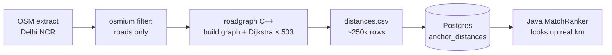

# Ubery — Proposed Stash

Ideas under consideration. **Not part of the design** until the team accepts one and it moves into the next design version.

| # | Idea | Language | Status | Target design |
|---|---|---|---|---|
| 1 | Offline road-distance engine (`tools/roadgraph`) | C++ | Proposed | v0.0.3? |
| 2 | Kubernetes manifests, tested locally only (`infra/k8s`) | YAML / Helm | Proposed | After Phase 1 |

---

## Idea 1 — Offline road-distance engine in C++

### Problem
The matcher in Design v0.0.2 (§3.3) estimates road distance as **straight-line km × 1.4**. That's a known shortcut: two places can be 5 km apart in a straight line but 15 km by road (river, highway with no crossing, Yamuna between Delhi and Noida). Wrong distances mean bad matches. A live routing API fixes this but costs money per call.

### Proposal
A C++ command-line tool that runs **offline on a laptop**, never on the server:

1. Download the OpenStreetMap road extract covering Delhi NCR (free, e.g. from Geofabrik).
2. Build a road graph: intersections are nodes, road segments are weighted edges (length in metres).
3. Pick ~500 **anchor localities** in NCR (e.g. "DLF Phase 3", "Sector 62 Noida") plus the 3 IGI terminal pickups.
4. Run **Dijkstra** from each anchor to get the road distance to every other anchor, using multiple threads.
5. Write a CSV distance matrix (~500 × 500 ≈ 250k rows) and load it into Postgres.

The Java matcher then snaps each destination to its nearest anchor (PostGIS) and looks up the real road distance instead of multiplying by 1.4.



### How it plugs into the design
New tables (one Flyway migration):

```sql
create table anchors (
  id    smallint primary key,
  name  text not null,                         -- 'DLF Phase 3, Gurugram'
  point geography(point, 4326) not null
);
create index anchors_gist on anchors using gist (point);

create table anchor_distances (
  from_id smallint not null references anchors,
  to_id   smallint not null references anchors,
  road_m  int not null,
  primary key (from_id, to_id)
);
```

Changes in the Java app:
- `trip_requests` gets `anchor_id` (nearest anchor, computed once on create).
- `MatchRanker.routeKm` reads distances from an in-memory `int[][]` matrix (250k ints ≈ 1 MB, loaded at startup) instead of `haversine × ROAD_FACTOR`.
- Distance from a real destination to its anchor is still straight-line. Error is small if anchors are dense enough.

### C++ design
```
tools/roadgraph/
  CMakeLists.txt
  src/
    main.cpp          CLI: roadgraph <edges.csv> <anchors.csv> <out.csv> [--threads N]
    graph.hpp/.cpp    CSR adjacency (compressed sparse row): two flat vectors, cache-friendly
    dijkstra.hpp/.cpp binary-heap Dijkstra (std::priority_queue) with lazy deletion
    io.hpp/.cpp       CSV read/write
  tests/              GoogleTest: small hand-made graphs with known shortest paths
```

Input is prepared with `osmium` (CLI) so the C++ code reads a plain edge-list CSV and doesn't need to parse OSM's binary format itself.

### Core C++ concepts it shows
- **Data structures:** graph in CSR form (`std::vector<int>` offsets + edges), `std::priority_queue` with a custom comparator.
- **Algorithms:** Dijkstra, complexity O((V + E) log V) per source, and why lazy deletion beats decrease-key here.
- **Memory:** contiguous storage vs `vector<vector<>>`, move semantics, RAII for files.
- **Concurrency:** one Dijkstra per anchor spread across `std::thread`s; the graph is read-only and shared, each thread owns its distance array, so no locks are needed.
- **Build and test:** CMake, compiler flags (`-O2`), GoogleTest, a benchmark you can quote.

Resume line once built: *"Built a C++ road-graph preprocessor (multithreaded Dijkstra over OpenStreetMap, N nodes, 503 sources in X s) that replaced a paid routing API in the matching engine."* Fill in N and X with real measurements.

### Why C++ here (the interview answer)
It's a CPU-heavy batch job over millions of nodes, run occasionally, with no server cost. That's where C++'s speed and memory control matter. It runs offline, so it adds nothing to the server, deploys or the AWS bill.

### Cost
- AWS: $0 (runs on a laptop; the output is a CSV).
- Postgres: one ~250k-row table, a few MB.
- Effort: roughly 1–2 weeks for one dev, after Phase 1.

### Risks / unknowns
- Size of the Delhi NCR road graph and actual run time: **not measured yet**.
- Anchor density: too few anchors → snapping error; too many → matrix grows as n². Start with ~500 and measure match quality.
- One-way streets: edges must be directed. Distance A→B ≠ B→A, so store both directions.
- Road data changes slowly; rerun the tool every few months.
- OSM data is ODbL-licensed: the app must show "© OpenStreetMap contributors".

### Decision needed
Accept into Design v0.0.3, or keep stashed until Phase 1 ships and we can measure how bad the 1.4 factor really is? (Recommendation: measure first.)

---

## Idea 2 — Kubernetes manifests, tested locally only

### Problem
Production runs on one EC2 instance with Docker Compose (Design v0.0.2 §2.4). That's the right choice for 1 server and 1 app, but it shows no Kubernetes skill, which many backend and DevOps roles ask for.

### Why not Kubernetes in production
- **Cost:** EKS charges ~$73/month for the control plane alone, before any servers. The $100 credits would last about a month.
- **Memory:** even k3s needs a few hundred MB, which the 2 GB instance doesn't have spare.
- **No need:** 1 server, 1 app. Docker Compose with `restart: unless-stopped` already restarts crashed containers.
- **Time:** weeks of cluster config for 2 devs instead of product work.

Kubernetes earns its place when there are several services across several servers, real traffic swings (many airports, peak hours), and someone whose job includes running the cluster.

### Proposal
Write Kubernetes manifests for the whole stack and run them on a **local cluster** (`kind` or `minikube`) on a laptop. Production stays on Docker Compose.

```
infra/k8s/
  namespace.yaml
  api/
    deployment.yaml     Spring Boot: 2 replicas, resource requests/limits, readiness + liveness probes
    service.yaml        ClusterIP
    configmap.yaml      non-secret config (profiles, URLs)
    secret.example.yaml template only; real secrets never committed
    hpa.yaml            HorizontalPodAutoscaler on CPU (shows autoscaling)
  postgres/
    statefulset.yaml    postgis/postgis image + PersistentVolumeClaim
    service.yaml
  redis/
    deployment.yaml
    service.yaml
  ingress.yaml          ingress-nginx: /api and /ws → api service
  README.md             kind create cluster → kubectl apply -k → open localhost
  kustomization.yaml
```

Optional later step: turn this into a small **Helm chart** with values for local vs production.

### Concepts it shows
- **Workload types:** Deployment (stateless API) vs StatefulSet (Postgres with stable storage), and why each fits.
- **Health:** readiness probe (`/actuator/health/readiness`) vs liveness probe (`/actuator/health/liveness`); Spring Boot Actuator already exposes both.
- **Config:** ConfigMap vs Secret, and why secrets don't go in git.
- **Networking:** Service, Ingress, and WebSocket upgrade through ingress-nginx.
- **Scaling:** HPA scaling the API to 2+ replicas. This also tests the design's limits: the in-memory STOMP broker (v0.0.2 §3.6) breaks with 2 replicas. Hitting that locally and explaining the fix (broker relay or Redis pub/sub) is a strong interview story.
- **Resources:** requests/limits and JVM heap sizing inside a container (`-XX:MaxRAMPercentage`).

### How to present it
*"Production runs on Docker Compose because one instance is enough. I wrote Kubernetes manifests for the full stack and tested them on a local cluster, including scaling the API to 2 replicas, which exposed and fixed a WebSocket broker limitation."*

### Cost
- AWS: $0 (runs on a laptop).
- Laptop: kind + the stack needs roughly 4–6 GB RAM free.
- Effort: about 1 week for one dev, after Phase 1, once the Docker images exist.

### Risks / unknowns
- Two deployment setups (Compose and k8s) can drift apart. Keep k8s as a tested demo, not a second production.
- Postgres in Kubernetes is fine locally, but in a real production cluster a managed database is usually the better choice.
- Laptop RAM: not checked yet.

### Decision needed
Accept for after Phase 1, or skip? (Recommendation: do it after Phase 1, since it reuses the Docker images Phase 1 already produces.)
