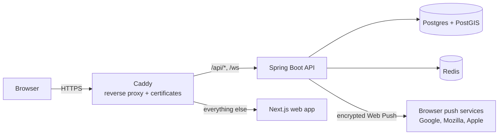

# Namastute

**Share a cab from Delhi airport with people from your flight.**

Travellers landing at Delhi IGI around the same time, heading the same way, find each other in the app and share one Uber or Ola. Namastute only **connects people**: it never books rides and never handles money. The fare is split fairly by distance, and everyone pays the booker directly by UPI.

*The name: **namaste** (a warm Indian greeting) + **astute** (smart). A smart way to greet a stranger and split a cab.*

## What works today
- **Phone login with OTP:** short-lived access tokens and rotating refresh tokens in an HttpOnly cookie.
- **Profile:** name in any Indian script, plus an optional UPI ID.
- **Plan a trip:** terminal, time you'll be outside (India time), seats, bags, and destination by search or by tapping a map.
- **Matching:** travellers and open groups heading your way, ranked by detour and time. No rider is taken more than max(3 km, 25%) beyond their own trip, and others only ever see your first name and area.
- **Groups:** ask to share, accept or decline (any member can answer), lock, and leave (a locked group needs a reason). The database guarantees two people can't take the last seat.
- **Live group chat** over WebSocket, with system messages for group changes.
- **Background jobs:** stale trips expire, groups lock themselves 5 minutes before meeting, and old groups close.
- **Finishing the ride:** "I'm here" at the pickup, then the booker enters the real fare and everyone sees their share with a UPI pay link.
- **Safety:** report someone you shared a cab with (reviewed by a person, with "Call 112" for emergencies), and silently block anyone so you never see each other again.
- **Push notifications** (Web Push, works with the app closed): someone wants to share, you're in a group, a new chat message while you're away, the fare is in. The lock screen only ever shows a first name. Installable on the Home Screen (needed for iPhone).

## Architecture
A **modular monolith**: one Spring Boot app split into modules (`auth`, `users`, `trips`, `groups`, `chat`, `feedback`, `notifications`) whose boundaries are checked by a test (Spring Modulith). In production everything runs on one server under one domain:



## Tech stack
| Part | Technology |
|---|---|
| API | Java 21, Spring Boot 4.1, Spring Modulith, Spring Security (JWT), Spring WebSocket + STOMP, Flyway, springdoc-openapi, Web Push (zerodep-web-push-java) |
| Data | PostgreSQL 16 + PostGIS 3.5 (geography, spatial index), Redis 7.4 (OTP codes and rate limits) |
| Web | Next.js 16, React 19, TypeScript, Tailwind CSS, Leaflet + OpenStreetMap, STOMP client; API types generated from OpenAPI |
| Infra | Docker, Docker Compose, Caddy (automatic HTTPS), GitHub Actions CI |

## Repository layout
```
apps/api      Spring Boot API (package com.namastute; one folder per module)
apps/web      Next.js web app
infra         docker-compose for development and production, Caddyfile, production runbook
Docs Text     design docs and Learning Notes (Markdown)
Docs HTML     the same docs as HTML (scripts/build-docs.py)
```

## Run it locally
Requirements: **JDK 21**, **Node 24 + pnpm**, **Docker Desktop** (running).

1. **Database and Redis** (from the repo root):
   ```bash
   docker compose -f infra/docker-compose.yml up -d --wait
   ```
2. **API** (from `apps/api`), then check http://localhost:8080/actuator/health:
   ```bash
   ./mvnw spring-boot:run
   ```
3. **Web app** (from `apps/web`), then open http://localhost:3000:
   ```bash
   cp .env.example .env.local
   pnpm install
   pnpm dev
   ```
4. **Log in:** in development no real SMS is sent. The code appears in the API's log as `SMS to +91…: Your Namastute code is 123456`.

### Tests
```bash
cd apps/api && ./mvnw test            # needs step 1 running: the integration tests use the real Postgres and Redis
cd apps/web && pnpm lint && pnpm build
```

### Changed a Java request or response record?
The web's API types are generated from the API itself, and CI fails if they're out of date:
```bash
cd apps/api && ./mvnw test            # rewrites apps/web/openapi.json
cd ../web && pnpm api:types           # regenerates lib/api-types.ts; fix any TypeScript errors, then commit both files
```

## Production
One server (AWS EC2 in Mumbai) runs Postgres, Redis, the API, the web app and Caddy with `infra/docker-compose.prod.yml`. Only Caddy is reachable from the internet, it gets HTTPS certificates automatically, and secrets come from an `infra/.env` file that is never committed. Setup, everyday commands and backups are in **[infra/README.md](infra/README.md)**.

Real users still need an SMS provider: until one is chosen, the production build refuses to start, on purpose.

## Status
- **Phase 1, core loop:** ✅ done. Two people can sign up, match, form a group, chat, lock, meet and split the fare.
- **Phase 2, trust and safety:** in progress. Fare split, the production build, report and block, and push notifications are done. Next: SMS provider, deployment, ratings, ID verification and women-only groups, live location at pickup.
- **Phase 3:** flight-delay tracking, auto-matching, load testing and more.

The full roadmap is in the design doc, section 7.

## Docs
- [Design v0.0.2](Docs%20Text/Design%20v0.0.2.md): product scope, architecture, data model, API and roadmap
- [Learning Notes](Docs%20Text/Learning%20Notes.md): every concept behind the code, explained from scratch, with code walkthroughs
- [Proposed Stash](Docs%20Text/Proposed%20Stash.md): ideas under consideration
