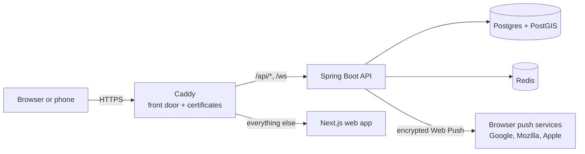

# Namastute

**Share a cab from Delhi airport with people from your flight.**

Travellers landing at Delhi's IGI airport around the same time, heading the same way, find each other in the app and share one Uber or Ola. Namastute only **connects people**: it never books rides and never handles money. The fare is split fairly by distance, and everyone pays the person who booked directly, by UPI (India's instant bank-to-bank payments).

*The name: **namaste** (a warm Indian greeting) + **astute** (smart). A smart way to greet a stranger and split a cab.*

**New to all this?** The [Learning Notes](Docs%20Text/Learning%20Notes.md) are a book that explains how this app was built, from the absolute basics up, with every term defined before it's used.

---

## Words used on this page
- **Frontend / backend:** the part of an app you see in your browser / the part running on a server that holds the data and enforces the rules.
- **API:** the list of requests the backend accepts; the frontend talks to the backend through it.
- **Database:** the program that stores the data permanently (here, **Postgres**).
- **Module:** a self-contained part of the backend with one job (logging in, trips, groups…).
- **Container (Docker):** a packaged, isolated copy of a program with everything it needs, so it runs the same on every computer.
- **Repository (repo):** this project folder, with its full history in Git.
- **OTP:** one-time password, the 6-digit code sent by SMS to log in.
- **WebSocket:** a connection that stays open so the server can send messages instantly (used for chat).
- **p95:** in performance results, the time 95% of requests were faster than.

---

## What it does
1. **Log in** with your phone number and a one-time code. No passwords.
2. **Plan a trip:** which terminal, when you'll be outside, where you're going (search or tap a map).
3. **See matches:** people and groups heading your way at about the same time, best first.
4. **Ask to share.** When someone accepts, you're in a **group** with a live **chat**.
5. The group's booker **locks** it and books a cab. At the pickup, everyone taps **"I'm here"** and can **share their live location** for a few minutes.
6. After the ride the booker enters the **fare**; everyone sees their fair **share** and a **UPI link** to pay.
7. **Rate** each other, **report** a problem, or **block** someone.

## What works today
**Accounts**
- **Phone login with OTP.** You stay logged in safely: a short-lived access token in memory plus a refresh token in a cookie JavaScript can't read. Code requests and wrong guesses are rate-limited.
- **Profile:** a name in any Indian script, plus an optional UPI ID.

**Trips and matching**
- **Plan a trip:** terminal, time you'll be outside (India time), seats, bags, and destination by search or by tapping a map.
- **Matching:** travellers and open groups heading your way, ranked by extra distance and time difference. Nobody is taken more than max(3 km, 25%) beyond their own trip, and others only ever see your first name and area.

**Groups and chat**
- **Groups:** ask to share, accept or decline (any member can answer), lock, and leave (leaving a locked group needs a reason). The database guarantees two people can't take the last seat at the same moment.
- **Live group chat** over WebSocket, with system messages for group changes.
- **Background jobs:** stale trips expire, groups lock themselves 5 minutes before meeting, and old groups close.

**Finishing the ride**
- **"I'm here"** at the pickup, then the booker enters the real fare and everyone sees their share with a UPI pay link.
- **Live location at the pickup:** around meeting time, group members can choose to share where they are on a small map ("about 150 m away"). Only the group sees it, it switches off by itself, and positions are never saved.

**Safety and trust**
- **Report** someone you shared a cab with (reviewed by a person; "Call 112" for emergencies), and **silently block** anyone so you never see each other again.
- **Ratings:** after meeting up, a thumbs up or down for each person in your group, once. Others see only the total ("92% 👍 · 12 ratings", or "New"); nobody sees who gave what.
- **Abuse limits:** per person, at most 30 match searches, 10 share requests and 5 trip plans a minute (answered with "429 Too Many Requests"), and 20 chat or location messages per 10 seconds.

**Staying in touch**
- **Push notifications** that work with the app closed: someone wants to share, you're in a group, a new chat message while you're away, the fare is in. The lock screen only ever shows a first name. The app can be installed on the home screen (iPhones need this for notifications).

---

## How it's built
The backend is a **modular monolith**: one Spring Boot program split into modules whose boundaries are checked by an automated test (Spring Modulith). It's simpler to run than many separate services, while still keeping each part self-contained. In production everything runs on one server under one domain:



| Module | Its job |
|---|---|
| `auth` | Login codes, tokens, security settings |
| `users` | Profiles, blocks, rating totals |
| `trips` | Planning trips, terminals, matching |
| `groups` | Join requests, groups and their rules, the fare split |
| `chat` | Live chat and live location over WebSocket |
| `feedback` | Reports, ratings, and the block/unblock requests |
| `notifications` | Push notifications |
| `verification` | ID checks: photo upload, the 7-day photo deletion (the review comes next) |
| `shared` | Error responses and the rate limiter, used by every module |

## Tech stack
| Part | Technology | What it is |
|---|---|---|
| Backend | Java 21, Spring Boot 4.1 | The language and the framework the API is built with |
| | Spring Modulith | Checks the modules only talk through their public doors |
| | Spring Security (JWT) | Checks every request comes from a logged-in user |
| | Spring WebSocket + STOMP | Live chat and location |
| | Flyway | Applies numbered database changes in order |
| | springdoc-openapi | Describes the API, so the frontend's types can be generated |
| | zerodep-web-push-java | Signs and encrypts push notifications |
| Data | PostgreSQL 16 + PostGIS 3.5 | The main database, with map support ("within 15 km") |
| | Redis 7.4 | Fast short-lived data: login codes and rate-limit counters |
| | Amazon S3 (SeaweedFS in development) | Private file storage for ID photos, deleted after the check; AWS SDK for Java |
| Web | Next.js 16, React 19, TypeScript | The web app and its language |
| | Tailwind CSS 4 | Styling, with the design system's tokens (colours, type, spacing) and dark/light themes |
| | Leaflet + OpenStreetMap | Maps |
| | uqr | Draws the UPI QR code shown on laptops |
| Infra | Docker, Docker Compose | Run every part in containers, the same on every computer |
| | Caddy | The front door: HTTPS certificates and routing |
| | GitHub Actions | Builds and tests every change before it's merged |
| | k6 | Load testing |

## Repository layout
```
apps/api      Spring Boot API (package com.namastute; one folder per module)
apps/web      Next.js web app
infra         Docker Compose for development and production, Caddyfile, production runbook
load          Load-test scripts (k6) and how to run them
Docs Text     Design docs and the Learning Notes book (Markdown)
Docs HTML     The same docs as web pages (built by scripts/build-docs.py)
```

---

## Run it on your computer
You need **JDK 21** (Java), **Node 24 with pnpm** (JavaScript tools) and **Docker Desktop** (running).

1. **Start the database and Redis** in containers (from the repo root):
   ```bash
   docker compose -f infra/docker-compose.yml up -d --wait
   ```
2. **Start the API** (from `apps/api`). It creates the database tables on first start. Check http://localhost:8080/actuator/health says `UP`:
   ```bash
   ./mvnw spring-boot:run
   ```
3. **Start the web app** (from `apps/web`), then open http://localhost:3000:
   ```bash
   cp .env.example .env.local
   pnpm install
   pnpm dev
   ```
4. **Log in:** in development no real SMS is sent. The code appears in the API's log as `SMS to +91…: Your Namastute code is 123456`.

### Tests
```bash
cd apps/api && ./mvnw test            # needs step 1 running: the integration tests use the real Postgres and Redis
cd apps/web && pnpm lint && pnpm build
```

### Changed a Java request or response record?
The web app's API types are generated from the API itself, and CI fails if they're out of date:
```bash
cd apps/api && ./mvnw test            # rewrites apps/web/openapi.json
cd ../web && pnpm api:types           # regenerates lib/api-types.ts; fix any TypeScript errors, then commit both files
```

### Load tests
How to run them is in [load/README.md](load/README.md); the results are below.

---

## Production
One server (AWS EC2 in Mumbai) runs Postgres, Redis, the API, the web app and Caddy with `infra/docker-compose.prod.yml`. Only Caddy is reachable from the internet, it gets HTTPS certificates automatically, and secrets come from an `infra/.env` file that is never committed. Setup, everyday commands, backups and the before-launch checklist are in **[infra/README.md](infra/README.md)**.

Real users still need an SMS provider: until one is chosen, the production build refuses to start, on purpose.

## Status
- **Phase 1, the core loop:** ✅ done. Two people can sign up, match, form a group, chat, lock, meet and split the fare.
- **Phase 2, trust, safety and launch readiness:** almost done. Fare split, the production build, report and block, push notifications, live location, ratings, the pre-launch fixes, load tests, indexes and rate limits are done. **Still to do:** an SMS provider (with India's DLT registration), the real pickup points, deployment, and ID verification for women-only groups (in progress: uploading is done; the review and women-only groups come next).
- **The redesign:** ✅ done, in four slices: the design system (tokens, fonts, dark/light theme, components), log in, profile, home, plan trip, the group screen (chat, pickup, live location, report and block, ratings), and the fare with UPI payment (a QR code on laptops).
- **Phase 3:** flight-delay tracking, automatic matching, and more.

The full roadmap is in the design doc, section 7.

## Load test results
The local production stack, squeezed into the 2 processor cores of the planned server (API 1.4, Postgres 0.6), tested with k6 ([load/](load/README.md), Learning Notes 66–67). The pass line: 95% of requests faster than 500 ms (p95), and under 1% errors.

| Travellers in one arrival wave | Matches p95 | Slowest request type p95 | Errors | Pickup groups of 4 chatting | Chat delivery p95 |
|---|---|---|---|---|---|
| 100 | 47 ms | 59 ms (ask) | 0% | 25 | 21 ms |
| 300 | 39 ms | 39 ms (matches) | 0% | 75 | 18 ms |
| 1000 | **593 ms ✗** | 593 ms (matches) | 1 in 16,342 | 250 | 10 ms |

- **One server comfortably handles 300 travellers per arrival wave**, far more than a pilot needs.
- **At 1000, matching gets slow at the peaks:** the API and Postgres both run out of processor time. Not fixed (the agreed bar was 300). A partial index on searching trips is now in (migration V8: the candidate query went from 13.3 to 10.2 ms with 100,000 old trips, and no longer grows with history). Further options when needed: fewer candidates per search, or a bigger server.
- **Memory is the next limit for WebSockets:** with 1000 open connections the API used 675 MB of its 768 MB.
- **Caveats:** measured on a laptop, not the real server; Caddy wasn't in the path; the planned server type (t3) runs at full speed only while it has "CPU credits". Re-run on the real server after deploying.

## Known limits
Deliberate shortcuts for launch, each marked `shortcut:` in the code with when it would change (Learning Notes 64):
- **One API server.** The chat broker and the message flood limit live in that server's memory; a second server needs a shared broker (RabbitMQ or Redis).
- **Women-only groups** are switched off until ID verification exists.
- **Distances** are straight-line × 1.4, not real road distance; matching only looks at destinations within 15 km of yours.
- **Chat catch-up** after a reconnect stops at 200 missed messages.
- **Chat pushes** skip anyone with the app open, even in a background tab the phone hasn't closed yet.
- **A blocked person's request** to another member of your group stays visible until someone declines it.
- **Push keys** must never change: new keys break every existing subscription.
- **Side jobs aren't stored durably:** if the server crashes at the exact moment after saving a change, that change's push notification can be lost. Pushes are best-effort anyway; a durable "outbox" would be the upgrade.
- **Reports** are reviewed with SQL (admins get a push for each one); there's no admin panel yet.

Before real users, the team also needs an SMS provider, the real pickup points, a map provider and an uptime monitor: see the checklist in [infra/README.md](infra/README.md).

## Docs
- [Learning Notes](Docs%20Text/Learning%20Notes.md) (also as a [web page](Docs%20HTML/Learning%20Notes.html)): the book. Every concept behind the code explained from scratch, with walkthroughs of the real files.
- [Design v0.0.2](Docs%20Text/Design%20v0.0.2.md): product scope, architecture, data model, API and roadmap.
- [Proposed Stash](Docs%20Text/Proposed%20Stash.md): ideas under consideration.
